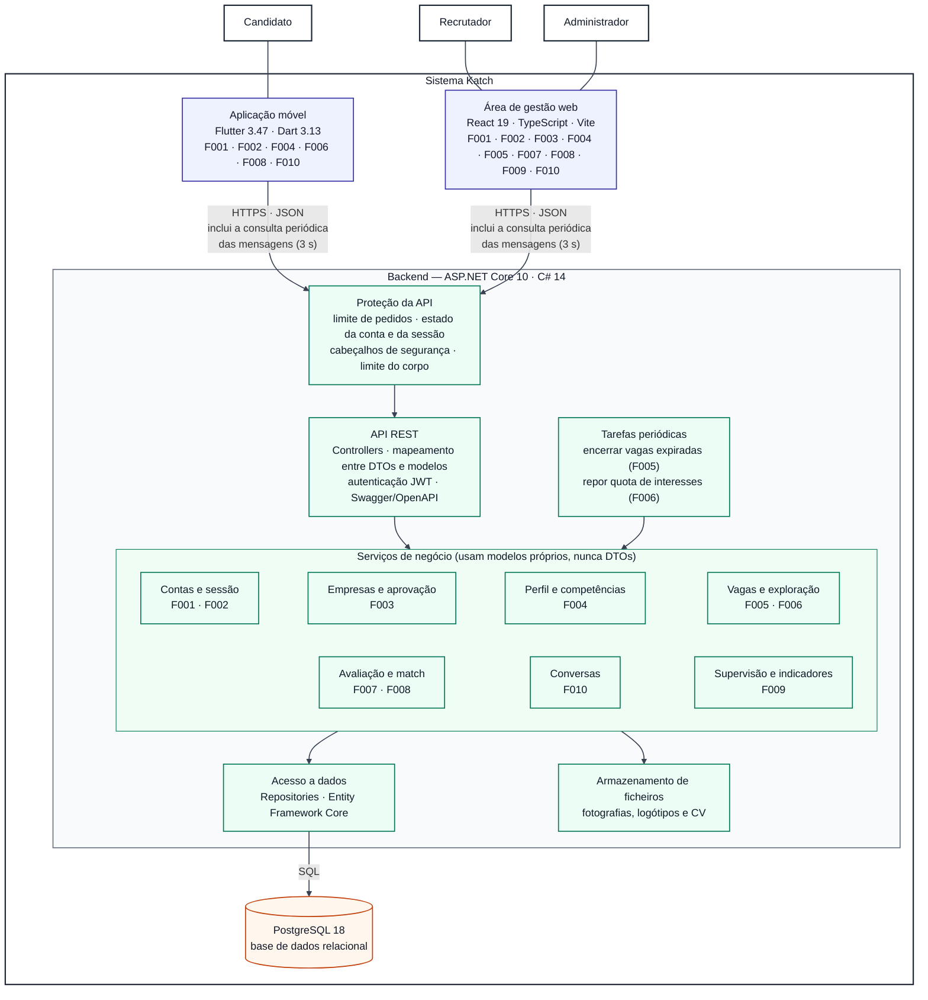
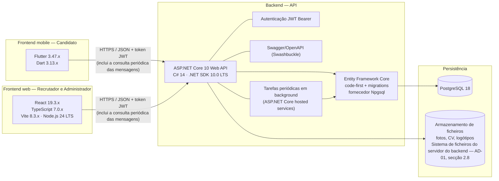

# Documentação de Arquitetura — Katch

**Unidade curricular:** Laboratório de Desenvolvimento de Software — LDS
**Milestone:** `m4`
**Ficheiro:** `m4-documentacao-arquitetura-v03.md`
**Pasta de arquivo:** `04-artefactos-tecnicos/04.05-arquitetura`

---

## 1. Identificação do documento

| Campo | Informação |
| --- | --- |
| Grupo | G11 |
| Sistema | Katch |
| Ano letivo | 2026/2027 |
| Curso | LEI — Licenciatura em Engenharia Informática |
| Turma | LEI3T2 |
| Versão do documento | v03 |
| Documentos de origem | `m3-proposta-sistema-v04.pdf` e `m3-declaracao-ambito-v04.pdf`, homologados pelo docente em 14-10-2026 (`m3-email-homologacao-ps-da-cca-v02.pdf`), Regulamento Interno do Grupo v01 (`m1-regulamento-grupo-v01.pdf`, secções 5, 10 e 11), `m2-backlog-projeto-v02.xlsx` (Issues `I033`, `I034` e `I051`) e a Issue `I100` do Backlog de Projeto vigente, `m3-modelo-de-dados-katch-v02.md`, `m3-especificacao-requisitos-v02.md` e a ata da reunião formal de 2026-10-16 (`m3-20261016-reuniao-extraordinaria-ata-v01.pdf`), a Declaração de Âmbito v04 (F003 e F004), os relatórios de refatoração `m4-relatorio-refatoracao-backend-v01.md` e `m4-relatorio-refatoracao-frontend-web-v01.md` (Issues `I136` e `I134`) e o código da `main` dos três repositórios: backend depois do merge das Issues `I138` e `I136`, web depois do merge da `I134` e mobile no commit `7eac590` (inclui a `I078`, matches e conversas). A refatoração `I135` (mobile) é do Sprint 10 e ainda não está na `main`, pelo que não é fonte deste documento |

### 1.1. Responsáveis por secção

O documento é consolidado por várias Issues dos Sprints 02, 04 e 09. Cada secção indica a Issue que a produz, para que a revisão e a auditoria de cada tarefa incidam apenas sobre a parte que lhe corresponde.

| Secção | Issue | Executor | Revisor | Auditor |
| --- | --- | --- | --- | --- |
| 2. Visão geral, componentes, responsabilidades, relações, fronteiras, interfaces, restrições, padrões, atributos de qualidade e evolução prevista | `I033` | João Coelho | João Borguem | Roberto Baptista |
| 3. Tecnologias e decisões tecnológicas | `I034` | Roberto Baptista | João Borguem | Miguel Santos |
| Redução de âmbito (secções 2 e 3, versão v02) | `I100` | Miguel Santos | João Borguem | João Coelho |
| Atualização das secções 2 e 3 ao código depois da refatoração e às funcionalidades F003 e F004 (versão v03) | `I137` | Miguel Santos | João Borguem | Roberto Baptista |

### 1.2. Histórico de versões

| Versão | Data | Descrição das alterações | Issue |
| --- | --- | --- | --- |
| v01 | 2026-10-01 | Criação do documento e da secção 3 (tecnologias e decisões tecnológicas). | `I034` |
| v01 | 2026-10-03 | Acrescento da secção 2 (arquitetura do sistema). | `I033` |
| v01 | 2026-10-07 | Correção da secção 2 após revisão: entrega de mensagens e notificações por ligação bidirecional persistente (DA v02), com a consulta periódica como alternativa proposta e pendente de decisão; AD-01 identificada como proposta; referência à especificação de requisitos (`m2-especificacao-requisitos-v01.md`). | `I033` |
| v01 | 2026-10-08 | Correção das referências documentais: o modelo de dados passa a ser citado como `m2-modelo-de-dados-katch-v01.md` na secção 1, e a referência à especificação de requisitos no histórico passa a indicar `m2-especificacao-requisitos-v01.md`, a única versão existente. | `I089` |
| v02 | 2026-10-16 | Redução de âmbito (`I100`): retirada da F011 (notificações) e substituição da ligação bidirecional persistente (SignalR) pela consulta periódica do cliente à API REST, de 3 em 3 segundos, com o atraso máximo de 5 segundos do parâmetro P17, como determinam a PS v04, a DA v04 e a deliberação 1 da ata de 2026-10-16. Ratificação da AD-01 (ficheiros no sistema de ficheiros do servidor, opção (a) da PA-01), deliberação 3 da mesma ata. Retirada da decisão D-08 (secção 3.5), mantendo-se a decisão da consulta periódica na AD-02, nos termos da deliberação 1; o identificador D-08 não é reutilizado. Acrescentada a tabela `candidate` à concorrência otimista com a coluna `xmin` (secções 2.6 e 3.3 e ponto 4 da secção 3.6) e os arrays à limitação do SQLite in-memory, sem a referência ao esquema v01 (ponto 4 da secção 3.6), como no modelo de dados v02. Alteradas as secções 2.2 a 2.9 e 3.1 a 3.3, as decisões AD-01 e AD-02, a secção 3.5 e os pontos 1 e 4 da secção 3.6. Referências atualizadas para a PS v04, a DA v04, o modelo de dados v02 e a especificação de requisitos v02. | `I100` |
| v02 | 2026-10-17 | Correção da revisão da `I100` (D02, D03, D05, M02): retirada da D-08 da secção 3.5, com remissão para a AD-02 nas secções 2.4, 3.3 e 3.6; PS e DA v04 e e-mail de homologação `m3-email-homologacao-ps-da-cca-v02.pdf` nas referências; histórico completado; secção 1.1 passa a indicar os Sprints 02 e 04. | `I100` |
| v03 | 2026-11-23 | Atualização (`I137`) às notas do docente de 2026-11-17 e ao código da `main` depois das Issues `I138`, `I136` e `I134` (a `I135`, mobile, é do Sprint 10 e ainda não está integrada): funcionalidades F003 e F004 e as restantes passam a constar do diagrama e da tabela de componentes (secções 2.2 e 2.3), com um quadro de funcionalidades por componente (secção 2.3.1); novos componentes do backend (proteção da API, modelos dos serviços, mapeamentos dos Controllers, exclusão mútua das tarefas periódicas); regra de que os DTOs só existem nos Controllers (secção 2.6); fim das sessões no servidor pela versão da sessão e parâmetros do JWT (secções 3.4 e 3.5, D-04); ponto 6 da secção 3.6 sobre a versão do TypeScript. A v02 fica conservada. | `I137` |

Cada alteração posterior acrescenta uma linha. As versões anteriores são conservadas, nos termos da secção 18.2 do Regulamento de Funcionamento da Unidade Curricular.

---

## 2. Arquitetura do sistema

### 2.1. Visão geral

O Katch tem dois clientes e um servidor. O Candidato usa a aplicação móvel e o Recrutador e o Administrador usam a área de gestão web. Os dois clientes comunicam com um único backend, que é o único componente com acesso à base de dados e aos ficheiros. O sistema não tem integração com serviços externos.

Esta secção descreve a estrutura do sistema: componentes, ligações, fronteiras, padrões e atributos de qualidade. As tecnologias e a sua justificação estão na secção 3. As classes, as tabelas e os fluxos de negócio são tratados nos modelos de classes, de dados e de comportamento.

### 2.2. Diagrama de arquitetura

Como o Mermaid não tem um tipo de diagrama de arquitetura, o diagrama usa um `flowchart`. Os atores são retângulos fora da fronteira, a fronteira é o retângulo «Sistema Katch» e o retângulo «Backend» agrupa os componentes internos do servidor. As setas são pedidos dos clientes à API REST, incluindo a consulta periódica das mensagens novas, de 3 em 3 segundos. As cores estão fixadas no próprio diagrama, para que se leia da mesma forma em tema claro e em tema escuro.

### 2.3. Componentes e responsabilidades

| Componente | Responsabilidade | Tecnologia | Repositório | Funcionalidades |
| --- | --- | --- | --- | --- |
| Aplicação móvel | Interface exclusiva do Candidato: registo, início de sessão, perfil e competências (F004), exploração de vagas, matches e conversas. | Flutter 3.47, Dart 3.13 | `katch-frontend-mobile` | F001, F002, F004, F006, F008, F010 |
| Área de gestão web | Interface do Recrutador (registo e página da Empresa, vagas, candidatos em espera, matches e conversas) e do Administrador (aprovação de Empresas, contas, indicadores e listas pré-definidas). Consulta o perfil do Candidato (F004) na avaliação. | React 19, TypeScript, Vite 8 | `katch-frontend-web` | F001, F002, F003, F004, F005, F007, F008, F009, F010 |
| API REST | Ponto de entrada dos clientes. Recebe os pedidos, autentica-os com JWT, verifica o tipo de conta e devolve as respostas. É a única camada que conhece os DTOs: os Controllers convertem-nos em modelos dos serviços e de volta (pasta `Controllers/Mapping`). Atende também a consulta periódica das mensagens novas e do número de mensagens por ler (F010). Documentada com Swagger/OpenAPI. | ASP.NET Core 10 (Web API), Swashbuckle | `katch-backend` | F001 a F010 |
| Serviços de negócio | Regras do domínio, por área: contas e sessão (F001, F002), Empresas e a sua aprovação (F003), perfil e competências do Candidato (F004), vagas e exploração, com filtragem e cálculo de distância (F005, F006), avaliação de candidatos e confirmação do match (F007, F008), conversas (F010) e supervisão e indicadores (F009). Incluem a validação automática, a quota de interesses e os estados da Empresa, da vaga e da conta. Recebem e devolvem modelos próprios (`Services/Models`) e não usam DTOs. | C# 14 | `katch-backend` | F001 a F010 |
| Proteção da API | Limite de pedidos por janela de tempo (por IP nos endpoints anónimos e por conta nos autenticados), confirmação em cada pedido do estado da conta e da versão da sessão, limite da dimensão do corpo, cabeçalhos de segurança, registo dos pedidos recusados sem dados pessoais, erros uniformes e verificação de saúde (`/health`). | ASP.NET Core 10 (Rate Limiting, middleware e Health Checks) | `katch-backend` | F001, F002 |
| Tarefas periódicas | Encerrar as vagas que atingiram a data-limite e repor a quota de interesses. Cada execução usa um bloqueio consultivo do PostgreSQL, para que só uma instância do backend a faça de cada vez. | Serviços em segundo plano do ASP.NET Core | `katch-backend` | F005, F006 |
| Acesso a dados | Persistência das entidades e consultas, com migrations e controlo de concorrência otimista. | Entity Framework Core (code-first), Npgsql | `katch-backend` | F001 a F010 |
| Armazenamento de ficheiros | Guarda as fotografias, os logótipos e os CV. A base de dados guarda apenas o nome gerado de cada ficheiro, nas colunas existentes e sem tabela de ficheiros (AD-01). | Sistema de ficheiros do servidor do backend | `katch-backend` | F003, F004, F005 |
| Base de dados | Guarda os dados do sistema, segundo o modelo de dados. | PostgreSQL 18 | `katch-backend` (migrations) | F001 a F010 |

### 2.3.1. Funcionalidades por componente

O quadro segue a Declaração de Âmbito v04 e indica, para cada funcionalidade, o componente do backend que a implementa e os clientes que a usam.

| Funcionalidade | Título (DA v04) | Serviços de negócio (backend) | Aplicação móvel | Área de gestão web |
| --- | --- | --- | --- | --- |
| F001 | Autenticação e controlo de acesso | Contas e sessão, com a Proteção da API | Início e fim de sessão; alteração da própria palavra-passe | Início e fim de sessão; alteração da própria palavra-passe; bloqueio e reativação de contas pelo Administrador |
| F002 | Registo e ativação de candidatos | Contas e sessão | Registo do Candidato | Consulta dos candidatos registados, com suspensão e reativação, pelo Administrador |
| F003 | Registo de empresas e aprovação administrativa | Empresas e aprovação | Consulta da página da Empresa a partir do detalhe da vaga | Registo e página da Empresa pelo Recrutador; aprovação, recusa e suspensão pelo Administrador |
| F004 | Perfil do candidato e competências | Perfil e competências | Criação e alteração do perfil, das competências e do CV | Consulta do perfil do Candidato pelo Recrutador, na avaliação |
| F005 | Publicação e gestão de vagas | Vagas e exploração; Tarefas periódicas | Não tem | Criação, alteração e encerramento de vagas |
| F006 | Exploração de vagas e manifestação de interesse | Vagas e exploração; Tarefas periódicas | Exploração por cartões e interesse | Não tem |
| F007 | Avaliação de candidatos | Avaliação e match | Não tem | Lista de candidatos em espera, aceitação e recusa |
| F008 | Confirmação de match e disponibilização de contacto | Avaliação e match | Ligações confirmadas | Ligações confirmadas |
| F009 | Supervisão da plataforma e indicadores de atividade | Supervisão e indicadores | Não tem | Indicadores, consulta global e listas pré-definidas |
| F010 | Comunicação entre as partes após confirmação de contacto | Conversas | Conversas, com consulta periódica | Conversas, com consulta periódica |

### 2.4. Interfaces e relações

| Ligação | Protocolo e formato | Notas |
| --- | --- | --- |
| Aplicação móvel → API REST | HTTPS, JSON | Pedidos autenticados com o token JWT. Só o tipo de conta Candidato acede por aqui. |
| Área de gestão web → API REST | HTTPS, JSON | Pedidos autenticados com o token JWT. Só os tipos de conta Recrutador e Administrador acedem por aqui. |
| Aplicações → API REST (consulta periódica das mensagens) | HTTPS, JSON; pedidos periódicos do cliente | A DA v04 (F010) determina que o cliente consulta o servidor a cada 3 a 5 segundos, enquanto a conversa ou a lista de conversas estiver aberta, e exclui a ligação bidirecional persistente. A reunião formal de 2026-10-16 (deliberação 1) fixou o intervalo em 3 segundos, e a especificação de requisitos v02 (parâmetro P17, RF029 e RF073) fixa em 5 segundos o atraso máximo com que a mensagem nova é apresentada. A consulta usa a mesma interface REST e o mesmo token JWT dos restantes pedidos e devolve as mensagens novas e o número de mensagens por ler. Não há notificações (DA v04, limites transversais), nem envio por e-mail ou SMS. |
| API REST e Tarefas periódicas → Serviços de negócio | Chamadas internas ao backend | As regras de negócio são executadas nos serviços. Os Controllers entregam aos serviços modelos próprios (`Services/Models`) e recebem modelos, que convertem em DTOs; os serviços não conhecem os DTOs. |
| Clientes → Proteção da API → API REST | HTTPS, JSON | Cada pedido passa primeiro pelos cabeçalhos do proxy, pelo registo do pedido, pelos cabeçalhos de segurança, pelo limite do corpo, pela autenticação, pelo limite de pedidos e pela confirmação do estado da conta e da versão da sessão, e só depois chega ao Controller. |
| Serviços de negócio → Acesso a dados → Base de dados | SQL, via Entity Framework Core | Única via de acesso à base de dados. |
| Serviços de negócio → Armazenamento de ficheiros | Leitura e escrita de ficheiros | Os clientes nunca acedem diretamente aos ficheiros nem à base de dados. |

A entrega das mensagens é feita por consulta periódica à API REST, como determina a DA v04 (F010). Não é usada ligação bidirecional persistente nem biblioteca adicional nos clientes. A decisão é a AD-02 (secção 2.8); a decisão D-08 da v01 (SignalR) foi retirada e o seu identificador não é reutilizado (secção 3.5). O antecedente é `m2-decisao-consulta-periodica-mensagens-notificacoes-v01.md`, que propunha um intervalo de 3 segundos, mantido pela reunião formal de 2026-10-16 (deliberação 1); o intervalo vigente é de 3 segundos e o atraso máximo, de 5 segundos (especificação de requisitos v02, P17), dentro dos 3 a 5 segundos da DA v04.

### 2.5. Fronteiras e restrições

A fronteira segue a Declaração de Âmbito v04.

| Dentro da fronteira | Fora da fronteira (excluído pela DA v04) |
| --- | --- |
| Aplicação móvel, área de gestão web, backend e base de dados, desenvolvidos pelo grupo. | Fornecedores externos de identidade; portais de emprego, redes profissionais e sistemas de recursos humanos; serviços de pagamento. |
| Conversas, entregues apenas dentro das aplicações, com consulta periódica das mensagens novas. | Serviços externos de mapas ou de geolocalização (a distância usa as coordenadas da lista pré-definida de localidades); mecanismo de notificações; envio de e-mail, SMS ou avisos para fora da plataforma; comunicação em tempo real por ligação persistente; serviços comerciais de comunicação ou de envio de notificações. |

Restrições que condicionam a arquitetura:

- O sistema usa apenas a língua portuguesa e dados fictícios, em ambiente académico.
- A base de dados de entrega é PostgreSQL. Em desenvolvimento corre em `localhost:6000` e é publicada depois por port forwarding no router do grupo. O SQLite em memória só é permitido nos testes automáticos.
- Cada componente tem o seu repositório e a sua pipeline CI/CD no GitHub Actions, com análise estática no SonarQube.

### 2.6. Padrões arquiteturais

| Padrão | Aplicação |
| --- | --- |
| Cliente–servidor com interface REST única | Os dois clientes usam a mesma interface do servidor, em HTTPS e JSON. |
| Backend em camadas | Controllers, Services, Repositories e Domain, como no âmbito de cobertura de testes do Regulamento Interno. Os Controllers não acedem diretamente à base de dados. |
| DTOs só nos Controllers | Os DTOs existem apenas na camada da API. Cada Controller converte o DTO do pedido num modelo dos serviços (`Services/Models`) e o resultado num DTO da resposta, através dos mapeamentos de `Controllers/Mapping`. Os serviços e os repositórios não os usam, o que mantém as regras de negócio independentes do formato da API. |
| Proteção da API por camadas do pipeline | Limite de pedidos, confirmação do estado da conta e da versão da sessão, limite do corpo e cabeçalhos de segurança são aplicados antes dos Controllers (`Infrastructure/RateLimiting`, `Infrastructure/Authentication`, `Infrastructure/Hosting`), com os limites reunidos em `LimitsOptions`. |
| Autenticação sem estado de sessão no servidor | Token JWT em cada pedido. O estado da conta e da Empresa é confirmado na base de dados em cada operação reservada (secção 3.5, D-04). |
| Persistência code-first | Entity Framework Core, com migrations para criar e evoluir o esquema. |
| Concorrência otimista | Coluna de sistema `xmin` nas tabelas `match` e `candidate`, para que duas alterações simultâneas ao mesmo registo não se sobreponham. |
| Consulta periódica | Entrega das mensagens novas e do número de mensagens por ler: o cliente consulta a API REST de 3 em 3 segundos, enquanto a conversa ou a lista de conversas está aberta, e a mensagem nova é apresentada em 5 segundos, no máximo (DA v04, F010; especificação de requisitos v02, P17). |
| Tarefas periódicas em segundo plano | Encerramento das vagas expiradas e reposição da quota de interesses, com exclusão mútua entre instâncias por bloqueio consultivo do PostgreSQL (`IBackgroundJobLock`). |
| Base de dados única | Uma só base de dados PostgreSQL, acedida apenas pelo backend. |

### 2.7. Atributos de qualidade

A tabela indica, para cada atributo, os requisitos não funcionais da especificação de requisitos (secção 5) e o componente que os suporta.

| Atributo | Requisitos | Componentes |
| --- | --- | --- |
| Desempenho | RNF001 (operações do servidor em 2 segundos), RNF002 (cartão de vaga seguinte em 2 segundos), RNF015 (ficheiro de 5 MB em 5 segundos); parâmetro P17 (consulta periódica das mensagens de 3 em 3 segundos, com atraso máximo de 5 segundos) | API REST, Serviços de negócio, Acesso a dados, Armazenamento de ficheiros |
| Segurança | RNF003 (palavras-passe em resumo irreversível), RNF004 a RNF006 e RNF009 (credencial de sessão, expiração e autorização de cada pedido), RNF007 e RNF016 (CV e conteúdo dos ficheiros), RNF008 (validação automática no servidor), RNF017 (dados confidenciais fora dos registos de diagnóstico) | Proteção da API, API REST, Serviços de negócio, Armazenamento de ficheiros |
| Usabilidade | RNF010 a RNF012 (interações na aplicação móvel e área de gestão web sem deslocamento horizontal) | Aplicação móvel, Área de gestão web |
| Fiabilidade e disponibilidade | RNF013 (dados confirmados conservados após reinício do servidor), RNF014 e RNF018 (indicação de falha de ligação em 10 segundos) | Base de dados, Aplicação móvel, Área de gestão web |

### 2.8. Decisões de arquitetura

| N.º | Decisão | Alternativas | Justificação |
| --- | --- | --- | --- |
| AD-01 | Os ficheiros (fotografias, logótipos e CV) são guardados no sistema de ficheiros do servidor do backend, com a base de dados a guardar apenas o nome gerado de cada ficheiro, nas colunas existentes e sem tabela de ficheiros (opção (a) da PA-01). Os ficheiros são servidos por uma operação da API que verifica a autorização. | Guardar os ficheiros na base de dados; usar um serviço externo de armazenamento; guardar os metadados dos ficheiros numa tabela de ficheiros (opção (b) da PA-01, rejeitada). | O modelo de dados mantém os ficheiros fora da base de dados. A DA exclui os serviços externos. A solução não acrescenta tecnologia à stack. A opção (a) não altera o modelo de dados e nenhum requisito exige os metadados que a tabela guardaria. **Estado:** ratificada na reunião formal de 2026-10-16 (deliberação 3 da ata `m3-20261016-reuniao-extraordinaria-ata-v01.pdf`). |
| AD-02 | As mensagens são entregues por consulta periódica do cliente à API REST, de 3 em 3 segundos, enquanto a conversa ou a lista de conversas está aberta, como determina a DA v04 (F010). | Ligação bidirecional persistente com ASP.NET Core SignalR (solução da v01, excluída pela DA v04); WebSockets diretos; serviços comerciais de notificação. | A DA v04 substitui a ligação persistente pela consulta periódica e exclui os serviços comerciais externos (limites transversais). A consulta usa a API REST e o token JWT já existentes e não acrescenta tecnologia nem biblioteca cliente. **Estado:** aprovada com a homologação da PS v04 e da DA v04 em 14-10-2026 (`m3-email-homologacao-ps-da-cca-v02.pdf`); o intervalo de 3 segundos foi fixado na reunião formal de 2026-10-16 (deliberação 1 da ata `m3-20261016-reuniao-extraordinaria-ata-v01.pdf`), com o atraso máximo de 5 segundos do P17 da especificação de requisitos v02. |

### 2.9. Evolução prevista

- **Entrega de mensagens.** A entrega usa a consulta periódica à API REST aprovada na DA v04. Alterar o intervalo de consulta (3 segundos) ou o atraso máximo (parâmetro P17) afeta a API REST e os clientes, e não os Serviços de negócio nem o modelo de dados.
- **Armazenamento de ficheiros.** O acesso aos ficheiros fica concentrado nos Serviços de negócio, o que permite mudar o local de armazenamento sem alterar as regras de negócio.

---

## 3. Tecnologias e decisões tecnológicas

### 3.1. Objetivo e regra de coerência

Esta secção identifica a tecnologia de cada componente do Katch e explica porque foi escolhida. As versões são as fixadas na secção 11.2 do Regulamento Interno do Grupo v01. Quando o Regulamento Interno não fixa uma versão, isso é dito expressamente e a versão fica fixada no ficheiro de dependências do repositório respetivo. As tecnologias que o Regulamento Interno não menciona (JWT, tarefas em background, armazenamento de ficheiros) têm a origem indicada na coluna «Origem da versão» da secção 3.3.

Nos termos da secção 11.1 do Regulamento Interno, qualquer alteração a uma tecnologia, versão, regra ou limiar fixado na secção 11 exige uma nova versão do Regulamento Interno. Esta secção não altera nenhuma dessas escolhas; limita-se a documentá-las e a justificá-las.

### 3.2. Mapa da stack

O diagrama mostra apenas a correspondência entre componentes e tecnologias. A estrutura interna, as interfaces e os padrões arquiteturais são tratados na secção 2 (`I033`).

### 3.3. Tecnologias por componente

| Componente | Tecnologia e versão | Origem da versão | Justificação |
| --- | --- | --- | --- |
| Backend — linguagem e framework | C# 14 com ASP.NET Core 10 (Web API) | RI v01, secção 11.2 | Framework maduro para APIs REST, com injeção de dependências, validação, autenticação e documentação OpenAPI integradas. Cumpre o requisito da UC de um backend funcional com testes, cobertura, análise estática e collection Postman. |
| Backend — SDK e execução | .NET SDK 10.0 (LTS) | RI v01, secção 11.2 | Versão com suporte de longo prazo (até novembro de 2028), o que garante atualizações de segurança durante todo o semestre e depois dele. |
| Backend — documentação da API | Swagger/OpenAPI com Swashbuckle, disponível em `/swagger` | RI v01, secções 5 e 11.2 | Permite explorar e testar os endpoints sem ferramentas externas e serve de referência à documentação da API (`04.11`). |
| Backend — acesso a dados | Entity Framework Core, abordagem code-first com migrations (`dotnet ef migrations`), com o fornecedor Npgsql e o pacote `EFCore.NamingConventions` (`UseSnakeCaseNamingConvention()`) | EF Core: RI v01, secção 11.2 (o RI não fixa a versão). Npgsql e `EFCore.NamingConventions`: modelo de dados (`m3-modelo-de-dados-katch-v02.md`); versão não fixada no RI | O modelo de dados fica descrito em C# e versionado com o código; as migrations tornam reproduzível a criação da base de dados em qualquer máquina do grupo e na pipeline. O Npgsql é necessário para o `xmin` como controlo de concorrência otimista em `match` e `candidate`, para os arrays e para os tipos enumerados do esquema. |
| Backend — entrega de mensagens | Consulta periódica do cliente à API REST (HTTPS, JSON), de 3 em 3 segundos, enquanto a conversa ou a lista de conversas está aberta | PS/DA v04 (F010); especificação de requisitos v02 (P17); ata de 2026-10-16 (deliberação 1); decisão AD-02 (secção 2.8) | A DA v04 determina que o cliente consulta o servidor a cada 3 a 5 segundos e exclui a comunicação em tempo real por ligação persistente. A consulta usa a API REST e o JWT já existentes, pelo que não acrescenta tecnologia ao backend nem aos clientes. O intervalo de 3 segundos foi fixado na reunião formal de 2026-10-16, com o atraso máximo de 5 segundos do P17. |
| Backend — tarefas periódicas | Hosted services do ASP.NET Core (`BackgroundService`) | Modelo de dados (`m3-modelo-de-dados-katch-v02.md`); framework do v01, secção 11.2 | Encerrar vagas cuja data-limite expirou (F005) e repor a quota de interesses (F006). Não exige nenhuma tecnologia adicional ao backend. A exclusão mútua entre instâncias usa o bloqueio consultivo do PostgreSQL (`pg_try_advisory_lock`), sem biblioteca adicional (`I136`). |
| Backend — proteção da API | Rate Limiting do ASP.NET Core (janela fixa), middleware próprios para o estado da conta e da sessão, o limite do corpo e o registo dos pedidos, e Health Checks | Issue `I136` (`m4-relatorio-refatoracao-backend-v01.md`) | Faz parte do ASP.NET Core 10, pelo que não acrescenta pacote. Os limites são valores por omissão de `LimitsOptions`, alteráveis por configuração. |
| Armazenamento de ficheiros | Sistema de ficheiros do servidor do backend | Modelo de dados (`m3-modelo-de-dados-katch-v02.md`: ficheiros fora da base de dados) | Fotos de perfil, CV, logótipos e galerias ficam fora da base de dados, que guarda apenas o nome gerado do ficheiro, nas colunas existentes (`varchar(500)`). O local de armazenamento está decidido: sistema de ficheiros do servidor do backend (AD-01, ratificada na reunião formal de 2026-10-16). |
| Base de dados | PostgreSQL 18 | RI v01, secções 5 e 11.2 | Base de dados relacional robusta e gratuita, adequada às relações do domínio (Candidato, Empresa, vaga, interesse, match). Em desenvolvimento corre em `localhost`, porta 6000 (RI, secção 5). |
| Base de dados — testes isolados | SQLite in-memory | RI v01, secções 5 e 11.2 | Usada apenas nos testes de integração do backend, para isolar cada execução. A base de dados de produção e entrega continua a ser PostgreSQL. Limitação: o SQLite não reproduz funcionalidades PostgreSQL usadas pelo esquema (ver secção 3.6, ponto 4). |
| Autenticação e autorização | JSON Web Token (JWT) com o esquema JWT Bearer do ASP.NET Core 10 (pacote oficial `Microsoft.AspNetCore.Authentication.JwtBearer`, na versão correspondente ao .NET 10) | Backlog de Projeto (`I033`, `I034`, `I051`); não fixada no RI — ver decisão D-04 | Autenticação sem estado de sessão, adequada a dois clientes distintos (aplicação móvel e área de gestão web) que consomem a mesma API. O tipo de conta (Candidato, Recrutador ou Administrador) segue no token, que tem expiração curta. Como a F001 determina que uma conta bloqueada ou desativada, ou associada a uma empresa não aprovada, não tem acesso às operações reservadas, o backend confirma na base de dados o estado da conta (`app_user.status`) e da empresa (`company.status`) em cada operação reservada, e não confia apenas no conteúdo do token. O segredo de assinatura é guardado em variável de ambiente (desenvolvimento) ou GitHub Secrets (pipeline), nos termos do RI, secção 14.2. O segredo (`Jwt__Secret`, com o mínimo de 32 bytes) é o único parâmetro do JWT que se configura: o emissor, o destinatário e a validade de 8 horas são constantes do código. Desde a `I136`, o token leva também a versão da sessão da conta (`app_user.token_version`), que o backend compara com a da base de dados em cada pedido: o fim de sessão, a mudança de palavra-passe e o bloqueio da conta incrementam-na e anulam os tokens já emitidos. |
| Frontend web — linguagem e framework | TypeScript 7.0.x com React 19.3.x | RI v01, secção 11.2 | React é a biblioteca de interfaces mais usada e com mais documentação; a tipagem estática do TypeScript reduz erros na integração com a API. |
| Frontend web — construção | Vite 8.3.x, npm, Node.js 24 LTS | RI v01, secção 11.2 | Arranque e recompilação rápidos em desenvolvimento e build de produção simples, executável na pipeline. Node.js LTS garante suporte durante o semestre. |
| Frontend mobile | Flutter 3.47.x com Dart 3.13.x (Flutter SDK, pub) | RI v01, secção 11.2 | Um único código para Android e iOS, com widgets próprios que facilitam a interação por cartões da exploração de vagas (F006). |
| Integração contínua | GitHub Actions (`.github/workflows/ci.yml` em `katch-backend`, `katch-frontend-web` e `katch-frontend-mobile`) | RI v01, secção 11.6 | Integrado no GitHub, onde já estão os repositórios e as regras de proteção da `main`; executa os quality gates QG-01 a QG-07 em cada Merge Request. |
| Análise estática | SonarQube Server 2026.1 LTA (Community Build, self-hosted), com o Quality Profile «Sonar way» de cada linguagem | RI v01, secções 5 e 11.4 | Uma única ferramenta para os três componentes, com Quality Gate que bloqueia a pipeline (QG-05). A edição LTA mantém-se estável durante todo o projeto. |
| Linters e formatação — backend | Roslyn Analyzers + StyleCop.Analyzers; `dotnet format` | RI v01, secções 11.3 e 11.4 | Aplicam as Microsoft C# Coding Conventions, com severidade `Error` a bloquear a pipeline. |
| Linters e formatação — web | ESLint (TypeScript + React) e Prettier | RI v01, secções 11.3 e 11.4 | O ESLint, com `eslint:recommended`, `react-hooks/recommended` e `@typescript-eslint/recommended`, e o Prettier verificam a convenção adotada (Airbnb TypeScript/React Style Guide), com severidade `error` a bloquear a pipeline. |
| Linters e formatação — mobile | Dart analyzer com `flutter_lints`; `dart format` | RI v01, secções 11.3 e 11.4 | Conjunto de regras recomendado pela equipa do Flutter, alinhado com o Effective Dart. |
| Testes — backend | xUnit (projetos `Katch.Backend.UnitTests` e `Katch.Backend.IntegrationTests`, com `WebApplicationFactory`); cobertura com coverlet + reportgenerator | RI v01, secções 11.2 e 11.5 | Framework de testes de referência no .NET; a cobertura de linhas é medida para cumprir o limiar obrigatório de 70% (QG-04). |
| Testes de API | Postman (aplicação desktop), com a collection versionada no repositório | RI v01, secção 5; versão não fixada no RI | Exigência da secção 17 do Regulamento da UC para `m3` (collection Postman importável). A collection é guardada no repositório para que qualquer elemento a execute da mesma forma. |
| Testes — web | Jest (unitários, cobertura mínima de 40%) e Playwright (sistema) | RI v01, secções 5, 11.2 e 11.5; versão não fixada no RI | Jest testa a lógica de componentes e hooks; Playwright automatiza os testes de sistema no browser (QG-06). |
| Testes — mobile | `flutter_test` (unitários e de widget, cobertura mínima de 40%) e `integration_test` (sistema) | RI v01, secções 5, 11.2 e 11.5; integrados no Flutter SDK 3.47.x | Ferramentas oficiais do Flutter; `integration_test` executa os testes de sistema da aplicação (QG-07). |
| Diagramas | Mermaid, com a fonte incluída nos ficheiros Markdown | RI v01, secção 5; Regulamento da UC, secção 17 | Diagramas em texto, editáveis e versionáveis, como exige o Regulamento da UC. |

### 3.4. Ferramentas de desenvolvimento recomendadas

| Componente | IDE ou editor recomendado (RI v01, secção 11.2) |
| --- | --- |
| Backend | Visual Studio 2022, JetBrains Rider ou VS Code (C# Dev Kit) |
| Frontend web | VS Code |
| Frontend mobile | VS Code (extensão Flutter) ou Android Studio |
| Base de dados | pgAdmin ou DBeaver |

As versões das dependências que o RI não fixa ficam fixadas no momento da configuração base de cada repositório: Jest e Playwright no `package.json` e no `package-lock.json` do `katch-frontend-web`; pacote JWT Bearer, Swashbuckle, Npgsql, `EFCore.NamingConventions`, xUnit e coverlet nos ficheiros `.csproj`/`Directory.Build.props` do `katch-backend`; `flutter_lints` e as restantes dependências do mobile no `pubspec.yaml` e no `pubspec.lock` do `katch-frontend-mobile`. O Postman é uma aplicação desktop sem ficheiro de dependências; a versão usada fica registada junto da collection versionada no repositório do backend. A versão instalada passa a ser a referência e só muda através de um Merge Request revisto e auditado.

### 3.5. Decisões tecnológicas

| ID | Decisão | Alternativas consideradas | Fundamentação | Origem |
| --- | --- | --- | --- | --- |
| D-01 | Três componentes autónomos (API, área de gestão web e aplicação móvel), cada um no seu repositório. | Monorepo único; aplicação web responsiva em vez de app móvel. | A DA atribui a aplicação móvel exclusivamente ao Candidato e a área de gestão web ao Recrutador e ao Administrador; repositórios separados permitem pipelines e responsáveis próprios por tecnologia. | DA v04; RI v01, secção 10.1 |
| D-02 | Backend em ASP.NET Core 10 sobre .NET 10 LTS. | Node.js/Express; Java/Spring Boot. | Suporte de longo prazo, desempenho e suporte OpenAPI/Swagger com Swashbuckle. | RI v01, secção 11.2 |
| D-03 | PostgreSQL 18 com EF Core code-first; SQLite in-memory apenas nos testes de integração. | SQL Server; MySQL; abordagem database-first. | O esquema fica versionado com o código; os testes correm isolados e depressa sem depender de um servidor de base de dados. O SQLite não reproduz tudo o que o esquema usa (limitação registada na secção 3.6, ponto 4). | RI v01, secções 5 e 11.2 |
| D-04 | Autenticação por JWT com o esquema JWT Bearer nativo do ASP.NET Core. | Sessões com cookies no servidor; fornecedor externo de identidade. | Os dois clientes (móvel e web) usam a mesma API sem estado de sessão no servidor; o tipo de conta segue no token, mas o estado da conta e da empresa é confirmado na base de dados em cada operação reservada, para que um bloqueio ou suspensão (F001, F003) produza efeito imediato; a versão da sessão da conta, também confirmada em cada pedido, faz o mesmo para o fim de sessão e a mudança de palavra-passe. A secção 3 da DA (limites transversais) exclui expressamente «fornecedores externos de identidade», pelo que a autenticação tem de ser assegurada pela própria API. O JWT está previsto no Backlog de Projeto (`I033`, `I034`, `I051`). O RI não fixa esta tecnologia, pelo que esta decisão a documenta sem alterar nada do que o RI fixa. | Backlog de Projeto (`I033`, `I034`, `I051`); DA v04 (limites transversais); F001 |
| D-05 | Frontend web em React 19 + TypeScript + Vite. | Angular; Vue. | Ecossistema mais amplo, tipagem estática e build rápido; ferramentas de teste (Jest, Playwright) compatíveis. | RI v01, secção 11.2 |
| D-06 | Aplicação móvel em Flutter. | React Native; Android nativo (Kotlin). | Código único para Android e iOS; o Candidato acede apenas pela aplicação móvel (DA). | RI v01, secção 11.2; DA v04 |
| D-07 | GitHub Actions + SonarQube Server 2026.1 LTA para os quality gates. | GitLab CI; SonarCloud. | Integração direta com os repositórios GitHub e Quality Gate bloqueante em todos os componentes. | RI v01, secções 11.4 e 11.6 |

A decisão D-08 da v01 (ligação bidirecional persistente com ASP.NET Core SignalR) foi retirada na v02 (Issue `I100`; deliberação 1 da ata `m3-20261016-reuniao-extraordinaria-ata-v01.pdf`) e o identificador não é reutilizado. A entrega das mensagens por consulta periódica é a decisão de arquitetura AD-02 (secção 2.8).

### 3.6. Pontos a acompanhar

| N.º | Ponto | Encaminhamento |
| --- | --- | --- |
| 1 | A entrega das mensagens (F010) é feita por consulta periódica à API REST, de 3 em 3 segundos, com o atraso máximo de 5 segundos do parâmetro P17 da especificação de requisitos v02, dentro dos 3 a 5 segundos da DA v04. O RI não fixa nenhuma tecnologia para isso e a solução não acrescenta nenhuma. | Decisão AD-02 (secção 2.8). Verificar no ambiente de demonstração (parâmetro P18) que o limite de 2 segundos para as operações do servidor (RNF001) se mantém com as consultas periódicas dos clientes. |
| 2 | O RI não fixa versões para Jest, Playwright, Postman, Npgsql, `EFCore.NamingConventions` nem para o pacote JWT Bearer. | Versões fixadas nos ficheiros de dependências de cada repositório (secção 3.4). |
| 4 | O SQLite in-memory dos testes de integração não reproduz o `xmin` (concorrência otimista em `match` e `candidate`), os tipos enumerados nativos, os arrays, nem as restrições `CHECK` com expressão regular do esquema. Estes aspetos não ficam cobertos pelos testes de integração. | Limitação aceite pelo RI (secções 5 e 11.2). Qualquer alternativa, como testar contra PostgreSQL, exige uma nova versão do RI. |
| 5 | O RI prevê o Quality Profile «Sonar way» para Dart no SonarQube Server Community Build. Está por confirmar que este perfil existe para essa edição; se não existir, o QG-05 do mobile não é cumprível como está definido. | Confirmar na instalação do SonarQube antes de `m3`. Uma eventual alteração exige uma nova versão do RI (secção 11.1). |
| 6 | O RI v01 (secção 11.2) fixa o TypeScript 7.0.x no frontend web, mas o `package.json` da `main` do `katch-frontend-web` declara `typescript ^6.0.3`, e o ESLint do web usa a configuração plana `eslint.config.js`, sem o guia Airbnb referido na secção 3.4 (`m4-relatorio-refatoracao-frontend-web-v01.md`, secção 6). Esta secção mantém as versões do RI. | Decidir se o código passa a cumprir o RI ou se o RI é alterado. Qualquer alteração ao RI exige uma nova versão (secção 11.1). |
