# Modelo de Classes — Backend

**Unidade curricular:** Laboratório de Desenvolvimento de Software — LDS
**Milestone:** `m3`
**Ficheiro:** `m3-modelo-classes-backend-v02.md`
**Pasta de arquivo:** `04-artefactos-tecnicos/04.07-modelos-de-classes`

---

## 1. Identificação do documento

| Campo | Informação |
| --- | --- |
| Grupo | G11 |
| Sistema | Katch |
| Ano letivo | 2026/2027 |
| Curso | LEI — Licenciatura em Engenharia Informática |
| Turma | LEI3T2 |
| Versão do documento | v02 |
| Módulo | Backend (`katch-backend`), API ASP.NET Core 10 em C# 14 |
| Issue | `I103` — Completar o modelo de classes do backend v02: operações em falta (versão anterior: `I036`) |
| Executor / Revisor / Auditor | Roberto Baptista / João Borguem / João Coelho |
| Documentos de origem | `m3-proposta-sistema-v04.pdf`, `m3-declaracao-ambito-v04.pdf` (redução de âmbito homologada), `m3-modelo-de-dados-katch-v02.md` (`I102`), `m2-modelo-classes-backend-v01.md` (`I036`), `m2-documentacao-api-v01.md` (`I092`, pontos em aberto PA-01, PA-03 e PA-10), `m2-modelo-classes-frontend-web-v01.md` (`I090`, dependências G1 a G3 e G11), `m2-modelo-classes-frontend-mobile-v01.md` (`I091`, pontos PC-10 e PC-11), `m2-documentacao-arquitetura-v01.md` (secção 2, `I033`), `m2-especificacao-requisitos-v01.md` (RF001 a RF118, RNF001 a RNF018), `m3-especificacao-requisitos-v02.md` (secção 2.2, operações não reservadas; P17; `I100` e `I101`), `m3-20261016-reuniao-extraordinaria-ata-v01.pdf` (deliberações 1 a 5), `m2-especificacoes-casos-uso-v01.md`, `m2-diagrama-estados-interesse-match-v01.md` (`I086`), `m1-regulamento-grupo-v01.pdf` (secções 11.2 a 11.5 e 14.2), Backlog de Projeto aprovado no Backlog Refinement de 2026-10-14 (Issue `I103`) |

O documento segue a secção 19 do Regulamento de Funcionamento da Unidade Curricular para `04.07-modelos-de-classes`: um ficheiro por módulo relevante, com classes, responsabilidades, atributos, operações, relações e multiplicidades. Corresponde à linha `OF-M3-024` — «Modelo de classes — backend v2» da Checklist de Controlo de Artefactos (v04). A v01 (`m2-modelo-classes-backend-v01.md`) é conservada.

### 1.1. Histórico de versões

| Versão | Data | Descrição das alterações | Issue |
| --- | --- | --- | --- |
| v01 | 2026-10-05 | Criação do documento: camadas, classes de domínio, enumerações, repositórios, serviços, tarefas periódicas, controllers e DTOs, com responsabilidades, atributos, operações, relações e multiplicidades. | `I036` |
| v01 | 2026-10-06 | Alinhamento com as correções da revisão da `I035`: retirada a transição T7 (`Match.CloseWithoutMatch` e consultas de interesses em espera por Candidato e por Empresa), por estar ainda por ratificar; concorrência otimista também em `Candidate` (`Version` ↔ `xmin`). | `I036` |
| v01 | 2026-10-07 | Correções da auditoria da `I036`: mensagens e notificações entregues pela ligação bidirecional persistente (`MessagesHub`, `NotificationsHub` e `IRealtimePublisher`), sem consulta periódica, e DC-07 revista (D01); atributos dos 21 DTOs que só constavam da lista da secção 7.2 (D02). | `I036` |
| v02 | 2026-10-15 | Alinhamento com a redução de âmbito (PS e DA v04) e com o modelo de dados v02, e operações em falta. Retirados a F011 (`Notification`, `NotificationType`, `INotificationRepository`, `INotificationService`, `NotificationsController`) e a ligação persistente (`MessagesHub`, `NotificationsHub`, `IRealtimePublisher`); as conversas passam a consulta periódica (DC-07 revista). Domínio igual ao modelo de dados v02: sem `CreatedAt` e `UpdatedAt` fora de `AppUser`, sem `StatusChangedAt` e `StatusChangedById`, `Job` sem `ClosedAt` e `CloseReason`, `Match` com um único `MatchStatus` de quatro valores e sem `CandidateStatus`, `RecruiterStatus`, `MatchedAt`, `ProfileOpenedById` e `LastMessageAt`, `OperationLog` sem `EntityType`, competências da lista como navegação N:M (`Candidate.Skills`) e competências «Outro» em `CandidateCustomSkill`. Operações acrescentadas: ficheiros (PA-01, opção (a)), dados e página da própria Empresa (PA-03, G1 a G3), CV do próprio Candidato (PA-10). Filtro de distância na consulta (N1) e vagas expiradas excluídas (N2). Lista completa na secção 1.2. | `I103` |
| v02 | 2026-10-16 | Alinhamento com as decisões da reunião formal de 2026-10-16 (`m3-20261016-reuniao-extraordinaria-ata-v01.pdf`): consulta periódica de 3 em 3 segundos, com o P17 de 5 segundos como tempo máximo até a mensagem aparecer (deliberação 1; secção 6.1, DC-07); `ReferenceListsController.ListLocations` sem credencial, com as quatro operações não reservadas em `[AllowAnonymous]` (deliberação 2; secções 5.3, 6 e 12, DC-14); opção (a) da PA-01 escolhida e AD-01 ratificada (deliberação 3; DC-10); limitações revistas. | `I103` |

Cada alteração posterior acrescenta uma linha. As versões anteriores são conservadas, nos termos da secção 18.2 do Regulamento de Funcionamento da Unidade Curricular.

### 1.2. Pontos resolvidos nesta versão

| Origem | Ponto | Resolução na v02 | Secções |
| --- | --- | --- | --- |
| Redução de âmbito (PS e DA v04) | Retirada da F011 — Notificações na plataforma. | Classes, serviços, repositório, controller, DTOs e enumeração das notificações retirados; a informação é consultada nas áreas de cada aplicação. | 3.4, 3.5, 4, 5, 6, 7 |
| Redução de âmbito (PS e DA v04) | Mensagens por consulta periódica, sem ligação persistente. | Hubs e `IRealtimePublisher` retirados; `ConversationsController.Open` aceita o instante da última mensagem recebida, para a consulta periódica obter só as novas. Intervalo de 3 segundos e P17 de 5 segundos (ata de 2026-10-16, deliberação 1). | 2.1, 5.2, 6.1, DC-07 |
| Modelo de dados v02 (DM-22) | Sem `created_at` e `updated_at` fora de `app_user`. | Atributos retirados de `Admin`, `Recruiter`, `Candidate`, `Skill`, `Benefit`, `Company`, `Job` e `Match`. | 3.1 a 3.4 |
| Modelo de dados v02 (DM-18) | Sem `status_changed_at` e `status_changed_by`. | Retirados de `AppUser` e `Company`; o autor e a data ficam só no `OperationLog`. | 3.1, 9 |
| Modelo de dados v02 (DM-23) | `job` sem `closed_at` nem `close_reason`. | `Job.ClosedAt`, `Job.CloseReason` e a enumeração `JobCloseReason` retirados; o encerramento automático é o `JobClosed` sem autor. | 3.3, 3.5 |
| Modelo de dados v02 (DM-21, DM-24) | Estado único da `match` e sem `matched_at` nem `profile_opened_by`. | `MatchStatus` com `DeclinedByCandidate`, `Waiting`, `Matched` e `RejectedByRecruiter`; `CandidateDecision` e `RecruiterDecision` retiradas; operações e tabela de transições revistas. | 3.4, 3.5 |
| Modelo de dados v02 (DM-19, DM-20) | `operation_log` sem `entity_type`; `match` sem `last_message_at`. | `OperationLog.EntityType`, `EntityType` e `Match.RegisterMessage` retirados; a última mensagem calcula-se em `IMatchRepository`. | 3.4, 4, 5.2 |
| Modelo de dados v02 (DM-16) e observação do docente | Relação Candidato–competência com multiplicidade `0..1` do lado de `Skill`. | Competências da lista como relação N:M pura (`Candidate.Skills` sobre `candidate_skill`, como `Job.Skills`); competências «Outro» na nova classe `CandidateCustomSkill`; `CandidateSkill` retirada. | 3.2, 5.1, 6, 7, 9 |
| API, PA-01; web, G11; mobile, PC-10 | Não havia operação para servir fotografias e logótipos. | `FilesController` e `IFileAccessService`, na opção (a): o ficheiro é identificado pelo caminho guardado, sem tabela de ficheiros. Opção (a) escolhida e AD-01 ratificada na deliberação 3 da ata de 2026-10-16. | 5.1, 5.2, 6, 7, DC-10 |
| API, PA-04; mobile, PC-01; NC-001, na parte da PA-04 | A consulta da lista de localidades exigia sessão, mas o registo do Candidato (RF003) precisa dela antes. | `ReferenceListsController.ListLocations` sem credencial, como operação não reservada da especificação de requisitos v02 (secção 2.2); competências e benefícios continuam a exigir sessão. Integrada nesta v02 por decisão da deliberação 2 da ata de 2026-10-16. | 5.3, 6, 12, DC-14 |
| API, PA-03; web, G1 a G3 | O Recrutador não lia os dados de registo nem a página da própria Empresa. | `CompanyController.GetRegistration` (política `Recruiter`) e `GetPage` (política `ApprovedCompany`); `CompanyRegistrationDto.LocationId`. | 5.1, 6, 7 |
| API, PA-10; mobile, PC-11 | O Candidato não obtinha o próprio CV. | `CandidateProfileController.GetCv` e `ICandidateProfileService.GetCvAsync`. | 5.1, 6 |
| Análise das limitações, N1 | A distância era filtrada no serviço depois do `take`, e o Candidato podia ficar sem cartões havendo vagas elegíveis. | Todos os filtros do RF014, incluindo a distância, aplicados na consulta antes de limitar o número de vagas. | 4, DC-12 |
| Análise das limitações, N2 | Vagas com data-limite atingida apresentadas e aceites até a tarefa periódica correr. | `Job.IsVisibleToCandidates(now)` e `ListEligibleForCandidateAsync` excluem as vagas expiradas; o interesse verifica o mesmo; periodicidade das tarefas fixada. | 3.3, 4, 5.2 |

---

## 2. Âmbito e convenções

### 2.1. Módulo e camadas

O módulo é o backend do Katch, o único componente com acesso à base de dados e aos ficheiros (arquitetura, secção 2.1). As classes seguem as camadas da arquitetura (secção 2.6) e o âmbito de cobertura do Regulamento Interno (secção 11.5): **Controllers**, **Services**, **Repositories** e **Domain**. Acrescentam-se os **DTOs**, as **tarefas periódicas** e os serviços de **infraestrutura** (ficheiros, credencial de sessão, palavras-passe, relógio e registo de autoria), que a arquitetura identifica como componentes do backend. Com a redução de âmbito (DA v04, F010 e secção 3), não há ligação persistente nem hubs: os clientes consultam periodicamente a API REST enquanto a conversa ou a lista de conversas está aberta (secção 6.1).

| Camada | Namespace | Responsabilidade | Depende de |
| --- | --- | --- | --- |
| Controllers | `Katch.Backend.Controllers` | Receber os pedidos HTTP, validar o formato dos DTOs, aplicar a autorização por tipo de conta e devolver as respostas. Não acedem à base de dados. | Services, DTOs |
| DTOs | `Katch.Backend.Dtos` | Formato dos dados trocados com os clientes. Registos imutáveis, sem lógica (excluídos da cobertura, RI 11.5). | — |
| Services | `Katch.Backend.Services` | Regras de negócio de F001 a F010, transações e registos de autoria. | Repositories, Domain, Infraestrutura |
| Tarefas periódicas | `Katch.Backend.BackgroundJobs` | Encerramento automático de vagas e reposição da quota de interesses. | Services |
| Repositories | `Katch.Backend.Repositories` | Persistência e consultas das entidades, com Entity Framework Core e Npgsql. | Domain |
| Domain | `Katch.Backend.Domain` | Entidades, enumerações e regras de estado que não dependem de outras linhas. | — |
| Infraestrutura | `Katch.Backend.Infrastructure` | Armazenamento e acesso aos ficheiros, emissão da credencial de sessão, resumo das palavras-passe, relógio, registo de autoria e configuração do Entity Framework Core (`Infrastructure.Persistence`). | Repositories |

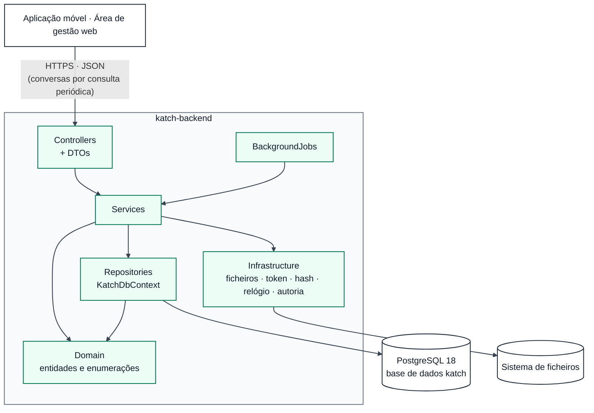

### 2.2. Convenções de código e de diagrama

- **Nomes:** Microsoft C# Coding Conventions (RI, secção 11.3): classes, propriedades e métodos em PascalCase; parâmetros em camelCase; interfaces com o prefixo `I`; métodos assíncronos com o sufixo `Async`. As colunas `snake_case` do modelo de dados resultam do `UseSnakeCaseNamingConvention()` (por exemplo, `PasswordHash` ↔ `password_hash`).
- **Tipos:** `Guid` ↔ `uuid`; `DateTimeOffset` ↔ `timestamptz` (UTC); `decimal` ↔ `numeric`; `short` ↔ `smallint`; `List<T>` de enumeração ou de texto ↔ arrays do PostgreSQL; `T?` = coluna que admite `NULL`.
- **Diagramas Mermaid (`classDiagram`):** `+` público, `-` privado; `$` = método estático; `~T~` = tipo genérico; `<<interface>>`, `<<enumeration>>` e `<<record>>` identificam o estereótipo.
- **Relações:** `--` associação com multiplicidades nas extremidades; `*--` composição (o filho não existe sem o pai); `..>` dependência (uso por injeção de dependências); `..|>` realização de interface.
- **Assíncrono:** as operações de Services e Repositories devolvem `Task` ou `Task<T>`; nos diagramas indica-se apenas o tipo `T`, para facilitar a leitura.

---

## 3. Domínio

As entidades correspondem uma a uma às tabelas do modelo de dados (secção 9 deste documento). As operações das entidades aplicam apenas as regras de estado que dependem da própria linha; as que dependem de outras linhas ficam nos Services (modelo de dados, secções 7.1 e 7.2).

### 3.1. Contas, Empresa e localidades

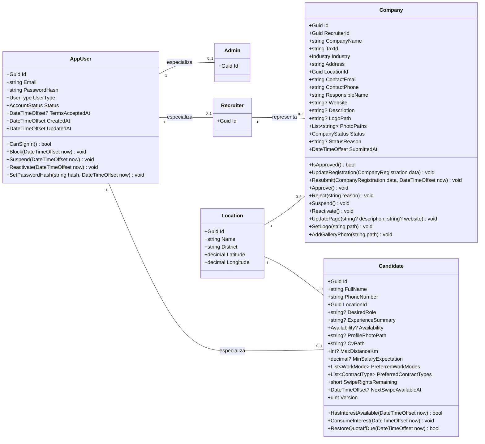

`CompanyRegistration` é um objeto de valor com os oito dados de registo da Empresa (RF041). `UpdateRegistration` rejeita a alteração do NIF com a Empresa aprovada (RF049). `Resubmit` limpa o motivo da recusa e atualiza `SubmittedAt` (RF045).

As mudanças de estado da conta e da Empresa não guardam o autor nem a data na própria entidade: os serviços registam-nos no `OperationLog` na mesma transação (modelo de dados, DM-18; RF112). Por isso as operações `Block`, `Suspend`, `Reactivate`, `Approve` e `Reject` deixam de receber o identificador do Administrador. `AppUser` é a única entidade com `CreatedAt` (data de registo, RF088) e `UpdatedAt` (modelo de dados, DM-22).

### 3.2. Perfil profissional e listas pré-definidas

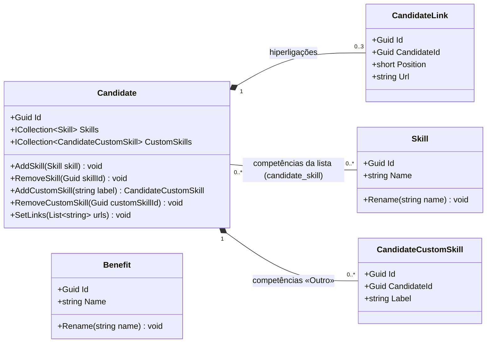

As competências do Candidato seguem o modelo de dados v02 (DM-16), o que corrige a observação do docente sobre a relação Candidato–competência:

- As competências da lista são uma relação N : M pura entre `Candidate` e `Skill` sobre a tabela `candidate_skill` (chave composta `candidate_id`, `skill_id`). Como em `job_skill`, a tabela de associação não tem atributos e não tem classe própria: é a navegação `Candidate.Skills` do Entity Framework Core. Cada linha refere exatamente uma `Skill`, e cada competência aparece no máximo uma vez por Candidato (RF008). Na v01, uma única classe `CandidateSkill` guardava as duas origens, com `SkillId` anulável, o que dava a multiplicidade `0..1` do lado de `Skill`.
- `CandidateCustomSkill` guarda as competências da opção «Outro», que não pertencem à lista e só existem para o Candidato que as indicou (relação 1 : 0..*). `AddCustomSkill` valida a designação (2 a 40 caracteres, letras, algarismos, espaços e `+ # . -`, P07) e rejeita uma designação já indicada pelo mesmo Candidato, sem distinção de maiúsculas (RF009).

As competências «Outro» não entram no destaque das competências coincidentes, porque as vagas só pretendem competências da lista (RF050, RF062).

### 3.3. Vagas

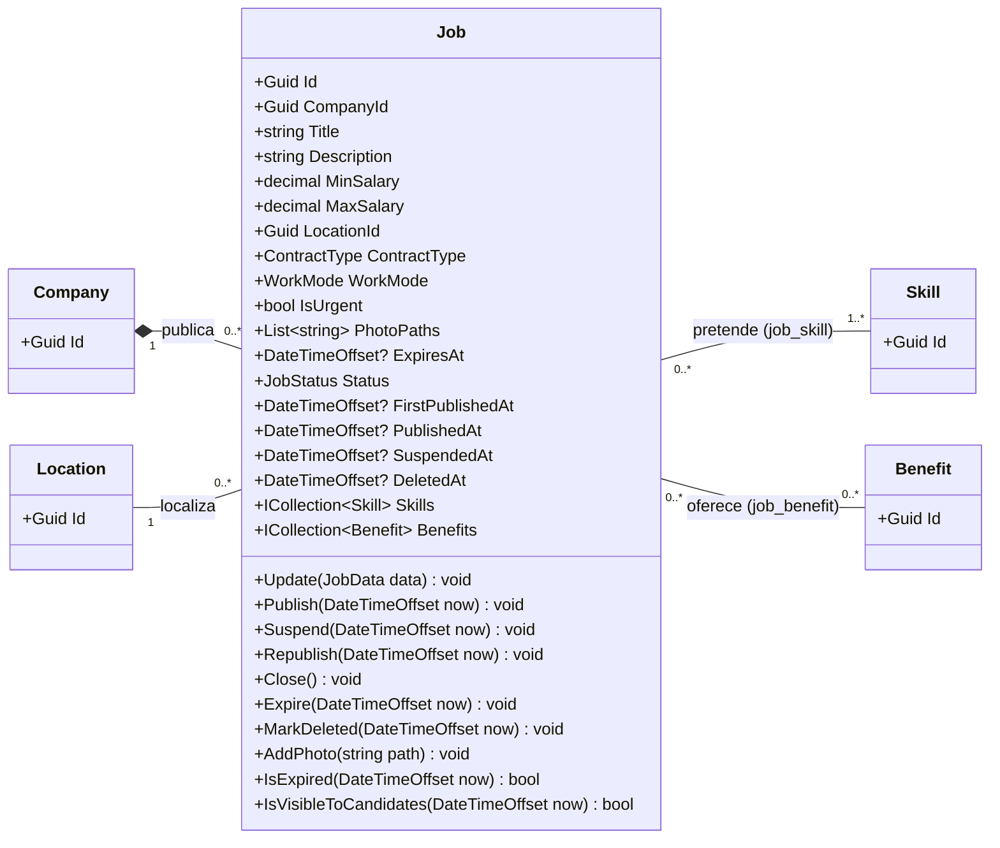

`JobData` é um objeto de valor com os campos da vaga (RF050). As relações N:M com `Skill` e `Benefit` são navegações do Entity Framework Core sobre as tabelas `job_skill` e `job_benefit`, sem classe própria.

| Operação | Efeito | Requisitos |
| --- | --- | --- |
| `Publish` | `Unpublished` → `Published`; preenche `FirstPublishedAt` na primeira publicação e `PublishedAt`. Rejeitada se `ExpiresAt` já foi atingida. | RF053, RF096 |
| `Suspend` / `Republish` | `Published` ↔ `Suspended`; `SuspendedAt` e `PublishedAt` atualizados. | RF055, RF115 |
| `Close` | Encerramento pelo Recrutador → `Closed`. O autor e a data ficam no `OperationLog` (`JobClosed` com autor). | RF056, RF112 |
| `Expire` | Encerramento pela tarefa periódica, só com `Published` e `ExpiresAt` atingida → `Closed`. Fica no `OperationLog` como `JobClosed` sem autor (modelo de dados, DM-23). | RF057 |
| `MarkDeleted` | Eliminação lógica (`DeletedAt`); o serviço só a permite sem interesses registados. | RF058, RF114 |
| `IsExpired(now)` | `ExpiresAt` preenchida e anterior ou igual a `now`. | RF057 |
| `IsVisibleToCandidates(now)` | `Published`, sem `DeletedAt` e não expirada, mesmo que a tarefa periódica ainda não a tenha encerrado (N2; modelo de dados, DM-17). O estado da Empresa é verificado na consulta (RF014). | RF014, RF057 |

Os interesses em espera não são alterados por `Suspend`, `Close` ou `Expire` (RF113).

### 3.4. Resposta a vaga, match e conversa

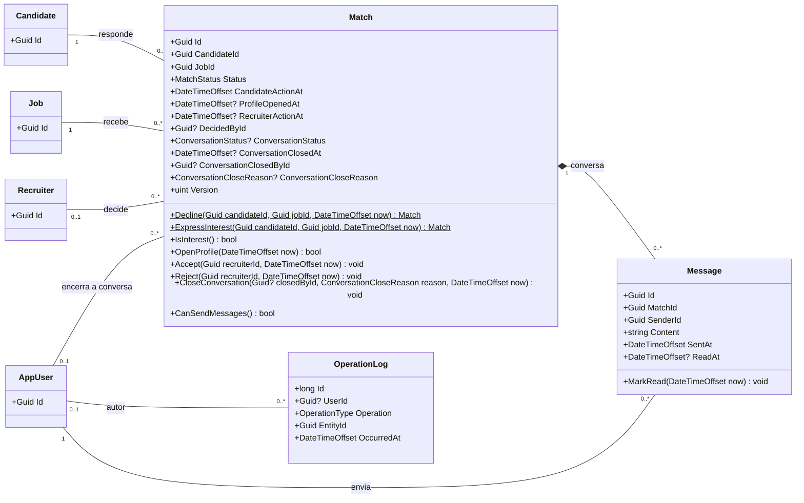

`Match` tem um único estado, `Status`, com os quatro valores do modelo de dados v02 (DM-21), em vez das três colunas de estado da v01. Só existem quatro combinações válidas, e um único valor torna impossíveis as restantes. O interesse registado é qualquer estado diferente de `DeclinedByCandidate` (`IsInterest()`). O Recrutador que abre o perfil é sempre o da Empresa da vaga, e a data da confirmação do match é a da decisão (`RecruiterActionAt`), pelo que `ProfileOpenedById` e `MatchedAt` deixam de existir (DM-24). O tipo de elemento do `OperationLog` resulta da operação (`Account*`, `Company*`, `Job*`, `Skill*`, `Benefit*`), sem atributo próprio (DM-19).

Regras aplicadas pelas operações de `Match` (modelo de dados, secções 6.13 e 7.1; transições do diagrama de estados do interesse e do match):

| Operação | Pré-condição verificada | Efeito | Transição | Requisitos |
| --- | --- | --- | --- | --- |
| `Decline` (estática) | — | `Status = DeclinedByCandidate`; `CandidateActionAt` | T1 | RF018 |
| `ExpressInterest` (estática) | — (a quota e a vaga visível são verificadas no serviço) | `Status = Waiting`; `CandidateActionAt` | T2 | RF019, RF113 |
| `OpenProfile` | `Status = Waiting` | Na primeira abertura, preenche `ProfileOpenedAt` e devolve `true`; nas seguintes não altera nada e devolve `false` | T3 | RF061, RF118 |
| `Accept` ou `Reject` sem perfil aberto | `ProfileOpenedAt` vazio | Rejeitada; o estado mantém-se `Waiting` | T4 | RF063, RF064 |
| `Accept` | `Status = Waiting` e `ProfileOpenedAt` preenchido | `Status = Matched`; `DecidedById` e `RecruiterActionAt`; abre a conversa (`ConversationStatus = Open`) | T5 | RF063, RF065, RF066, RF068 |
| `Reject` | `Status = Waiting` e `ProfileOpenedAt` preenchido | `Status = RejectedByRecruiter`; `DecidedById` e `RecruiterActionAt` | T6 | RF064, RF065 |
| Interesse em espera | — | Só sai de `Waiting` por `Accept` ou `Reject`, sem prazo de expiração | — | RF113 |
| `Accept` ou `Reject` com decisão registada | `Status` diferente de `Waiting` | Rejeitada (não altera a decisão) | — | RF117 |
| `CloseConversation` | `Status = Matched` e `ConversationStatus = Open` | `ConversationStatus = Closed`, com data, motivo e autor quando é uma das partes | — | RF030, RF074, RF075 |
| `CanSendMessages` | — | `true` só com `Status = Matched` e `ConversationStatus = Open` | — | RF069, RF070 |

Em `Match` e em `Candidate`, `Version` é mapeada para a coluna de sistema `xmin` (concorrência otimista, modelo de dados, secção 7.3): em `Match`, protege as decisões e o encerramento da conversa (RF117, RF075); em `Candidate`, impede que dois interesses simultâneos ultrapassem a quota (RF020, P11).

### 3.5. Enumerações

```mermaid
classDiagram
    direction LR
    class UserType {
        <<enumeration>>
        Candidate
        Recruiter
        Admin
    }
    class AccountStatus {
        <<enumeration>>
        Active
        Blocked
        Suspended
    }
    class WorkMode {
        <<enumeration>>
        OnSite
        Hybrid
        Remote
    }
    class ContractType {
        <<enumeration>>
        Permanent
        FixedTerm
        Internship
        ServiceProvision
    }
    class Availability {
        <<enumeration>>
        Immediate
        FifteenDays
        OneMonth
        ToBeAgreed
    }
    class Industry {
        <<enumeration>>
        Technology
        Healthcare
        Retail
        Hospitality
        Construction
        Manufacturing
        Education
        Finance
        Logistics
        Services
        Other
    }
    class CompanyStatus {
        <<enumeration>>
        Pending
        Approved
        Rejected
        Suspended
    }
    class JobStatus {
        <<enumeration>>
        Unpublished
        Published
        Suspended
        Closed
    }
    class MatchStatus {
        <<enumeration>>
        DeclinedByCandidate
        Waiting
        Matched
        RejectedByRecruiter
    }
    class ConversationStatus {
        <<enumeration>>
        Open
        Closed
    }
    class ConversationCloseReason {
        <<enumeration>>
        ClosedByParty
        AccountBlockedOrSuspended
        CompanySuspended
    }
    class OperationType {
        <<enumeration>>
        CompanySubmitted
        CompanyUpdated
        CompanyApproved
        CompanyRejected
        CompanySuspended
        CompanyReactivated
        JobCreated
        JobPublished
        JobUpdated
        JobSuspended
        JobRepublished
        JobClosed
        JobDeleted
        AccountBlocked
        AccountReactivated
        AccountSuspended
        SkillCreated
        SkillRenamed
        BenefitCreated
        BenefitRenamed
    }
```

Cada enumeração é mapeada para o tipo enumerado do PostgreSQL com o mesmo nome em `snake_case` e os valores em maiúsculas (por exemplo, `ContractType.ServiceProvision` ↔ `'SERVICE_PROVISION'`), através do mapeamento de enumerações do Npgsql.

São doze enumerações, uma por tipo enumerado da secção 5.1 do modelo de dados v02, pela mesma ordem de valores. Em relação à v01, saíram `JobCloseReason` (DM-23), `CandidateDecision` e `RecruiterDecision` (DM-21), `NotificationType` (F011) e `EntityType` (DM-19), e `MatchStatus` passou a ter os quatro estados da resposta e do match. A ordem dos valores é preservada na base de dados, porque o PostgreSQL a usa nas ordenações e comparações de tipos enumerados (`I042`, migration inicial).

| Enumeração | Valores no PostgreSQL |
| --- | --- |
| `MatchStatus` | `DECLINED_BY_CANDIDATE`, `WAITING`, `MATCHED`, `REJECTED_BY_RECRUITER` |
| `JobStatus` | `UNPUBLISHED`, `PUBLISHED`, `SUSPENDED`, `CLOSED` |
| `OperationType` | As 20 operações do RF112 registadas no `operation_log`, exceto o interesse e a recusa de vaga e a decisão do Recrutador, que ficam na `match` |

---

## 4. Repositories

Os repositórios isolam o Entity Framework Core dos Services. O `KatchDbContext` concentra o mapeamento das entidades (convenção `snake_case`, tipos enumerados, arrays, `xmin`, filtro das vagas eliminadas) e funciona como unidade de trabalho.

```mermaid
classDiagram
    direction TB
    class KatchDbContext {
        +DbSet~AppUser~ Users
        +DbSet~Admin~ Admins
        +DbSet~Recruiter~ Recruiters
        +DbSet~Candidate~ Candidates
        +DbSet~Location~ Locations
        +DbSet~CandidateLink~ CandidateLinks
        +DbSet~CandidateCustomSkill~ CandidateCustomSkills
        +DbSet~Skill~ Skills
        +DbSet~Benefit~ Benefits
        +DbSet~Company~ Companies
        +DbSet~Job~ Jobs
        +DbSet~Match~ Matches
        +DbSet~Message~ Messages
        +DbSet~OperationLog~ OperationLogs
        #OnModelCreating(ModelBuilder modelBuilder) void
    }
    class IUnitOfWork {
        <<interface>>
        +SaveChangesAsync() int
        +BeginTransactionAsync() IDbContextTransaction
    }
    class IUserRepository {
        <<interface>>
        +GetByIdAsync(Guid id) AppUser?
        +GetByEmailAsync(string email) AppUser?
        +EmailExistsAsync(string email) bool
        +AddAsync(AppUser user) void
        +ListAsync(AccountFilter filter) List~AppUser~
        +CountActiveCandidatesAtAsync(DateTimeOffset at) int
    }
    class ICandidateRepository {
        <<interface>>
        +GetWithProfileAsync(Guid id) Candidate?
        +GetByProfilePhotoPathAsync(string path) Candidate?
        +AddAsync(Candidate candidate) void
        +ListForAdminAsync() List~Candidate~
        +ListQuotaDueAsync(DateTimeOffset now) List~Candidate~
    }
    class ICompanyRepository {
        <<interface>>
        +GetByIdAsync(Guid id) Company?
        +GetByRecruiterAsync(Guid recruiterId) Company?
        +TaxIdExistsAsync(string taxId, Guid? exceptId) bool
        +AddAsync(Company company) void
        +ListPendingAsync() List~Company~
        +ListAllWithPublishedCountAsync() List~CompanyWithCount~
        +CountByStatusAtAsync(CompanyStatus status, DateTimeOffset at) int
    }
    class IJobRepository {
        <<interface>>
        +GetByIdAsync(Guid id) Job?
        +AddAsync(Job job) void
        +ListByCompanyAsync(Guid companyId) List~Job~
        +ListEligibleForCandidateAsync(Candidate candidate, DateTimeOffset now, int take) List~EligibleJob~
        +ListPublishedWithInterestCountAsync() List~JobWithCount~
        +ListExpiredAsync(DateTimeOffset now) List~Job~
        +HasInterestsAsync(Guid jobId) bool
        +CountFirstPublishedAsync(DateTimeOffset from, DateTimeOffset to) int
    }
    class IMatchRepository {
        <<interface>>
        +GetByIdAsync(Guid id) Match?
        +GetAsync(Guid candidateId, Guid jobId) Match?
        +AddAsync(Match match) void
        +ListWaitingByJobAsync(Guid jobId) List~Match~
        +ListMatchesByCandidateAsync(Guid candidateId) List~Match~
        +ListMatchesByCompanyAsync(Guid companyId) List~Match~
        +ListConversationsByUserAsync(Guid userId) List~ConversationView~
        +ListOpenConversationsByUserAsync(Guid userId) List~Match~
        +ListDeclinedByJobAsync(Guid jobId) List~Match~
        +HasInterestFromCandidateInCompanyAsync(Guid candidateId, Guid companyId) bool
        +CountInterestsAsync(DateTimeOffset from, DateTimeOffset to) int
        +CountMatchesAsync(DateTimeOffset from, DateTimeOffset to) int
    }
    class IMessageRepository {
        <<interface>>
        +AddAsync(Message message) void
        +ListByMatchAsync(Guid matchId, DateTimeOffset? after) List~Message~
        +MarkReadAsync(Guid matchId, Guid readerId, DateTimeOffset now) int
        +CountConversationsStartedAsync(DateTimeOffset from, DateTimeOffset to) int
    }
    class IReferenceDataRepository {
        <<interface>>
        +ListLocationsAsync() List~Location~
        +ListSkillsAsync() List~Skill~
        +ListBenefitsAsync() List~Benefit~
        +GetSkillAsync(Guid id) Skill?
        +GetBenefitAsync(Guid id) Benefit?
        +SkillNameExistsAsync(string name, Guid? exceptId) bool
        +BenefitNameExistsAsync(string name, Guid? exceptId) bool
        +AddSkillAsync(Skill skill) void
        +AddBenefitAsync(Benefit benefit) void
    }
    class IOperationLogRepository {
        <<interface>>
        +AddAsync(OperationLog entry) void
    }
    class JobRepository {
        -KatchDbContext context
    }
    class MatchRepository {
        -KatchDbContext context
    }
    KatchDbContext ..|> IUnitOfWork
    JobRepository ..|> IJobRepository
    MatchRepository ..|> IMatchRepository
    JobRepository "1" --> "1" KatchDbContext : usa
    MatchRepository "1" --> "1" KatchDbContext : usa
```

Cada interface tem uma implementação com o mesmo nome sem o prefixo `I` (`UserRepository`, `CandidateRepository`, `CompanyRepository`, `JobRepository`, `MatchRepository`, `MessageRepository`, `ReferenceDataRepository`, `OperationLogRepository`), que recebe o `KatchDbContext` por injeção de dependências. O diagrama mostra duas, como exemplo da relação.

Projeções de leitura (registos sem lógica, usados só para devolver dados calculados na consulta):

| Projeção | Conteúdo | Usada em |
| --- | --- | --- |
| `CompanyWithCount`, `JobWithCount` | Entidade e contagem | Listas do Administrador (RF097, RF098) |
| `EligibleJob` | `Job` e distância em km à localidade do Candidato | Cartão de vaga seguinte (RF013 a RF015) |
| `ConversationView` | `Match`, nome da outra parte, função da vaga, designação da Empresa, instante da última mensagem e número de mensagens por ler | Lista de conversas (RF027, RF071) |

Regras das consultas:

- `ListEligibleForCandidateAsync` aplica **todos** os filtros do RF014 na consulta à base de dados, incluindo a distância, e só depois limita o resultado a `take` vagas: vaga publicada, não eliminada e não expirada (`ExpiresAt` nula ou posterior a `now`, N2), Empresa aprovada, sem resposta anterior do Candidato, intervalo salarial, regimes e tipos de contrato e distância máxima, exceto nas vagas `Remote`. A distância em linha reta é calculada na própria consulta, com a fórmula de Haversine sobre as coordenadas de `location`, e devolvida em `EligibleJob` (RF015). Na v01 a distância era filtrada no serviço depois de limitar o resultado, e o Candidato podia receber «sem vagas» havendo vagas elegíveis mais à frente (N1).
- O filtro global de consulta do `KatchDbContext` exclui as vagas com `DeletedAt` preenchido (modelo de dados, DM-09).
- `ListConversationsByUserAsync` calcula a última mensagem com o máximo de `message.sent_at` por conversa e as mensagens por ler com `read_at` nulo e remetente diferente do utilizador, sem atributo próprio na `match` (modelo de dados, DM-20; índices `ix_message_match_sent` e `ix_message_unread`).
- `ListByMatchAsync(matchId, after)` devolve o histórico completo quando `after` é nulo e, na consulta periódica, só as mensagens enviadas depois desse instante (secção 6.1).
- `HasInterestFromCandidateInCompanyAsync` confirma se o Candidato tem um interesse registado (estado diferente de `DeclinedByCandidate`) numa vaga da Empresa; autoriza o Recrutador a obter a fotografia de perfil (secção 5.1, `FileAccessService`).
- `HasInterestsAsync` e `CountInterestsAsync` contam como interesse qualquer estado diferente de `DeclinedByCandidate` (modelo de dados, DM-21). `CountMatchesAsync` conta os estados `Matched` pela data de `RecruiterActionAt` (DM-24).
- `CountActiveCandidatesAtAsync` e `CountByStatusAtAsync` calculam o estado das contas e das Empresas na data final do período a partir do estado atual e das linhas do `operation_log` posteriores a essa data (modelo de dados, DM-18 e índices `ix_operation_log_*`; RF096). As restantes contagens do RF096 usam `job.first_published_at`, `match.candidate_action_at`, `match.recruiter_action_at` e a primeira mensagem de cada conversa.

---

## 5. Services e infraestrutura

### 5.1. Serviços de negócio

```mermaid
classDiagram
    direction LR
    class IAuthService {
        <<interface>>
        +RegisterCandidateAsync(RegisterCandidateRequest request) LoginResponse
        +CreateRecruiterAccountAsync(CreateRecruiterAccountRequest request) LoginResponse
        +LoginAsync(LoginRequest request, ClientApp app) LoginResponse
        +ChangePasswordAsync(Guid userId, ChangePasswordRequest request) void
    }
    class ICandidateProfileService {
        <<interface>>
        +GetAsync(Guid candidateId) CandidateProfileDto
        +UpdateAsync(Guid candidateId, UpdateCandidateProfileRequest request) CandidateProfileDto
        +UpdatePreferencesAsync(Guid candidateId, SearchPreferencesDto request) SearchPreferencesDto
        +AddSkillAsync(Guid candidateId, AddSkillRequest request) CandidateProfileDto
        +RemoveSkillAsync(Guid candidateId, Guid skillId) void
        +AddCustomSkillAsync(Guid candidateId, AddCustomSkillRequest request) CandidateProfileDto
        +RemoveCustomSkillAsync(Guid candidateId, Guid customSkillId) void
        +SetLinksAsync(Guid candidateId, SetLinksRequest request) CandidateProfileDto
        +UploadPhotoAsync(Guid candidateId, IFormFile file) string
        +UploadCvAsync(Guid candidateId, IFormFile file) string
        +GetCvAsync(Guid candidateId) FileContent
    }
    class IJobExplorationService {
        <<interface>>
        +GetNextCardAsync(Guid candidateId) JobCardDto?
        +GetDetailAsync(Guid candidateId, Guid jobId) JobDetailDto
        +GetCompanyPageAsync(Guid companyId) CompanyPageDto
        +DeclineAsync(Guid candidateId, Guid jobId) void
        +ExpressInterestAsync(Guid candidateId, Guid jobId) QuotaDto
        +GetQuotaAsync(Guid candidateId) QuotaDto
    }
    class ICompanyService {
        <<interface>>
        +RegisterAsync(Guid recruiterId, CompanyRegistrationRequest request) CompanyStatusDto
        +ResubmitAsync(Guid recruiterId, CompanyRegistrationRequest request) CompanyStatusDto
        +GetStatusAsync(Guid recruiterId) CompanyStatusDto
        +GetRegistrationAsync(Guid recruiterId) CompanyRegistrationDto
        +UpdateRegistrationAsync(Guid recruiterId, CompanyRegistrationRequest request) CompanyStatusDto
        +GetPageAsync(Guid recruiterId) CompanyPageDto
        +UpdatePageAsync(Guid recruiterId, CompanyPageRequest request) CompanyPageDto
        +UploadLogoAsync(Guid recruiterId, IFormFile file) string
        +AddGalleryPhotoAsync(Guid recruiterId, IFormFile file) string
    }
    class IJobService {
        <<interface>>
        +CreateAsync(Guid recruiterId, JobRequest request) JobDto
        +UpdateAsync(Guid recruiterId, Guid jobId, JobRequest request) JobDto
        +PublishAsync(Guid recruiterId, Guid jobId) JobDto
        +SuspendAsync(Guid recruiterId, Guid jobId) JobDto
        +RepublishAsync(Guid recruiterId, Guid jobId) JobDto
        +CloseAsync(Guid recruiterId, Guid jobId) JobDto
        +DeleteAsync(Guid recruiterId, Guid jobId) void
        +AddPhotoAsync(Guid recruiterId, Guid jobId, IFormFile file) string
        +ListOwnAsync(Guid recruiterId) List~JobDto~
        +CloseExpiredAsync() int
    }
    class ICandidateEvaluationService {
        <<interface>>
        +ListWaitingAsync(Guid recruiterId, Guid jobId) List~WaitingCandidateDto~
        +OpenProfileAsync(Guid recruiterId, Guid matchId) CandidateFullProfileDto
        +GetCvAsync(Guid recruiterId, Guid matchId) FileContent
        +AcceptAsync(Guid recruiterId, Guid matchId) MatchDto
        +RejectAsync(Guid recruiterId, Guid matchId) void
    }
    class IMatchService {
        <<interface>>
        +ListForCandidateAsync(Guid candidateId) List~MatchDto~
        +ListForRecruiterAsync(Guid recruiterId) List~MatchDto~
    }
    class IConversationService {
        <<interface>>
        +ListAsync(Guid userId) List~ConversationSummaryDto~
        +OpenAsync(Guid userId, Guid matchId, DateTimeOffset? after) List~MessageDto~
        +SendAsync(Guid userId, Guid matchId, SendMessageRequest request) MessageDto
        +CloseAsync(Guid userId, Guid matchId) void
    }
    class IFileAccessService {
        <<interface>>
        +GetAsync(Guid userId, UserType userType, FileKind kind, string fileName) FileContent
    }
    class IAccountAdminService {
        <<interface>>
        +ListAccountsAsync() List~AccountDto~
        +ListCandidatesAsync() List~CandidateAdminDto~
        +BlockAsync(Guid adminId, Guid userId) void
        +SuspendCandidateAsync(Guid adminId, Guid candidateId) void
        +ReactivateAsync(Guid adminId, Guid userId) void
    }
    class ICompanyAdminService {
        <<interface>>
        +ListPendingAsync() List~PendingCompanyDto~
        +GetSubmittedDataAsync(Guid companyId) CompanyRegistrationDto
        +ApproveAsync(Guid adminId, Guid companyId) void
        +RejectAsync(Guid adminId, Guid companyId, RejectCompanyRequest request) void
        +SuspendAsync(Guid adminId, Guid companyId) void
        +ReactivateAsync(Guid adminId, Guid companyId) void
        +ListCompaniesAsync() List~CompanyAdminDto~
        +ListPublishedJobsAsync() List~PublishedJobAdminDto~
    }
    class IIndicatorService {
        <<interface>>
        +GetAsync(DateOnly from, DateOnly to) IndicatorsDto
    }
    class IReferenceListService {
        <<interface>>
        +ListLocationsAsync() List~ReferenceItemDto~
        +ListSkillsAsync() List~ReferenceItemDto~
        +ListBenefitsAsync() List~ReferenceItemDto~
        +AddSkillAsync(Guid adminId, ReferenceItemRequest request) ReferenceItemDto
        +RenameSkillAsync(Guid adminId, Guid skillId, ReferenceItemRequest request) ReferenceItemDto
        +AddBenefitAsync(Guid adminId, ReferenceItemRequest request) ReferenceItemDto
        +RenameBenefitAsync(Guid adminId, Guid benefitId, ReferenceItemRequest request) ReferenceItemDto
    }
    class IQuotaService {
        <<interface>>
        +RestoreDueQuotasAsync() int
    }
```

Cada interface tem uma implementação com o mesmo nome sem o prefixo `I` (por exemplo, `CandidateEvaluationService`), registada no contentor de injeção de dependências com tempo de vida `Scoped`. As dependências de cada implementação estão na secção 5.3.

`FileContent` é um registo com o conteúdo do ficheiro (`Stream`), o tipo de conteúdo (`image/jpeg`, `image/png` ou `application/pdf`) e o nome a apresentar; os controllers devolvem-no com `File(...)`.

Operações acrescentadas na v02:

| Operação | Regra | Origem |
| --- | --- | --- |
| `ICompanyService.GetRegistrationAsync` | Devolve os dados de registo da Empresa do próprio Recrutador em qualquer estado (pendente, recusada para correção, aprovada ou suspensa); sem Empresa registada, o pedido é rejeitado como «não encontrado». Inclui o identificador da localidade, para preencher a seleção nos formulários de correção e de alteração. | API, PA-03; web, G1 e G3; RF044, RF045, RF049 |
| `ICompanyService.GetPageAsync` | Devolve a página de apresentação da Empresa do próprio Recrutador; só com a Empresa aprovada, como a alteração da página. | API, PA-03; web, G2; RF046 a RF048 |
| `ICandidateProfileService.GetCvAsync` | Devolve o curriculum vitae do próprio Candidato; sem CV, o pedido é rejeitado como «não encontrado». | API, PA-10; mobile, PC-11; RF011, RNF007 |
| `ICandidateProfileService.AddCustomSkillAsync`, `RemoveCustomSkillAsync` | Competências da opção «Outro», separadas das da lista (secção 3.2). `AddSkillAsync` e `RemoveSkillAsync` passam a tratar só competências da lista, identificadas pelo `SkillId`. | Modelo de dados, DM-16; RF008, RF009 |
| `IFileAccessService.GetAsync` | Serve fotografias e logótipos pelo endereço dos DTOs, depois de verificar a autorização (tabela seguinte). O CV não é servido por esta operação. | API, PA-01; web, G11; mobile, PC-10 |
| `IConversationService.OpenAsync` (parâmetro `after`) | Sem `after`, devolve o histórico completo; com `after`, só as mensagens posteriores, para a consulta periódica. Em ambos os casos marca como lidas as mensagens da outra parte. | DA v04, F010; RF027, RF028, RF108, RF109 |

Autorização do `FileAccessService` (opção (a) da PA-01: o ficheiro é identificado pelo tipo e pelo nome gerado pelo `LocalFileStorage`, sem tabela de ficheiros):

| Tipo de ficheiro (`FileKind`) | Quem pode obter |
| --- | --- |
| `CompanyLogo`, `CompanyPhoto`, `JobPhoto` | Qualquer conta com sessão iniciada (são apresentados nos cartões, no detalhe da vaga e na página da Empresa). |
| `ProfilePhoto` | O próprio Candidato e o Recrutador de uma Empresa em cuja vaga o Candidato tem um interesse registado (`IMatchRepository.HasInterestFromCandidateInCompanyAsync`). |
| `CurriculumVitae` | Nunca por esta operação: o CV é obtido só por `ICandidateProfileService.GetCvAsync` (próprio Candidato) e `ICandidateEvaluationService.GetCvAsync` (Recrutador da vaga em espera), RNF007. |

Um nome de ficheiro inexistente, de outro tipo ou sem autorização devolve «não encontrado», para não revelar a existência do ficheiro.

### 5.2. Infraestrutura e tarefas periódicas

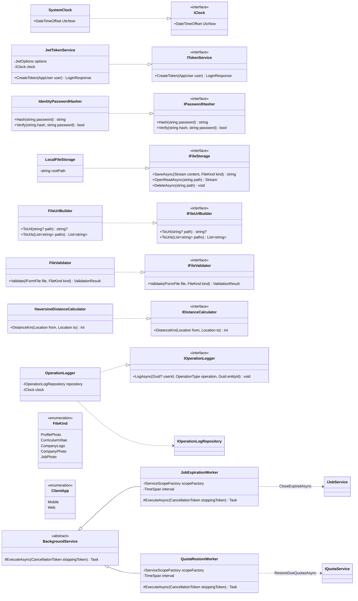

| Classe | Responsabilidade | Requisitos |
| --- | --- | --- |
| `SystemClock` (`IClock`) | Fornece a data e hora atual em UTC. Nos testes é substituído por um relógio simulado, para verificar o período de bloqueio e a expiração da credencial de sessão. | RF020, RF021, RNF005 |
| `JwtTokenService` | Emite a credencial de sessão (JWT) com o identificador e o tipo de conta e validade de 8 horas. O segredo vem de variável de ambiente ou GitHub Secrets. | RNF004, RNF005; RI 14.2 |
| `IdentityPasswordHasher` | Calcula e verifica o resumo das palavras-passe com valor aleatório por conta (`PasswordHasher` do ASP.NET Core Identity). | RNF003 |
| `LocalFileStorage` | Guarda e lê os ficheiros no sistema de ficheiros do servidor. Cada ficheiro fica numa pasta por tipo (`FileKind`) com um nome gerado (identificador aleatório e extensão do formato real), e o caminho relativo `<tipo>/<nome>` é o que se guarda na base de dados (opção (a) da PA-01, sem tabela de ficheiros). | Arquitetura, AD-01; API, PA-01 |
| `FileUrlBuilder` | Converte o caminho guardado no endereço da API que serve o ficheiro (`/api/files/<tipo>/<nome>`), usado em `PhotoUrl`, `LogoUrl` e `PhotoUrls` dos DTOs. O caminho no sistema de ficheiros nunca é enviado ao cliente. | API, PA-01; arquitetura, secção 2.4 |
| `FileValidator` | Valida o formato real (assinatura do ficheiro), a extensão e a dimensão de cada tipo de ficheiro. | P01, P02, RNF016 |
| `HaversineDistanceCalculator` | Calcula a distância em linha reta entre duas localidades, em km arredondados às unidades. | RF015 |
| `OperationLogger` | Insere uma linha no `operation_log` por cada operação do RF112, com o autor (nulo só no encerramento automático de vaga), a operação e o identificador do elemento. O tipo de elemento resulta da operação (modelo de dados, DM-19). | RF112 |
| `JobExpirationWorker` | Executa a cada minuto o encerramento das vagas publicadas com data-limite atingida (`Job.Expire`, registado como `JobClosed` sem autor). Entretanto, as vagas expiradas já não são apresentadas nem aceitam interesses, porque a consulta e o serviço verificam `ExpiresAt` (N2). | RF057 |
| `QuotaRestoreWorker` | Executa a cada minuto a reposição integral das quotas cujo período de bloqueio terminou. A consulta da quota e o interesse aplicam também `Candidate.RestoreQuotaIfDue`, para que o valor devolvido esteja sempre certo antes da tarefa correr. | RF021 |

O intervalo das duas tarefas periódicas é configurável (`BackgroundJobs:IntervalSeconds`, 60 segundos por omissão). Fixar o intervalo resolve a parte do N2 que dependia da periodicidade; a correção da regra não depende dele, porque as consultas verificam a data-limite e o fim do bloqueio no próprio pedido.

### 5.3. Dependências dos serviços

```mermaid
classDiagram
    direction LR
    class AuthService
    class CandidateProfileService
    class JobExplorationService
    class CompanyService
    class JobService
    class CandidateEvaluationService
    class ConversationService
    class FileAccessService
    class AccountAdminService
    class CompanyAdminService
    class MatchService
    class IndicatorService
    class ReferenceListService
    class QuotaService
    AuthService ..> IUserRepository
    AuthService ..> ICandidateRepository
    AuthService ..> IPasswordHasher
    AuthService ..> ITokenService
    CandidateProfileService ..> ICandidateRepository
    CandidateProfileService ..> IReferenceDataRepository
    CandidateProfileService ..> IFileStorage
    CandidateProfileService ..> IFileValidator
    CandidateProfileService ..> IFileUrlBuilder
    JobExplorationService ..> ICandidateRepository
    JobExplorationService ..> IJobRepository
    JobExplorationService ..> ICompanyRepository
    JobExplorationService ..> IMatchRepository
    JobExplorationService ..> IDistanceCalculator
    JobExplorationService ..> IFileUrlBuilder
    CompanyService ..> ICompanyRepository
    CompanyService ..> IFileStorage
    CompanyService ..> IFileValidator
    CompanyService ..> IFileUrlBuilder
    CompanyService ..> IOperationLogger
    JobService ..> IJobRepository
    JobService ..> ICompanyRepository
    JobService ..> IFileStorage
    JobService ..> IFileValidator
    JobService ..> IFileUrlBuilder
    JobService ..> IOperationLogger
    CandidateEvaluationService ..> IMatchRepository
    CandidateEvaluationService ..> ICompanyRepository
    CandidateEvaluationService ..> IFileStorage
    CandidateEvaluationService ..> IFileUrlBuilder
    ConversationService ..> IMatchRepository
    ConversationService ..> IMessageRepository
    FileAccessService ..> IFileStorage
    FileAccessService ..> ICandidateRepository
    FileAccessService ..> ICompanyRepository
    FileAccessService ..> IMatchRepository
    AccountAdminService ..> IUserRepository
    AccountAdminService ..> ICandidateRepository
    AccountAdminService ..> IMatchRepository
    AccountAdminService ..> IOperationLogger
    CompanyAdminService ..> ICompanyRepository
    CompanyAdminService ..> IJobRepository
    CompanyAdminService ..> IMatchRepository
    CompanyAdminService ..> IOperationLogger
    IndicatorService ..> IUserRepository
    IndicatorService ..> ICompanyRepository
    IndicatorService ..> IJobRepository
    IndicatorService ..> IMatchRepository
    IndicatorService ..> IMessageRepository
    ReferenceListService ..> IReferenceDataRepository
    ReferenceListService ..> IOperationLogger
    MatchService ..> IMatchRepository
    QuotaService ..> ICandidateRepository
```

No cartão de vaga seguinte, a distância vem calculada da consulta de `IJobRepository` (`EligibleJob`, N1). `JobExplorationService` continua a usar `IDistanceCalculator` só no detalhe de uma vaga, em que a distância é calculada para essa vaga. As duas usam a mesma fórmula de Haversine, arredondada às unidades (RF015).

Todos os serviços que alteram dados dependem também de `IUnitOfWork` e de `IClock`; essas dependências não são desenhadas para não sobrecarregar o diagrama.

| Serviço | Responsabilidade | Casos de uso | Requisitos |
| --- | --- | --- | --- |
| `AuthService` | Registo de Candidato com validação automática e ativação imediata; criação de conta de Recrutador; início de sessão com mensagem única para credenciais erradas e rejeição de contas bloqueadas ou suspensas; alteração da palavra-passe. | UC01, UC02, UC03, UC07 | RF001 a RF005, RF037, RF038, RF040, RF083, RF084; RNF003, RNF009 |
| `CandidateProfileService` | Perfil profissional, preferências de procura (também a partir da área de exploração), competências da lista e «Outro» (em classes separadas), hiperligações, fotografia, envio do CV e obtenção do próprio CV. | UC04, UC05 | RF006 a RF012, RF023; RNF007 |
| `JobExplorationService` | Cartão de vaga seguinte com o filtro do RF014 e a distância calculados na consulta; detalhe da vaga e página da Empresa; recusa e interesse (só em vagas visíveis e não expiradas, verificação da quota com controlo de concorrência, uma resposta por vaga). O autor e a data do interesse e da recusa ficam na própria linha de `match`, e não no `operation_log` (modelo de dados, tipo `operation_type`). O Recrutador consulta os novos interessados na lista de candidatos em espera, sem aviso ativo (DA v04, F007). | UC05, UC06 | RF013 a RF022, RF112; RNF002 |
| `CompanyService` | Registo, nova submissão e alteração da Empresa (NIF único e imutável depois da aprovação), estado do pedido, consulta dos dados de registo e da página da própria Empresa, página de apresentação, logótipo e galeria. A decisão do Administrador é consultada no estado do pedido (DA v04, F003). | UC07, UC08 | RF039, RF041 a RF049, RF112 |
| `JobService` | Criação, alteração, publicação, suspensão, nova publicação, encerramento e eliminação lógica de vagas da própria Empresa; fotografias; encerramento automático. Suspender ou encerrar uma vaga não altera os interesses em espera (RF113). | UC09, UC10 | RF050 a RF059, RF114, RF115, RF112 |
| `CandidateEvaluationService` | Lista de candidatos em espera; abertura do perfil completo com registo; acesso ao CV; aceitação (decisão, match e conversa numa transação) e recusa. As partes consultam o novo match na lista de matches (DA v04, F008). | UC11, UC12 | RF060 a RF066, RF068, RF117, RF118; RNF007 |
| `MatchService` | Listas de matches do Candidato e da Empresa, com os contactos. | UC13 | RF024, RF025, RF067 |
| `ConversationService` | Lista de conversas com mensagens por ler e última mensagem; histórico, completo ou só com as mensagens posteriores a um instante, com marcação de leitura; envio (só com match e conversa aberta); encerramento. Os clientes obtêm as mensagens novas por consulta periódica destas operações (DA v04, F010). Nenhuma operação para o Administrador. | UC14 | RF026 a RF030, RF069 a RF074, RF108, RF109, RF103 |
| `FileAccessService` | Serve fotografias e logótipos pelo endereço dos DTOs, com a autorização por tipo de ficheiro da secção 5.1. | UC04 a UC08, UC11 | RF013, RF017, RF047, RF048, RF052, RF061; RNF007 |
| `AccountAdminService` | Listas de contas e de Candidatos; bloqueio, suspensão e reativação, com passagem das conversas a só de consulta e registo de autoria. | UC18 | RF085 a RF090, RF075, RF112 |
| `CompanyAdminService` | Empresas pendentes e dados submetidos; aprovação e recusa com motivo; suspensão (conversas a só de consulta) e reativação; listas globais de Empresas e de vagas publicadas. | UC16, UC17 | RF091 a RF095, RF097, RF098, RF116, RF075, RF112 |
| `IndicatorService` | Os sete indicadores do período, só com contagens e sem acesso ao texto das mensagens. | UC19 | RF096, RF103, RF104 |
| `ReferenceListService` | Listas pré-definidas: consulta de localidades (também sem sessão, para o registo do Candidato), competências e benefícios; acrescento e alteração de designações pelo Administrador. | UC03, UC20 | RF003, RF099 a RF102, RF112 |
| `QuotaService` | Reposição integral das quotas no fim do período de bloqueio; o Candidato consulta a quota na área de exploração (DA v04, F006). | UC05 | RF021 |

---

## 6. Controllers

```mermaid
classDiagram
    direction LR
    class ControllerBase {
        <<abstract>>
    }
    class AuthController {
        -IAuthService authService
        +RegisterCandidate(RegisterCandidateRequest request) ActionResult~LoginResponse~
        +CreateRecruiterAccount(CreateRecruiterAccountRequest request) ActionResult~LoginResponse~
        +Login(LoginRequest request) ActionResult~LoginResponse~
        +Logout() IActionResult
        +ChangePassword(ChangePasswordRequest request) IActionResult
    }
    class CandidateProfileController {
        -ICandidateProfileService profileService
        +Get() ActionResult~CandidateProfileDto~
        +Update(UpdateCandidateProfileRequest request) ActionResult~CandidateProfileDto~
        +UpdatePreferences(SearchPreferencesDto request) ActionResult~SearchPreferencesDto~
        +AddSkill(AddSkillRequest request) ActionResult~CandidateProfileDto~
        +RemoveSkill(Guid skillId) IActionResult
        +AddCustomSkill(AddCustomSkillRequest request) ActionResult~CandidateProfileDto~
        +RemoveCustomSkill(Guid customSkillId) IActionResult
        +SetLinks(SetLinksRequest request) ActionResult~CandidateProfileDto~
        +UploadPhoto(IFormFile file) IActionResult
        +UploadCv(IFormFile file) IActionResult
        +GetCv() IActionResult
    }
    class JobExplorationController {
        -IJobExplorationService explorationService
        +GetNextCard() ActionResult~JobCardDto~
        +GetDetail(Guid jobId) ActionResult~JobDetailDto~
        +GetCompanyPage(Guid companyId) ActionResult~CompanyPageDto~
        +Decline(Guid jobId) IActionResult
        +ExpressInterest(Guid jobId) ActionResult~QuotaDto~
        +GetQuota() ActionResult~QuotaDto~
    }
    class CompanyController {
        -ICompanyService companyService
        +Register(CompanyRegistrationRequest request) ActionResult~CompanyStatusDto~
        +Resubmit(CompanyRegistrationRequest request) ActionResult~CompanyStatusDto~
        +GetStatus() ActionResult~CompanyStatusDto~
        +GetRegistration() ActionResult~CompanyRegistrationDto~
        +UpdateRegistration(CompanyRegistrationRequest request) ActionResult~CompanyStatusDto~
        +GetPage() ActionResult~CompanyPageDto~
        +UpdatePage(CompanyPageRequest request) ActionResult~CompanyPageDto~
        +UploadLogo(IFormFile file) IActionResult
        +AddGalleryPhoto(IFormFile file) IActionResult
    }
    class JobsController {
        -IJobService jobService
        +List() ActionResult~List~JobDto~~
        +Create(JobRequest request) ActionResult~JobDto~
        +Update(Guid jobId, JobRequest request) ActionResult~JobDto~
        +Publish(Guid jobId) ActionResult~JobDto~
        +Suspend(Guid jobId) ActionResult~JobDto~
        +Republish(Guid jobId) ActionResult~JobDto~
        +Close(Guid jobId) ActionResult~JobDto~
        +Delete(Guid jobId) IActionResult
        +AddPhoto(Guid jobId, IFormFile file) IActionResult
    }
    class CandidateEvaluationController {
        -ICandidateEvaluationService evaluationService
        +ListWaiting(Guid jobId) ActionResult~List~WaitingCandidateDto~~
        +OpenProfile(Guid matchId) ActionResult~CandidateFullProfileDto~
        +GetCv(Guid matchId) IActionResult
        +Accept(Guid matchId) ActionResult~MatchDto~
        +Reject(Guid matchId) IActionResult
    }
    class MatchesController {
        -IMatchService matchService
        +List() ActionResult~List~MatchDto~~
    }
    class ConversationsController {
        -IConversationService conversationService
        +List() ActionResult~List~ConversationSummaryDto~~
        +Open(Guid matchId, DateTimeOffset? after) ActionResult~List~MessageDto~~
        +Send(Guid matchId, SendMessageRequest request) ActionResult~MessageDto~
        +Close(Guid matchId) IActionResult
    }
    class FilesController {
        -IFileAccessService fileAccessService
        +Get(FileKind kind, string fileName) IActionResult
    }
    class AdminAccountsController {
        -IAccountAdminService accountAdminService
        +ListAccounts() ActionResult~List~AccountDto~~
        +ListCandidates() ActionResult~List~CandidateAdminDto~~
        +Block(Guid userId) IActionResult
        +SuspendCandidate(Guid candidateId) IActionResult
        +Reactivate(Guid userId) IActionResult
    }
    class AdminCompaniesController {
        -ICompanyAdminService companyAdminService
        +ListPending() ActionResult~List~PendingCompanyDto~~
        +GetSubmittedData(Guid companyId) ActionResult~CompanyRegistrationDto~
        +Approve(Guid companyId) IActionResult
        +Reject(Guid companyId, RejectCompanyRequest request) IActionResult
        +Suspend(Guid companyId) IActionResult
        +Reactivate(Guid companyId) IActionResult
        +ListCompanies() ActionResult~List~CompanyAdminDto~~
        +ListPublishedJobs() ActionResult~List~PublishedJobAdminDto~~
    }
    class AdminIndicatorsController {
        -IIndicatorService indicatorService
        +Get(DateOnly from, DateOnly to) ActionResult~IndicatorsDto~
    }
    class ReferenceListsController {
        -IReferenceListService referenceListService
        +ListLocations() ActionResult~List~ReferenceItemDto~~
        +ListSkills() ActionResult~List~ReferenceItemDto~~
        +ListBenefits() ActionResult~List~ReferenceItemDto~~
        +AddSkill(ReferenceItemRequest request) ActionResult~ReferenceItemDto~
        +RenameSkill(Guid skillId, ReferenceItemRequest request) ActionResult~ReferenceItemDto~
        +AddBenefit(ReferenceItemRequest request) ActionResult~ReferenceItemDto~
        +RenameBenefit(Guid benefitId, ReferenceItemRequest request) ActionResult~ReferenceItemDto~
    }
    ControllerBase <|-- AuthController
    ControllerBase <|-- CandidateProfileController
    ControllerBase <|-- JobExplorationController
    ControllerBase <|-- CompanyController
    ControllerBase <|-- JobsController
    ControllerBase <|-- CandidateEvaluationController
    ControllerBase <|-- MatchesController
    ControllerBase <|-- ConversationsController
    ControllerBase <|-- FilesController
    ControllerBase <|-- AdminAccountsController
    ControllerBase <|-- AdminCompaniesController
    ControllerBase <|-- AdminIndicatorsController
    ControllerBase <|-- ReferenceListsController
    AuthController "1" ..> "1" IAuthService
    CandidateProfileController "1" ..> "1" ICandidateProfileService
    JobExplorationController "1" ..> "1" IJobExplorationService
    CompanyController "1" ..> "1" ICompanyService
    JobsController "1" ..> "1" IJobService
    CandidateEvaluationController "1" ..> "1" ICandidateEvaluationService
    MatchesController "1" ..> "1" IMatchService
    ConversationsController "1" ..> "1" IConversationService
    FilesController "1" ..> "1" IFileAccessService
    AdminAccountsController "1" ..> "1" IAccountAdminService
    AdminCompaniesController "1" ..> "1" ICompanyAdminService
    AdminIndicatorsController "1" ..> "1" IIndicatorService
    ReferenceListsController "1" ..> "1" IReferenceListService
```

O identificador do utilizador (`userId`, `candidateId`, `recruiterId`, `adminId`) é sempre obtido da credencial de sessão, nunca do corpo do pedido (RNF006).

| Controller | Rota base | Autorização | Casos de uso |
| --- | --- | --- | --- |
| `AuthController` | `/api/auth` | Registo, criação de conta e início de sessão sem credencial; fim de sessão e alteração da palavra-passe com qualquer tipo de conta | UC01, UC02, UC03, UC07 |
| `CandidateProfileController` | `/api/candidate/profile` | Candidato | UC04 |
| `JobExplorationController` | `/api/candidate/jobs` | Candidato | UC05, UC06 |
| `CompanyController` | `/api/recruiter/company` | Recrutador; consulta e alteração da página, logótipo e galeria também exigem Empresa aprovada (`GetRegistration` só exige a política `Recruiter`, porque os dados são lidos em qualquer estado da Empresa) | UC07, UC08 |
| `JobsController` | `/api/recruiter/jobs` | Recrutador com Empresa aprovada | UC09, UC10 |
| `CandidateEvaluationController` | `/api/recruiter` | Recrutador com Empresa aprovada | UC11, UC12 |
| `MatchesController` | `/api/matches` | Candidato ou Recrutador | UC13 |
| `ConversationsController` | `/api/conversations` | Candidato ou Recrutador (o Administrador é rejeitado) | UC14 |
| `FilesController` | `/api/files/{kind}/{fileName}` | Qualquer conta com sessão iniciada; autorização por tipo de ficheiro no serviço (secção 5.1) | UC04 a UC08, UC11 |
| `AdminAccountsController` | `/api/admin/accounts` | Administrador (RF104) | UC18 |
| `AdminCompaniesController` | `/api/admin/companies` | Administrador (RF104) | UC16, UC17 |
| `AdminIndicatorsController` | `/api/admin/indicators` | Administrador (RF104) | UC19 |
| `ReferenceListsController` | `/api/reference-lists` | Consulta das localidades (`ListLocations`) sem credencial, por ser operação não reservada (especificação de requisitos v02, secção 2.2); consulta das competências e dos benefícios com sessão iniciada; acrescento e alteração só pelo Administrador | UC03, UC20 |

A autorização usa atributos `[Authorize(Roles = …)]` com o tipo de conta da credencial de sessão (RF104). As quatro operações não reservadas da especificação de requisitos v02 (secção 2.2) usam `[AllowAnonymous]`: `AuthController.RegisterCandidate`, `AuthController.CreateRecruiterAccount`, `AuthController.Login` e `ReferenceListsController.ListLocations` (DC-14). Todas as restantes exigem credencial de sessão válida (RNF004). Em cada pedido autenticado, o backend confirma na base de dados que a conta continua ativa e rejeita as contas bloqueadas ou suspensas (RF086, RF089). A política `ApprovedCompany` confirma também o estado da Empresa em cada operação reservada (arquitetura, secção 2.6; RF039; RNF004, RNF006).

O fim de sessão (RF105 a RF107) não altera dados no servidor, porque a autenticação não guarda estado de sessão (arquitetura, secção 2.6): o cliente descarta a credencial e passa a exigir novo início de sessão, e `Logout` apenas confirma o pedido. As rotas e os formatos detalhados são definidos na documentação da API (`04.11`).

### 6.1. Consulta periódica das conversas

Com a redução de âmbito (DA v04, F010 e secção 3), não há ligação persistente entre cliente e servidor nem hubs. Enquanto a conversa ou a lista de conversas está aberta, o cliente repete, de 3 em 3 segundos (DA v04, F010; ata de 2026-10-16, deliberação 1), os mesmos pedidos que usa para abrir a área de conversas:

| Pedido periódico | Operação | Resposta |
| --- | --- | --- |
| Lista de conversas aberta | `ConversationsController.List` | Conversas com a última mensagem, o número de mensagens por ler e o estado (aberta ou só de consulta) |
| Conversa aberta | `ConversationsController.Open(matchId, after)`, com `after` igual ao instante da última mensagem já recebida | Só as mensagens novas; as da outra parte ficam marcadas como lidas |

O servidor não guarda estado de ligação: cada consulta é um pedido HTTP autenticado igual aos restantes, sujeito às mesmas regras de autorização (RNF004, RNF006). A mensagem nova surge na primeira consulta seguinte ao envio, ou seja, no máximo cerca de 3 segundos mais a duração do pedido, dentro dos 5 segundos do parâmetro P17 da especificação de requisitos v02. O backend não depende do valor do intervalo, que é configurado nos clientes. A passagem da conversa a só de consulta (encerramento, bloqueio ou suspensão) chega ao cliente na consulta seguinte, pelo estado da conversa.

---

## 7. DTOs

Os DTOs são `record` imutáveis, sem lógica, validados pelos atributos de validação do ASP.NET Core e, de novo, nos serviços (RNF008). Não expõem entidades nem colunas internas (por exemplo, `PasswordHash`, `CvPath` ou `Version`).

### 7.1. DTOs principais

```mermaid
classDiagram
    direction LR
    class RegisterCandidateRequest {
        <<record>>
        +string FullName
        +string Email
        +string PhoneNumber
        +Guid LocationId
        +string Password
        +bool AcceptTerms
    }
    class LoginRequest {
        <<record>>
        +string Email
        +string Password
    }
    class LoginResponse {
        <<record>>
        +string Token
        +DateTimeOffset ExpiresAt
        +UserType UserType
        +Guid UserId
    }
    class JobCardDto {
        <<record>>
        +Guid JobId
        +string Title
        +string CompanyName
        +string? LogoUrl
        +decimal MinSalary
        +decimal MaxSalary
        +string LocationName
        +int DistanceKm
        +ContractType ContractType
        +WorkMode WorkMode
        +bool IsUrgent
        +List~string~ PhotoUrls
    }
    class JobDetailDto {
        <<record>>
        +JobCardDto Card
        +string Description
        +List~string~ Skills
        +List~string~ Benefits
        +Guid CompanyId
    }
    class QuotaDto {
        <<record>>
        +int Available
        +DateTimeOffset? BlockedUntil
    }
    class WaitingCandidateDto {
        <<record>>
        +Guid MatchId
        +Guid CandidateId
        +string FullName
        +DateTimeOffset InterestAt
    }
    class CandidateFullProfileDto {
        <<record>>
        +Guid MatchId
        +string FullName
        +string? PhotoUrl
        +string? DesiredRole
        +string LocationName
        +Availability? Availability
        +string? ExperienceSummary
        +List~string~ Links
        +List~SkillTagDto~ Skills
        +bool HasCv
    }
    class SkillTagDto {
        <<record>>
        +string Name
        +bool MatchesJob
    }
    class MatchDto {
        <<record>>
        +Guid MatchId
        +string JobTitle
        +string CompanyName
        +string CounterpartName
        +string ContactEmail
        +string ContactPhone
        +DateTimeOffset MatchedAt
    }
    class MessageDto {
        <<record>>
        +Guid MessageId
        +Guid SenderId
        +string Content
        +DateTimeOffset SentAt
        +DateTimeOffset? ReadAt
    }
    class SendMessageRequest {
        <<record>>
        +string Content
    }
    class CompanyRegistrationRequest {
        <<record>>
        +string CompanyName
        +string TaxId
        +Industry Industry
        +string Address
        +Guid LocationId
        +string ContactEmail
        +string ContactPhone
        +string ResponsibleName
    }
    class JobRequest {
        <<record>>
        +string Title
        +string Description
        +decimal MinSalary
        +decimal MaxSalary
        +Guid LocationId
        +ContractType ContractType
        +WorkMode WorkMode
        +List~Guid~ SkillIds
        +List~Guid~ BenefitIds
        +bool IsUrgent
        +DateTimeOffset? ExpiresAt
    }
    class RejectCompanyRequest {
        <<record>>
        +string Reason
    }
    class IndicatorsDto {
        <<record>>
        +int ActiveCandidates
        +int ApprovedCompanies
        +int PendingCompanies
        +int JobsFirstPublished
        +int InterestsExpressed
        +int MatchesConfirmed
        +int ConversationsStarted
    }
    class ApiErrorDto {
        <<record>>
        +string Message
        +List~FieldErrorDto~ Fields
    }
    class FieldErrorDto {
        <<record>>
        +string Field
        +string Reason
    }
    JobDetailDto "1" *-- "1" JobCardDto
    CandidateFullProfileDto "1" *-- "0..*" SkillTagDto
    ApiErrorDto "1" *-- "0..*" FieldErrorDto
```

### 7.2. Lista completa

Os DTOs que não estão na secção 7.1 têm os atributos seguintes:

```mermaid
classDiagram
    direction LR
    class CreateRecruiterAccountRequest {
        <<record>>
        +string Email
        +string Password
        +bool AcceptTerms
    }
    class ChangePasswordRequest {
        <<record>>
        +string CurrentPassword
        +string NewPassword
    }
    class CandidateProfileDto {
        <<record>>
        +Guid CandidateId
        +string FullName
        +string Email
        +string PhoneNumber
        +Guid LocationId
        +string LocationName
        +string? DesiredRole
        +Availability? Availability
        +string? ExperienceSummary
        +string? PhotoUrl
        +bool HasCv
        +List~string~ Links
        +List~ReferenceItemDto~ Skills
        +List~CustomSkillDto~ CustomSkills
        +SearchPreferencesDto Preferences
    }
    class CustomSkillDto {
        <<record>>
        +Guid CustomSkillId
        +string Label
    }
    class UpdateCandidateProfileRequest {
        <<record>>
        +string? DesiredRole
        +Guid LocationId
        +Availability? Availability
        +string? ExperienceSummary
    }
    class SearchPreferencesDto {
        <<record>>
        +int? MaxDistanceKm
        +decimal? MinSalaryExpectation
        +List~WorkMode~ WorkModes
        +List~ContractType~ ContractTypes
    }
    class AddSkillRequest {
        <<record>>
        +Guid SkillId
    }
    class AddCustomSkillRequest {
        <<record>>
        +string Label
    }
    class SetLinksRequest {
        <<record>>
        +List~string~ Urls
    }
    class CompanyPageDto {
        <<record>>
        +Guid CompanyId
        +string CompanyName
        +string? Description
        +string? Website
        +string? LogoUrl
        +List~string~ PhotoUrls
    }
    class CompanyPageRequest {
        <<record>>
        +string? Description
        +string? Website
    }
    class CompanyRegistrationDto {
        <<record>>
        +Guid CompanyId
        +string CompanyName
        +string TaxId
        +Industry Industry
        +string Address
        +Guid LocationId
        +string LocationName
        +string ContactEmail
        +string ContactPhone
        +string ResponsibleName
        +DateTimeOffset SubmittedAt
    }
    class CompanyStatusDto {
        <<record>>
        +Guid CompanyId
        +CompanyStatus Status
        +string? RejectionReason
        +DateTimeOffset SubmittedAt
    }
    class JobDto {
        <<record>>
        +Guid JobId
        +string Title
        +string Description
        +decimal MinSalary
        +decimal MaxSalary
        +Guid LocationId
        +string LocationName
        +ContractType ContractType
        +WorkMode WorkMode
        +List~ReferenceItemDto~ Skills
        +List~ReferenceItemDto~ Benefits
        +bool IsUrgent
        +DateTimeOffset? ExpiresAt
        +JobStatus Status
        +DateTimeOffset? PublishedAt
        +List~string~ PhotoUrls
        +int WaitingCandidates
    }
    class ConversationSummaryDto {
        <<record>>
        +Guid MatchId
        +string CounterpartName
        +string JobTitle
        +string CompanyName
        +ConversationStatus Status
        +ConversationCloseReason? CloseReason
        +DateTimeOffset? LastMessageAt
        +int UnreadCount
    }
    class AccountDto {
        <<record>>
        +Guid UserId
        +string Email
        +UserType UserType
        +AccountStatus Status
    }
    class CandidateAdminDto {
        <<record>>
        +Guid CandidateId
        +string FullName
        +string Email
        +string LocationName
        +DateTimeOffset RegisteredAt
        +AccountStatus Status
    }
    class PendingCompanyDto {
        <<record>>
        +Guid CompanyId
        +string CompanyName
        +string TaxId
        +DateTimeOffset SubmittedAt
    }
    class CompanyAdminDto {
        <<record>>
        +Guid CompanyId
        +string CompanyName
        +CompanyStatus Status
        +int PublishedJobs
    }
    class PublishedJobAdminDto {
        <<record>>
        +Guid JobId
        +string Title
        +string CompanyName
        +DateTimeOffset PublishedAt
        +int InterestCount
    }
    class ReferenceItemDto {
        <<record>>
        +Guid Id
        +string Name
    }
    class ReferenceItemRequest {
        <<record>>
        +string Name
    }
    CandidateProfileDto "1" *-- "0..*" ReferenceItemDto : competências da lista
    CandidateProfileDto "1" *-- "0..*" CustomSkillDto : competências «Outro»
    CandidateProfileDto "1" *-- "1" SearchPreferencesDto
    JobDto "1" *-- "0..*" ReferenceItemDto
```

| DTO | Regras dos atributos | Requisitos |
| --- | --- | --- |
| `CreateRecruiterAccountRequest`, `ChangePasswordRequest` | Correio eletrónico no formato local@domínio; palavra-passe com pelo menos 8 caracteres, uma letra e um algarismo; aceitação obrigatória das condições. | RF002, RF037, RF040, RF084; P04, P05 |
| `CandidateProfileDto`, `UpdateCandidateProfileRequest`, `CustomSkillDto` | Resumo até 1000 caracteres; localidade da lista; competências da lista em `Skills` e competências «Outro» em `CustomSkills`; `PhotoUrl` e `HasCv` nunca expõem o caminho do ficheiro. | RF006, RF008 a RF012 |
| `SearchPreferencesDto` | Distância de 1 a 500 km; pretensão salarial em euros; regimes e tipos de contrato das enumerações. | RF007, RF023 |
| `AddSkillRequest` | Identificador de uma competência da lista pré-definida. | RF008 |
| `AddCustomSkillRequest` | Designação da opção «Outro»: 2 a 40 caracteres, letras, algarismos, espaços e + # . -, não só espaços. | RF009, P07 |
| `SetLinksRequest` | Até 3 endereços iniciados por http:// ou https://. | RF012 |
| `CompanyPageDto`, `CompanyPageRequest` | Descrição até 1000 caracteres; sítio na Internet iniciado por http:// ou https://. | RF017, RF046 a RF048 |
| `CompanyRegistrationDto`, `CompanyStatusDto` | Os oito dados submetidos, com o identificador e a designação da localidade; estado entre pendente, aprovada, recusada e suspensa; motivo só no estado recusada. | RF044, RF045, RF049, RF092 |
| `JobDto` | Mesmas regras do `JobRequest`; `WaitingCandidates` conta os interesses em espera da vaga. | RF050 a RF056, RF060 |
| `ConversationSummaryDto` | Número de mensagens por ler; instante da última mensagem, calculado (modelo de dados, DM-20); estado da conversa (`Open` ou `Closed`) e, quando fechada, o motivo (encerrada por uma das partes ou só de consulta por bloqueio ou suspensão), como em `conversation_status` e `conversation_close_reason` do modelo de dados. | RF027, RF071, RF075 |
| `AccountDto`, `CandidateAdminDto` | Tipo e estado de conta das enumerações. | RF085, RF088 |
| `PendingCompanyDto`, `CompanyAdminDto`, `PublishedJobAdminDto` | Os três dados do RF091; designação, estado e número de vagas publicadas; função, Empresa, data de publicação e número de interesses. | RF091, RF097, RF098 |
| `ReferenceItemDto`, `ReferenceItemRequest` | Designação não vazia e única na lista (verificada no serviço). | RF099 a RF102 |

| DTO | Direção | Usado em | Requisitos |
| --- | --- | --- | --- |
| `RegisterCandidateRequest`, `CreateRecruiterAccountRequest`, `LoginRequest`, `LoginResponse`, `ChangePasswordRequest` | Pedido / resposta | `AuthController` | RF001 a RF005, RF037, RF038, RF040, RF083, RF084, RF105 a RF107 |
| `CandidateProfileDto`, `CustomSkillDto`, `UpdateCandidateProfileRequest`, `SearchPreferencesDto`, `AddSkillRequest`, `AddCustomSkillRequest`, `SetLinksRequest` | Pedido / resposta | `CandidateProfileController` | RF006 a RF012, RF023 |
| `JobCardDto`, `JobDetailDto`, `CompanyPageDto`, `QuotaDto` | Resposta | `JobExplorationController` | RF013, RF016, RF017, RF020, RF022 |
| `CompanyRegistrationRequest`, `CompanyRegistrationDto`, `CompanyStatusDto`, `CompanyPageRequest`, `CompanyPageDto` | Pedido / resposta | `CompanyController`, `AdminCompaniesController` | RF041 a RF049, RF092 |
| `JobRequest`, `JobDto` | Pedido / resposta | `JobsController` | RF050 a RF056, RF114, RF115 |
| `WaitingCandidateDto`, `CandidateFullProfileDto`, `SkillTagDto` | Resposta | `CandidateEvaluationController` | RF060 a RF062 |
| `MatchDto` | Resposta | `MatchesController`, `CandidateEvaluationController` | RF024, RF025, RF067 |
| `ConversationSummaryDto`, `MessageDto`, `SendMessageRequest` | Pedido / resposta | `ConversationsController` | RF026 a RF028, RF069, RF071, RF072 |
| `AccountDto`, `CandidateAdminDto` | Resposta | `AdminAccountsController` | RF085, RF088 |
| `PendingCompanyDto`, `RejectCompanyRequest`, `CompanyAdminDto`, `PublishedJobAdminDto` | Pedido / resposta | `AdminCompaniesController` | RF091, RF094, RF097, RF098 |
| `IndicatorsDto` | Resposta | `AdminIndicatorsController` | RF096 |
| `ReferenceItemDto`, `ReferenceItemRequest` | Pedido / resposta | `ReferenceListsController` | RF099 a RF102 |
| `ApiErrorDto`, `FieldErrorDto` | Resposta de erro | Todos os controllers | RF004, RF042 (cada campo em causa e o motivo) |

Os URL de fotografias e logótipos dos DTOs (`PhotoUrl`, `LogoUrl`, `PhotoUrls`) têm a forma `/api/files/<tipo>/<nome>` e são servidos pelo `FilesController` depois de verificar a autorização (secção 5.1); o caminho no sistema de ficheiros nunca é enviado ao cliente (arquitetura, secção 2.4). Os ficheiros binários (fotografias, logótipos e CV) são devolvidos com o tipo de conteúdo do formato real e não têm DTO.

Dois atributos dos DTOs são calculados e não correspondem a colunas: `MatchDto.MatchedAt` é o `RecruiterActionAt` do `Match` no estado `Matched` (modelo de dados, DM-24), e `ConversationSummaryDto.LastMessageAt` é o instante da última mensagem da conversa (DM-20). `MatchDto.ContactEmail` e `ContactPhone` são os contactos da outra parte: os da Empresa para o Candidato e os do Candidato para o Recrutador (RF025, RF067).

---

## 8. Exemplo de interação entre camadas

Aceitação de um Candidato pelo Recrutador (UC12), com as multiplicidades de cada ligação.

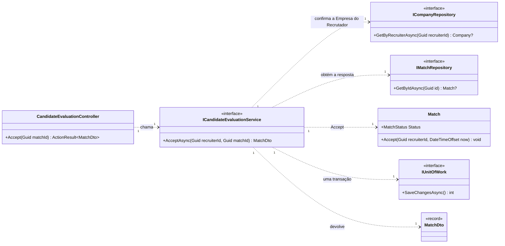

O serviço confirma que a vaga do `Match` pertence à Empresa do Recrutador e que a Empresa está aprovada, e chama `Match.Accept`, que exige `Status = Waiting` e o perfil aberto. A operação passa o estado a `Matched`, regista `DecidedById` e `RecruiterActionAt` e abre a conversa, e o serviço grava tudo numa única transação. Se outro processo tiver alterado o `Match` entretanto (por exemplo, um segundo pedido de decisão sobre o mesmo Candidato), a gravação falha pelo controlo de concorrência (`xmin`) e o pedido é rejeitado (RF063, RF066, RF068, RF117). O Candidato e o Recrutador consultam o novo match nas respetivas listas de matches, sem aviso ativo (DA v04, F008).

---

## 9. Correspondência com o modelo de dados

| Classe de domínio | Tabela | Notas de mapeamento |
| --- | --- | --- |
| `AppUser` | `app_user` | Índice único sobre `lower(email)`. Única entidade com `CreatedAt` e `UpdatedAt` (DM-22). |
| `Admin`, `Recruiter`, `Candidate` | `admin`, `recruiter`, `candidate` | Chave primária partilhada com `app_user` (relação 1 : 0..1); `Admin` e `Recruiter` só têm `Id`. `Candidate.Version` ↔ `xmin`. |
| `Location` | `location` | Só leitura na aplicação. |
| `CandidateLink` | `candidate_link` | `Position` de 1 a 3. |
| `Skill`, `Benefit` | `skill`, `benefit` | Índices únicos sobre `lower(name)`. |
| `Candidate.Skills` (navegação) | `candidate_skill` | Associação N:M pura com `Skill`, chave composta, sem classe própria (DM-16). |
| `CandidateCustomSkill` | `candidate_custom_skill` | Índice único sobre (`candidate_id`, `lower(label)`) (DM-16). |
| `Company` | `company` | `RecruiterId` único; `PhotoPaths` ↔ `varchar(500)[]`; sem `status_changed_*` (DM-18). |
| `Job` | `job`, `job_skill`, `job_benefit` | `Skills` e `Benefits` são navegações N:M sobre `job_skill` e `job_benefit`; `PhotoPaths` ↔ array; filtro global `DeletedAt IS NULL`; sem `closed_at` nem `close_reason` (DM-23). |
| `Match` | `match` | Um único `Status` (`match_status`, DM-21); `Version` ↔ `xmin`; atributos da conversa na própria tabela. |
| `Message` | `message` | Sem operações de edição nem eliminação (DA, F010). |
| `OperationLog` | `operation_log` | Só inserções; chave `long` com identidade; sem `entity_type` (DM-19). |
| Enumerações (secção 3.5) | Tipos enumerados (modelo de dados, secção 5.1) | Mesmos valores e pela mesma ordem, em PascalCase no C# e em maiúsculas no PostgreSQL. |

As 17 tabelas do modelo de dados v02 têm correspondência nas 14 classes de domínio; `candidate_skill`, `job_skill` e `job_benefit` não têm classe própria, por serem associações sem atributos. A tabela `notification` deixou de existir com a F011, e a classe `CandidateSkill` da v01 deu lugar à navegação `Candidate.Skills` e à classe `CandidateCustomSkill`.

---

## 10. Decisões de desenho

| ID | Decisão | Fundamentação |
| --- | --- | --- |
| DC-01 | Quatro camadas (Controllers, Services, Repositories, Domain), com DTOs, tarefas periódicas e infraestrutura à parte. | Arquitetura, secção 2.6; âmbito de cobertura do RI, secção 11.5. |
| DC-02 | Um repositório por agregado, com interface, e o `KatchDbContext` como unidade de trabalho. | Os Services ficam testáveis com repositórios simulados; os testes de integração usam o `KatchDbContext` com SQLite in-memory (RI, secção 11.2). |
| DC-03 | Regras de estado nas entidades e regras entre várias linhas nos Services. | Mesma divisão do modelo de dados (secções 7.1 e 7.2); as entidades rejeitam transições inválidas antes de chegar à base de dados. |
| DC-04 | `IClock` em vez de `DateTimeOffset.UtcNow` direto. | Permite verificar com relógio simulado o período de bloqueio de 24 horas e a expiração da credencial de sessão (RF020, RF021, RNF005). |
| DC-05 | Os identificadores do utilizador vêm sempre da credencial de sessão. | Impede que um pedido direto atue em nome de outro utilizador (RNF004, RNF006). |
| DC-06 | Um serviço e um controller por caso de uso ou grupo de casos de uso do mesmo ator. | Cada classe tem uma responsabilidade identificável e rastreável aos casos de uso (secção 5.3). |
| DC-07 | Mensagens novas obtidas por consulta periódica da API REST (`ConversationsController.List` e `Open` com `after`); sem hubs, sem ligação persistente e sem notificações. *(Revista na v02; na v01, ligação bidirecional persistente com `MessagesHub`, `NotificationsHub` e `IRealtimePublisher`.)* | DA v04 (F010: consulta periódica a cada 3 a 5 segundos, fixada em 3 segundos, com o P17 de 5 segundos como tempo máximo até a mensagem aparecer, na deliberação 1 da ata de 2026-10-16; secção 3: sem comunicação em tempo real nem mecanismo de notificações), homologada pelo docente. O servidor fica sem estado de ligação e todas as conversas usam os mesmos pedidos e a mesma autorização. |
| DC-08 | DTOs como `record` sem lógica. | Excluídos da cobertura pelo RI (secção 11.5) e nunca expõem dados internos. |
| DC-09 | Competências da lista como navegação N:M (`Candidate.Skills`) e competências «Outro» em `CandidateCustomSkill`. | Modelo de dados v02, DM-16, e observação do docente: a relação com `Skill` passa a N:M pura, sem chave estrangeira anulável, igual a `Job.Skills`. |
| DC-10 | Ficheiros servidos pelo `FilesController` a partir do caminho guardado (`<tipo>/<nome>`), sem tabela de ficheiros. | Opção (a) da PA-01, a mesma do modelo de dados v02 (sem tabela de ficheiros), e arquitetura, AD-01 (ficheiros no sistema de ficheiros do servidor). Opção escolhida e AD-01 ratificada na deliberação 3 da ata `m3-20261016-reuniao-extraordinaria-ata-v01.pdf`. |
| DC-11 | `Match` com um único `MatchStatus` de quatro valores. | Modelo de dados v02, DM-21: só há quatro combinações válidas, e um valor único torna as restantes impossíveis. As operações `Accept` e `Reject` só atuam a partir de `Waiting` (RF117). |
| DC-12 | Filtros do RF014, incluindo a distância, aplicados na consulta antes de limitar o resultado; vagas expiradas excluídas pela data. | N1 e N2: com o filtro de distância depois do `take`, o Candidato podia ficar sem cartões havendo vagas elegíveis; sem verificar `ExpiresAt`, uma vaga expirada era apresentada até a tarefa periódica correr (modelo de dados, DM-17). |
| DC-13 | Sem datas de criação e alteração nem autor de mudança de estado nas entidades, exceto `AppUser.CreatedAt` e `UpdatedAt`. | Modelo de dados v02, DM-18, DM-22 a DM-24: nenhum requisito as usa, e o autor e a data das operações do RF112 ficam no `OperationLog`. |
| DC-14 | `ReferenceListsController.ListLocations` sem credencial (`[AllowAnonymous]`); as consultas de competências e de benefícios continuam a exigir sessão. | Especificação de requisitos v02, secção 2.2 (consulta da lista pré-definida de localidades como operação não reservada), aprovada na deliberação 2 da ata de 2026-10-16: o registo do Candidato (RF003) exige escolher a localidade antes de existir sessão. A resposta só contém identificador e designação, sem dados pessoais (RNF006). |

---

## 11. Limitações

| Limitação | Consequência |
| --- | --- |
| O modelo segue o modelo de dados v02 (`I102`), ainda em revisão, e é a versão seguida pelas tarefas de implementação `I042`, `I043`, `I044` e `I046` (ata de 2026-10-16, deliberação 5). | Uma alteração ao modelo de dados obriga a rever as classes afetadas e a acrescentar uma linha ao histórico. |
| A especificação de requisitos, a arquitetura e a documentação da API v02 são produzidas por outras Issues (`I100`, `I101` e `I104`) e integradas na main pela ordem I100, I101, I102, I103, I104 (ata de 2026-10-16, deliberação 4). | Até lá, a main ainda tem as v01, com a F011, a ligação persistente e o P17 anteriores à redução de âmbito. As referências RF031 a RF036, RF076 a RF082, RF110 e RF111 deixam de ter correspondência neste modelo, e as rotas novas (`/api/files`, `GetRegistration`, `GetPage`, `GetCv`, competências «Outro», `after`) entram na documentação da API v02 (`I104`). |
| As melhorias de contrato da API PA-05 (código de erro), PA-07 a PA-09 (atributos de `WaitingCandidateDto`, `MatchDto` e `CandidateFullProfileDto`) e as do modelo mobile PC-03, PC-04 e PC-07 não fazem parte desta Issue. | São tratadas na revisão do contrato da API (DTOs e erros); este modelo mantém esses DTOs como na v01. |
| A transição T7 (encerramento de interesses em espera sem decisão), proposta em `m2-decisao-encerramento-interesses-em-espera-v01.md`, não está ratificada e contraria o RF113 em vigor. | Não está representada; o `MatchStatus` não tem valor para esse encerramento. Se for ratificada e os requisitos forem alterados, uma nova versão acrescenta o valor, a operação em `Match` e as consultas em `IMatchRepository`. |
| As assinaturas mostram os tipos de retorno sem `Task`, e as dependências de `IUnitOfWork` e `IClock` não estão todas desenhadas. | Simplificação de leitura; a implementação em `m3` segue a convenção assíncrona da secção 2.2. |
| Depois do fim de sessão, a credencial descartada pelo cliente continua tecnicamente válida até expirar (8 horas, RNF005). | Risco aceite no ambiente académico; uma lista de credenciais revogadas pode ser acrescentada mais tarde sem alterar os Services. |
| A consulta periódica gera um pedido a cada 3 segundos por cliente com uma conversa ou a lista de conversas aberta. | Adequado aos dados de demonstração (P18); o parâmetro `after` limita a resposta às mensagens novas. |
| As rotas são indicativas. | As rotas, os códigos de estado e os exemplos são fixados na documentação da API (`04.11`). |

---

## 12. Rastreabilidade

| Casos de uso | Controllers | Services | Entidades |
| --- | --- | --- | --- |
| UC01, UC02 (início e fim de sessão e palavra-passe) | `AuthController` | `AuthService` | `AppUser` |
| UC03 (registo do Candidato) | `AuthController`, `ReferenceListsController` (consulta das localidades sem sessão) | `AuthService`, `ReferenceListService` | `AppUser`, `Candidate`, `Location` |
| UC04 (perfil profissional) | `CandidateProfileController`, `FilesController` | `CandidateProfileService`, `FileAccessService` | `Candidate`, `CandidateLink`, `CandidateCustomSkill`, `Skill` |
| UC05, UC06 (exploração de vagas e página da Empresa) | `JobExplorationController`, `CandidateProfileController`, `FilesController` | `JobExplorationService`, `QuotaService`, `CandidateProfileService`, `FileAccessService` | `Job`, `Company`, `Match`, `Candidate`, `Location` |
| UC07, UC08 (registo e página da Empresa) | `AuthController`, `CompanyController`, `FilesController` | `AuthService`, `CompanyService`, `FileAccessService` | `Recruiter`, `Company`, `OperationLog` |
| UC09, UC10 (vagas) | `JobsController` | `JobService` | `Job`, `Skill`, `Benefit`, `Match`, `OperationLog` |
| UC11, UC12 (perfil do Candidato e decisão) | `CandidateEvaluationController`, `FilesController` | `CandidateEvaluationService`, `FileAccessService` | `Match`, `Candidate` |
| UC13 (matches) | `MatchesController` | `MatchService` | `Match`, `Company`, `Candidate` |
| UC14 (conversas) | `ConversationsController` | `ConversationService` | `Match`, `Message` |
| UC15 (notificações) | — | — | Retirado com a F011 (PS e DA v04). A revisão da numeração dos casos de uso é feita na especificação de casos de uso v02. |
| UC16, UC17 (aprovação e supervisão de Empresas e vagas) | `AdminCompaniesController` | `CompanyAdminService` | `Company`, `Job`, `Match`, `OperationLog` |
| UC18 (contas) | `AdminAccountsController` | `AccountAdminService` | `AppUser`, `Match`, `OperationLog` |
| UC19 (indicadores) | `AdminIndicatorsController` | `IndicatorService` | `AppUser`, `Company`, `Job`, `Match`, `Message`, `OperationLog` |
| UC20 (listas pré-definidas) | `ReferenceListsController` | `ReferenceListService` | `Skill`, `Benefit`, `Location`, `OperationLog` |
