# Modelo de Classes — Frontend Mobile

**Unidade curricular:** Laboratório de Desenvolvimento de Software — LDS
**Milestone:** `m3`
**Ficheiro:** `m3-modelo-classes-frontend-mobile-v02.md`
**Pasta de arquivo:** `04-artefactos-tecnicos/04.07-modelos-de-classes`

---

## 1. Identificação do documento

| Campo | Informação |
| --- | --- |
| Grupo | G11 |
| Sistema | Katch |
| Ano letivo | 2026/2027 |
| Curso | LEI — Licenciatura em Engenharia Informática |
| Turma | LEI3T2 |
| Versão do documento | v02 |
| Módulo | Frontend mobile (`katch-frontend-mobile`), aplicação Flutter 3.47.x em Dart 3.13.x, exclusiva do Candidato |
| Issue | `I111` — Atualizar à Declaração de Âmbito v04 os modelos de classes dos frontends e os diagramas de comportamento (v02); versão anterior: `I091` — Elaborar o modelo de classes do frontend mobile |
| Executor / Revisor / Auditor | v01 (`I091`): João Coelho / Roberto Baptista / João Borguem; v02 (`I111`): João Borguem / Roberto Baptista / João Coelho |
| Documentos de origem | `m3-proposta-sistema-v04.pdf` e `m3-declaracao-ambito-v04.pdf` (F010, F006, F008 e limites transversais), homologados em 14-10-2026 (`m3-email-homologacao-ps-da-cca-v02.pdf`); `m3-prototipo-baixa-fidelidade-v02.pdf` (secção A, ecrãs M01 a M18, M20 e M21; sem o M19); `m3-modelo-classes-backend-v02.md` (controllers e DTOs, secção 6.1 e DC-07, `I103`); `m3-documentacao-arquitetura-v02.md` (secções 2 e 3, decisão AD-02); `m3-especificacao-requisitos-v02.md` (RF001 a RF030, RF068, RF070, RF075, RF105, RF108 e RNF002, RNF005, RNF010, RNF011, RNF014; parâmetros P01 a P11 e P17; secção 1.3, requisitos descontinuados); `m3-especificacoes-casos-uso-v02.md` (UC01 a UC06, UC13 e UC14); `m3-documentacao-api-v02.md` (secções 2 a 8, 10 e 11, `I101` e `I104`); `m3-modelo-de-dados-katch-v02.md`; `m3-diagrama-atividades-fluxo-match-v02.md`; `m3-diagrama-estados-interesse-match-v02.md`; `m3-20261016-reuniao-extraordinaria-ata-v01.pdf` (deliberação 1: consulta periódica de 3 em 3 segundos); `m1-regulamento-grupo-v01.pdf` (secções 11.2 a 11.5); `m2-modelo-classes-frontend-mobile-v01.md` (versão anterior, conservada) |

O documento segue a secção 19 do Regulamento de Funcionamento da Unidade Curricular para `04.07-modelos-de-classes`: um ficheiro por módulo relevante, com classes, responsabilidades, atributos, operações, relações e multiplicidades. Corresponde à linha `OF-M3-026` — «Modelo de classes — frontend mobile v2» da Checklist de Controlo de Artefactos (v04); a v01 corresponde à linha `OF-M2-009`. É o módulo da aplicação Flutter do Candidato; o backend está em `m3-modelo-classes-backend-v02.md` e a área de gestão web tem o seu próprio módulo (`m3-modelo-classes-frontend-web-v02.md`).

### 1.1. Histórico de versões

| Versão | Data | Descrição das alterações | Issue |
| --- | --- | --- | --- |
| v01 | 2026-10-08 | Criação do documento: camadas, modelos que espelham os DTOs, núcleo, serviços de acesso à API, sessão, cliente da ligação persistente, gestão de estado, ecrãs e widgets, com responsabilidades, atributos, operações, relações e multiplicidades. | `I091` |
| v01 | 2026-10-09 | Correções da revisão da `I091` e alinhamento com a documentação da API (`I092`): motivo do início de sessão igual à `message` do `ApiErrorDto` (D01); classificação dos erros pelo código HTTP (D02); cabeçalho `X-Client-App`, enumerações em maiúsculas com `_`, rotas e parâmetro `access_token` da API (D03); pontos de coerência ligados aos pontos em aberto da API e acrescentados PC-09 a PC-12 (M01); recarga da lista de conversas ao receber `ConversationClosed` (M02); correspondência das operações com as do controller (M03). | `I091` |
| v02 | 2026-10-29 | Atualização à Declaração de Âmbito v04 (redução de âmbito, `I100`): retirados a área e o contador de notificações (ecrã M19, separador «Notificações», `NotificationsScreen`, `NotificationsStore`, `NotificationService`, `NotificationTile`, `NotificationDto`, `NotificationListDto`, `NotificationType`, `NotificationTarget` e `NotificationTargetKind`) e a ligação persistente (camada Tempo real, `RealtimeClient`, `SignalRRealtimeClient`, `HubChannel`, `ReconnectPolicy`, `RealtimeCoordinator`, `RealtimeState` e `NotificationReceivedEvent`); acrescentada a atualização periódica das conversas do Candidato por consulta à API de 3 em 3 segundos, só com a aplicação em primeiro plano e com a lista de conversas ou uma conversa aberta (camada Consulta periódica, `PollingScheduler`, `TimerPollingScheduler`, `PollingLoop`, `PollingConfig` e `AppLifecycleMonitor`; secção 7; decisões DFM-05, DFM-11, DFM-15 e DFM-16). Alinhamento com a documentação da API v02: competências «Outro» em operações próprias (`CustomSkillDto`, `AddCustomSkillRequest`, `addCustomSkill`, `removeCustomSkill`; `AddSkillRequest` só com `skillId`; `ProfileSkillDto` retirado), `QuotaDto.total`, `MatchDto.jobStatus`, `locationName` e `logoUrl` (com a enumeração `JobStatus`), `ConversationSummaryDto.closedBy`, `ApiErrorDto.code` e `blockedUntil`, parâmetro `after` na consulta das mensagens, lista de localidades sem sessão e ficheiros em `/api/files/{kind}/{fileName}`; pontos de coerência PC-01, PC-02, PC-05, PC-07, PC-10, PC-11 e PC-12 resolvidos ou sem aplicação, PC-03 e PC-04 resolvidos em parte. Protótipo v02 (20 ecrãs, 4 separadores) e rastreabilidade aos 35 requisitos funcionais da especificação v02 com componente Frontend mobile. Lista das alterações na secção 16. | `I111` |

Cada alteração posterior acrescenta uma linha. As versões anteriores são conservadas, nos termos da secção 18.2 do Regulamento de Funcionamento da Unidade Curricular.

---

## 2. Âmbito e convenções

### 2.1. Módulo e camadas

O módulo é a aplicação móvel do Katch, o ponto de acesso exclusivo do Candidato (arquitetura v02, secção 2.3). Comunica com o backend só por HTTPS e JSON, com a credencial de sessão (JWT) em cada pedido. Não há ligação persistente nem notificações (DA v04, F010 e limites transversais): as mensagens novas, o número de mensagens por ler e o estado das conversas chegam pela consulta periódica à API, de 3 em 3 segundos, enquanto a lista de conversas ou uma conversa está aberta com a aplicação em primeiro plano (arquitetura v02, secção 2.4 e AD-02; backend v02, secção 6.1; API v02, secção 7). O Candidato conhece as restantes mudanças — quota de interesses reposta, novos matches — consultando a área correspondente. Nunca acede à base de dados nem aos ficheiros do servidor. Cobre as funcionalidades F001, F002, F004, F006, F008 e F010 (arquitetura v02, secção 2.3), a página da Empresa da F003 (RF017, PC-08) e os 20 ecrãs do protótipo v02 (secção A).

A arquitetura não fixa a estrutura interna da aplicação Flutter. As classes seguem as camadas da tabela seguinte, que separam o que muda por razões diferentes: a apresentação, o estado, o acesso à API e a sessão. A regra de dependência é única: cada camada só usa as camadas indicadas na coluna «Depende de».

| Camada | Pasta em `lib/` | Responsabilidade | Depende de |
| --- | --- | --- | --- |
| Ecrãs e widgets | `app/`, `screens/`, `widgets/` | Apresentar os 20 ecrãs do protótipo v02, captar a interação e mostrar o estado dos controllers e dos stores. Não chamam serviços nem o `ApiClient`. | Estado, Modelos |
| Estado | `state/` | Estado de apresentação de cada ecrã e estado partilhado entre ecrãs: carregamento, erros por campo, filtros, contadores. Valida o que o utilizador escreve, orquestra os serviços e decide quando a consulta periódica corre. | Serviços, Sessão, Consulta periódica, Núcleo, Modelos |
| Serviços | `services/` | Um serviço por controller do backend usado pelo Candidato. Traduz cada operação num pedido e devolve modelos. Não tem estado de apresentação. | Núcleo, Modelos |
| Consulta periódica | `polling/` | Repetição de um pedido a intervalo fixo (3 segundos), sem sobreposição de pedidos, só com a aplicação em primeiro plano. Não conhece a API: repete a tarefa que o estado lhe entrega. | Núcleo |
| Sessão | `session/` | Guardar, restaurar e terminar a credencial de sessão; fornecer a credencial ao `ApiClient` e ao `RemoteImage`. | Núcleo, Modelos |
| Núcleo | `core/` | `ApiClient` (pedidos HTTPS, tempo limite, erros), relógio, estado da ligação, regras de validação local e acesso a recursos do dispositivo (ficheiros e aplicações externas). | Modelos |
| Modelos | `models/` | Espelho dos DTOs do backend, enumerações e valores auxiliares. Imutáveis e sem lógica de negócio. | — |

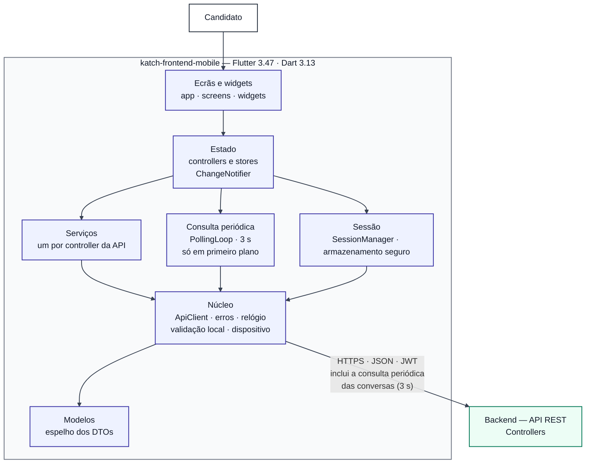

Todas as camadas usam os Modelos; a seta só está desenhada a partir do Núcleo para não sobrecarregar o diagrama. O `ApiClient` obtém a credencial através da interface `CredentialProvider`, que fica no Núcleo e é implementada pelo `SessionManager`; assim o Núcleo não depende da Sessão e não há dependências circulares entre pastas.

### 2.2. Convenções de código e de diagrama

- **Nomes:** Effective Dart (RI, secção 11.3): tipos em `UpperCamelCase`; membros, parâmetros e constantes em `lowerCamelCase`; ficheiros e pastas em `lowercase_with_underscores` (por exemplo, `JobCardDto` em `job_card_dto.dart`); membros privados com o prefixo `_`. As interfaces não têm o prefixo `I` do C#: são `abstract interface class` e a implementação tem um prefixo que a identifica (`HttpAuthService` implementa `AuthService`). A formatação é verificada com `dart format` e a análise estática com `flutter_lints` (RI, secções 11.3 e 11.4).
- **Sufixos:** `...Screen` (ecrã), `...Controller` (estado de um ecrã), `...Store` (estado partilhado entre ecrãs), `...Service` (acesso a um controller da API), `...Dto`, `...Request` e `...Response` (modelos que espelham os DTOs do backend, com o mesmo nome).
- **Tipos:** o mapeamento dos tipos do backend (modelo de classes do backend, secção 2.2) é o da tabela seguinte. `Json` é o `typedef` de `Map<String, Object?>` usado nas operações `fromJson` e `toJson`.

| Backend (C#) | Frontend (Dart) | Notas |
| --- | --- | --- |
| `Guid` | `String` | Texto do UUID, tal como segue no JSON. |
| `DateTimeOffset` | `DateTime` | ISO 8601 em UTC com o sufixo `Z` (API, secção 2.3); convertido para a hora local só na apresentação. |
| `decimal` | `double` | Número JSON com até 2 casas decimais; salários em euros brutos mensais. |
| `int`, `bool`, `string` | `int`, `bool`, `String` | — |
| `T?` | `T?` | A coluna ou o campo admite ausência. |
| `List<T>` | `List<T>` | Imutável depois de criada. |
| Enumerações | `enum` | Valores em `lowerCamelCase` (`WorkMode.onSite`); `fromWire` e `toWire` de cada enumeração convertem de e para o texto em maiúsculas com `_` da API (secções 2.3 e 2.4, DAPI-01): `WorkMode.onSite` ↔ `"ON_SITE"`, `Availability.fifteenDays` ↔ `"FIFTEEN_DAYS"`. Os nomes das propriedades JSON são os dos atributos em `camelCase`. |

- **Diagramas Mermaid (`classDiagram`):** `+` público, `-` privado (em Dart, `_`); `$` = membro estático; `~T~` = tipo genérico; `Future~T~` = operação assíncrona; `<<interface>>`, `<<abstract>>`, `<<enumeration>>`, `<<model>>` (modelo imutável que espelha um DTO), `<<widget>>` e `<<mixin>>` identificam o estereótipo. As operações `fromJson` e `toJson` dos modelos, os construtores e o método `build` dos widgets não são desenhados, exceto onde são relevantes; a convenção está nesta secção.
- **Relações:** `..>` dependência (recebida por construtor); `..|>` realização de interface; `<|--` herança; `-->` associação; `*--` composição (o filho não existe sem o pai); `o--` agregação (o estado de um controller ou store contém modelos). As multiplicidades estão nas extremidades.

### 2.3. Estrutura de pastas do repositório `katch-frontend-mobile`

O modelo orienta a estrutura do código de `m4`. Cada pasta de `lib/` corresponde a uma camada da secção 2.1 e cada classe deste documento tem o seu ficheiro, nomeado segundo a convenção de nomes.

```text
katch-frontend-mobile/
├── lib/
│   ├── main.dart            # arranque: cria AppDependencies, restaura a sessão e executa KatchApp
│   ├── app/                 # KatchApp, AppScope, AppDependencies, AppRoutes, AuthGate, HomeShell
│   ├── core/                # api_client, http_api_client, api_exception, credential_provider, clock,
│   │                        # connection_monitor, input_rules, device/ (file_picker, external_launcher)
│   ├── models/              # um ficheiro por DTO, enumerações e modelos auxiliares
│   ├── services/            # uma interface e uma implementação Http por serviço
│   ├── session/             # session, session_manager, session_storage
│   ├── polling/             # polling_scheduler, timer_polling_scheduler, polling_loop, polling_config,
│   │                        # app_lifecycle_monitor
│   ├── state/               # stores/ (estado partilhado) e controllers/ (estado de cada ecrã)
│   ├── screens/             # auth/, profile/, exploration/, matches/, conversations/, account/
│   └── widgets/             # widgets reutilizados por mais de um ecrã
├── test/                    # flutter_test: models, services, state e widgets
├── integration_test/        # integration_test: testes de sistema (QG-07)
├── analysis_options.yaml    # flutter_lints
└── pubspec.yaml             # dependências e versões fixadas na configuração base do repositório
```

Os pacotes de terceiros necessários (cliente HTTP, armazenamento seguro, seletor de ficheiros e abertura de aplicações externas) não são fixados pelo Regulamento Interno; as versões ficam fixadas no `pubspec.yaml` e no `pubspec.lock` na configuração base do repositório, como a arquitetura prevê (secção 3.4). Cada um fica atrás de uma interface do Núcleo ou da Sessão, pelo que a escolha do pacote só altera uma classe (secção 12, DFM-03). A consulta periódica não precisa de pacote: usa o `Timer` do Dart e o `WidgetsBindingObserver` do Flutter.

---

## 3. Modelos

Os modelos espelham os DTOs do contrato da API (documentação da API v02, secção 8) com o mesmo nome e os mesmos atributos, para que a rastreabilidade seja direta. São classes imutáveis (`final class`, atributos `final`, construtor `const`), escritas à mão, sem geração de código e sem lógica de negócio. Cada resposta tem a fábrica estática `fromJson(Json json)` e cada pedido tem `toJson()`; `SearchPreferencesDto` tem as duas porque é pedido e resposta. Dos 40 DTOs da API v02, o Candidato usa 22; os restantes 18 pertencem ao Recrutador e ao Administrador e não têm modelo na aplicação (secção 11.3). Os campos acrescentados pela `I104` (`QuotaDto.total`, `MatchDto.jobStatus`, `locationName` e `logoUrl`, `ConversationSummaryDto.closedBy`, `ApiErrorDto.code` e `blockedUntil`) fazem parte do contrato v02, que a aplicação segue; o modelo de classes do backend v02 só os acompanha numa versão posterior (documentação da API v02, L-08).

### 3.1. Autenticação e perfil

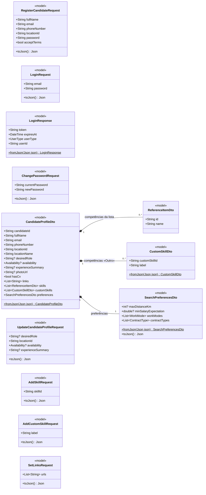

`LoginResponse` é a resposta de `login` e de `register`. `CandidateProfileDto` nunca contém o caminho dos ficheiros: `photoUrl` é um URL da API (`/api/files/{kind}/{fileName}`) que serve a imagem depois de verificar a autorização e `hasCv` só indica se existe curriculum vitae (documentação da API v02, 2.6). As competências da lista (`skills`, com o `id` da competência) e as competências «Outro» (`customSkills`, com o `customSkillId`) chegam em listas separadas e são acrescentadas e retiradas por operações próprias (API v02, 6.2.4, 6.2.5, 6.2.10 e 6.2.11; modelo de dados v02, DM-16). `ReferenceItemDto` está descrito na secção 3.2. A API v02 permite ao Candidato obter o próprio CV (`GET /api/candidate/profile/cv`, 6.2.9), mas o protótipo v02 não tem nenhuma ação para o abrir; a aplicação só envia o CV (RF011) e mostra `hasCv` (PC-11).

### 3.2. Exploração, matches, conversas, listas e erros

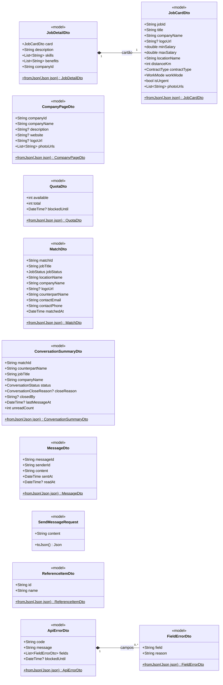

`MessageDto` é a resposta da abertura da conversa e da consulta periódica (`open`, com ou sem `after`) e do envio (secção 7). `MatchDto.contactEmail` e `contactPhone` são os contactos da Empresa (RF025); `jobStatus` e `locationName` são o estado e a localidade da vaga, e `logoUrl` o logótipo da Empresa (M14, M15). `ConversationSummaryDto.closedBy` é o `userId` de quem encerrou a conversa (`null` com a conversa aberta e no encerramento automático), que a aplicação compara com o utilizador da sessão (M18). `QuotaDto.total` é o total da quota (10, P11). `ApiErrorDto` é o formato único dos erros que o servidor devolve; `code` identifica o erro no catálogo da API (`ERR-01` a `ERR-50`), `message` indica o motivo e, quando a rejeição é de validação, `fields` tem cada campo em causa (RF004); `blockedUntil` só vem no ERR-31 (quota esgotada) e dá o fim do bloqueio (RF020).

### 3.3. Enumerações

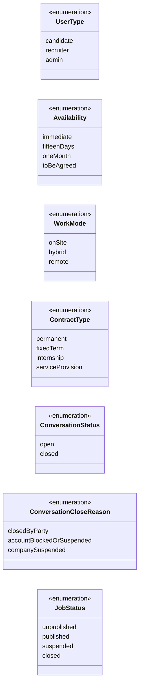

As sete enumerações têm os mesmos valores das do contrato da API (documentação da API v02, secção 2.4). `JobStatus` passou a ser usada pela aplicação com o campo `MatchDto.jobStatus` (M14, «Vaga encerrada»). A enumeração `NotificationType` da v01 foi retirada com a funcionalidade F011.

As enumerações de estado do cliente (`SessionStatus`, `LoadStatus`, `ExplorationStatus`, `RegistrationStep` e `ListFilter`) estão nas secções em que são usadas.

### 3.4. Modelos auxiliares do cliente

Os modelos auxiliares não existem no backend; resultam das necessidades da aplicação.

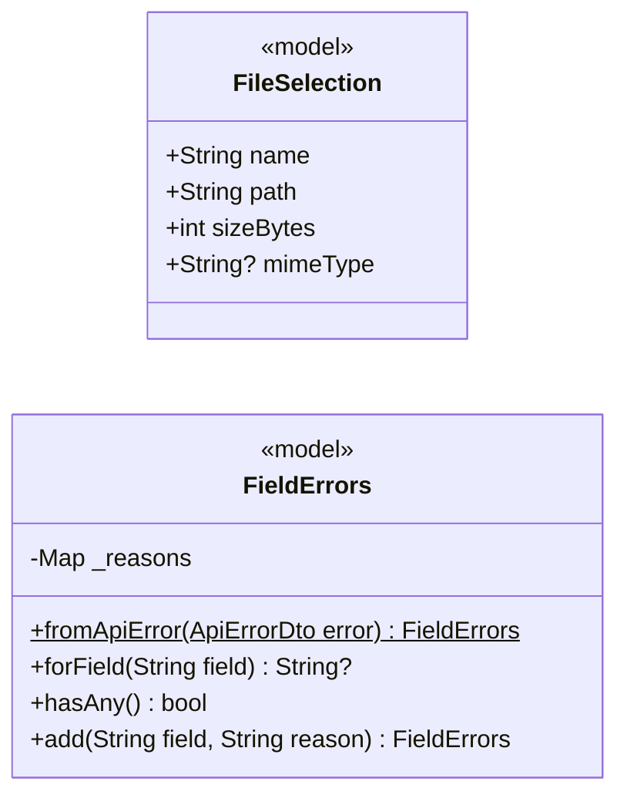

| Classe | Responsabilidade | Requisitos |
| --- | --- | --- |
| `FileSelection` | Ficheiro escolhido no dispositivo (fotografia ou curriculum vitae), com o nome, o caminho local, a dimensão e o tipo. É validado localmente (`InputRules`) antes de ser enviado. | RF010, RF011 |
| `FieldErrors` | Motivo de rejeição por campo de um formulário, obtido de `ApiErrorDto` ou da validação local. O atributo `_reasons` é um mapa do nome do campo para o motivo. Cada ecrã com formulário mostra o motivo junto do campo. | RF004, RF009 |

Os modelos auxiliares `NotificationTarget` e `NotificationTargetKind` da v01 foram retirados com a funcionalidade F011.

---

## 4. Núcleo

O Núcleo concentra o que todas as outras camadas partilham: o acesso HTTPS ao backend, os erros, o relógio, o estado da ligação, as regras de validação local e o acesso a recursos do dispositivo.

### 4.1. Pedidos à API e erros

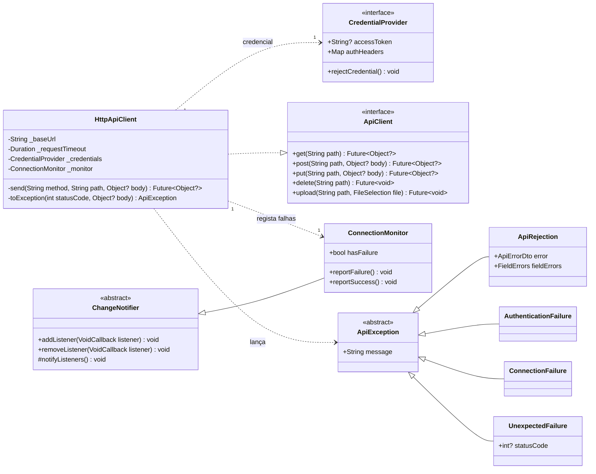

| Classe | Responsabilidade | Requisitos |
| --- | --- | --- |
| `ApiClient` | Interface única dos pedidos à API. As operações devolvem o JSON já descodificado (`Object?`) e os serviços convertem-no em modelos. É a fronteira que os testes substituem por uma implementação simulada. | Arquitetura, secção 2.6 |
| `HttpApiClient` | Envia cada pedido por HTTPS, em JSON, com a credencial de sessão no cabeçalho de autorização. O tempo limite de cada pedido é de 9 segundos, abaixo dos 10 segundos do RNF014. Quando não há resposta nesse tempo, regista a falha em `ConnectionMonitor` e lança `ConnectionFailure`. Todas as respostas de erro da API trazem um `ApiErrorDto` (API, secção 4.1), incluindo `401` e `403`, pelo que a exceção se escolhe pelo código HTTP e pelo tipo de operação, segundo as regras abaixo. | RNF004, RNF005, RNF009, RNF014 |
| `CredentialProvider` | Interface do Núcleo através da qual `HttpApiClient` e `RemoteImage` obtêm a credencial e comunicam que o servidor a recusou. É implementada por `SessionManager`. | RNF004 |
| `ConnectionMonitor` | Guarda se o último pedido falhou por falta de ligação e avisa `ConnectionBanner`. Volta a `false` no primeiro pedido que obtém resposta. Os pedidos da consulta periódica também contam, pelo que uma falha de ligação com a área de conversas aberta é indicada no limite do RNF014. | RNF014 |
| `ApiRejection` | O servidor rejeitou o pedido e indicou o motivo, por regra de negócio (quota esgotada, vaga indisponível, conversa só de consulta, palavra-passe atual errada) ou por validação (cada campo em causa, em `fieldErrors`). `error.code` identifica o erro e, no ERR-31, `error.blockedUntil` dá o fim do bloqueio da quota. | RF001, RF004, RF009, RF010 a RF012, RF020, RF026, RNF009 |
| `AuthenticationFailure` | A credencial foi recusada numa operação reservada: expirada ou inválida (`401`, ERR-01) ou conta bloqueada ou suspensa durante a sessão (`403`, ERR-03 ou ERR-04). Termina a sessão. No início de sessão, ERR-02 a ERR-05 chegam como `ApiRejection`, com a `message` do servidor. | RF086, RF089, RNF004, RNF005 |
| `ConnectionFailure` | O pedido não obteve resposta em 9 segundos ou a ligação não pôde ser estabelecida. Os formulários mantêm o que o Candidato escreveu e permitem voltar a submeter. | RNF014 |
| `UnexpectedFailure` | Resposta de erro que o modelo de erros não prevê. Mostra uma mensagem genérica e permite repetir a operação. | — |

Regras de classificação das respostas de erro, segundo a API v02 (secções 3.4, 4.1, 4.2 e 4.3). As operações não reservadas são as que a API admite sem credencial e que a aplicação usa: o registo do Candidato, o início de sessão e a consulta da lista de localidades (API v02, secção 3.3; especificação de requisitos v02, secção 2.2); todas as outras são reservadas. A exceção escolhe-se pelo código HTTP e pelo campo `code` do `ApiErrorDto`.

| Resposta | Operação | Exceção |
| --- | --- | --- |
| Sem resposta em 9 segundos ou sem ligação | Qualquer | `ConnectionFailure` (regista a falha em `ConnectionMonitor`) |
| `401` (ERR-01) | Reservada | `AuthenticationFailure` (chama `rejectCredential()`) |
| `403` com `code` ERR-03 (conta bloqueada) ou ERR-04 (conta suspensa) | Reservada | `AuthenticationFailure` (chama `rejectCredential()`) |
| `401` (ERR-02) e `403` (ERR-03, ERR-04, ERR-05) | Início de sessão | `ApiRejection`, com a `message` do `ApiErrorDto` |
| Restantes `4xx` (`400`, `403` de ERR-06 a ERR-08, `404`, `409`, `413`, `415`) | Qualquer | `ApiRejection` |
| `5xx` (ERR-50) | Qualquer | `UnexpectedFailure` |

O ERR-03 e o ERR-04 têm o mesmo código HTTP que o ERR-06, o ERR-07 e o ERR-08; distinguem-se pelo campo `code`, que a API v02 acrescentou ao `ApiErrorDto` (PA-05). A classificação deixou de depender do texto das mensagens (PC-12 resolvido).

### 4.2. Relógio, validação local e dispositivo

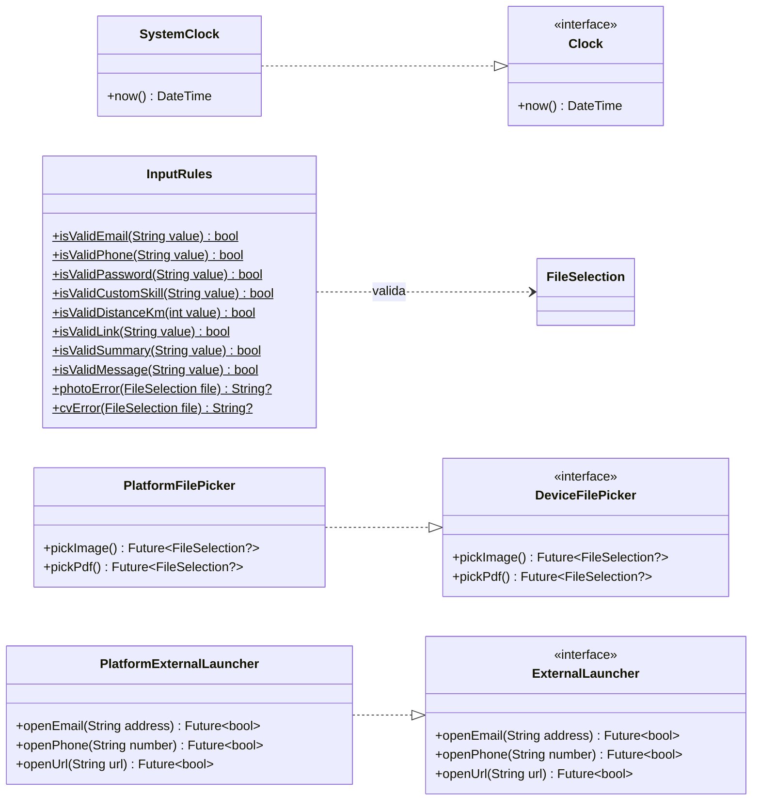

| Classe | Responsabilidade | Requisitos |
| --- | --- | --- |
| `Clock` e `SystemClock` | Data e hora atuais em UTC. Nos testes é substituído por um relógio simulado, para verificar o tempo em falta até ao fim do bloqueio da quota e a expiração da sessão. Mesma razão do `IClock` do backend (DC-04). | RF020, RNF005 |
| `InputRules` | Regras de validação local, só para dar ao Candidato o motivo antes de enviar o pedido. O servidor aplica as mesmas regras e é a autoridade (RNF008); o formato real dos ficheiros é verificado no servidor (RNF016). | RF003, RF004, RF007 a RF012, RF026; P01 a P08, P10 |
| `DeviceFilePicker` | Abre o seletor de ficheiros do dispositivo para a fotografia (JPEG ou PNG) e para o curriculum vitae (PDF). Devolve `null` quando o Candidato desiste. | RF010, RF011 |
| `ExternalLauncher` | Abre uma aplicação externa do dispositivo: o correio eletrónico e a chamada telefónica para os contactos do match e o navegador para o sítio da Empresa. A plataforma nunca envia correio eletrónico nem SMS por si própria (arquitetura, secção 2.5). | RF017, RF025 |

Valores aplicados por `InputRules` (especificação de requisitos, secção 3):

| Regra | Valor | Parâmetro | Usada em |
| --- | --- | --- | --- |
| `isValidEmail` | Formato local@domínio | P04 | `RegisterController` |
| `isValidPhone` | 9 algarismos | P04 | `RegisterController` |
| `isValidPassword` | Pelo menos 8 caracteres, uma letra e um algarismo | P05 | `RegisterController`, `ChangePasswordController` |
| `isValidCustomSkill` | 2 a 40 caracteres: letras, algarismos, espaços e os símbolos + # . - | P07 | `SkillsController` |
| `isValidDistanceKm` | Número inteiro de 1 a 500 | P06 | `PreferencesController` |
| `isValidLink` | Endereço iniciado por `http://` ou `https://` | P10 | `ProfileFilesController` |
| `isValidSummary` | No máximo 1000 caracteres | P08 | `ProfileFormController` |
| `isValidMessage` | 1 a 1000 caracteres | P03 | `ChatController` |
| `photoError` | JPEG ou PNG, no máximo 5 MB | P01 | `ProfileFilesController` |
| `cvError` | PDF, no máximo 5 MB | P02 | `ProfileFilesController` |

---

## 5. Serviços de acesso à API

Há um serviço por controller do backend usado pelo Candidato: seis serviços para seis controllers (secção 11.2). O `FilesController` não tem serviço: os seus URL chegam prontos nos DTOs e são obtidos pelo `RemoteImage` (secção 9.4). O `NotificationsController` deixou de existir com a funcionalidade F011 e, com ele, o `NotificationService` da v01. Cada serviço é uma interface (`abstract interface class`) e tem uma implementação `Http...` que recebe o `ApiClient` por construtor; os controllers de estado dependem da interface, pelo que os testes usam serviços simulados. Cada operação de um serviço corresponde a uma operação do controller (modelo de classes do backend v02, secção 6; documentação da API v02, secção 6), com os mesmos parâmetros e resultados, sem o identificador do utilizador, que o servidor obtém da credencial (backend, DC-05). O nome é o da operação do controller em `lowerCamelCase`, com três exceções por legibilidade: `Get` e `Update` do perfil passam a `getProfile` e `updateProfile`, e `RegisterCandidate` passa a `register`. A correspondência completa, com o método e a rota da API, está na secção 11.2.

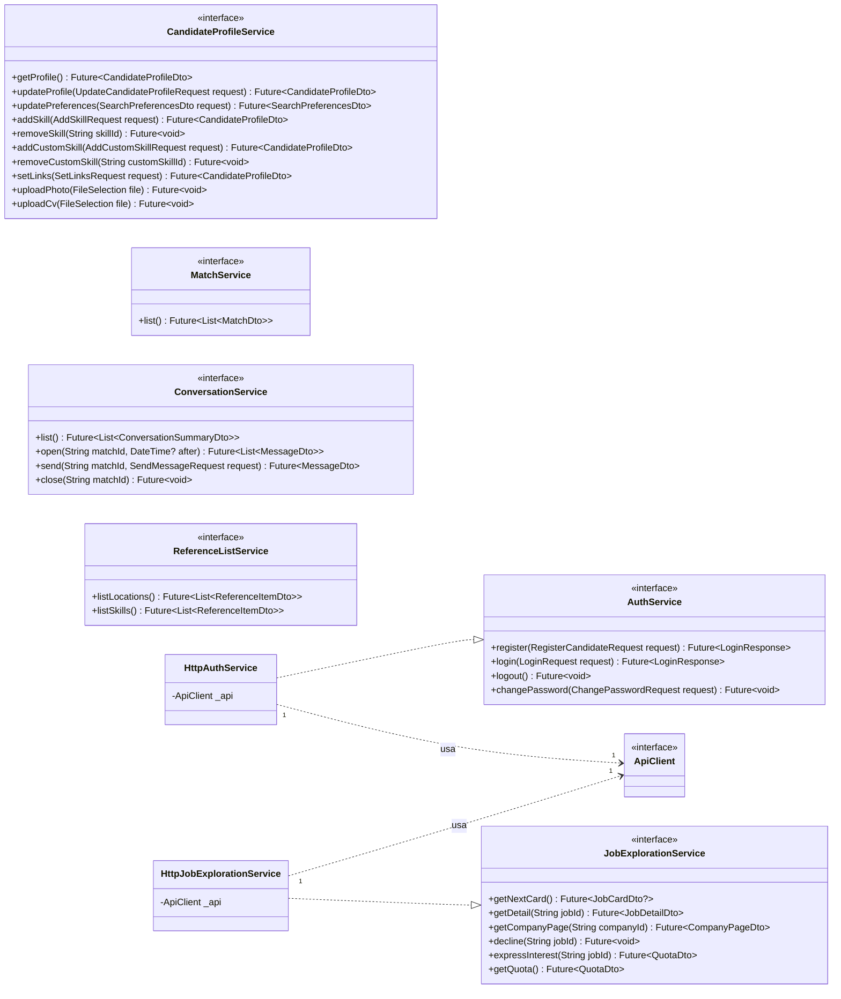

O diagrama mostra duas implementações, como exemplo da relação. As restantes quatro seguem o mesmo padrão: `HttpCandidateProfileService`, `HttpMatchService`, `HttpConversationService` e `HttpReferenceListService`.

| Serviço | Controller do backend | Rota base (API, secção 5) | Casos de uso | Requisitos |
| --- | --- | --- | --- | --- |
| `AuthService` | `AuthController` | `/api/auth` | UC01, UC02, UC03 | RF001 a RF005, RF105 |
| `CandidateProfileService` | `CandidateProfileController` | `/api/candidate/profile` | UC04, UC05 | RF006 a RF012, RF023 |
| `JobExplorationService` | `JobExplorationController` | `/api/candidate/jobs` | UC05, UC06 | RF013, RF014, RF016 a RF022 |
| `MatchService` | `MatchesController` | `/api/matches` | UC13 | RF024, RF025 |
| `ConversationService` | `ConversationsController` | `/api/conversations` | UC14 | RF026 a RF030, RF068, RF070, RF075, RF108 |
| `ReferenceListService` | `ReferenceListsController` | `/api/reference-lists` | UC03, UC04 | RF003, RF006, RF008 |

As rotas, os métodos, os códigos de estado, os formatos e os exemplos são os da documentação da API v02 (`m3-documentacao-api-v02.md`, secções 5 e 6), que é o contrato com o backend.

Regras dos serviços:

- `register`, `login` e `listLocations` não exigem credencial de sessão; as restantes operações exigem-na. `HttpAuthService.login` envia o cabeçalho `X-Client-App: mobile` (API v02, secção 3.2, DAPI-02); uma conta que não seja do Candidato recebe ERR-05. `ReferenceListService.listLocations` é usada antes do início de sessão (ecrã de registo, M02), o que a API v02 permite (6.13.1, DAPI-12; PC-01 resolvido).
- `getNextCard` devolve `null` quando nenhuma vaga cumpre as preferências de procura (RF014), a que a API responde com `204 No Content` (6.3.1); o ecrã mostra então M11.
- `expressInterest` devolve a quota atualizada. Uma tentativa com a quota esgotada, uma segunda manifestação na mesma vaga ou uma vaga já indisponível são rejeitadas pelo servidor (`ApiRejection`) sem alterar a quota (UC05, E1 a E3).
- `uploadPhoto` e `uploadCv` não devolvem endereço: os DTOs nunca expõem o caminho dos ficheiros. Depois de cada envio, o estado volta a pedir o perfil (`getProfile`) para obter o novo `photoUrl` e `hasCv`.
- `open(matchId, null)` devolve o histórico completo e `open(matchId, after)` só as mensagens enviadas depois de `after`, que é sempre o `sentAt` de uma mensagem recebida do servidor (API v02, 6.8.2, DAPI-14). Em ambos os casos o servidor marca como lidas as mensagens da outra parte (RF108). `list` devolve o número de mensagens por ler e o estado de cada conversa. São as duas operações que a consulta periódica repete (secção 7).
- `addSkill` e `removeSkill` tratam as competências da lista, pelo identificador da competência (`skillId`); `addCustomSkill` e `removeCustomSkill` tratam as competências «Outro», pelo `customSkillId` (API v02, 6.2.4, 6.2.5, 6.2.10 e 6.2.11).
- `uploadPhoto` e `uploadCv` enviam o ficheiro em `multipart/form-data`, no campo `file` (API, secção 2.6), e a API responde `204 No Content`.
- `changePassword` com a palavra-passe atual errada recebe `400` com o campo `currentPassword` (API, 6.1.5), e não `401`; a aplicação não o confunde com sessão expirada.

---

## 6. Sessão

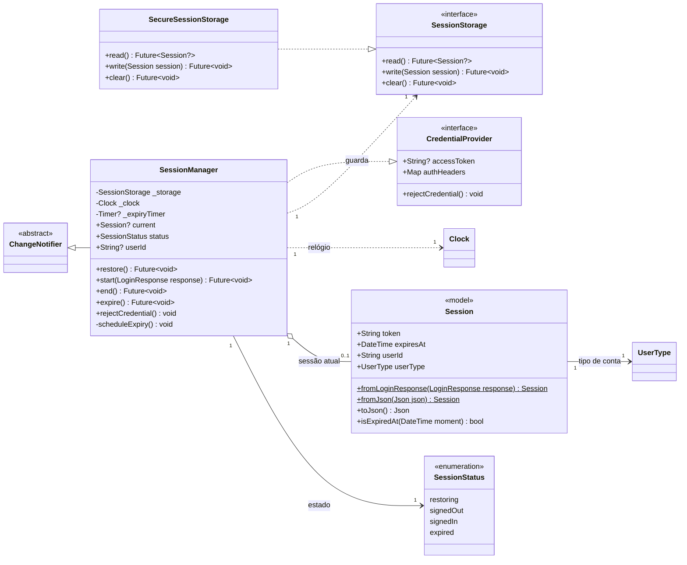

| Operação | Efeito | Requisitos |
| --- | --- | --- |
| `restore()` | Chamada no arranque, com o estado `restoring`. Lê a sessão do armazenamento seguro; se existir e ainda não tiver expirado, passa a `signedIn`; caso contrário, apaga-a e passa a `signedOut`. Permite que o ecrã «Conta» (M20) afirme que o dispositivo está ligado à conta. | RNF005, P20 |
| `start(response)` | Chamada depois do início de sessão ou do registo. Rejeita (`AuthenticationFailure`) uma resposta cujo `userType` não seja `candidate`, porque a aplicação móvel é exclusiva do Candidato. Guarda a sessão, passa a `signedIn` e agenda a expiração para `expiresAt` (8 horas depois do início de sessão). | RF001, RF005, RNF005, P20 |
| `end()` | Fim de sessão pedido pelo Candidato: apaga a sessão do armazenamento e passa a `signedOut`. O servidor não guarda estado de sessão; a credencial descartada fica válida até expirar (backend, secção 11). | RF105 |
| `expire()` e `rejectCredential()` | A sessão chegou a `expiresAt` ou o servidor recusou a credencial numa operação reservada (ERR-01, ERR-03 ou ERR-04). Apaga a sessão e passa a `expired`; `AuthGate` volta ao ecrã de início de sessão (M01). | RF086, RF089, RNF004, RNF005 |
| `accessToken` e `authHeaders` | Dão a credencial ao `HttpApiClient` e ao `RemoteImage` (cabeçalho de autorização). | RNF004, RNF006 |

Os stores observam `SessionManager`: quando o estado deixa de ser `signedIn`, os stores esvaziam os dados do Candidato e param a consulta periódica; os ecrãs com consulta periódica são fechados, porque `AuthGate` volta a M01.

---

## 7. Consulta periódica das conversas

A Declaração de Âmbito v04 substitui a ligação bidirecional persistente pela consulta periódica do cliente ao servidor (F010) e retira as notificações (limites transversais). Enquanto a lista de conversas (M16) ou uma conversa (M17, M18) está aberta, com a aplicação em primeiro plano e a sessão iniciada, a aplicação repete de 3 em 3 segundos os mesmos pedidos que usa para abrir essas áreas (documentação da API v02, secção 7; backend v02, secção 6.1 e DC-07; arquitetura v02, AD-02; especificação de requisitos v02, RF029 e P17; ata de 2026-10-16, deliberação 1). A DA v04 exclui «a atualização das conversas quando a aplicação não está aberta»: com a aplicação em segundo plano não há consultas.

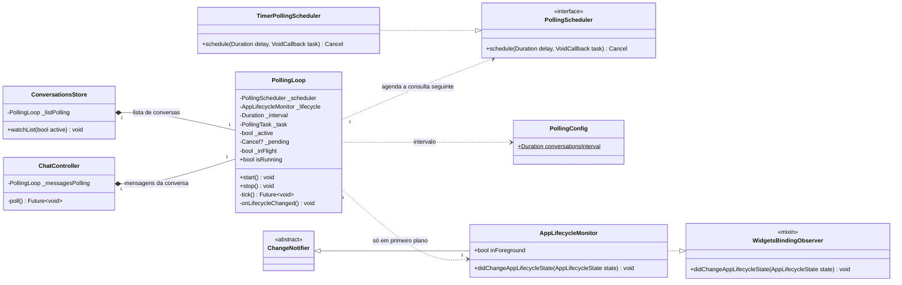

| Classe | Responsabilidade | Requisitos |
| --- | --- | --- |
| `PollingScheduler` e `TimerPollingScheduler` | Agendam uma tarefa para daqui a `delay` e devolvem a função que a cancela. A implementação usa o `Timer` do Dart. Nos testes (`flutter_test`) é substituída por um agendador simulado, para verificar o intervalo sem esperar (RI, secção 11.5). | P17 |
| `PollingConfig.conversationsInterval` | Intervalo da consulta periódica: 3 segundos (P17; deliberação 1 da ata de 2026-10-16), fixado num único sítio. | P17 |
| `AppLifecycleMonitor` | Observa o ciclo de vida da aplicação com o `WidgetsBindingObserver` do Flutter e indica se está em primeiro plano (`resumed`). Avisa os `PollingLoop` e os stores quando a aplicação muda de plano. | RF029 |
| `PollingLoop` | Repete uma tarefa assíncrona (`PollingTask`, `typedef` de `Future<void> Function()`) enquanto está ativo (`start`) e a aplicação está em primeiro plano: executa-a, espera pela resposta e só então agenda a execução seguinte para `_interval` depois (regra 2). Com a aplicação em segundo plano suspende-se; ao voltar ao primeiro plano executa a tarefa logo e retoma o ciclo. `stop()` cancela a execução agendada e descarta a resposta de um pedido ainda em curso. | RF029, P17 |
| `ConversationsStore` (consulta da lista) | Ativa o seu `PollingLoop` com `watchList(true)` quando `ConversationsScreen` (M16) é apresentado e desativa-o com `watchList(false)` quando deixa de o ser. A tarefa é `ConversationService.list()` (secção 8.1). | RF027, RF029, RF075 |
| `ChatController` (consulta das mensagens) | Ativa o seu `PollingLoop` quando `ChatScreen` (M17, M18) abre a conversa e para-o em `dispose`. A tarefa (`poll`) é `ConversationService.open(matchId, after)` com o `sentAt` da última mensagem recebida (secção 8.5). | RF028, RF029, RF108 |

Pedidos repetidos (documentação da API v02, 7.1):

| Ecrã aberto | Pedido repetido de 3 em 3 segundos | Efeito na aplicação | Requisitos |
| --- | --- | --- | --- |
| M16 — lista de conversas | `ConversationService.list()` → `GET /api/conversations` | Substitui a lista: atualiza `unreadCount` de cada conversa, a ordem por `lastMessageAt`, o estado (`status`, `closeReason`, `closedBy`) e o total `unreadMessages` do separador «Conversas». | RF027, RF029, RF075; P17 |
| M17, M18 — conversa | `ConversationService.open(matchId, after)` → `GET /api/conversations/{matchId}/messages?after=<sentAt da última mensagem recebida>` | Acrescenta ao histórico as mensagens novas, sem duplicados; o servidor marca-as como lidas (RF108). Para saber se a conversa passou a só de consulta, a mesma tarefa pede também a lista (`list()`) e lê o resumo da conversa (regra 5). | RF028, RF029, RF075, RF108; P17 |

Regras:

1. **Quando consulta.** Só com a sessão iniciada, a aplicação em primeiro plano e M16 ou M17/M18 apresentado. Com a aplicação em segundo plano, noutro separador ou com a sessão terminada não há consultas (DA v04, F010; P17). Não há notificações nativas do sistema operativo, nem envio por correio eletrónico ou SMS (DA v04, limites transversais).
2. **Sem sobreposição.** O pedido seguinte só é agendado depois da resposta (ou da falha) do anterior, 3 segundos depois. Uma mensagem enviada pelo Recrutador logo a seguir a uma consulta surge, no pior caso, na consulta seguinte, 3 segundos mais a duração do pedido depois, dentro dos 5 segundos do P17, com as operações do servidor dentro dos 2 segundos do RNF001 (documentação da API v02, 7.2).
3. **Primeira consulta e `after`.** Ao abrir a conversa, `ChatController` pede o histórico completo (`open` sem `after`) e guarda o `sentAt` da última mensagem. Daí em diante, cada consulta envia esse valor em `after`; uma resposta vazia não altera o histórico. O valor é sempre o recebido do servidor, nunca a hora do dispositivo, para que a diferença entre os relógios não faça perder mensagens.
4. **Mensagens próprias.** A mensagem enviada pelo Candidato chega pela resposta de `send` e é acrescentada logo ao histórico; se a consulta seguinte a devolver também, é ignorada, porque o histórico é juntado por `messageId` (DFM-11).
5. **Mudança de estado da conversa.** O encerramento pela Empresa, o bloqueio ou a suspensão de uma conta e a suspensão da Empresa chegam na consulta seguinte, pelo `status`, `closeReason` e `closedBy` do resumo da conversa em `list()` (documentação da API v02, 7.2). Por isso, com a conversa aberta, cada consulta pede as mensagens e a lista; a resposta da lista atualiza também o `ConversationsStore`. Um `409` (ERR-36 ou ERR-37) num envio antecipa essa leitura.
6. **Erros.** Um `401` (ERR-01) ou um `403` de conta bloqueada ou suspensa (ERR-03, ERR-04) chega como `AuthenticationFailure`: `SessionManager` termina a sessão, `AuthGate` volta a M01 e os ecrãs com consulta periódica são fechados. Uma falha de ligação (`ConnectionFailure`) é registada no `ConnectionMonitor`, que mostra o `ConnectionBanner`, e o ciclo continua: a consulta seguinte é feita 3 segundos depois.
7. **Contador do separador «Conversas».** Fora de M16 e de M17/M18 não há consulta periódica: `ConversationsStore` pede a lista uma vez no início de sessão, quando o Candidato escolhe os separadores «Matches» ou «Conversas» e quando a aplicação volta ao primeiro plano, e o contador mostra o valor dessa leitura (DFM-16).
8. **Sem notificações.** A informação que na v01 chegava por notificação é consultada na área correspondente: a quota de interesses reposta na área de exploração (M09, RF022), os novos matches na lista de matches (M14, RF024) e as mensagens novas na lista de conversas (M16, RF027) (DA v04, F006, F008 e limites transversais).

### 7.1. Sequência: receção de uma mensagem

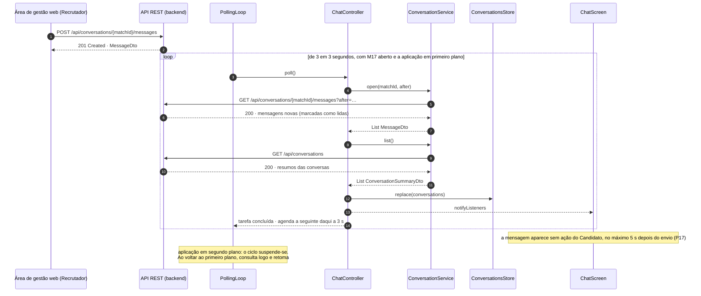

A aplicação não recebe nenhum aviso do servidor: é a consulta seguinte ao envio que traz a mensagem. `ChatController` junta as mensagens recebidas ao histórico por `messageId`, sem duplicados, e guarda o `sentAt` da última para a consulta seguinte (regra 3).

---

## 8. Estado

O estado da aplicação é gerido com o `ChangeNotifier` do próprio Flutter, sem pacote externo (secção 12, DFM-02). Há dois tipos de classes:

- **Stores** — estado partilhado entre ecrãs (perfil, conversas, listas pré-definidas). Existem uma vez por aplicação, são criados em `AppDependencies` e esvaziam-se quando a sessão termina.
- **Controllers** — estado de um ecrã ou de um fluxo (formulário, carregamento, erros por campo). São criados quando o ecrã abre e destruídos (`dispose`) quando fecha.

Os ecrãs não chamam serviços: pedem ao controller ou ao store, que chama o serviço, atualiza o estado e chama `notifyListeners()`. Os widgets reconstroem-se com `ListenableBuilder`. A lógica de estado é a que o Regulamento Interno inclui na cobertura mínima de 40% do frontend mobile (RI, secção 11.5) e é testada com `flutter_test` sobre serviços simulados.

Tratamento comum dos erros dos serviços (secção 4.1):

| Erro | Resposta do estado |
| --- | --- |
| `ApiRejection` | Mostra o motivo; nos formulários, mostra cada campo em causa através de `FieldErrors`. O que o Candidato escreveu mantém-se. |
| `ConnectionFailure` | Mantém os dados e o formulário; `ConnectionBanner` indica a falha (RNF014) e o Candidato volta a submeter. |
| `AuthenticationFailure` | Já tratada por `SessionManager` (`expire()`); o estado não faz mais nada. |
| `UnexpectedFailure` | Mostra uma mensagem genérica e permite repetir a operação. |

### 8.1. Stores partilhados

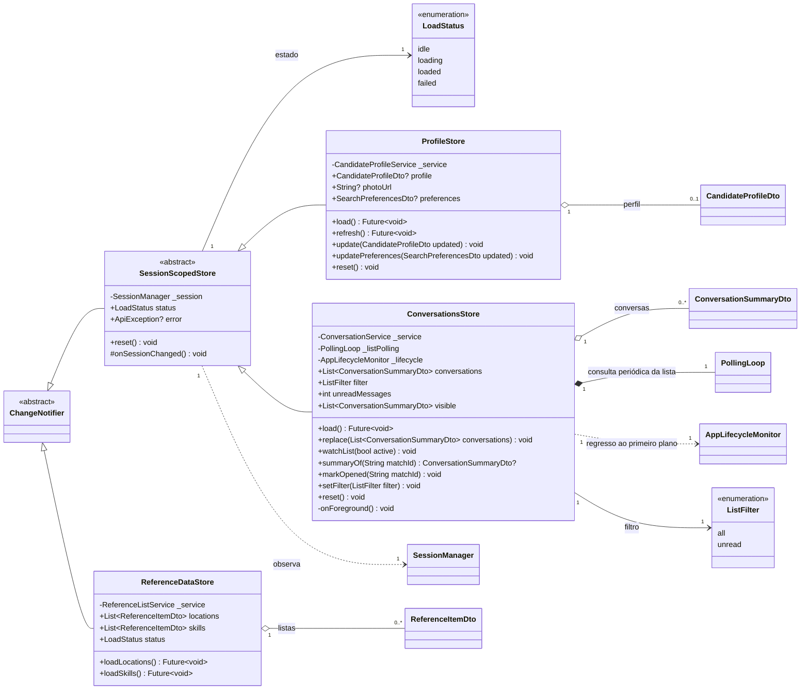

| Store | Responsabilidade | Usado em | Requisitos |
| --- | --- | --- | --- |
| `SessionScopedStore` | Base dos stores com dados do Candidato. Observa `SessionManager` e chama `reset()` quando a sessão deixa de estar iniciada, para que nenhum dado de uma conta fique em memória depois do fim de sessão; no `ConversationsStore`, `reset()` também para a consulta periódica. | — | RF105 |
| `ProfileStore` | Perfil profissional do Candidato, carregado depois do início de sessão. Cada controller que altera o perfil entrega o `CandidateProfileDto` devolvido pelo serviço (`update`); depois de um envio de ficheiro volta a pedir o perfil (`refresh`) para obter `photoUrl` e `hasCv`. Expõe as preferências de procura, que a área de exploração observa. | M05 a M08, M09, M20 | RF006 a RF012, RF023 |
| `ConversationsStore` | Lista de conversas com o número de mensagens por ler e o estado de cada uma. `unreadMessages` é a soma de `unreadCount` e alimenta o cabeçalho «mensagens por ler» do ecrã M16 e o contador do separador «Conversas». `watchList(true)`, chamado quando M16 é apresentado, ativa a consulta periódica da lista de 3 em 3 segundos (`_listPolling`, secção 7); `watchList(false)` desativa-a. Fora de M16, a lista é pedida uma vez no início de sessão, ao escolher os separadores «Matches» ou «Conversas» e quando a aplicação volta ao primeiro plano (`onForeground`, DFM-16). `replace` substitui a lista com a resposta obtida pelo `ChatController` (secção 8.5). `markOpened` põe a zero o contador da conversa que o Candidato abriu (o servidor já a marcou como lida, RF108). Uma conversa que passa a `closed` fica só de consulta, com o motivo (`closeReason`) e a parte que a encerrou (`closedBy`). Uma conversa nova aparece na lista na leitura seguinte à confirmação do match (RF068). `filter` é o filtro «Todas» ou «Não lidas», aplicado só à lista já carregada. | M16, M17, M18, barra inferior | RF027, RF028, RF029, RF030, RF068, RF075, RF108 |
| `ReferenceDataStore` | Listas pré-definidas de localidades e de competências. Não é de âmbito de sessão, porque as localidades são precisas no registo, antes do início de sessão; a API v02 serve a lista de localidades sem credencial (6.13.1; PC-01 resolvido). | M02, M05, M07 | RF003, RF006, RF008 |

O `NotificationsStore` da v01 foi retirado com a funcionalidade F011.

### 8.2. Autenticação, registo e conta

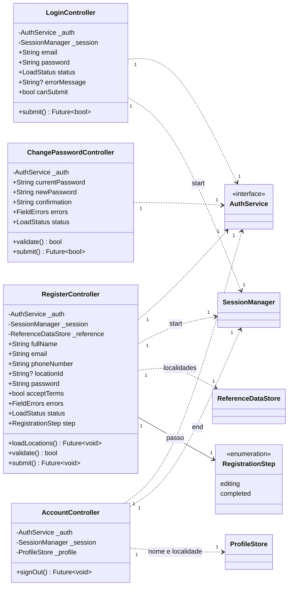

| Controller | Ecrãs | Responsabilidade | Requisitos |
| --- | --- | --- | --- |
| `LoginController` | M01 | Envia o correio eletrónico e a palavra-passe; em caso de êxito, entrega a `LoginResponse` a `SessionManager.start`. Quando o servidor rejeita o início de sessão, mostra a `message` do `ApiErrorDto` devolvido, sem a alterar nem a juntar com outras: ERR-02 (credenciais erradas, a mesma mensagem para correio inexistente e palavra-passe errada, RNF009), ERR-03 (conta bloqueada), ERR-04 (conta suspensa) e ERR-05 (ponto de acesso) (API, 6.1.3 e 4.3). O RF001 exige a indicação do motivo também quando a conta está bloqueada ou suspensa, e o RNF009 só uniformiza o das credenciais erradas; o ecrã M01 do protótipo junta os motivos num só texto (PC-09). | RF001, RNF009 |
| `RegisterController` | M02, M03, M04 | Formulário de registo: valida localmente (`InputRules`: campos obrigatórios, correio eletrónico, contacto de 9 algarismos, palavra-passe, aceitação das condições) e, só depois, envia. Os motivos do servidor, por campo, também vão para `errors` (M03). Em caso de êxito, inicia a sessão com a `LoginResponse` do registo e passa a `step = completed` (M04, «A sua conta está ativa»). Se o Candidato sair do formulário, nada é guardado. | RF003, RF004, RF005 |
| `ChangePasswordController` | M21 | Valida que a palavra-passe nova cumpre o P05, é diferente da atual e coincide com a confirmação; a confirmação só existe no cliente e não segue no `ChangePasswordRequest`. O servidor rejeita uma palavra-passe atual errada. | RF002 |
| `AccountController` | M20 | Mostra o nome, o correio eletrónico e a localidade do `ProfileStore`. `signOut()` pede o fim de sessão ao servidor (`AuthService.logout`), sem depender do resultado, e termina a sessão local (`SessionManager.end`): o cliente descarta a credencial e passa a exigir novo início de sessão. | RF105 |

### 8.3. Perfil profissional

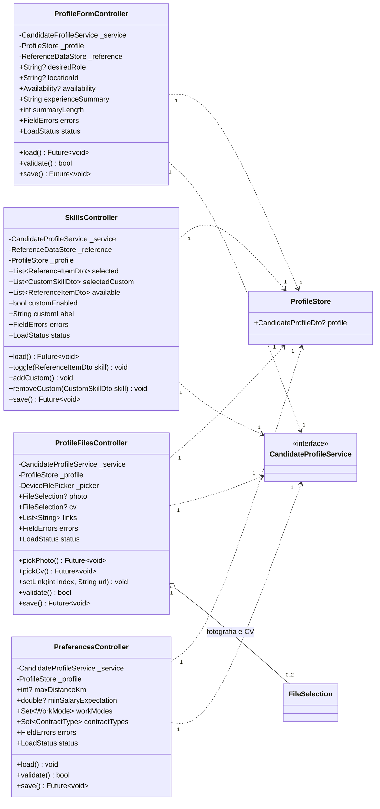

| Controller | Ecrãs | Responsabilidade | Requisitos |
| --- | --- | --- | --- |
| `ProfileFormController` | M05 | Função pretendida, localidade (da lista), disponibilidade (imediata, 15 dias, 1 mês ou a combinar) e resumo da experiência com o contador «n/1000». Valida o limite do resumo (P08) e grava com `updateProfile`. | RF006 |
| `ProfileFilesController` | M06 (e as linhas de fotografia e CV de M05) | Fotografia, curriculum vitae e até 3 hiperligações. Valida localmente o formato e a dimensão (P01, P02) e os endereços (P10) **antes do primeiro pedido**, para que nenhum envio se faça com dados que já se sabe estarem errados; depois envia a fotografia, o CV e as hiperligações por esta ordem e volta a pedir o perfil. Os motivos, por campo, ficam em `errors` e são os que M06 mostra («Só JPEG ou PNG até 5 MB», «Só PDF até 5 MB», «A hiperligação tem de começar por http:// ou https://»). | RF010, RF011, RF012 |
| `SkillsController` | M07 | Competências como etiquetas: escolhe da lista pré-definida (`toggle`), acrescenta uma competência «Outro» (2 a 40 caracteres, P07) ou remove uma etiqueta. `save()` envia ao serviço só as diferenças: `addSkill` e `removeSkill` (pelo `skillId`) para as competências da lista, e `addCustomSkill` e `removeCustomSkill` (pelo `customSkillId`) para as competências «Outro» (API v02, 6.2.4, 6.2.5, 6.2.10 e 6.2.11). | RF008, RF009 |
| `PreferencesController` | M08 | Distância máxima (1 a 500 km, P06), pretensão salarial mínima, regimes de trabalho e tipos de contrato. Grava com `updatePreferences` e entrega as novas preferências ao `ProfileStore`, que a área de exploração observa. | RF007, RF023 |

### 8.4. Exploração de vagas

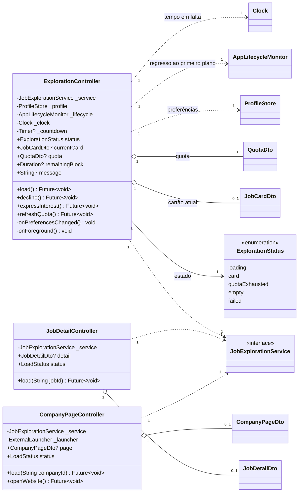

`ExplorationController` é o estado dos ecrãs M09, M10 e M11, que são três estados do mesmo ecrã:

| `status` | Ecrã | Quando | Comportamento |
| --- | --- | --- | --- |
| `card` | M09 | Há um cartão e a quota tem interesses disponíveis. | Mostra o cartão e «Interesses disponíveis: n de 10», com `quota.available` e `quota.total` (RF022). Recusar, manifestar interesse e abrir o detalhe exigem uma só interação (RNF010). |
| `quotaExhausted` | M10 | A quota não tem interesses e `blockedUntil` está no futuro. | Mostra o cartão com o aviso «Esgotou os 10 interesses» e o tempo em falta (`remainingBlock`, calculado com `Clock`). O botão de interesse fica desativado, mas recusar, ver o detalhe e ajustar as preferências continuam disponíveis (UC05, A4). |
| `empty` | M11 | `getNextCard` não devolveu cartão. | Indica que não há vagas compatíveis e oferece «Ajustar preferências» (UC05, A6). |

Operações:

- `load()` pede a quota (`getQuota`) e o cartão seguinte (`getNextCard`) e escolhe o estado.
- `decline()` recusa a vaga e pede o cartão seguinte; não altera a quota (RF018).
- `expressInterest()` não faz nenhum pedido com a quota esgotada (RF020). Caso contrário, regista o interesse (`expressInterest`), guarda a quota devolvida (a vaga deixa de ser mostrada) e pede o cartão seguinte (RF019). Se o servidor rejeitar o interesse (segunda manifestação na mesma vaga, quota esgotada entretanto ou vaga que deixou de estar disponível, UC05 E1 a E3), mostra o motivo em `message`, atualiza a quota e passa ao cartão seguinte; a quota não é alterada. Na quota esgotada entretanto (ERR-31), o fim do bloqueio vem em `ApiErrorDto.blockedUntil`, e o ecrã passa a M10 sem novo pedido.
- Em `quotaExhausted`, um temporizador atualiza `remainingBlock` a cada minuto. Quando chega a zero, pede a quota (`getQuota`): se o período já terminou, o servidor aplica a reposição antes de responder (API v02, 6.3.6), pelo que a resposta já traz os 10 interesses. A reposição não é notificada (DA v04, F006: o aviso ativo da reposição da quota está fora do âmbito): o Candidato vê os interesses repostos no cartão. Quando a aplicação volta ao primeiro plano (`onForeground`), `load()` pede de novo a quota e o cartão, porque o bloqueio pode ter terminado com a aplicação em segundo plano.
- Quando as preferências do `ProfileStore` mudam (M08, aberto a partir de M09 ou de M11), `load()` volta a pedir os cartões, que passam a respeitar os novos valores (RF023).
- O total da quota vem em `quota.total`, com o valor do parâmetro P11 (API v02, 6.3.6; PC-07 resolvido).

### 8.5. Matches e conversas

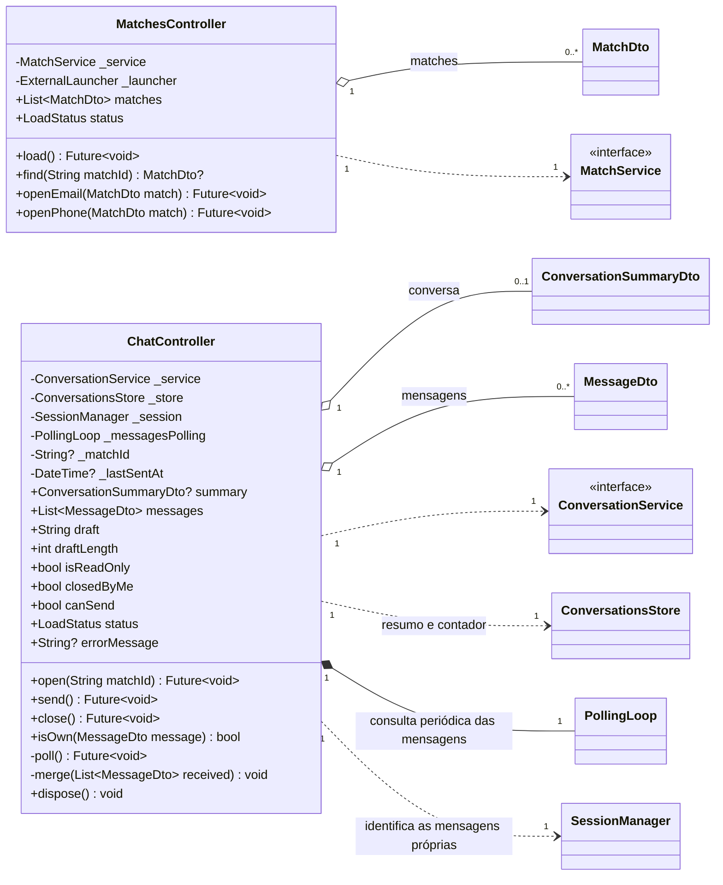

| Classe | Ecrãs | Responsabilidade | Requisitos |
| --- | --- | --- | --- |
| `MatchesController` | M14, M15 | Lista de matches, com a vaga, a localidade, o estado da vaga (`jobStatus`, «Vaga encerrada») e a Empresa com o logótipo de cada um, incluindo os de vagas encerradas ou de Empresas suspensas. É aqui que o Candidato vê um novo match, sem notificação (DA v04, F008): a lista é pedida ao abrir o separador «Matches». Os contactos (correio eletrónico e telefone) já vêm no `MatchDto`, pelo que M15 não faz novo pedido; abrir o correio ou a chamada passa por `ExternalLauncher`. «Abrir conversa» navega para `ChatScreen` com o `matchId`. | RF024, RF025 |
| `ConversationsStore` (M16) | M16 | Ver a secção 8.1. A lista só mostra conversas dos matches do Candidato (RF070); o Administrador não tem acesso a conversas. Enquanto M16 está apresentado, a lista é atualizada por consulta periódica (secção 7). | RF027, RF029, RF070 |
| `ChatController` | M17, M18 | Abre a conversa (`open` sem `after`: devolve o histórico completo e o servidor marca as mensagens como lidas, RF108), envia (`send`) e encerra (`close`, depois do qual recarrega a lista de conversas para obter o motivo). O resumo (Empresa, vaga, estado, motivo e parte que encerrou) vem de `ConversationsStore`, porque `open` só devolve mensagens; quando a conversa é aberta a partir da lista de matches, o store é carregado primeiro. `canSend` exige conversa aberta e texto de 1 a 1000 caracteres (P03); em modo só de consulta, `isReadOnly` desativa a escrita e o ecrã passa a M18 (RF026, RF075); `closedByMe` compara `closedBy` com o utilizador da sessão, para M18 indicar «Encerrou esta conversa» ou «A Empresa encerrou esta conversa» (PC-04). `isOwn` compara `senderId` com o utilizador da sessão para alinhar as mensagens. Enquanto o ecrã está aberto e a aplicação em primeiro plano, `_messagesPolling` executa `poll()` de 3 em 3 segundos: pede `open(matchId, _lastSentAt)` e `list()`, junta as mensagens novas e atualiza o resumo e o `ConversationsStore` (secção 7, regras 3 a 5). As mensagens são juntadas por `messageId`, sem duplicados, porque a mensagem enviada pelo próprio Candidato chega pela resposta de `send` e pode voltar numa consulta. A consulta para em `dispose`. | RF026, RF028, RF029, RF030, RF075, RF108 |

O `NotificationsStore` (M19) da v01 foi retirado com a funcionalidade F011.

---

## 9. Ecrãs e widgets

### 9.1. Estrutura de navegação

Os 20 ecrãs do protótipo v02 correspondem a 16 classes de ecrã: M03, M10, M11 e M18 são estados de M02, M09 e M17 e não classes próprias (secção 12, DFM-12). `HomeShell` tem a barra de navegação inferior com os quatro separadores do protótipo v02 (Explorar, Matches, Conversas e Perfil); os ecrãs M06, M07 e M08 abrem por cima da barra. O ecrã M19 e o separador «Notificações» foram retirados no protótipo v02.

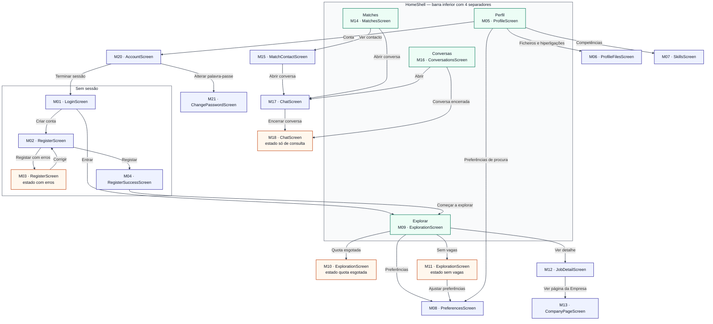

Os nós a verde são os quatro separadores de `HomeShell`, cada um com o seu ecrã inicial; os nós a laranja são estados de um ecrã. A partir de M09, cada uma das áreas do RNF011 (perfil profissional, preferências de procura, lista de matches e lista de conversas) está a uma ou duas interações: um toque no separador da barra inferior ou, nas preferências, no botão «Preferências» de M09.

### 9.2. Estrutura da aplicação

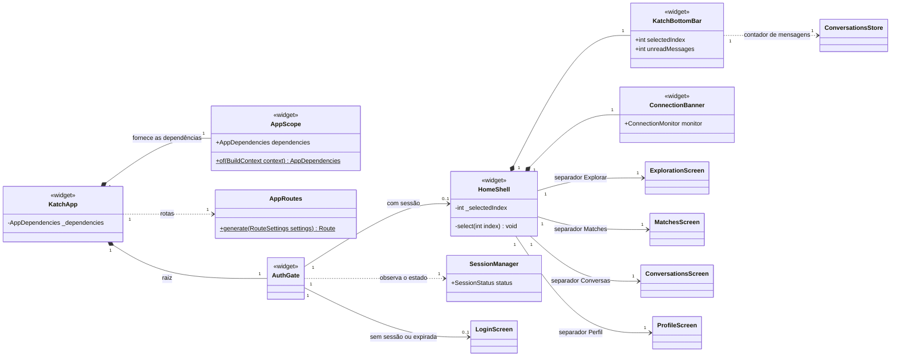

| Classe | Responsabilidade | Requisitos |
| --- | --- | --- |
| `KatchApp` | Raiz da aplicação: `MaterialApp` com as rotas de `AppRoutes` e o `AppScope`. | — |
| `AppScope` | `InheritedWidget` que dá aos ecrãs as dependências de `AppDependencies` (serviços, stores e dispositivo), sem pacote de injeção de dependências (secção 12, DFM-03). | — |
| `AppRoutes` | Associa cada rota à classe de ecrã e aos seus argumentos (`jobId`, `companyId`, `matchId`). | — |
| `AuthGate` | Escolhe o que a aplicação mostra segundo `SessionManager.status`: um ecrã de espera (`LoadStateView`) enquanto restaura a sessão, o início de sessão e o registo sem sessão, ou `HomeShell` com sessão. Quando a sessão expira, volta a M01. | RNF005 |
| `HomeShell` | Contentor dos quatro separadores (Explorar, Matches, Conversas e Perfil), com a barra inferior. Garante que cada área é alcançada em, no máximo, 3 interações a partir da exploração de vagas. Ao mudar para os separadores «Matches» ou «Conversas», pede ao `ConversationsStore` uma leitura da lista (DFM-16). | RNF011 |
| `KatchBottomBar` | Barra inferior com os quatro separadores; o separador «Conversas» mostra `unreadMessages`. Não há separador nem contador de notificações (protótipo v02). | RF027, RNF011 |
| `ConnectionBanner` | Faixa que indica a falha de ligação quando `ConnectionMonitor.hasFailure`. | RNF014 |

### 9.3. Ecrãs e controllers

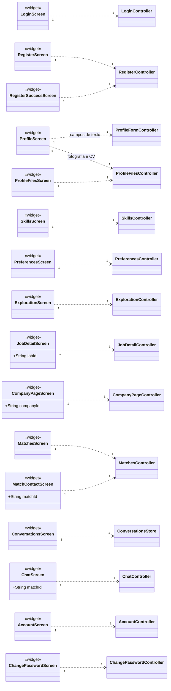

Cada ecrã cria o seu controller em `initState`, obtendo as dependências de `AppScope`, e destrói-o em `dispose`; a destruição do `ChatController` para a consulta periódica da conversa. O ecrã que mostra estado partilhado (`ConversationsScreen`) usa diretamente o store e chama `watchList(true)` quando é apresentado e `watchList(false)` quando deixa de o ser. `RegisterSuccessScreen` e `MatchContactScreen` partilham o controller do ecrã de onde vêm (`RegisterController` e `MatchesController`) para não repetirem pedidos.

### 9.4. Widgets principais

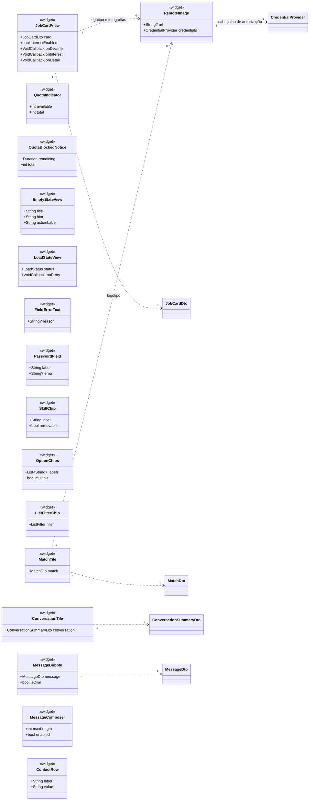

| Widget | Responsabilidade | Usado em | Requisitos |
| --- | --- | --- | --- |
| `RemoteImage` | Mostra a fotografia ou o logótipo de um URL da API (`GET /api/files/{kind}/{fileName}`, API v02, 6.9.1). Esses URL só servem o ficheiro com credencial, pelo que o pedido leva o cabeçalho de autorização. Sem URL, ou com `404`, mostra o marcador do protótipo (o «X»). | M05, M09, M12 a M15, M20 | RF010, RF013, RF017, RF024 |
| `JobCardView` | Cartão de vaga com função, designação e logótipo da Empresa, intervalo salarial, localidade e distância, tipo de contrato, regime, indicação de urgência e fotografias. Recusar, manifestar interesse e ver o detalhe são botões do cartão, e recusar e manifestar interesse também podem ser feitos com o gesto de deslizar para a esquerda ou para a direita, cada um com uma só interação. O logótipo e as fotografias só aparecem quando existem. | M09, M10 | RF013, RF018, RF019, RNF010 |
| `QuotaIndicator` | «Interesses disponíveis: n de 10». | M09 | RF022 |
| `QuotaBlockedNotice` | «Esgotou os 10 interesses. Poderá voltar a manifestar interesse dentro de n h m min.» | M10 | RF020 |
| `EmptyStateView` | Estado sem conteúdo, com a ação sugerida («Ajustar preferências»). | M11 | RF014 |
| `LoadStateView` | Indicador de carregamento e de erro, com a ação de repetir. | todos os ecrãs com pedidos | RNF014 |
| `FieldErrorText` | Motivo de rejeição junto do campo. | M01 a M03, M06 a M08, M21 | RF004 |
| `PasswordField` | Campo de palavra-passe com a indicação do formato exigido (P05). | M01, M02, M21 | RF001, RF002, RF003 |
| `SkillChip` | Etiqueta de competência, removível com um toque. | M05, M07 | RF008 |
| `OptionChips` | Seleção por etiquetas: disponibilidade (uma opção), regimes e tipos de contrato (várias). | M05, M08 | RF006, RF007 |
| `ListFilterChip` | Filtro «Todas» ou «Não lidas» da lista de conversas. | M16 | RF027 |
| `MatchTile` | Linha de um match, com o logótipo da Empresa, a vaga, a localidade, o estado da vaga («Vaga encerrada», a partir de `jobStatus`) e as ações «Ver contacto» e «Abrir conversa». | M14 | RF024 |
| `ContactRow` | Linha de contacto (correio eletrónico ou telefone) que abre a aplicação externa. | M15 | RF025 |
| `ConversationTile` | Linha de uma conversa, com a Empresa, a vaga, o contador de mensagens por ler e a indicação de conversa encerrada; atualizada pela consulta periódica da lista. | M16 | RF027, RF029, RF075 |
| `MessageBubble` | Mensagem do histórico, alinhada pelo remetente, com a data e hora e a indicação de leitura nas mensagens enviadas pelo Candidato. | M17, M18 | RF028 |
| `MessageComposer` | Caixa de escrita com o contador «n/1000» e o botão «Enviar»; desativada quando a conversa é só de consulta. | M17, M18 | RF026, RF075 |

Os botões «Simular: ...» do protótipo servem para navegar entre estados do protótipo estático; não fazem parte da aplicação e não têm classe (secção 12, DFM-13).

---

## 10. Composição e interação entre camadas

### 10.1. Composição das dependências

`AppDependencies` é a raiz de composição: cria, uma vez, as instâncias que o resto da aplicação usa e liga-as por construtor. É criada em `main.dart` com a configuração do ambiente (`AppConfig`), antes de `KatchApp`.

```mermaid
classDiagram
    direction LR
    class AppConfig {
        +String apiBaseUrl
    }
    class AppDependencies {
        +create(AppConfig config)$ AppDependencies
        +dispose() void
    }
    class Clock {
        <<interface>>
    }
    class ConnectionMonitor
    class SessionManager
    class ApiClient {
        <<interface>>
    }
    class PollingScheduler {
        <<interface>>
    }
    class AppLifecycleMonitor
    class DeviceFilePicker {
        <<interface>>
    }
    class ExternalLauncher {
        <<interface>>
    }
    class AuthService {
        <<interface>>
    }
    class CandidateProfileService {
        <<interface>>
    }
    class JobExplorationService {
        <<interface>>
    }
    class MatchService {
        <<interface>>
    }
    class ConversationService {
        <<interface>>
    }
    class ReferenceListService {
        <<interface>>
    }
    class ProfileStore
    class ConversationsStore
    class ReferenceDataStore
    AppDependencies "1" ..> "1" AppConfig : lê
    AppDependencies "1" *-- "1" Clock
    AppDependencies "1" *-- "1" ConnectionMonitor
    AppDependencies "1" *-- "1" SessionManager
    AppDependencies "1" *-- "1" ApiClient
    AppDependencies "1" *-- "1" PollingScheduler
    AppDependencies "1" *-- "1" AppLifecycleMonitor
    AppDependencies "1" *-- "1" DeviceFilePicker
    AppDependencies "1" *-- "1" ExternalLauncher
    AppDependencies "1" *-- "1" AuthService
    AppDependencies "1" *-- "1" CandidateProfileService
    AppDependencies "1" *-- "1" JobExplorationService
    AppDependencies "1" *-- "1" MatchService
    AppDependencies "1" *-- "1" ConversationService
    AppDependencies "1" *-- "1" ReferenceListService
    AppDependencies "1" *-- "1" ProfileStore
    AppDependencies "1" *-- "1" ConversationsStore
    AppDependencies "1" *-- "1" ReferenceDataStore
```

Cada `PollingLoop` é criado pelo store ou pelo controller que o usa (`ConversationsStore`, `ChatController`), com o `PollingScheduler` e o `AppLifecycleMonitor` únicos de `AppDependencies`; o `AppLifecycleMonitor` é registado no `WidgetsBinding` em `main.dart`.

### 10.2. Exemplo: manifestar interesse numa vaga

Manifestar interesse (UC05, ecrãs M09 e M10), com as multiplicidades de cada ligação.

```mermaid
classDiagram
    direction LR
    class ExplorationScreen {
        <<widget>>
    }
    class JobCardView {
        <<widget>>
        +VoidCallback onInterest
    }
    class ExplorationController {
        +expressInterest() Future~void~
    }
    class JobExplorationService {
        <<interface>>
        +expressInterest(String jobId) Future~QuotaDto~
        +getNextCard() Future~JobCardDto?~
    }
    class HttpJobExplorationService
    class ApiClient {
        <<interface>>
        +post(String path, Object? body) Future~Object?~
    }
    class HttpApiClient
    class CredentialProvider {
        <<interface>>
    }
    class SessionManager
    class QuotaDto {
        <<model>>
        +int available
        +int total
        +DateTime? blockedUntil
    }
    class JobCardDto {
        <<model>>
    }
    class ApiRejection
    ExplorationScreen "1" *-- "1" JobCardView : cartão atual
    JobCardView "1" ..> "1" ExplorationController : onInterest
    ExplorationController "1" ..> "1" JobExplorationService : chama
    HttpJobExplorationService ..|> JobExplorationService
    HttpJobExplorationService "1" ..> "1" ApiClient : POST
    HttpApiClient ..|> ApiClient
    HttpApiClient "1" ..> "1" CredentialProvider : credencial
    SessionManager ..|> CredentialProvider
    JobExplorationService "1" ..> "1" QuotaDto : devolve
    JobExplorationService "1" ..> "0..1" JobCardDto : cartão seguinte
    ExplorationController "1" o-- "0..1" QuotaDto : guarda
    ExplorationController "1" o-- "0..1" JobCardDto : mostra
    HttpApiClient ..> ApiRejection : quota esgotada ou vaga indisponível
```

O Candidato toca em «Manifestar interesse» (ou desliza o cartão para a direita): `JobCardView` chama `onInterest` e o controller verifica que a quota tem interesses disponíveis. `expressInterest` chega ao `HttpApiClient`, que acrescenta a credencial de sessão e envia o pedido com tempo limite de 9 segundos. O servidor verifica a quota com controlo de concorrência, regista o interesse e devolve a `QuotaDto` atualizada; o controller guarda-a, deixa de mostrar a vaga e pede o cartão seguinte. Se este foi o décimo interesse, `blockedUntil` fica preenchido e o ecrã passa a M10. Se o servidor rejeitar o interesse, o `HttpApiClient` lança `ApiRejection` com o motivo e o `code` do erro, que o controller mostra sem alterar a quota (UC05, E1 a E3). O interesse registado entra na lista de candidatos em espera da vaga, que o Recrutador consulta; não há notificação ao Recrutador (DA v04, F007).

---

## 11. Correspondências

### 11.1. Ecrãs do protótipo v02

Os 20 ecrãs da secção A do protótipo v02 (`m3-prototipo-baixa-fidelidade-v02.pdf`), com os requisitos e os casos de uso que o próprio protótipo indica na legenda de cada ecrã. O M19 foi retirado no protótipo v02.

| Ecrã | Nome no protótipo | Classe de ecrã (estado) | Controller ou store | Serviço e operação | Modelos | Requisitos | UC |
| --- | --- | --- | --- | --- | --- | --- | --- |
| M01 | Início de sessão | `LoginScreen` | `LoginController` | `AuthService.login` | `LoginRequest`, `LoginResponse`, `ApiErrorDto` | RF001 | UC01 |
| M02 | Registo | `RegisterScreen` (formulário) | `RegisterController`, `ReferenceDataStore` | `AuthService.register`; `ReferenceListService.listLocations` | `RegisterCandidateRequest`, `LoginResponse`, `ReferenceItemDto` | RF003 | UC03 |
| M03 | Registo com erros | `RegisterScreen` (estado com erros de campo) | `RegisterController` | `AuthService.register` | `ApiErrorDto`, `FieldErrorDto` | RF004 | UC03 |
| M04 | Conta ativa | `RegisterSuccessScreen` | `RegisterController` (`step = completed`) | — (a sessão começa com a `LoginResponse` do registo) | `LoginResponse` | RF005 | UC03 |
| M05 | Perfil profissional | `ProfileScreen` | `ProfileFormController`, `ProfileFilesController`, `ProfileStore` | `CandidateProfileService.getProfile`, `updateProfile`, `uploadPhoto`, `uploadCv`; `ReferenceListService.listLocations` | `CandidateProfileDto`, `UpdateCandidateProfileRequest`, `ReferenceItemDto` | RF006, RF010, RF011, RF012 | UC04 |
| M06 | Erros de ficheiro | `ProfileFilesScreen` | `ProfileFilesController` | `CandidateProfileService.uploadPhoto`, `uploadCv`, `setLinks` | `SetLinksRequest`, `CandidateProfileDto`, `ApiErrorDto` | RF010 a RF012 | UC04 |
| M07 | Competências | `SkillsScreen` | `SkillsController` | `CandidateProfileService.addSkill`, `removeSkill`, `addCustomSkill`, `removeCustomSkill`; `ReferenceListService.listSkills` | `AddSkillRequest`, `AddCustomSkillRequest`, `CustomSkillDto`, `ReferenceItemDto` | RF008, RF009 | UC04 |
| M08 | Preferências de procura | `PreferencesScreen` | `PreferencesController`, `ProfileStore` | `CandidateProfileService.updatePreferences` | `SearchPreferencesDto` | RF007, RF023 | UC04, UC05 |
| M09 | Exploração | `ExplorationScreen` (estado `card`) | `ExplorationController` | `JobExplorationService.getNextCard`, `decline`, `expressInterest`, `getQuota` | `JobCardDto`, `QuotaDto` | RF013, RF014, RF018, RF019, RF022 | UC05 |
| M10 | Quota esgotada | `ExplorationScreen` (estado `quotaExhausted`) | `ExplorationController` | `JobExplorationService.expressInterest` (rejeição), `getQuota` | `QuotaDto`, `ApiErrorDto` | RF020, RF021 | UC05 |
| M11 | Sem vagas | `ExplorationScreen` (estado `empty`) | `ExplorationController` | `JobExplorationService.getNextCard` (sem cartão) | — (`JobCardDto?` nulo) | RF014 | UC05 |
| M12 | Detalhe da vaga | `JobDetailScreen` | `JobDetailController` | `JobExplorationService.getDetail` | `JobDetailDto`, `JobCardDto` | RF016 | UC05 |
| M13 | Página da Empresa | `CompanyPageScreen` | `CompanyPageController` | `JobExplorationService.getCompanyPage` | `CompanyPageDto` | RF017 | UC06 |
| M14 | Matches | `MatchesScreen` | `MatchesController` | `MatchService.list` | `MatchDto` (com `jobStatus` e `logoUrl`) | RF024 | UC13 |
| M15 | Contacto do match | `MatchContactScreen` | `MatchesController` | — (os contactos já estão em `MatchDto`) | `MatchDto` | RF025 | UC13 |
| M16 | Lista de conversas | `ConversationsScreen` | `ConversationsStore` | `ConversationService.list` (ao abrir e por consulta periódica) | `ConversationSummaryDto` | RF027, RF029 | UC14 |
| M17 | Conversa | `ChatScreen` (conversa aberta) | `ChatController` | `ConversationService.open` (sem `after` ao abrir e com `after` na consulta periódica), `list`, `send`, `close` | `MessageDto`, `SendMessageRequest`, `ConversationSummaryDto` | RF026, RF028, RF029, RF030, RF108 | UC14 |
| M18 | Conversa só de consulta | `ChatScreen` (estado só de consulta) | `ChatController` | `ConversationService.open`, `list` | `ConversationSummaryDto` (com `closeReason` e `closedBy`), `MessageDto` | RF026, RF030, RF075 | UC14 |
| M20 | Conta | `AccountScreen` | `AccountController`, `ProfileStore` | `AuthService.logout` | `CandidateProfileDto` | RF002, RF105 | UC01, UC02 |
| M21 | Alterar palavra-passe | `ChangePasswordScreen` | `ChangePasswordController` | `AuthService.changePassword` | `ChangePasswordRequest`, `ApiErrorDto` | RF002 | UC02 |

### 11.2. Controllers do backend

Cada operação dos seis controllers com serviço tem uma operação no serviço correspondente, com os mesmos parâmetros e resultados (secção 5); o `FilesController` é usado pelo `RemoteImage`. O método, a rota e a secção são os de `m3-documentacao-api-v02.md`.

| Controller | Operação do controller | Método e rota (API) | API | Serviço e operação na aplicação | Ecrãs |
| --- | --- | --- | --- | --- | --- |
| `AuthController` | `RegisterCandidate` | `POST /api/auth/candidates` | 6.1.1 | `AuthService.register` | M02, M03 |
| `AuthController` | `Login` | `POST /api/auth/login` (cabeçalho `X-Client-App: mobile`) | 6.1.3 | `AuthService.login` | M01 |
| `AuthController` | `Logout` | `POST /api/auth/logout` | 6.1.4 | `AuthService.logout` | M20 |
| `AuthController` | `ChangePassword` | `PUT /api/auth/password` | 6.1.5 | `AuthService.changePassword` | M21 |
| `CandidateProfileController` | `Get` | `GET /api/candidate/profile` | 6.2.1 | `CandidateProfileService.getProfile` | M05, M20 |
| `CandidateProfileController` | `Update` | `PUT /api/candidate/profile` | 6.2.2 | `CandidateProfileService.updateProfile` | M05 |
| `CandidateProfileController` | `UpdatePreferences` | `PUT /api/candidate/profile/preferences` | 6.2.3 | `CandidateProfileService.updatePreferences` | M08 |
| `CandidateProfileController` | `AddSkill` | `POST /api/candidate/profile/skills` | 6.2.4 | `CandidateProfileService.addSkill` | M07 |
| `CandidateProfileController` | `RemoveSkill` | `DELETE /api/candidate/profile/skills/{skillId}` | 6.2.5 | `CandidateProfileService.removeSkill` | M07 |
| `CandidateProfileController` | `AddCustomSkill` | `POST /api/candidate/profile/custom-skills` | 6.2.10 | `CandidateProfileService.addCustomSkill` | M07 |
| `CandidateProfileController` | `RemoveCustomSkill` | `DELETE /api/candidate/profile/custom-skills/{customSkillId}` | 6.2.11 | `CandidateProfileService.removeCustomSkill` | M07 |
| `CandidateProfileController` | `SetLinks` | `PUT /api/candidate/profile/links` | 6.2.6 | `CandidateProfileService.setLinks` | M06 |
| `CandidateProfileController` | `UploadPhoto` | `PUT /api/candidate/profile/photo` | 6.2.7 | `CandidateProfileService.uploadPhoto` | M05, M06 |
| `CandidateProfileController` | `UploadCv` | `PUT /api/candidate/profile/cv` | 6.2.8 | `CandidateProfileService.uploadCv` | M05, M06 |
| `JobExplorationController` | `GetNextCard` | `GET /api/candidate/jobs/next` | 6.3.1 | `JobExplorationService.getNextCard` | M09, M10, M11 |
| `JobExplorationController` | `GetDetail` | `GET /api/candidate/jobs/{jobId}` | 6.3.2 | `JobExplorationService.getDetail` | M12 |
| `JobExplorationController` | `GetCompanyPage` | `GET /api/candidate/jobs/companies/{companyId}` | 6.3.3 | `JobExplorationService.getCompanyPage` | M13 |
| `JobExplorationController` | `Decline` | `POST /api/candidate/jobs/{jobId}/decline` | 6.3.4 | `JobExplorationService.decline` | M09, M10 |
| `JobExplorationController` | `ExpressInterest` | `POST /api/candidate/jobs/{jobId}/interest` | 6.3.5 | `JobExplorationService.expressInterest` | M09, M10 |
| `JobExplorationController` | `GetQuota` | `GET /api/candidate/jobs/quota` | 6.3.6 | `JobExplorationService.getQuota` | M09, M10 |
| `MatchesController` | `List` | `GET /api/matches` | 6.7.1 | `MatchService.list` | M14, M15 |
| `ConversationsController` | `List` | `GET /api/conversations` (ao abrir e na consulta periódica) | 6.8.1 | `ConversationService.list` | M16, M17, M18 |
| `ConversationsController` | `Open` | `GET /api/conversations/{matchId}/messages` (ao abrir) e `…/messages?after=<sentAt>` (consulta periódica) | 6.8.2 | `ConversationService.open` | M17, M18 |
| `ConversationsController` | `Send` | `POST /api/conversations/{matchId}/messages` | 6.8.3 | `ConversationService.send` | M17 |
| `ConversationsController` | `Close` | `POST /api/conversations/{matchId}/close` | 6.8.4 | `ConversationService.close` | M17 |
| `FilesController` | `Get` | `GET /api/files/{kind}/{fileName}` (URL dos DTOs) | 6.9.1 | `RemoteImage` (pelo `CredentialProvider`) | M05, M09, M12 a M15, M20 |
| `ReferenceListsController` | `ListLocations` | `GET /api/reference-lists/locations` (sem credencial) | 6.13.1 | `ReferenceListService.listLocations` | M02, M05 |
| `ReferenceListsController` | `ListSkills` | `GET /api/reference-lists/skills` | 6.13.2 | `ReferenceListService.listSkills` | M07 |

São 27 operações de serviço de 6 controllers, mais a obtenção de ficheiros do `FilesController`: 28 dos 72 endpoints da API v02. Não são usadas pelo Candidato: `CandidateProfileController.GetCv` (6.2.9; o protótipo v02 não tem ação para abrir o próprio CV, PC-11); `AuthController.CreateRecruiterAccount` (UC07); `ReferenceListsController.ListBenefits` (os benefícios da vaga chegam como texto em `JobDetailDto.benefits`) e as operações de acrescento e alteração de competências e benefícios, reservadas ao Administrador (UC20); e os controllers `CompanyController`, `JobsController`, `CandidateEvaluationController`, `AdminAccountsController`, `AdminCompaniesController` e `AdminIndicatorsController`, que são do Recrutador e do Administrador. Não há hubs nem eventos (API v02, secção 5).

Pedidos da consulta periódica (secção 7):

| Pedido repetido | API | Quem repete | Quando | Ecrãs |
| --- | --- | --- | --- | --- |
| `ConversationService.list()` | 6.8.1 | `ConversationsStore` (`_listPolling`) e `ChatController` (`poll`) | M16, M17 ou M18 apresentado, aplicação em primeiro plano | M16, M17, M18; contador da barra inferior |
| `ConversationService.open(matchId, after)` | 6.8.2 | `ChatController` (`poll`) | M17 ou M18 apresentado, aplicação em primeiro plano | M17, M18 |

### 11.3. DTOs e enumerações do backend

| DTO do backend | Modelo na aplicação | Direção | Serviço ou evento | Ecrãs |
| --- | --- | --- | --- | --- |
| `RegisterCandidateRequest` | `RegisterCandidateRequest` | Pedido | `AuthService.register` | M02 |
| `LoginRequest` | `LoginRequest` | Pedido | `AuthService.login` | M01 |
| `LoginResponse` | `LoginResponse` | Resposta | `AuthService.login`, `AuthService.register` | M01, M02, M04 |
| `ChangePasswordRequest` | `ChangePasswordRequest` | Pedido | `AuthService.changePassword` | M21 |
| `CandidateProfileDto` | `CandidateProfileDto` | Resposta | `CandidateProfileService.getProfile`, `updateProfile`, `addSkill`, `addCustomSkill`, `setLinks` | M05 a M08, M20 |
| `CustomSkillDto` | `CustomSkillDto` | Resposta | (dentro de `CandidateProfileDto.customSkills`) | M05, M07 |
| `UpdateCandidateProfileRequest` | `UpdateCandidateProfileRequest` | Pedido | `CandidateProfileService.updateProfile` | M05 |
| `SearchPreferencesDto` | `SearchPreferencesDto` | Pedido e resposta | `CandidateProfileService.updatePreferences` | M05, M08 |
| `AddSkillRequest` | `AddSkillRequest` | Pedido | `CandidateProfileService.addSkill` | M07 |
| `AddCustomSkillRequest` | `AddCustomSkillRequest` | Pedido | `CandidateProfileService.addCustomSkill` | M07 |
| `SetLinksRequest` | `SetLinksRequest` | Pedido | `CandidateProfileService.setLinks` | M06 |
| `JobCardDto` | `JobCardDto` | Resposta | `JobExplorationService.getNextCard` | M09, M10, M12 |
| `JobDetailDto` | `JobDetailDto` | Resposta | `JobExplorationService.getDetail` | M12 |
| `CompanyPageDto` | `CompanyPageDto` | Resposta | `JobExplorationService.getCompanyPage` | M13 |
| `QuotaDto` | `QuotaDto` | Resposta | `JobExplorationService.expressInterest`, `getQuota` | M09, M10 |
| `MatchDto` | `MatchDto` | Resposta | `MatchService.list` | M14, M15 |
| `ConversationSummaryDto` | `ConversationSummaryDto` | Resposta | `ConversationService.list` | M16 a M18 |
| `MessageDto` | `MessageDto` | Resposta | `ConversationService.open` (com e sem `after`), `send` | M17, M18 |
| `SendMessageRequest` | `SendMessageRequest` | Pedido | `ConversationService.send` | M17 |
| `ReferenceItemDto` | `ReferenceItemDto` | Resposta | `ReferenceListService.listLocations`, `listSkills`; dentro de `CandidateProfileDto.skills` | M02, M05, M07 |
| `ApiErrorDto` | `ApiErrorDto` | Resposta de erro | Todos os serviços (`ApiRejection`) | M01 a M08, M17, M21 |
| `FieldErrorDto` | `FieldErrorDto` | Resposta de erro | (dentro de `ApiErrorDto`) | M02, M03, M06 a M08, M21 |

São 22 modelos, um por cada um dos 22 DTOs usados pelo Candidato. Os 18 DTOs restantes, dos 40 da documentação da API v02, não têm modelo, porque pertencem a casos de uso do Recrutador ou do Administrador:

| Utilizador | DTOs sem modelo na aplicação |
| --- | --- |
| Recrutador (UC07 a UC12) | `CreateRecruiterAccountRequest`, `CompanyRegistrationRequest`, `CompanyPageRequest`, `CompanyStatusDto`, `JobRequest`, `JobDto`, `WaitingCandidateDto`, `CandidateFullProfileDto`, `SkillTagDto` |
| Recrutador e Administrador (UC07, UC16) | `CompanyRegistrationDto` |
| Administrador (UC16 a UC20) | `RejectCompanyRequest`, `PendingCompanyDto`, `CompanyAdminDto`, `PublishedJobAdminDto`, `AccountDto`, `CandidateAdminDto`, `IndicatorsDto`, `ReferenceItemRequest` |

Enumerações: `UserType`, `Availability`, `WorkMode`, `ContractType`, `ConversationStatus`, `ConversationCloseReason` e `JobStatus` têm os mesmos valores que no contrato da API v02 (secção 2.4). `AccountStatus`, `Industry` e `CompanyStatus` não aparecem em nenhum DTO que o Candidato receba ou envie; `MatchStatus`, `OperationType` e `ClientApp` são internas do backend; `FileKind` só aparece na rota dos URL de ficheiros, que a aplicação não constrói. Os DTOs `ProfileSkillDto`, `NotificationDto` e `NotificationListDto` da v01 não existem na API v02.

### 11.4. Arquitetura e Regulamento Interno

| Origem | Exigência | Classes |
| --- | --- | --- |
| Arquitetura, 2.1 e 2.3 | A aplicação móvel é o ponto de acesso exclusivo do Candidato. | `SessionManager.start` (rejeita outros tipos de conta), `AuthGate`, as 16 classes de ecrã |
| Arquitetura, 2.3 | Funcionalidades da aplicação móvel: F001, F002, F004, F006, F008 e F010. | F001: M01, M20, M21; F002: M02 a M04; F004: M05 a M08; F006: M09 a M12; F008: M14, M15; F010: M16 a M18 (a página da Empresa, M13, é da F003, ver PC-08) |
| Arquitetura, 2.4 | Aplicação móvel → API REST, em HTTPS e JSON, com o token JWT em cada pedido, incluindo a consulta periódica das mensagens (3 s). | `ApiClient`, `HttpApiClient`, `CredentialProvider`, `SessionManager`, os 6 serviços |
| Arquitetura, 2.4 e AD-02 | Mensagens entregues por consulta periódica à API REST, de 3 em 3 segundos, enquanto a conversa ou a lista de conversas está aberta; sem ligação persistente (D-08 retirada). | `PollingLoop`, `PollingScheduler`, `TimerPollingScheduler`, `PollingConfig`, `AppLifecycleMonitor`, `ConversationsStore.watchList`, `ChatController.poll` |
| Arquitetura, 2.5; DA v04, limites transversais | Sem mecanismo de notificações, sem notificações nativas do sistema operativo, nem envio por correio eletrónico ou SMS. | Nenhuma classe de notificação nem de envio. `ExternalLauncher` só abre aplicações externas por iniciativa do Candidato. |
| Arquitetura, 2.5 | Sem serviços externos de mapas ou de geolocalização. | A distância chega calculada em `JobCardDto.distanceKm`; não há classes de localização. |
| Arquitetura, 2.6 | Cliente–servidor com interface REST única; autenticação sem estado de sessão no servidor. | `ApiClient` e os 6 serviços; `CredentialProvider.authHeaders`; `AuthenticationFailure` |
| Arquitetura, 2.7 | Desempenho: RNF002 (cartão seguinte em 2 segundos). | `ExplorationController` (PC-06) |
| Arquitetura, 2.7 | Usabilidade: RNF010 (uma interação por ação sobre o cartão) e RNF011 (3 interações para cada área). | `JobCardView`; `HomeShell` e `KatchBottomBar` |
| Arquitetura, 2.7 | Fiabilidade: RNF014 (indicação de falha de ligação em 10 segundos). | `HttpApiClient`, `ConnectionMonitor`, `ConnectionBanner` |
| Arquitetura, 2.7 | Segurança: RNF004 a RNF006 (credencial válida, expiração e autorização de cada pedido). | `SessionManager`, `HttpApiClient`; nenhum serviço envia o identificador do utilizador |
| Arquitetura, 3.3 e 3.4 | Flutter 3.47.x e Dart 3.13.x; `flutter_test` e `integration_test`; versões dos pacotes fixadas no `pubspec.yaml`. | Secção 2.3 |
| RI, 11.2 | Flutter 3.47.x, Dart 3.13.x, pub, VS Code ou Android Studio. | Módulo inteiro |
| RI, 11.3 | Effective Dart, `dart format`. | Secção 2.2 |
| RI, 11.4 | `flutter_lints` com `analysis_options.yaml`. | Secção 2.3 |
| RI, 11.5 | Cobertura mínima de 40% sobre widgets e lógica de estado; exclui ficheiros gerados. | Camadas Estado e Ecrãs e widgets (secção 8); os modelos são escritos à mão, sem ficheiros gerados (DFM-04) |
| RI, 11.6 | Testes de sistema automáticos (`integration_test`, QG-07). | Fluxos dos 20 ecrãs (secção 11.1) |

### 11.5. Requisitos

| Requisito | Classes |
| --- | --- |
| RF001 | `LoginScreen`, `LoginController`, `AuthService.login`, `SessionManager.start` |
| RF002 | `ChangePasswordScreen`, `ChangePasswordController`, `AuthService.changePassword`, `InputRules.isValidPassword` |
| RF003 | `RegisterScreen`, `RegisterController`, `ReferenceDataStore`, `AuthService.register` |
| RF004 | `RegisterController`, `FieldErrors`, `InputRules`, `FieldErrorText`, `ApiErrorDto`, `FieldErrorDto` |
| RF005 | `RegisterSuccessScreen`, `RegisterController.step`, `SessionManager.start` |
| RF006 | `ProfileScreen`, `ProfileFormController`, `CandidateProfileService.updateProfile`, `OptionChips` |
| RF007 | `PreferencesScreen`, `PreferencesController`, `CandidateProfileService.updatePreferences`, `SearchPreferencesDto` |
| RF008 | `SkillsScreen`, `SkillsController`, `ReferenceListService.listSkills`, `CandidateProfileService.addSkill` e `removeSkill`, `SkillChip` |
| RF009 | `SkillsController.addCustom` e `removeCustom`, `InputRules.isValidCustomSkill`, `CandidateProfileService.addCustomSkill` e `removeCustomSkill`, `AddCustomSkillRequest`, `CustomSkillDto` |
| RF010 | `ProfileFilesController.pickPhoto`, `DeviceFilePicker.pickImage`, `InputRules.photoError`, `CandidateProfileService.uploadPhoto`, `RemoteImage` |
| RF011 | `ProfileFilesController.pickCv`, `DeviceFilePicker.pickPdf`, `InputRules.cvError`, `CandidateProfileService.uploadCv` |
| RF012 | `ProfileFilesController.setLink`, `InputRules.isValidLink`, `CandidateProfileService.setLinks`, `SetLinksRequest` |
| RF013 | `ExplorationScreen`, `JobCardView`, `JobCardDto`, `ExplorationController.load`, `JobExplorationService.getNextCard` |
| RF014 | `ExplorationController` (estado `empty`, M11); a seleção das vagas é feita no servidor e o cliente não filtra |
| RF015 | Servidor (cálculo da distância); a aplicação mostra `JobCardDto.distanceKm` |
| RF016 | `JobDetailScreen`, `JobDetailController`, `JobExplorationService.getDetail`, `JobDetailDto` |
| RF017 | `CompanyPageScreen`, `CompanyPageController`, `JobExplorationService.getCompanyPage`, `CompanyPageDto`, `ExternalLauncher.openUrl` |
| RF018 | `ExplorationController.decline`, `JobCardView.onDecline`, `JobExplorationService.decline` |
| RF019 | `ExplorationController.expressInterest`, `JobCardView.onInterest`, `JobExplorationService.expressInterest` |
| RF020 | `ExplorationController` (estado `quotaExhausted`, `remainingBlock`), `QuotaBlockedNotice`, `QuotaDto.blockedUntil`, `ApiErrorDto.blockedUntil` (ERR-31) |
| RF021 | `ExplorationController.refreshQuota` e `onForeground`, `QuotaDto` (reposição consultada, sem notificação) |
| RF022 | `QuotaIndicator`, `ExplorationController.quota`, `QuotaDto.available` e `total`, `JobExplorationService.getQuota` |
| RF023 | `PreferencesScreen` aberto a partir de `ExplorationScreen`, `ProfileStore.updatePreferences`, `ExplorationController.load` |
| RF024 | `MatchesScreen`, `MatchesController`, `MatchService.list`, `MatchTile`, `MatchDto.jobStatus` |
| RF025 | `MatchContactScreen`, `MatchDto.contactEmail` e `contactPhone`, `ContactRow`, `ExternalLauncher` |
| RF026 | `ChatController.send`, `MessageComposer`, `InputRules.isValidMessage`, `ConversationService.send`, `SendMessageRequest` |
| RF027 | `ConversationsScreen`, `ConversationsStore`, `ConversationService.list`, `ConversationTile`, `KatchBottomBar` |
| RF028 | `ChatScreen`, `ChatController.open`, `ConversationService.open`, `MessageBubble`, `MessageDto` |
| RF029 | `ChatController.poll`, `ConversationsStore.watchList`, `PollingLoop`, `PollingConfig` (3 s), `AppLifecycleMonitor`, `ConversationService.open` com `after` e `list` |
| RF030 | `ChatController.close`, `ConversationService.close`, `ConversationsStore.load` (motivo e parte que encerrou) |
| RF068 | `ConversationsStore` (a conversa do novo match aparece na lista), `MatchesController` («Abrir conversa») |
| RF070 | `ChatScreen` só aberto a partir de um match (M14, M15, M16); o servidor rejeita o envio sem match (ERR-37), apresentado como `ApiRejection` |
| RF075 | `ChatController.isReadOnly` e `closedByMe`, `ConversationsStore` (consulta periódica da lista), `MessageComposer.enabled`, `ConversationStatus`, `ConversationCloseReason`, `ConversationSummaryDto.closedBy` |
| RF105 | `AccountScreen`, `AccountController.signOut`, `AuthService.logout`, `SessionManager.end`, `SessionScopedStore.reset` |
| RF108 | `ChatController.open` e `poll` (o servidor marca as mensagens como lidas), `ConversationsStore.markOpened` |
| RNF002 | `ExplorationController` (pede o cartão seguinte logo que o servidor confirma a resposta, PC-06) |
| RNF005 | `SessionManager.scheduleExpiry` e `expire`, `AuthGate` |
| RNF010 | `JobCardView` (três botões e os gestos de deslizar, cada ação com uma só interação) |
| RNF011 | `HomeShell`, `KatchBottomBar` |
| RNF014 | `HttpApiClient` (tempo limite de 9 segundos, também nos pedidos da consulta periódica), `ConnectionMonitor`, `ConnectionBanner`, `LoadStateView` |

---

## 12. Decisões de desenho

| ID | Decisão | Fundamentação |
| --- | --- | --- |
| DFM-01 | Sete camadas (Ecrãs e widgets, Estado, Serviços, Consulta periódica, Sessão, Núcleo e Modelos) com a regra de dependência da secção 2.1 (a camada Tempo real da v01 foi substituída pela Consulta periódica). | Separa o que muda por razões diferentes e permite testar a lógica de estado sem a interface (RI, secção 11.5). O Núcleo não depende da Sessão: `CredentialProvider` inverte a dependência. |
| DFM-02 | Estado com `ChangeNotifier` do Flutter, sem pacote de gestão de estado. | O Regulamento Interno não fixa nenhum pacote e a arquitetura não acrescenta dependências sem necessidade. O que muda se o grupo preferir um pacote é só a camada Estado. |
| DFM-03 | Um serviço por controller do backend, definido como `abstract interface class` e injetado por construtor; `AppDependencies` e `AppScope` fazem a composição, sem pacote de injeção de dependências. Cada pacote de terceiros (HTTP, armazenamento seguro, ficheiros e aplicações externas) fica atrás de uma interface. | Cada serviço corresponde a um controller identificável e rastreável aos casos de uso; os testes usam implementações simuladas; a escolha de um pacote altera uma só classe. |
| DFM-04 | Os modelos têm o mesmo nome e os mesmos atributos dos DTOs, são imutáveis e escritos à mão, com `fromJson` e `toJson`. Sem geração de código. | Rastreabilidade direta ao backend (secção 11.3); 23 classes pequenas não justificam a dependência nem a etapa de construção, e os ficheiros ficam todos sob a cobertura de 40% do RI, secção 11.5, que só exclui ficheiros gerados. |
| DFM-05 | A consulta periódica fica num `PollingLoop` genérico, que repete a tarefa que o store ou o controller lhe entrega e agenda a execução seguinte só depois da resposta da anterior, atrás de `PollingScheduler` (revista na v02; a v01 previa a ligação persistente atrás de `RealtimeClient`). | DA v04 (F010) e arquitetura v02 (AD-02, D-08 retirada); P17. Sem pedidos sobrepostos quando o servidor demora, o atraso máximo do P17 cumpre-se com o RNF001; o agendador simulado permite testar o intervalo com `flutter_test` (RI, secção 11.5). |
| DFM-06 | Tempo limite de 9 segundos em cada pedido. | O RNF014 exige a indicação de falha de ligação em, no máximo, 10 segundos depois do envio do pedido; 9 segundos deixam 1 segundo para a apresentar. É superior aos 5 segundos do carregamento de um ficheiro de 5 MB (RNF015). |
| DFM-07 | A sessão é guardada no armazenamento seguro do dispositivo e termina em `expiresAt` ou quando o servidor recusa a credencial. | O ecrã M20 indica que o dispositivo está ligado à conta; a credencial dura 8 horas (RNF005, P20) e o servidor não guarda estado de sessão (arquitetura, 2.6). |
| DFM-08 | A validação local só dá o motivo ao Candidato mais depressa; o servidor aplica as mesmas regras e decide. Os motivos do servidor, por campo, prevalecem. | RNF008 e RNF016: o servidor valida 100% das regras, incluindo os pedidos diretos e o conteúdo real dos ficheiros. |
| DFM-09 | `RemoteImage` envia a credencial de sessão ao pedir imagens. | Os URL de fotografias e logótipos dos DTOs são servidos por `GET /api/files/{kind}/{fileName}` depois de verificar a autorização (API v02, 2.6 e 6.9.1; PC-10 resolvido). |
| DFM-10 | Navegação por barra inferior com os quatro separadores do protótipo v02; ações do cartão como botões e gestos. | RNF011 (3 interações para cada área) e RNF010 (uma interação por ação sobre o cartão). |
| DFM-11 | `ChatController` pede o histórico completo ao abrir a conversa e, depois, só as mensagens posteriores à última recebida (`after` = `sentAt` dessa mensagem), juntando-as por `messageId` (revista na v02). | A API v02 identifica a conversa pelo `matchId` e devolve só as mensagens novas (6.8.2, DAPI-14), o que reduz cada consulta a uma lista normalmente vazia (L-07). Usar o `sentAt` do servidor evita perder mensagens por diferença de relógios; juntar por `messageId` evita duplicar a mensagem que o próprio Candidato enviou. |
| DFM-12 | Os ecrãs M03, M10, M11 e M18 são estados de `RegisterScreen`, `ExplorationScreen` e `ChatScreen`, e não classes. | São variantes do mesmo ecrã que dependem do estado do controller (erros de campo, quota esgotada, sem vagas, conversa só de consulta). |
| DFM-13 | Os botões «Simular: ...» do protótipo não fazem parte da aplicação. | Servem para navegar entre estados do protótipo estático. |
| DFM-14 | O registo inicia a sessão com a `LoginResponse` que o servidor devolve. | O backend devolve uma `LoginResponse` em `RegisterCandidate`; o ecrã M04 («A sua conta está ativa» e «Começar a explorar») segue-se sem novo início de sessão (RF005). |
| DFM-15 | A consulta periódica só corre com a aplicação em primeiro plano (`AppLifecycleMonitor`); ao voltar ao primeiro plano, a consulta é feita logo, e a área de exploração volta a pedir a quota e o cartão. | DA v04, F010 (fora do âmbito «a atualização das conversas quando a aplicação não está aberta») e P17 («com sessão iniciada», «enquanto a conversa ou a lista de conversas está aberta»); poupa bateria e rede. A leitura imediata no regresso repõe o que mudou entretanto, incluindo a reposição da quota (RF021). |
| DFM-16 | Fora de M16 e de M17/M18, o contador do separador «Conversas» é atualizado por uma leitura da lista no início de sessão, ao escolher os separadores «Matches» ou «Conversas» e no regresso ao primeiro plano, e não por consulta periódica. | O P17 só prevê a consulta periódica com a conversa ou a lista de conversas aberta. Uma leitura nesses momentos mantém o contador útil sem pedidos de 3 em 3 segundos em toda a aplicação. |

---

## 13. Pontos de coerência

Na v01, o cruzamento do protótipo (`I039`), do modelo de classes do backend (`I036`), da arquitetura (`I033`) e da especificação com o modelo da aplicação móvel encontrou doze pontos de coerência (PC-01 a PC-12). Este documento não altera esses artefactos. A tabela conserva a situação descrita na v01 e acrescenta o estado na v02, depois da documentação da API v02 (`I101`, `I104`), do modelo de classes do backend v02 (`I103`), da arquitetura v02 (`I100`) e do protótipo v02 (`I100`).

| ID | Situação (v01) | Estado na v02 | Tratamento neste modelo | Ponto da API |
| --- | --- | --- | --- | --- |
| PC-01 | O registo (M02) mostra a lista de localidades antes do início de sessão, e o backend só permitia a consulta das listas com sessão iniciada. | Resolvido | `ReferenceListService.listLocations` sem credencial (API v02, 6.13.1, DAPI-12). | PA-04 (resolvido pela `I101`) |
| PC-02 | O evento `MessageReceived` não identificava a conversa. | Sem aplicação | Não há ligação persistente nem eventos; as mensagens novas são pedidas por conversa, identificada pelo `matchId` (API v02, 6.8.2 com `after`; secção 7). | PA-02 (sem aplicação) |
| PC-03 | M14 e M15 mostram o estado do match («Match ativo», «Vaga encerrada», «Empresa suspensa»), o logótipo da Empresa e a localidade da vaga, que `MatchDto` não tinha. | Resolvido em parte | `MatchDto` tem `jobStatus`, `locationName` e `logoUrl` (API v02, 8.4): M14 e M15 mostram «Vaga encerrada», a localidade e o logótipo. Continua sem atributo para «Empresa suspensa»: M14 e M15 não distinguem esse caso, que o RF024 não obriga a indicar (só a manter o match na lista). Proposta: acrescentar o estado da Empresa a `MatchDto` numa versão da API, ou retirar a indicação do protótipo. | PA-08 (resolvido); estado da Empresa por tratar |
| PC-04 | M16 mostra o logótipo da Empresa e M18 indica que a conversa «foi encerrada pela Empresa», mas `ConversationSummaryDto` não tinha logótipo nem a parte que encerrou. | Resolvido em parte | `ConversationSummaryDto.closedBy` (API v02, 8.4): M18 indica se foi o Candidato ou a Empresa a encerrar (`ChatController.closedByMe`). Continua sem `logoUrl` na lista de conversas: `ConversationTile` mostra o marcador sem logótipo. | PC-04 da API (resolvido quanto a `closedBy`) |
| PC-05 | `LoginRequest` não indicava a aplicação de origem. | Resolvido (já na v01) | Cabeçalho `X-Client-App: mobile` no início de sessão (API v02, 3.2, DAPI-02). | — |
| PC-06 | O RNF002 exige o cartão seguinte em 2 segundos depois de uma resposta, e a aplicação faz dois pedidos em sequência. | Por resolver | `ExplorationController` pede o cartão seguinte logo que o servidor confirma a resposta. Proposta mantida: confirmar em `m3`, no ambiente de demonstração, que os dois pedidos cumprem o RNF002, ou devolver o cartão seguinte na resposta. | — |
| PC-07 | `QuotaDto` só tinha os interesses disponíveis, e «n de 10» exige o total. | Resolvido | `QuotaDto.total` (API v02, 6.3.6, 8.2). | PC-07 da API (resolvido) |
| PC-08 | A arquitetura (secção 2.3) não indica a F003 nas funcionalidades da aplicação móvel, mas o RF017 e o ecrã M13 são do Candidato. | Por resolver | M13 está no modelo (`CompanyPageScreen`), segundo o RF017 e o protótipo. A arquitetura v02 mantém a linha sem a F003. Proposta mantida: acrescentar a F003 à linha da aplicação móvel numa nova versão da arquitetura. | — |
| PC-09 | O ecrã M01 junta num só texto motivos que a API devolve distintos (ERR-02 a ERR-05). | Por resolver | `LoginController` apresenta a `message` do `ApiErrorDto` devolvido (secção 8.2). O protótipo v02 não alterou o M01. Proposta mantida: corrigir o M01 numa nova versão do protótipo. | — |
| PC-10 | Não havia operação que servisse os URL dos ficheiros, nem formato fixado. | Resolvido | `GET /api/files/{kind}/{fileName}` com a credencial no cabeçalho (API v02, 2.6 e 6.9.1); `RemoteImage` (DFM-09). | PA-01 (resolvido) |
| PC-11 | O backend não tinha operação para o Candidato obter o próprio CV. | Resolvido na API | `GET /api/candidate/profile/cv` existe (API v02, 6.2.9), mas o protótipo v02 não tem ação para abrir o próprio CV; a aplicação só envia o CV e mostra `hasCv`. Se o protótipo vier a ter essa ação, acrescenta-se `getCv` ao `CandidateProfileService`. | PA-10 (resolvido) |
| PC-12 | O `ApiErrorDto` não tinha código de erro; o `403` de conta bloqueada ou suspensa reconhecia-se pela mensagem. | Resolvido | `ApiErrorDto.code` (API v02, 4.1); classificação pelo código (secção 4.1). | PA-05 (resolvido) |

Ficam por resolver os pontos PC-06, PC-08 e PC-09 e a parte por resolver de PC-03 e PC-04. Nenhum deles impede a implementação deste modelo.

---

## 14. Limitações

| Limitação | Consequência |
| --- | --- |
| O modelo depende do protótipo v02, do modelo de classes do backend v02, da documentação da API v02 e da arquitetura v02. | Uma alteração a qualquer deles obriga a rever as classes afetadas e a acrescentar uma linha ao histórico de versões. |
| Os campos de DTO acrescentados pela `I104` constam da documentação da API v02, mas ainda não do modelo de classes do backend v02 (API v02, L-08). | Se o backend de `m3` não os implementar, os elementos que deles dependem (total da quota, estado da vaga do match, parte que encerrou a conversa, código de erro) ficam sem dados; a divergência é tratada como defeito do backend, porque prevalece a documentação da API (DAPI-11). |
| Os pontos de coerência PC-06, PC-08 e PC-09 e partes de PC-03 e PC-04 continuam por resolver (secção 13). | O comportamento implementado segue este modelo e os requisitos nesses pontos. |
| A mensagem nova pode demorar até 3 segundos mais a duração do pedido a aparecer, e a mudança de estado de uma conversa só chega na consulta seguinte (API v02, L-04). | Dentro do P17 (5 segundos). Fora de M16 e de M17/M18, o contador do separador «Conversas» só é atualizado nos momentos da DFM-16. |
| A consulta das mensagens com `after` só devolve mensagens novas, sem a indicação de leitura das mensagens já recebidas. | A indicação «Lida» das mensagens enviadas pelo Candidato só se atualiza quando a conversa é aberta de novo, com o histórico completo. O RF028 (histórico com a indicação de leitura) é cumprido na abertura da conversa. |
| Com a conversa aberta, cada consulta faz dois pedidos (mensagens e lista), para detetar a mudança de estado da conversa. | Carga adequada aos dados de demonstração (P18; API v02, L-07); a arquitetura v02 (secção 3.6, ponto 1) manda verificar o RNF001 com as consultas periódicas no ambiente de demonstração. |
| Algumas ações do protótipo gravam vários elementos em pedidos separados: M06 (fotografia, CV e hiperligações) e M07 (competências da lista e «Outro»). A API não tem uma operação única. | A mensagem «Os dados não foram guardados» de M06 pode não ser verdadeira se um pedido falhar depois de outro ter sido aceite. Mitigação: a validação local de todos os elementos antes do primeiro pedido e a recarga do perfil depois de qualquer falha, para mostrar o que ficou gravado. |
| Fora do âmbito: notificações (área, contador e notificações nativas do sistema operativo), atualização das conversas com a aplicação fechada ou em segundo plano, funcionamento sem ligação à rede e serviços externos de mapas (DA v04, F010 e limites transversais). | A aplicação só mostra mensagens novas com a aplicação aberta, em primeiro plano e com a sessão iniciada; a quota reposta e os novos matches são vistos quando o Candidato abre a área correspondente. |
| Os pacotes de terceiros não estão escolhidos. | A escolha fica na configuração base do repositório (`pubspec.yaml`); cada pacote fica atrás de uma interface. |
| O modelo não descreve a conceção visual dos ecrãs, os testes nem a configuração do repositório. | Estão no protótipo v02, nos testes de `m3` e `m4` e na configuração base do `katch-frontend-mobile`. |

---

## 15. Cobertura e índice de classes

### 15.1. Cobertura

| Verificação | Resultado |
| --- | --- |
| Ecrãs da secção A do protótipo v02 | 20 de 20 (M01 a M18, M20 e M21): 16 classes de ecrã e 4 estados de ecrã (M03, M10, M11 e M18). Secção 11.1. |
| Controllers da API v02 usados pelo Candidato | 6 de 6 com serviço, e 27 operações de serviço; mais o `FilesController` através do `RemoteImage`: 28 dos 72 endpoints. Secção 11.2. |
| Hubs, eventos e notificações | Nenhum (DA v04). Consulta periódica com 2 pedidos repetidos: 6.8.1 e 6.8.2 com `after`. Secções 7 e 11.2. |
| DTOs | 22 modelos, um por cada um dos 22 DTOs que o Candidato usa; os outros 18 DTOs da API v02 (40 no total) não têm modelo e estão justificados. Secção 11.3. |
| Enumerações | 7 enumerações do contrato espelhadas. Secção 3.3. |
| Casos de uso | UC01 a UC06, UC13 e UC14 (o UC15 foi retirado). Secção 11.1. |
| Requisitos | 35 requisitos funcionais com componente Frontend mobile (RF001 a RF030, RF068, RF070, RF075, RF105 e RF108) e 5 não funcionais (RNF002, RNF005, RNF010, RNF011 e RNF014). Secção 11.5. |
| Requisitos descontinuados ainda referidos como em vigor | Nenhum (RF031 a RF036 e RF110 retirados das tabelas). |
| Pontos de coerência | 12 (PC-01 a PC-12): 7 resolvidos ou sem aplicação (PC-01, PC-02, PC-05, PC-07, PC-10, PC-11 e PC-12), 2 resolvidos em parte (PC-03 e PC-04) e 3 por resolver (PC-06, PC-08 e PC-09). Secção 13. |
| Diagramas Mermaid | 22: 19 diagramas de classes, 2 fluxogramas e 1 diagrama de sequência. |
| Classes do módulo | 131: 127 desenhadas nos diagramas e 4 implementações `Http...` descritas na secção 5. |

### 15.2. Índice de classes

`ChangeNotifier` e `WidgetsBindingObserver`, que aparecem nos diagramas, são classes do Flutter e não pertencem ao módulo.

| Camada ou grupo | Nº | Classes |
| --- | --- | --- |
| Ecrãs (16 classes de ecrã) | 16 | `LoginScreen`, `RegisterScreen`, `RegisterSuccessScreen`, `ProfileScreen`, `ProfileFilesScreen`, `SkillsScreen`, `PreferencesScreen`, `ExplorationScreen`, `JobDetailScreen`, `CompanyPageScreen`, `MatchesScreen`, `MatchContactScreen`, `ConversationsScreen`, `ChatScreen`, `AccountScreen`, `ChangePasswordScreen` |
| Estrutura da aplicação | 7 | `KatchApp`, `AppScope`, `AppRoutes`, `AuthGate`, `HomeShell`, `AppDependencies`, `AppConfig` |
| Widgets | 18 | `KatchBottomBar`, `ConnectionBanner`, `RemoteImage`, `JobCardView`, `QuotaIndicator`, `QuotaBlockedNotice`, `EmptyStateView`, `LoadStateView`, `FieldErrorText`, `PasswordField`, `SkillChip`, `OptionChips`, `ListFilterChip`, `MatchTile`, `ConversationTile`, `MessageBubble`, `MessageComposer`, `ContactRow` |
| Estado — controllers | 13 | `LoginController`, `RegisterController`, `ChangePasswordController`, `AccountController`, `ProfileFormController`, `ProfileFilesController`, `SkillsController`, `PreferencesController`, `ExplorationController`, `JobDetailController`, `CompanyPageController`, `MatchesController`, `ChatController` |
| Estado — stores e enumerações de estado | 8 | `SessionScopedStore`, `ProfileStore`, `ConversationsStore`, `ReferenceDataStore`, `LoadStatus`, `ListFilter`, `ExplorationStatus`, `RegistrationStep` |
| Serviços (interfaces e implementações Http) | 12 | `AuthService`, `CandidateProfileService`, `JobExplorationService`, `MatchService`, `ConversationService`, `ReferenceListService`, `HttpAuthService`, `HttpJobExplorationService`, `HttpCandidateProfileService`, `HttpMatchService`, `HttpConversationService`, `HttpReferenceListService` |
| Consulta periódica | 5 | `PollingScheduler`, `TimerPollingScheduler`, `PollingConfig`, `PollingLoop`, `AppLifecycleMonitor` |
| Sessão | 5 | `Session`, `SessionStatus`, `SessionStorage`, `SecureSessionStorage`, `SessionManager` |
| Núcleo | 16 | `ApiClient`, `HttpApiClient`, `CredentialProvider`, `ConnectionMonitor`, `ApiException`, `ApiRejection`, `AuthenticationFailure`, `ConnectionFailure`, `UnexpectedFailure`, `Clock`, `SystemClock`, `InputRules`, `DeviceFilePicker`, `PlatformFilePicker`, `ExternalLauncher`, `PlatformExternalLauncher` |
| Modelos — espelho dos DTOs (22) | 22 | `RegisterCandidateRequest`, `LoginRequest`, `LoginResponse`, `ChangePasswordRequest`, `CandidateProfileDto`, `CustomSkillDto`, `UpdateCandidateProfileRequest`, `SearchPreferencesDto`, `AddSkillRequest`, `AddCustomSkillRequest`, `SetLinksRequest`, `JobCardDto`, `JobDetailDto`, `CompanyPageDto`, `QuotaDto`, `MatchDto`, `ConversationSummaryDto`, `MessageDto`, `SendMessageRequest`, `ReferenceItemDto`, `ApiErrorDto`, `FieldErrorDto` |
| Modelos — enumerações (7) e auxiliares | 9 | `UserType`, `Availability`, `WorkMode`, `ContractType`, `ConversationStatus`, `ConversationCloseReason`, `JobStatus`, `FileSelection`, `FieldErrors` |
| **Total** | **131** | |

Classes da v01 retiradas (18): `NotificationsScreen`, `NotificationTile`, `NotificationsStore`, `NotificationService`, `HttpNotificationService`, `RealtimeClient`, `SignalRRealtimeClient`, `HubChannel`, `ReconnectPolicy`, `RealtimeCoordinator`, `RealtimeState`, `NotificationReceivedEvent`, `ProfileSkillDto`, `NotificationDto`, `NotificationListDto`, `NotificationType`, `NotificationTarget` e `NotificationTargetKind`. Classes acrescentadas na v02 (8): `PollingScheduler`, `TimerPollingScheduler`, `PollingConfig`, `PollingLoop`, `AppLifecycleMonitor`, `CustomSkillDto`, `AddCustomSkillRequest` e `JobStatus`.

---

## 16. Alterações face à v01

| # | Secção | Alteração na v02 | Fundamento |
| --- | --- | --- | --- |
| 1 | 1 | Identificação na v02, Issue `I111`, responsáveis da v02, documentos de origem na PS e na DA v04 e nas v02 do protótipo, do backend, da arquitetura, da especificação de requisitos, dos casos de uso, da API, do modelo de dados e dos diagramas de comportamento; linha `OF-M3-026` da CCA. | Redução de âmbito (`I100`); CCA v04 |
| 2 | 2.1, 2.3, 12 (DFM-01, DFM-03) | Camada Tempo real (`realtime/`) substituída pela camada Consulta periódica (`polling/`); funcionalidades sem a F011; 20 ecrãs; pasta `screens/notifications/` e pacote da ligação persistente retirados. | DA v04, F010; arquitetura v02, AD-02 |
| 3 | 3.1 | `ProfileSkillDto` substituído por `CustomSkillDto`; `CandidateProfileDto` com `skills` (`ReferenceItemDto[]`) e `customSkills`; `AddSkillRequest` só com `skillId`; novo `AddCustomSkillRequest`; obtenção do próprio CV existente na API, sem uso no protótipo (PC-11). | API v02, 6.2 e 8.2; modelo de dados v02, DM-16 |
| 4 | 3.2, 3.3, 3.4 | Retirados `NotificationDto`, `NotificationListDto`, `NotificationType`, `NotificationTarget` e `NotificationTargetKind`; acrescentados `QuotaDto.total`, `MatchDto.jobStatus`, `locationName` e `logoUrl`, `ConversationSummaryDto.closedBy`, `ApiErrorDto.code` e `blockedUntil`, e a enumeração `JobStatus` (22 modelos de DTO). | DA v04; API v02, 8 e 11.3 |
| 5 | 4.1 | `CredentialProvider` sem o cliente de tempo real; classificação dos erros pelo campo `code` (PC-12); lista de localidades entre as operações não reservadas. | API v02, 3.3 e 4.1 |
| 6 | 5 | Retirado o `NotificationService` (seis serviços); `removeSkill(skillId)`, `addCustomSkill` e `removeCustomSkill`; `ConversationService.open(matchId, after)`; `listLocations` sem credencial; regras revistas. | API v02, 6.2, 6.8 e 6.13.1 |
| 7 | 6 | Credencial dada ao `HttpApiClient` e ao `RemoteImage`; os stores param a consulta periódica no fim de sessão. | Secção 7 |
| 8 | 7 | Secção «Cliente da ligação persistente» substituída por «Consulta periódica das conversas»: retirados `RealtimeClient`, `SignalRRealtimeClient`, `HubChannel`, `ReconnectPolicy`, `RealtimeCoordinator`, `RealtimeState` e `NotificationReceivedEvent`; acrescentados `PollingScheduler`, `TimerPollingScheduler`, `PollingConfig`, `PollingLoop` e `AppLifecycleMonitor`, os pedidos repetidos, as regras 1 a 8 e a nova sequência da receção de uma mensagem (7.1). | DA v04, F010 e limites transversais; P17; backend v02, 6.1; API v02, 7 |
| 9 | 8.1 | Retirado o `NotificationsStore`; `ConversationsStore` com `watchList`, `replace`, consulta periódica da lista e leitura no regresso ao primeiro plano, sem `onMessageReceived` nem `onConversationClosed`. | Secção 7; DFM-16 |
| 10 | 8.3 | `SkillsController` com as competências da lista e as «Outro» em listas e operações separadas. | API v02, 6.2.10 e 6.2.11 |
| 11 | 8.4 | `ExplorationController` sem dependência das notificações: reposição da quota consultada (temporizador e regresso ao primeiro plano), total da quota em `QuotaDto.total` e fim do bloqueio em `ApiErrorDto.blockedUntil`. | DA v04, F006; API v02, 6.3.6 e 4.1 |
| 12 | 8.5 | `ChatController` com consulta periódica (`_messagesPolling`, `poll`, `_lastSentAt`) e `closedByMe`, sem `RealtimeClient`; `MatchesController` com o estado da vaga e o logótipo. | Secção 7; API v02, 8.4 |
| 13 | 9 | Retirados o ecrã M19, o separador «Notificações» (quatro separadores), `NotificationsScreen` e `NotificationTile`; `KatchBottomBar` só com o contador de conversas; `MatchTile` com o logótipo e o estado da vaga. | Protótipo v02 |
| 14 | 10 | `AppDependencies` sem o cliente de tempo real, o coordenador, o `NotificationService` e o `NotificationsStore`, e com o `PollingScheduler` e o `AppLifecycleMonitor`; `QuotaDto.total` no exemplo. | Secção 7 |
| 15 | 11 | Correspondências com o protótipo v02 (20 ecrãs), com os controllers da API v02 (27 operações de serviço e 28 de 72 endpoints, sem hubs), com os DTOs da API v02 (22 de 40) e com os 35 requisitos funcionais da especificação v02 com componente Frontend mobile (RF031 a RF036 e RF110 retirados; RF068 e RF070 acrescentados). | Especificação de requisitos v02; API v02 |
| 16 | 12 | DFM-05, DFM-09 e DFM-11 revistas; acrescentadas DFM-15 (só em primeiro plano) e DFM-16 (contador do separador «Conversas»). | Secção 7 |
| 17 | 13 | Pontos de coerência com o estado na v02: PC-01, PC-07, PC-10, PC-11 e PC-12 resolvidos, PC-02 sem aplicação, PC-03 e PC-04 resolvidos em parte, PC-06, PC-08 e PC-09 por resolver. | API v02, 11.3; arquitetura v02; protótipo v02 |
| 18 | 14, 15 | Limitações revistas; cobertura e índice de classes recontados (131 classes: 18 retiradas e 8 acrescentadas). | — |

As restantes classes, operações, relações, regras e decisões da v01 mantêm-se sem alterações.
