# Modelo de Classes — Frontend Web

**Unidade curricular:** Laboratório de Desenvolvimento de Software — LDS
**Milestone:** `m4`
**Ficheiro:** `m4-modelo-classes-frontend-web-v03.md`
**Pasta de arquivo:** `04-artefactos-tecnicos/04.07-modelos-de-classes`

---

## 1. Identificação do documento

| Campo | Informação |
| --- | --- |
| Grupo | G11 |
| Sistema | Katch |
| Ano letivo | 2026/2027 |
| Curso | LEI — Licenciatura em Engenharia Informática |
| Turma | LEI3T2 |
| Versão do documento | v03 |
| Módulo | Área de gestão web (`katch-frontend-web`), React 19.3 com TypeScript 6.0 e Vite 8.3 |
| Issue | `I137` — Atualizar o modelo de classes do frontend web ao código depois da Issue `I134` (versão anterior: `I111`, Atualizar à Declaração de Âmbito v04 os modelos de classes dos frontends e os diagramas de comportamento (v02); antes, `I090`, Elaborar o modelo de classes do frontend web) |
| Executor / Revisor / Auditor | v01 (`I090`): Roberto Baptista / João Borguem / Miguel Santos; v02 (`I111`): João Borguem / Roberto Baptista / João Coelho; v03 (`I137`): Miguel Santos / João Borguem / Roberto Baptista |
| Documentos de origem | `m3-proposta-sistema-v04.pdf` e `m3-declaracao-ambito-v04.pdf` (F010, F003, F007, F008 e limites transversais), homologados em 14-10-2026 (`m3-email-homologacao-ps-da-cca-v02.pdf`); `m4-documentacao-arquitetura-v03.md` (secções 2 e 3, decisão AD-02); `m4-modelo-classes-backend-v03.md` (`I137`; secção 6.1 e DC-07); `m3-especificacao-requisitos-v02.md` (67 requisitos funcionais com componente Frontend web, RNF004 a RNF009, RNF012, RNF018; parâmetros P01 a P21, com o P17 da consulta periódica; secção 1.3, requisitos descontinuados); `m3-especificacoes-casos-uso-v02.md` (UC01, UC02, UC07 a UC14 e UC16 a UC20); `m3-prototipo-baixa-fidelidade-v02.pdf` (Recrutador, ecrãs W01 a W23, W25 e W26; Administrador, ecrãs A01 a A11; sem o W24); `m3-diagrama-estados-interesse-match-v02.md`; `m3-diagrama-atividades-aprovacao-empresa-v02.md`; `m3-modelo-de-dados-katch-v02.md` (DM-02, DM-21, `I102`); `m3-documentacao-api-v02.md` (secções 2 a 8, 10 e 11, `I101` e `I104`); `m3-20261016-reuniao-extraordinaria-ata-v01.pdf` (deliberação 1: consulta periódica de 3 em 3 segundos); `m1-regulamento-grupo-v01.pdf` (secções 11.2 a 11.5); `m2-modelo-classes-frontend-web-v01.md` (versão anterior, conservada), `m3-modelo-classes-frontend-web-v02.md` (versão anterior, conservada), `m4-relatorio-refatoracao-frontend-web-v01.md` (`I134`, secções 5 e 6), as notas do docente de 2026-11-17 e o código do `katch-frontend-web` depois do merge da Issue `I134` (refatoração e limpeza do frontend web) |

O documento segue a secção 19 do Regulamento de Funcionamento da Unidade Curricular para `04.07-modelos-de-classes`: um ficheiro por módulo relevante, com classes, responsabilidades, atributos, operações, relações e multiplicidades. Corresponde à linha `OF-M3-025` — «Modelo de classes — frontend web v2» da Checklist de Controlo de Artefactos (v04); a v01 corresponde à linha `OF-M2-008`. A v01 e a v02 são conservadas.

### 1.1. Histórico de versões

| Versão | Data | Descrição das alterações | Issue |
| --- | --- | --- | --- |
| v01 | 2026-10-08 | Criação do documento: camadas, tipos dos DTOs e enumerações, cliente da API e serviços, ficheiros protegidos, ligação persistente, sessão, rotas protegidas por tipo de conta e por estado da Empresa, páginas e componentes do Recrutador e do Administrador, estado dos ecrãs, dependências do backend por resolver, divergências com os protótipos e rastreabilidade. | `I090` |
| v01 | 2026-10-09 | Alinhamento com a documentação da API v01 (`I092`) antes da revisão: enumerações com os valores JSON da API, cabeçalho `X-Client-App`, tratamento dos erros do catálogo da API, carregamentos em `multipart/form-data`, pedido HTTP de cada operação dos serviços, autenticação e eventos dos hubs; dependências G1 a G10 confrontadas com os pontos em aberto PA-01 a PA-06 da API e acrescentadas G11 e G12. | `I090` |
| v01 | 2026-10-09 | Alinhamento com a versão revista da documentação da API v01 (`I092`): lista de matches só com Empresa aprovada (6.7.1), com a rota `/matches`, a moldura do Recrutador e a divergência P2 ajustadas; ERR-35 também na abertura do perfil e na obtenção do CV; dependências G1, G2, G4, G5 e G10 confrontadas com PA-03 e PA-07 a PA-09; cabeçalho `X-Client-App` descrito como exigido no início de sessão. | `I090` |
| v01 | 2026-10-09 | Melhorias M01 a M06 do relatório de revisão (ciclo 1): ligações página → hook, página → componente e hook → serviço com multiplicidades nos diagramas (nova secção 8.4, relações dos componentes partilhados em 8.1 e dos hooks aos serviços na secção 9); `IResourceState` com o prefixo `I`; exceção do `useProtectedFile` na regra da secção 9; ecrãs da `RecruiterShell`; modelo de dados e decisão da consulta periódica nos documentos de origem; destino da notificação `COMPANY_APPROVED` registado (DF-13). | `I090` |
| v02 | 2026-10-29 | Atualização à Declaração de Âmbito v04 (redução de âmbito, `I100`): retirados a área e o contador de notificações (`NotificationsPage`, rota `/notificacoes`, ecrã W24, `useNotifications`, `NotificationService`, `NotificationType`, `NotificationDto`, `NotificationListDto` e a decisão DF-13) e a ligação persistente (camada Tempo real, `IRealtimeClient`, `SignalRRealtimeClient`, `RealtimeProvider`, `RealtimeStatus` e os dois hubs); acrescentada a atualização periódica das conversas do Recrutador por consulta à API de 3 em 3 segundos (camada Consulta periódica, `IPollingScheduler`, `TimeoutPollingScheduler`, `PollingLoop`, `pollingConfig` e `ConversationsProvider`; secção 6, decisões DF-14 e DF-15). Alinhamento com a documentação da API v02: operações e pedidos da secção 5 (dados e página da própria Empresa, parâmetro `after`, obtenção de ficheiros em `/api/files/{kind}/{fileName}`), tipos dos DTOs com os campos acrescentados pela `I104` (`code` e `blockedUntil` em `ApiErrorDto`, `locationId` em `CompanyRegistrationDto`, `desiredRole` e `locationName` em `WaitingCandidateDto`, `profileOpenedAt` em `CandidateFullProfileDto`, `jobStatus`, `locationName` e `logoUrl` em `MatchDto`, `closedBy` em `ConversationSummaryDto`), identificação dos erros pelo campo `code` e dependências G1 a G12 resolvidas ou sem aplicação. Protótipo v02 (sem o W24) e rastreabilidade aos 67 requisitos funcionais da especificação v02 com componente Frontend web. Lista das alterações na secção 16. | `I111` |
| v03 | 2026-11-23 | Atualização ao código do `katch-frontend-web` depois da Issue `I134` (refatoração e limpeza do frontend web) e às notas do docente de 2026-11-17, com os documentos de origem da `m4` (arquitetura v03, modelo de classes do backend v03). Camadas Layouts, Validação, Configuração e Utilitários; retirados o `ConnectionMonitor`, o `ConnectionBanner`, as interfaces `I*Service`, o `EmptyState`, as barras superiores e o `FileUpload`; acrescentados os componentes de formulário, de erro e de feedback, os painéis da Empresa e a `ReferenceListSection`; hooks de apoio (`useResource` com `reloadAfter`, `useFormSubmission`, `useFileUpload`, `useActionConfirmation`, `usePagination`, `useModalFocus`) e hooks de dados (`useCompanyPage`, `useJobFormData`, `useLocations`); quatro páginas passam a chamar serviços (DF-16); parâmetros fixos em `src/config/app.ts`; indicação «Lida» atualizada durante a conversa (`nextAfter`, `mergeMessages`); fim de sessão no servidor (`POST /api/auth/logout`, backend v03, DC-17) e rejeição de contas bloqueadas ou suspensas a cada pedido (ERR-03, ERR-04); tabelas de páginas, componentes, hooks e rotas conferidas com o código; TypeScript 6.0 em vez de 7.0. Lista das alterações na secção 16. | `I137` |

Cada alteração posterior acrescenta uma linha. As versões anteriores são conservadas, nos termos da secção 18.2 do Regulamento de Funcionamento da Unidade Curricular.

---

## 2. Âmbito e convenções

### 2.1. Módulo e camadas

O módulo é a área de gestão web, o cliente do Recrutador e do Administrador (arquitetura, secção 2.3). Não acede à base de dados nem ao sistema de ficheiros: tudo o que apresenta vem da API REST. Não há ligação persistente nem notificações (DA v04, F010 e limites transversais): as mensagens novas, o número de mensagens por ler e o estado das conversas do Recrutador chegam pela consulta periódica à API, de 3 em 3 segundos, enquanto a conversa ou a lista de conversas está aberta (arquitetura v03, secção 2.4 e AD-02; backend v03, secção 6.1; API v02, secção 7). O Recrutador conhece as restantes mudanças (decisão sobre a Empresa, novos interessados, novos matches) consultando a área correspondente.

A aplicação móvel do Candidato é um módulo distinto, com modelo de classes próprio. Por isso, os controllers `CandidateProfileController` e `JobExplorationController` do backend não têm serviço correspondente neste módulo.

Os DTOs que o backend devolve só existem nos controllers (backend v03, secção 2.1); este módulo recebe-os como JSON e declara os tipos correspondentes na camada Tipos (secção 3).

| Camada | Pasta | Responsabilidade | Depende de |
| --- | --- | --- | --- |
| Páginas | `src/pages` | Uma página por ecrã do protótipo, com os estados e diálogos desse ecrã. Compõe componentes, invoca hooks e trata os estados de carregamento, de erro e de lista vazia. Quatro páginas chamam serviços diretamente, porque o pedido é único e não tem estado a partilhar: `JobListPage` e `JobFormPage` (`JobService`), `CompanyRegistrationPage` e `CompanyRequestStatusPage` (`CompanyService`). | Componentes, Hooks, Serviços (4 páginas), Validação, Sessão, Rotas (`paths`) |
| Componentes | `src/components` | Blocos de interface reutilizáveis. Recebem dados por propriedades e devolvem eventos. Os genéricos (tabela, campos, diálogos, paginação) não conhecem a API; os da Empresa (`CompanyDataForm`, `CompanyPageForm`, painéis) recebem a operação por propriedade; o `ChangePasswordForm` chama o `AuthService`. | Tipos, Hooks (`useFormSubmission`, `useFileUpload`, `useModalFocus`, `useProtectedFile`, `useLocations`, `useSession`), Validação, Serviços (`ChangePasswordForm`) |
| Layouts | `src/layouts` | As duas molduras: `RecruiterShell` (barra lateral do Recrutador e contexto das conversas) e `AdminShell` (barra lateral e menu do utilizador da supervisão). | Componentes, Hooks, Rotas (`paths`) |
| Rotas | `src/routes` | Declaração das rotas (`AppRouter`), caminhos (`paths`) e proteção por sessão, por tipo de conta e pelo estado da Empresa. | Sessão, Layouts, Páginas |
| Hooks | `src/hooks` | Estado de cada ecrã: invoca os serviços, guarda o resultado e expõe as operações às páginas. Inclui os hooks de apoio (`useResource`, `useFormSubmission`, `useFileUpload`, `useActionConfirmation`, `usePagination`, `useModalFocus`, `useProtectedFile`) e o contexto das conversas. | Serviços, Consulta periódica, Sessão, Validação, Configuração, Tipos |
| Serviços | `src/services` | Um serviço por controller do backend usado neste módulo, com uma instância única criada em `services/index.ts`. Traduz cada operação da interface numa chamada da API. | Cliente da API, Tipos |
| Cliente da API | `src/api` | Pedido HTTP, credencial de sessão no cabeçalho, limite de tempo, tradução dos erros, obtenção de ficheiros protegidos, deteção da falha de ligação e difusão dos erros da API (`onApiError`). | Sessão, Configuração, Tipos |
| Consulta periódica | `src/polling` | Agendamento da repetição de um pedido a intervalo fixo (3 segundos), sem sobreposição de pedidos, e paragem quando o ecrã que a pediu é fechado. Não conhece a API: repete a tarefa que o hook lhe entrega. | Configuração |
| Sessão | `src/session` | Credencial de sessão, tipo de conta, expiração e estado da Empresa do Recrutador. | Cliente da API, Serviços, Tipos |
| Validação | `src/validation` | Regras dos formulários verificadas no cliente antes do envio (campos obrigatórios, formato, comprimento, ficheiros de imagem, período dos indicadores). O servidor volta a validar tudo (RNF016). | Configuração, Tipos, Utilitários |
| Configuração | `src/config` | Valores fixos da aplicação (`app.ts`: intervalo da consulta periódica, linhas por página, limites das imagens, comprimento das mensagens, período por omissão) e valores lidos do ambiente (`env.ts`: endereço da API e tempo limite). | — |
| Utilitários | `src/utils` | Formatação e cálculo de datas (`date.ts`), reconhecimento de erros da API por `code` (`apiErrors.ts`) e normalização de endereços (`url.ts`). | Cliente da API (`ApiError`) |
| Tipos | `src/types` | Espelho dos DTOs e das enumerações do backend, mapa de designações em português e a enumeração própria da área de entrada (`LoginArea`). Sem lógica. | — |

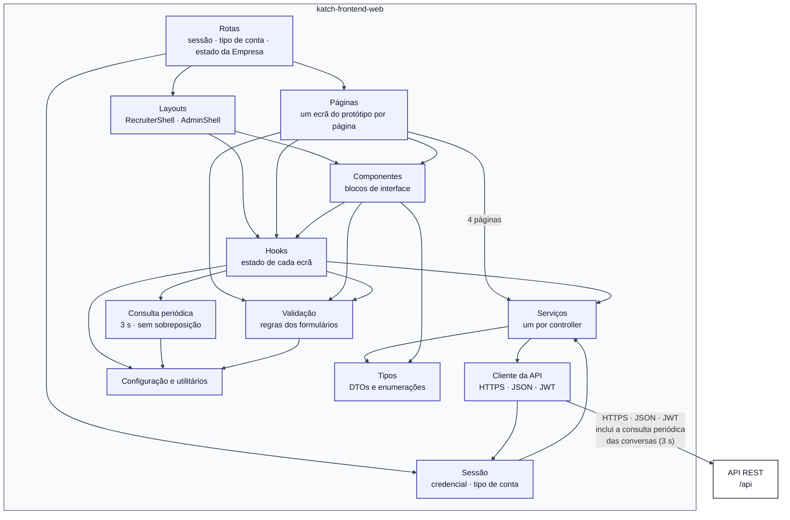

### 2.2. Convenções de código e de diagrama

- **Nomes:** componentes, páginas e tipos em PascalCase; funções, variáveis e propriedades em camelCase; hooks com o prefixo `use`; as interfaces que definem um contrato ou o resultado de um hook têm o prefixo `I` (`IApiClient`, `IPollingScheduler`, `IResourceState`, `ICandidateProfileState`). O ESLint 10 (configuração plana em `eslint.config.js`, com as regras recomendadas do ESLint, do `typescript-eslint` e dos hooks do React) e o Prettier verificam o código (RI, secções 11.3 e 11.4); o guia Airbnb referido no RI não é verificado automaticamente (secção 14).
- **Comentários:** cada ficheiro de produção tem um cabeçalho JSDoc com `@param` e `@returns`, e cada rota tem o comentário `RFxxx: Título` com o requisito que a justifica. O código não refere identificadores de Issues.
- **Tipos:** os tipos do cliente espelham os DTOs do backend com os mesmos nomes e os mesmos campos em camelCase (por exemplo, `CompanyStatusDto.CompanyId` ↔ `companyId`), que é a forma por omissão da serialização JSON do ASP.NET Core. Correspondências: `Guid` ↔ `string`; `DateTimeOffset` ↔ `string` em ISO 8601; `DateOnly` ↔ `string` no formato `aaaa-MM-dd`; `decimal` e `int` ↔ `number`; `bool` ↔ `boolean`; `List<T>` ↔ `T[]`; `T?` ↔ `T | null`. As datas e horas chegam em UTC com o sufixo `Z` e são convertidas para a hora local só na apresentação. As enumerações do backend são uniões de literais de texto com os valores JSON da API, em maiúsculas com `_` e iguais aos do PostgreSQL: `ContractType.ServiceProvision` ↔ `"SERVICE_PROVISION"` (documentação da API, secções 2.3 e 2.4, DAPI-01). A enumeração própria do cliente (`LoginArea`) não vai para a API e usa PascalCase.
- **Diagramas Mermaid (`classDiagram`):** `+` público, `-` privado; atributos na forma `tipo nome`, como no modelo de classes do backend; `T?` = valor que pode ser `null`; `~T~` = tipo genérico. Estereótipos: `<<interface>>`, `<<enumeration>>`, `<<type>>` (tipo de dados sem lógica), `<<page>>`, `<<component>>`, `<<hook>>`, `<<context>>` (contexto React), `<<constant>>` (valor de configuração) e `<<module>>` (ficheiro de funções e constantes sem classe, como `paths` ou `date`).
- **Relações:** `--` associação com multiplicidades; `*--` composição (o elemento composto só existe dentro do todo); `..>` dependência (uso por importação ou por propriedade); `..|>` realização de interface; `<|--` especialização.
- **Assíncrono:** as operações dos serviços, do cliente da API e dos hooks que fazem pedidos devolvem `Promise<T>`; nos diagramas indica-se apenas `T`, como no modelo de classes do backend (secção 2.2).
- **Páginas, componentes e hooks:** são funções React. A notação de classe representa as propriedades (atributos), o estado exposto e os comandos de interface (operações), como exige a secção 19 do Regulamento da UC para os modelos de classes.

---

## 3. Tipos do cliente

### 3.1. Enumerações

As enumerações são as do contrato da API (documentação da API v02, secção 2.4) usadas pela área de gestão web, com os valores JSON. Um valor fora da lista é rejeitado pelo servidor com `400`.

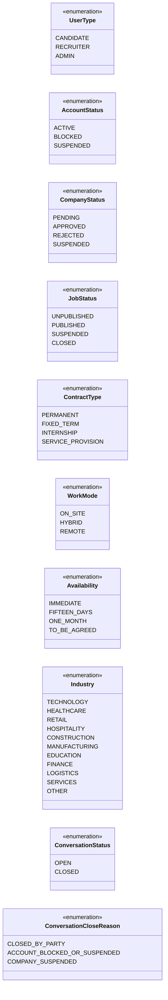

`MatchStatus`, `OperationType` e `ClientApp` são enumerações internas do backend: nenhum DTO as contém e não fazem parte do contrato (documentação da API v02, secção 2.4). O ponto de acesso (`ClientApp`) é indicado no cabeçalho `X-Client-App` (secção 4.1). `FileKind` só aparece na rota de `GET /api/files/{kind}/{fileName}`, dentro dos URL que os DTOs já trazem prontos; o cliente nunca constrói esses URL e, por isso, não declara o tipo (secção 4.3). A enumeração `NotificationType` da v01 foi retirada com a funcionalidade F011.

A língua da interface é apenas o português (arquitetura, secção 2.5). As designações apresentadas estão num único módulo de apresentação (`src/types/labels.ts`), com um `Record` por enumeração; os formulários e os filtros tiram as opções dos mesmos mapas (`optionsOf`):

| Mapa | Enumeração | Designações em português | Origem |
| --- | --- | --- | --- |
| `userTypeLabels` | `UserType` | Candidato; Recrutador; Administrador | RF085 |
| `accountStatusLabels` | `AccountStatus` | Ativa; Bloqueada; Suspensa | RF085, RF088 |
| `companyStatusLabels` | `CompanyStatus` | Pendente; Aprovada; Recusada; Suspensa | RF044, RF097 |
| `jobStatusLabels` | `JobStatus` | Não publicada; Publicada; Suspensa; Encerrada | W09, W21 |
| `contractTypeLabels` | `ContractType` | Sem termo; A termo; Estágio; Prestação de serviços | P09 |
| `workModeLabels` | `WorkMode` | Presencial; Híbrido; Remoto | P16 |
| `availabilityLabels` | `Availability` | Imediata; Quinze dias; Um mês; A combinar | P14 |
| `industryLabels` | `Industry` | Tecnologia; Saúde; Comércio; Hotelaria e restauração; Construção; Indústria; Educação; Finanças; Logística; Serviços; Outro | P15 |
| `conversationCloseReasonLabels` | `ConversationCloseReason` | Encerrada por uma das partes; Conta bloqueada ou suspensa; Empresa suspensa | RF074, RF075 |
| `badgeStatusLabels` | `JobStatus`, `CompanyStatus` e `AccountStatus` | Junção dos três mapas anteriores, usada pelo `StatusBadge` | RF044, RF053, RF085, RF097 |

O `ConversationStatus` não tem mapa: a `ConversationsPage` mostra a etiqueta «Encerrada» nas conversas `CLOSED` e a faixa «Conversa encerrada. Apenas consulta.» na conversa aberta (secção 6).

No motivo `CLOSED_BY_PARTY`, a página distingue «Encerrada por si» de «Encerrada pelo Candidato» comparando `ConversationSummaryDto.closedBy` com o `userId` da sessão (documentação da API v02, 8.4).

### 3.2. Tipos dos DTOs

Os tipos espelham os DTOs do backend (modelo de classes do backend v03, secções 7.1 e 7.2), campo a campo, e coincidem com `src/types/api.ts`. São tipos de dados sem lógica.

```mermaid
classDiagram
    direction LR
    class LoginRequest {
        <<type>>
        +string email
        +string password
    }
    class LoginResponse {
        <<type>>
        +string token
        +string expiresAt
        +UserType userType
        +string userId
    }
    class CreateRecruiterAccountRequest {
        <<type>>
        +string email
        +string password
        +boolean acceptTerms
    }
    class ChangePasswordRequest {
        <<type>>
        +string currentPassword
        +string newPassword
    }
    class CompanyRegistrationRequest {
        <<type>>
        +string companyName
        +string taxId
        +Industry industry
        +string address
        +string locationId
        +string contactEmail
        +string contactPhone
        +string responsibleName
    }
    class CompanyRegistrationDto {
        <<type>>
        +string companyId
        +string companyName
        +string taxId
        +Industry industry
        +string address
        +string locationId
        +string locationName
        +string contactEmail
        +string contactPhone
        +string responsibleName
        +string submittedAt
    }
    class CompanyStatusDto {
        <<type>>
        +string companyId
        +CompanyStatus status
        +string? rejectionReason
        +string submittedAt
    }
    class CompanyPageDto {
        <<type>>
        +string companyId
        +string companyName
        +string? description
        +string? website
        +string? logoUrl
        +string[] photoUrls
    }
    class CompanyPageRequest {
        <<type>>
        +string? description
        +string? website
    }
    class JobRequest {
        <<type>>
        +string title
        +string description
        +number minSalary
        +number maxSalary
        +string locationId
        +ContractType contractType
        +WorkMode workMode
        +string[] skillIds
        +string[] benefitIds
        +boolean isUrgent
        +string? expiresAt
    }
    class JobDto {
        <<type>>
        +string jobId
        +string title
        +string description
        +number minSalary
        +number maxSalary
        +string locationId
        +string locationName
        +ContractType contractType
        +WorkMode workMode
        +ReferenceItemDto[] skills
        +ReferenceItemDto[] benefits
        +boolean isUrgent
        +string? expiresAt
        +JobStatus status
        +string? publishedAt
        +string[] photoUrls
        +number waitingCandidates
    }
    class ReferenceItemDto {
        <<type>>
        +string id
        +string name
    }
    class ReferenceItemRequest {
        <<type>>
        +string name
    }
    JobDto "1" *-- "0..*" ReferenceItemDto : competências e benefícios
```

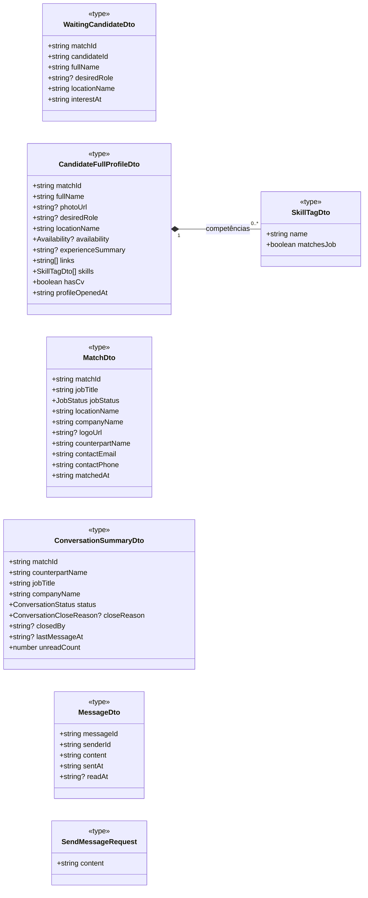

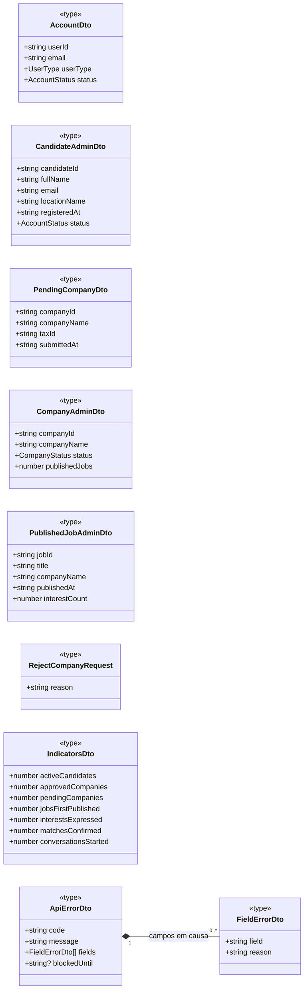

São 29 tipos, com os campos da documentação da API v02 (secção 8). Os campos acrescentados pela `I104` (`ApiErrorDto.code` e `blockedUntil`, `WaitingCandidateDto.desiredRole` e `locationName`, `CandidateFullProfileDto.profileOpenedAt`, `MatchDto.jobStatus`, `locationName` e `logoUrl`, `ConversationSummaryDto.closedBy`) fazem parte do contrato v02, que o cliente segue, e constam do modelo de classes do backend v03 (secção 7). `blockedUntil` só é preenchido no ERR-31, que não ocorre neste módulo. Os tipos próprios do Candidato (`RegisterCandidateRequest`, `CandidateProfileDto`, `CustomSkillDto`, `UpdateCandidateProfileRequest`, `SearchPreferencesDto`, `AddSkillRequest`, `AddCustomSkillRequest`, `SetLinksRequest`, `JobCardDto`, `JobDetailDto`, `QuotaDto`) pertencem ao modelo de classes da aplicação móvel.

`photoUrl`, `logoUrl` e `photoUrls` são URL da API, na forma `/api/files/{kind}/{fileName}`, que servem o ficheiro depois de verificar a autorização (documentação da API v02, 2.6 e 6.9.1). O cliente nunca constrói esses URL; usa-os tal como chegam e obtém o conteúdo como descrito na secção 4.3.

---

## 4. Acesso à API

### 4.1. Cliente da API

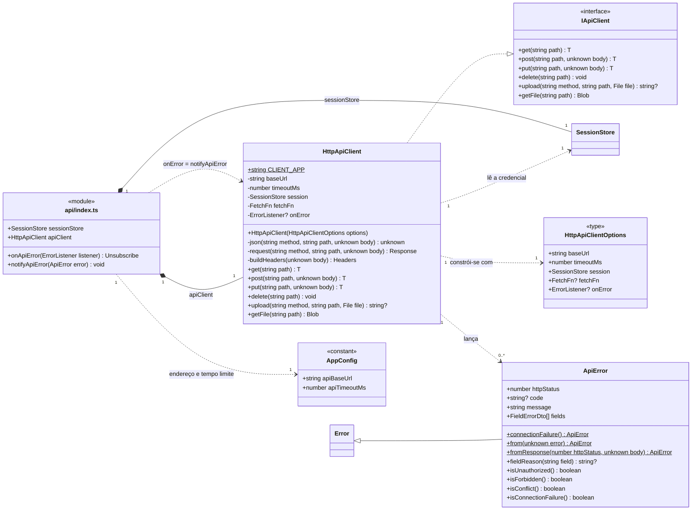

`get`, `post`, `put` e `json` são genéricos no tipo da resposta esperada; por exemplo, `get<CompanyStatusDto>(…)` devolve `Promise<CompanyStatusDto>`. O parâmetro de tipo está omitido no diagrama. `FetchFn` é o tipo de `fetch` (substituído nos testes) e `ErrorListener` é `(error: ApiError) => void`.

| Elemento | Responsabilidade | Requisitos |
| --- | --- | --- |
| `HttpApiClient.buildHeaders` | Acrescenta `Accept: application/json`, o cabeçalho `X-Client-App` com `CLIENT_APP` = `web`, exigido no início de sessão (documentação da API, secção 3.2, DAPI-02), `Content-Type: application/json` quando há corpo que não é um formulário, e a credencial de sessão no cabeçalho `Authorization` (`Bearer`), obtida de `SessionStore.token()`, que devolve `null` com a credencial expirada. O identificador do utilizador nunca vai na rota nem no corpo do pedido: o servidor obtém-no da credencial (backend, DC-05; documentação da API, secção 2.5). | RF038, RF083, RNF004, RNF006 |
| `HttpApiClient.upload` | Envia o ficheiro em `multipart/form-data`, num único campo `file`, com `PUT` (fotografia única: logótipo) ou `POST` (galeria e fotografias da vaga), e devolve o endereço do cabeçalho `Location` da resposta (`204` ou `201`) ou `null` (documentação da API, secção 2.6, DAPI-10). | RF047, RF048, RF052 |
| `HttpApiClient.request` | Aborta o pedido ao fim de `timeoutMs`, que é inferior a 10 segundos (9000 ms por omissão), e, se não houver resposta, lança um `ApiError` com `isConnectionFailure()` verdadeiro (`httpStatus` 0). Numa resposta de erro, converte-a num `ApiError`, passa-o ao `onError` e lança-o. O temporizador cobre o pedido até chegarem os cabeçalhos da resposta; a leitura do corpo não tem limite próprio (secção 14). | RNF018, P19 |
| `HttpApiClient.json` | Lê o corpo da resposta como JSON; sem corpo (`204`), devolve `undefined`. | — |
| `toApiError` (função do módulo) | Converte a resposta de erro no `ApiErrorDto`, que é o formato de todas as respostas de erro, incluindo `401`, `403`, `404`, `413`, `415` e `500` (documentação da API, secção 4.1), por `ApiError.fromResponse`. Uma resposta sem `message` e `code` em texto (por exemplo, a de um intermediário da rede) dá a mensagem genérica «Ocorreu um erro inesperado. Tente de novo.» e `code` `null`. Expõe o motivo por campo, para a página o apresentar junto de cada campo (W04, A04d, A09b, A10b): o nome do campo vem em camelCase e, nas listas, com o índice (`skillIds[0]`); nos carregamentos é `file`. | RF037, RF040, RF042, RF084, RF094, RF099 a RF102 |
| `HttpApiClient.getFile` | Obtém um ficheiro protegido (fotografia, logótipo ou CV) com a credencial no cabeçalho e devolve-o como `Blob` (secção 4.3). | RNF004, RNF007 |
| `ApiError.from` | Devolve o próprio `ApiError` ou, para qualquer outro erro, um `ApiError` `500` genérico; é com ele que os hooks guardam o erro. | RNF018 |
| `ApiError.isUnauthorized` | Código `401`. Num pedido com sessão é ERR-01 (credencial em falta, inválida, expirada ou terminada): o `SessionProvider` termina a sessão e a rota encaminha para o início de sessão. No pedido de início de sessão é ERR-02 (credenciais erradas) e só a `LoginPage` o trata. | RNF004, RNF005, RNF009, P20 |
| `ApiError.isForbidden` | Código `403`: conta bloqueada ou suspensa, ponto de acesso errado, tipo de conta não autorizado, Empresa não aprovada ou elemento de outro titular; o tratamento depende de `code` (secção 4.2). | RF039, RF104, RNF006 |
| `ApiError.isConflict` | Código `409`: a operação não é possível no estado atual do elemento; o tratamento depende de `code` (secção 4.2). | RF058, RF117 |
| `onApiError`, `notifyApiError` | O cliente é criado antes do React e não conhece a sessão; por isso, cada resposta de erro é difundida a quem se tenha registado com `onApiError`. Só o `SessionProvider` se regista (ERR-01 e ERR-07, secção 4.2). `onApiError` devolve a função que cancela o registo. | RNF004, RF039 |
| `appConfig` (`config/env.ts`) | Endereço da API (`VITE_API_BASE_URL`, vazio por omissão, para o proxy do servidor de desenvolvimento) e tempo limite (`VITE_API_TIMEOUT_MS`, aceite só entre 0 e 10 segundos; senão, 9000 ms). | RNF018, P19 |
| `isConflictWithCode` (`utils/apiErrors.ts`) | Indica se um erro é um `409` com um dado `code`; é o que as páginas e os hooks usam para escolher o tratamento. | — |

A falha de ligação não é guardada num estado global: cada página ou hook que faz um pedido guarda o `ApiError` e mostra a mensagem de ligação no `ErrorAlert`, com «Tentar de novo» (secção 4.2). Os pedidos da consulta periódica também passam pelo cliente; uma falha de ligação com a área de conversas aberta aparece no limite do RNF018 como mensagem acima das mensagens (secção 6).

O valor de `timeoutMs` é fixado na configuração do repositório. Os verbos HTTP, as rotas completas e os códigos de estado de cada operação são os da documentação da API v02 e estão na tabela da secção 5.

### 4.2. Tratamento dos erros

O `ApiErrorDto` traz o identificador do erro no campo `code` (`ERR-01` a `ERR-50`; documentação da API v02, 4.1 e 4.3; PA-05 resolvido). `ApiError.fromResponse` copia-o para `ApiError.code`, e o tratamento de cada erro escolhe-se pelo código HTTP e por `code`, sem comparar o texto das mensagens. Quando a resposta não traz `ApiErrorDto` (por exemplo, falha de um intermediário da rede), `code` fica `null` e a página apresenta a mensagem genérica de erro. A mensagem apresentada ao utilizador é sempre a `message` do servidor. Os erros que não são tratados num sítio próprio (tabela seguinte) aparecem no `ErrorAlert` da página ou do diálogo, ou no `FormBanner` dos formulários (`useFormSubmission`).

| Erro da API | Código | Tratamento na área de gestão web | Ecrãs | Requisitos |
| --- | --- | --- | --- | --- |
| ERR-01 | 401 | O `SessionProvider` termina a sessão (`SessionStore.clear`), só se houver sessão; o `RequireSession` encaminha para `/entrar` ou `/admin/entrar`, conforme a rota pedida. A consulta periódica para, porque a `ConversationsPage` é desmontada (secção 6). | Todos | RNF004, RNF005 |
| ERR-02 | 401 | Só no início de sessão: a `LoginPage` apresenta a mensagem única no `FormBanner`, sem distinguir correio inexistente de palavra-passe errada. | W01, A01 | RF038, RF083, RNF009 |
| ERR-03, ERR-04 | 403 | No início de sessão, a `LoginPage` apresenta a mensagem no `FormBanner`. Depois de a sessão iniciada, a conta pode ser bloqueada ou suspensa: o servidor passa a responder com ERR-03 ou ERR-04 a cada pedido, e o cliente não termina a sessão por este erro (só o ERR-01 e o ERR-07 são tratados pela sessão): cada página mostra a mensagem do servidor, e com a área de conversas aberta a consulta periódica seguinte recebe o erro (documentação da API v02, 7.2). O Recrutador sai com «Terminar sessão» (secção 14). | W01, A01 | RF086, RNF004 |
| ERR-05 | 403 | Conta de Candidato na área de gestão web: a `LoginPage` apresenta a mensagem no `FormBanner` (secção 7.2, regra 5). | W01, A01 | RF038, RF083 |
| ERR-06 | 403 | Sem tratamento próprio: o `RequireUserType` encaminha para `/acesso-negado` antes de qualquer pedido; se o servidor devolver o erro, a página mostra a mensagem. | A11 | RF103, RF104 |
| ERR-07 | 403 | O `SessionProvider` lê o estado da Empresa de novo (`refreshCompanyStatus`) e o `RequireCompanyStatus` encaminha para `/empresa/estado`. Aplica-se também à lista de matches (documentação da API, 6.7.1). | W05, W06, W21, W26 | RF039 |
| ERR-08, ERR-20 | 403, 404 | A página mostra a mensagem no `ErrorAlert`; nas páginas de lista, «Tentar de novo» volta a ler a lista de origem. `ERR-20` em `getStatus` e em `getRegistration` não é erro: o `CompanyService` devolve `null`, que significa Empresa por registar (secção 5, regra 7). Num ficheiro, qualquer falha mostra o marcador vazio (secção 4.3). Na edição de uma vaga que já não existe, o `useJobFormData` produz o mesmo `ApiError` (`404`, `ERR-20`). | Todos | RF059, RNF006 |
| ERR-10, ERR-11 | 400 | Motivo junto de cada campo de `fields`, pelo `useFormSubmission`; ERR-11 junto do campo de ficheiro (mensagem do `ImageUploadButton`). No período dos indicadores, o `useIndicators` junta a mensagem e os motivos como erro do período. Na consulta periódica, um `after` mal formado não ocorre, porque o cliente envia o `sentAt` recebido do servidor. | W04, W06, W08, W10, W11, W22, W25, A04d, A09b, A10b | RF037, RF042, RF051, RF084, RF094, RF099 a RF102 |
| ERR-12, ERR-13 | 413, 415 | Mensagem do servidor, mostrada pelo `useFileUpload`. Na prática não ocorrem, porque o cliente verifica o formato e a dimensão antes de enviar (`validateImageFile`; secção 5, regra 8). | W07, W10, W11 | RF047, RF048, RF052 |
| ERR-30 | 409 | Transição de estado já não possível (vaga, Empresa ou conta mudou entretanto): nas listas, a falha aparece no `ActionFeedback` e a lista é lida de novo (`reloadAfter`, que recarrega também quando a ação falha; na lista de vagas, `reload`); no A04e, a mensagem com «Ver lista atualizada»; ao voltar a submeter um registo que já não está recusado, a `CompanyRequestStatusPage` não o trata como falha e mostra o estado novo. | W12 a W14, A04e, A05b, A07b, A08b | RF053 a RF056, RF093 a RF095, RF115, RF116 |
| ERR-34, ERR-35 | 409 | ERR-34: decisão sem abertura do perfil registada. ERR-35: o interesse já não está em espera, na decisão, na abertura do perfil ou na obtenção do CV (documentação da API, 6.6.2 a 6.6.5; UC12, E1 e E4). Em ambos: a `CandidateProfilePage` mostra a mensagem e o estado da decisão volta a `idle`; «Voltar aos candidatos» lê de novo a lista de candidatos em espera. | W16, W17, W18, W20 | RF061, RF063, RF064, RF117, RF118, RNF007 |
| ERR-36, ERR-37 | 409 | O `ConversationsProvider` mostra a mensagem junto do campo de escrita e lê a lista de conversas de novo, sem esperar pela consulta periódica seguinte; a conversa passa a só de consulta (W23). | W22, W23 | RF069, RF070, RF075 |
| ERR-38 | 409 | Diálogo «Não é possível eliminar a vaga» do W15, com «Encerrar vaga» e «Voltar». | W15 | RF058, RF114 |
| ERR-39 | 409 | Mensagem do servidor junto do botão; o `useCompanyPage` lê a página de novo e o contador «n/6» é atualizado. A verificação local (`GALLERY_MAX_PHOTOS`, `MAX_JOB_PHOTOS`) evita o pedido na maioria dos casos. | W07, W10, W11 | RF048, RF052, P13 |
| ERR-40 | 409 | Já existe Empresa: a `CompanyRegistrationPage` não trata como falha; lê o estado (`refreshCompanyStatus`) e segue para `/empresa/estado`. | W03 | RF041 |
| ERR-41 | 409 | Alteração concorrente: sem tratamento próprio; o `FormBanner` mostra a mensagem do servidor e o utilizador repete a operação. | Todos os formulários | — |
| ERR-50 | 500 | Mensagem do servidor; nada ficou gravado e a ação pode ser repetida. | Todos | RNF013 |
| Sem resposta | — | `isConnectionFailure()`: a página ou o diálogo mostra a mensagem de ligação no `ErrorAlert` com «Tentar de novo» (nos formulários, o `FormBanner` oferece «Tentar de novo» como novo envio). Na consulta periódica, a falha não interrompe o ciclo: a consulta seguinte é feita 3 segundos depois e, se tiver resposta, a mensagem desaparece. | A02d e todos | RNF018 |

Os erros ERR-31 a ERR-33 são exclusivos do Candidato e não ocorrem neste módulo.

### 4.3. Ficheiros protegidos

Um elemento `` ou uma ligação `<a href>` do browser não envia o cabeçalho `Authorization`. Como os endereços dos ficheiros só respondem depois de verificar a credencial (backend, secção 7.2; RNF007), o cliente não os usa diretamente: obtém o conteúdo com `getFile` do cliente da API (`apiClient`) e apresenta-o através de um endereço local do browser (`URL.createObjectURL`), libertado quando o componente desaparece.

Os endereços são servidos por `GET /api/files/{kind}/{fileName}` (documentação da API v02, 6.9.1), autorizado pela credencial de sessão no cabeçalho: logótipos e fotografias da Empresa e das vagas para qualquer conta com sessão; fotografia de perfil do Candidato só para o Recrutador de uma Empresa em cuja vaga o Candidato tem um interesse registado. Um ficheiro inexistente ou sem autorização devolve `404` (ERR-20); qualquer falha na obtenção faz o `ProtectedImage` mostrar o marcador vazio («Fotografia»). O cliente usa o endereço tal como vem no DTO ou no cabeçalho `Location`, sem o construir. O CV não tem endereço: é obtido em `GET /api/recruiter/interests/{matchId}/cv` (`application/pdf`), só enquanto o interesse está em espera (RNF007).

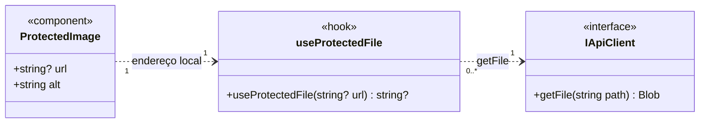

| Elemento | Responsabilidade | Ecrãs | Requisitos |
| --- | --- | --- | --- |
| `useProtectedFile` | Recebe o endereço devolvido pela API (ou `null`), obtém o ficheiro com a credencial (`GET /api/files/{kind}/{fileName}`) e devolve o endereço local, ou `null` enquanto carrega, sem endereço ou se o pedido falhar; revoga o endereço local ao desmontar ou quando o endereço muda. É o único hook que não devolve um recurso (secção 9). | W07, W10, W11, W17, W19 | RNF004, RNF007 |
| `ProtectedImage` | Apresenta fotografias e logótipos protegidos; sem endereço local mostra o marcador vazio do protótipo. | W07, W10, W11, W17, W19 | RF047, RF048, RF052, RF061 |
| `CandidateEvaluationService.getCv` | Obtém o CV em PDF (`Blob`). Quem o abre é o `useCandidateProfile.openCv`, num novo separador, a partir de um endereço local que é revogado ao fim de 60 segundos. Sem CV, o servidor devolve `404` (ERR-20); com o interesse fora de espera, `409` (ERR-35); com a vaga de outra Empresa, `403` (ERR-08). O botão «Abrir CV (PDF)» só aparece com `hasCv` verdadeiro e antes de haver decisão. | W17 | RF061, RNF007 |

---

## 5. Serviços

Há um serviço por controller do backend usado pela área de gestão web, com as operações do controller em camelCase e os mesmos nomes (backend v03, secção 6). Cada serviço recebe o `IApiClient` no construtor e tem uma instância única, criada em `src/services/index.ts` com o `apiClient` (secção 4.1); os hooks e a sessão importam essas instâncias. Não há interfaces `I…Service`: a abstração que permite simular o servidor nos testes é o `IApiClient`. O `FilesController` não tem serviço: os seus URL chegam prontos nos DTOs e são obtidos com `IApiClient.getFile` (secção 4.3). O `NotificationsController` deixou de existir com a funcionalidade F011 e, com ele, o `NotificationService` da v01.

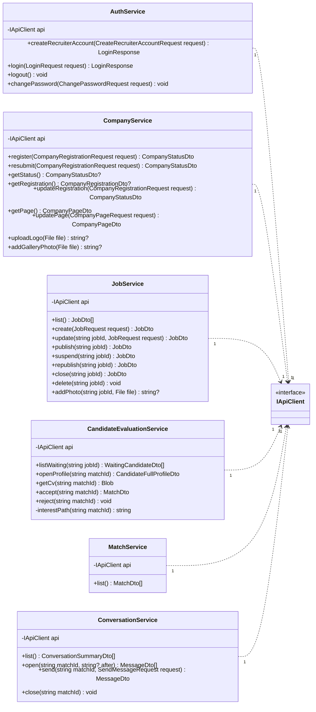

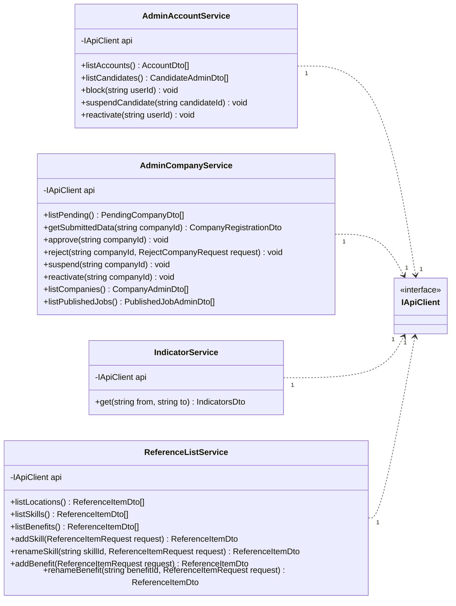

| Serviço | Controller correspondente | Rota base | Quem usa | Casos de uso |
| --- | --- | --- | --- | --- |
| `AuthService` | `AuthController` | `/api/auth` | Recrutador e Administrador | UC01, UC02, UC07 |
| `CompanyService` | `CompanyController` | `/api/recruiter/company` | Recrutador | UC07, UC08 |
| `JobService` | `JobsController` | `/api/recruiter/jobs` | Recrutador | UC09, UC10 |
| `CandidateEvaluationService` | `CandidateEvaluationController` | `/api/recruiter` | Recrutador | UC11, UC12 |
| `MatchService` | `MatchesController` | `/api/matches` | Recrutador | UC13 |
| `ConversationService` | `ConversationsController` | `/api/conversations` | Recrutador | UC14 |
| `AdminAccountService` | `AdminAccountsController` | `/api/admin/accounts` | Administrador | UC18 |
| `AdminCompanyService` | `AdminCompaniesController` | `/api/admin/companies` | Administrador | UC16, UC17 |
| `IndicatorService` | `AdminIndicatorsController` | `/api/admin/indicators` | Administrador | UC19 |
| `ReferenceListService` | `ReferenceListsController` | `/api/reference-lists` | Recrutador (consulta) e Administrador | UC09, UC10, UC20 |

Pedido HTTP de cada operação, segundo a documentação da API v02 (secções 5 e 6; o número entre parênteses é a secção do endpoint). As rotas com `{…}` recebem o identificador como texto (`Guid`), codificado com `encodeURIComponent`.

| Serviço | Operação | Pedido | Resposta de sucesso |
| --- | --- | --- | --- |
| `AuthService` | `createRecruiterAccount` | `POST /api/auth/recruiters` | `201` · `LoginResponse` |
| | `login` | `POST /api/auth/login` (com `X-Client-App: web`) | `200` · `LoginResponse` |
| | `logout` | `POST /api/auth/logout` | `204` |
| | `changePassword` | `PUT /api/auth/password` | `204` |
| `CompanyService` | `register` | `POST /api/recruiter/company` | `201` · `CompanyStatusDto` |
| | `resubmit` | `POST /api/recruiter/company/resubmission` | `200` · `CompanyStatusDto` |
| | `getStatus` | `GET /api/recruiter/company/status` | `200` · `CompanyStatusDto`; `404` sem Empresa (devolvido como `null`) |
| | `getRegistration` | `GET /api/recruiter/company` (6.4.8) | `200` · `CompanyRegistrationDto`; `404` sem Empresa (devolvido como `null`) |
| | `updateRegistration` | `PUT /api/recruiter/company` | `200` · `CompanyStatusDto` |
| | `getPage` | `GET /api/recruiter/company/page` (6.4.9) | `200` · `CompanyPageDto` |
| | `updatePage` | `PUT /api/recruiter/company/page` | `200` · `CompanyPageDto` |
| | `uploadLogo` | `PUT /api/recruiter/company/logo` (`multipart/form-data`) | `204` · `Location` |
| | `addGalleryPhoto` | `POST /api/recruiter/company/photos` (`multipart/form-data`) | `201` · `Location` |
| `JobService` | `list` | `GET /api/recruiter/jobs` | `200` · `JobDto[]` |
| | `create` | `POST /api/recruiter/jobs` | `201` · `JobDto` |
| | `update` | `PUT /api/recruiter/jobs/{jobId}` | `200` · `JobDto` |
| | `publish`, `suspend`, `republish`, `close` | `POST /api/recruiter/jobs/{jobId}/publish`, `…/suspend`, `…/republish`, `…/close` | `200` · `JobDto` |
| | `delete` | `DELETE /api/recruiter/jobs/{jobId}` | `204` |
| | `addPhoto` | `POST /api/recruiter/jobs/{jobId}/photos` (`multipart/form-data`) | `201` · `Location` |
| `CandidateEvaluationService` | `listWaiting` | `GET /api/recruiter/jobs/{jobId}/waiting-candidates` | `200` · `WaitingCandidateDto[]` |
| | `openProfile` | `GET /api/recruiter/interests/{matchId}/profile` | `200` · `CandidateFullProfileDto` |
| | `getCv` | `GET /api/recruiter/interests/{matchId}/cv` | `200` · `application/pdf` |
| | `accept` | `POST /api/recruiter/interests/{matchId}/accept` | `200` · `MatchDto` |
| | `reject` | `POST /api/recruiter/interests/{matchId}/reject` | `204` |
| `MatchService` | `list` | `GET /api/matches` | `200` · `MatchDto[]` |
| `ConversationService` | `list` | `GET /api/conversations` | `200` · `ConversationSummaryDto[]` |
| | `open` | `GET /api/conversations/{matchId}/messages` (6.8.2), sem `after` ao abrir a conversa; na consulta periódica, `GET /api/conversations/{matchId}/messages?after=<sentAt da última mensagem recebida>` | `200` · `MessageDto[]` (histórico completo, ou só as mensagens posteriores a `after`; lista vazia se não houver novas) |
| | `send` | `POST /api/conversations/{matchId}/messages` | `201` · `MessageDto` |
| | `close` | `POST /api/conversations/{matchId}/close` | `204` |
| `AdminAccountService` | `listAccounts` | `GET /api/admin/accounts` | `200` · `AccountDto[]` |
| | `listCandidates` | `GET /api/admin/accounts/candidates` | `200` · `CandidateAdminDto[]` |
| | `block` | `POST /api/admin/accounts/{userId}/block` | `204` |
| | `suspendCandidate` | `POST /api/admin/accounts/candidates/{candidateId}/suspend` | `204` |
| | `reactivate` | `POST /api/admin/accounts/{userId}/reactivate` | `204` |
| `AdminCompanyService` | `listPending` | `GET /api/admin/companies/pending` | `200` · `PendingCompanyDto[]` |
| | `getSubmittedData` | `GET /api/admin/companies/{companyId}/registration` | `200` · `CompanyRegistrationDto` |
| | `approve`, `suspend`, `reactivate` | `POST /api/admin/companies/{companyId}/approve`, `…/suspend`, `…/reactivate` | `204` |
| | `reject` | `POST /api/admin/companies/{companyId}/reject` | `204` |
| | `listCompanies` | `GET /api/admin/companies` | `200` · `CompanyAdminDto[]` |
| | `listPublishedJobs` | `GET /api/admin/companies/published-jobs` | `200` · `PublishedJobAdminDto[]` |
| `IndicatorService` | `get` | `GET /api/admin/indicators?from=aaaa-MM-dd&to=aaaa-MM-dd` | `200` · `IndicatorsDto` |
| `ReferenceListService` | `listLocations`, `listSkills`, `listBenefits` | `GET /api/reference-lists/locations`, `…/skills`, `…/benefits` | `200` · `ReferenceItemDto[]` |
| | `addSkill`, `addBenefit` | `POST /api/reference-lists/skills`, `…/benefits` | `201` · `ReferenceItemDto` |
| | `renameSkill`, `renameBenefit` | `PUT /api/reference-lists/skills/{skillId}`, `…/benefits/{benefitId}` | `200` · `ReferenceItemDto` |
| `IApiClient` | `getFile` | `GET /api/files/{kind}/{fileName}` (6.9.1), com o URL tal como vem no DTO ou no `Location` | `200` · `image/jpeg` ou `image/png`; `404` sem ficheiro ou sem autorização |

Regras dos serviços:

1. `AuthService.createRecruiterAccount` devolve a credencial de sessão (`LoginResponse`), como no backend: depois de criar a conta (W02), o `SessionProvider.signUp` inicia a sessão e o Recrutador segue para o registo da Empresa (W03).
2. `AuthService.logout` pede `POST /api/auth/logout`, com que o servidor revoga as credenciais emitidas à conta (versão da sessão; backend v03, DC-17). O `SessionProvider.signOut` não espera pela resposta: descarta a credencial no cliente e ignora uma falha do pedido, para que o utilizador saia sempre.
3. `JobService.addPhoto` exige o identificador da vaga. Na criação (W10), as fotografias escolhidas ficam em espera no formulário e só são enviadas, uma a uma, depois de `create` devolver a vaga; as que falharem ficam listadas com o motivo (na criação, o formulário passa à edição da vaga criada com essa lista).
4. `CandidateEvaluationService.accept` e `reject` só são chamadas a partir da página do perfil completo, depois de `openProfile`, porque é essa chamada que regista a abertura exigida pelo RF118 (UC12, pré-condição 5): o `useCandidateProfile` pede o perfil ao montar e só aceita uma decisão com o perfil aberto (`profileOpened`). O servidor rejeita a decisão sem esse registo (UC12, E1).
5. `JobService.delete` é pedido sem verificação prévia no cliente: `JobDto.waitingCandidates` só conta os interesses em espera e não todos os interesses registados. Se a vaga tiver interesses, o servidor rejeita a eliminação com `409` (ERR-38) e a página apresenta o diálogo do W15, com a alternativa de encerrar a vaga (RF058, RF114).
6. `IndicatorService.get` envia as datas no formato `aaaa-MM-dd` (`DateOnly` no backend), como parâmetros de consulta; o servidor interpreta-as como dias completos no fuso `Europe/Lisbon` e rejeita, com `400`, a data inicial posterior à final e a data final posterior à atual (documentação da API, 6.12.1, DAPI-07). O `useIndicators` faz as mesmas verificações antes do pedido (`periodError`; A02c).
7. `CompanyService.getStatus` e `getRegistration` devolvem `404` (ERR-20) quando o Recrutador ainda não registou a Empresa (documentação da API v02, 6.4.3 e 6.4.8). O serviço converte essa resposta em `null` (função `nullWhenNoCompany`), que o `SessionProvider` guarda como «sem Empresa registada» (`companyStatus` nulo com `companyLoaded` verdadeiro; secção 7.1). `getRegistration` exige só a política `Recruiter`, e serve por isso também os ecrãs de Empresa pendente, recusada ou suspensa (W05, W06, W26); `getPage` exige `ApprovedCompany`.
8. Antes de cada carregamento, o cliente verifica o formato e a dimensão do ficheiro (`validateImageFile`): logótipo JPEG ou PNG até 2 MB; fotografias da galeria e da vaga JPEG ou PNG até 5 MB; no máximo 6 fotografias na galeria e 5 por vaga (P01, P13). O servidor volta a verificar tudo, incluindo o conteúdo do ficheiro (RNF016).
9. `AdminAccountService.reactivate` recebe o identificador da conta. Na `CandidatesPage` é usado o `candidateId`, que é o mesmo identificador, porque a tabela `candidate` partilha a chave primária com `app_user` (modelo de dados v02, DM-02).
10. `ConversationService.open` é a mesma operação na abertura da conversa e na consulta periódica: sem `after`, devolve o histórico completo; com `after`, só as mensagens enviadas depois desse instante. Em ambos os casos o servidor marca como lidas as mensagens do Candidato (RF109); repetir o pedido não muda nada (documentação da API v02, 2.5 e DAPI-05). O valor de `after` é sempre o `sentAt` de uma mensagem recebida do servidor, nunca a hora do browser, para que a diferença entre os relógios não faça perder mensagens (secção 6, regra 3).
11. As operações de `ConversationService` não são chamadas pelo Administrador: a área de supervisão não tem conversas e o servidor rejeita o Administrador com `403` (ERR-06) (RF103).

---

## 6. Consulta periódica das conversas

A Declaração de Âmbito v04 substitui a ligação bidirecional persistente pela consulta periódica do cliente ao servidor (F010) e retira as notificações (limites transversais). Enquanto a lista de conversas ou uma conversa está aberta na área de gestão web, o cliente repete, de 3 em 3 segundos, os mesmos pedidos que usa para abrir a área de conversas (documentação da API v02, secção 7; backend v03, secção 6.1 e DC-07; arquitetura v03, AD-02; ata de 2026-10-16, deliberação 1). Não há biblioteca de comunicação em tempo real nem pedidos específicos para a consulta periódica. Só o Recrutador usa esta secção: a área de supervisão não tem conversas (RF103).

Na área de gestão web, a lista de conversas e a conversa escolhida estão no mesmo ecrã (W22, W23). Por isso, com a `ConversationsPage` aberta há sempre uma consulta da lista e, com uma conversa escolhida, também uma consulta das mensagens dessa conversa.

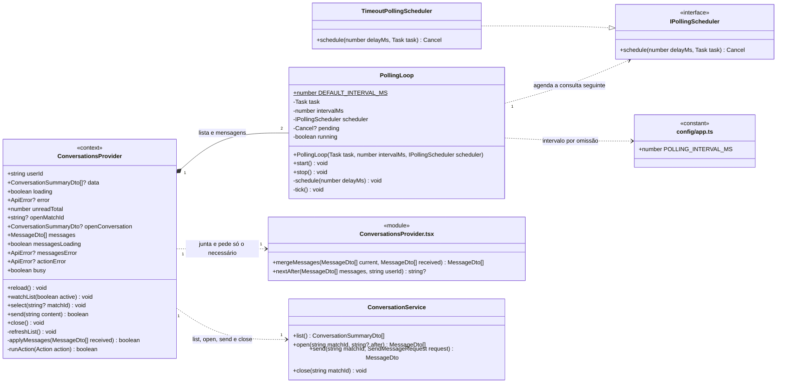

Os pedidos da consulta periódica passam pelo `HttpApiClient`, como todos os outros: levam a credencial de sessão no cabeçalho e têm o mesmo tempo limite (secção 4.1).

| Elemento | Responsabilidade | Requisitos |
| --- | --- | --- |
| `IPollingScheduler` e `TimeoutPollingScheduler` | Agendam uma tarefa (`Task`, tipo `() => Promise<void>`) para daqui a `delayMs` milissegundos e devolvem a função que a cancela (`Cancel`, tipo `() => void`). A implementação usa `setTimeout`. Nos testes Jest é substituída por temporizadores simulados, para verificar o intervalo sem esperar (RI, secção 11.5). | P17 |
| `PollingLoop` | Repete uma tarefa assíncrona: `start()` executa-a logo (agendamento a 0 ms), espera pela resposta e só então agenda a execução seguinte para `intervalMs` depois (regra 2); uma falha da tarefa não interrompe o ciclo. `stop()` cancela a execução agendada e impede novos agendamentos; a resposta de um pedido ainda em curso é descartada pelo `ConversationsProvider` (regra 9). Chamar `start()` num ciclo já ativo não faz nada. | RF073, P17 |
| `POLLING_INTERVAL_MS` | Intervalo da consulta periódica: 3000 ms (P17; deliberação 1 da ata de 2026-10-16). Fixado em `src/config/app.ts`, num único sítio, e usado como `PollingLoop.DEFAULT_INTERVAL_MS`. | P17 |
| `ConversationsProvider` | Contexto com o estado da área de conversas: lista, total de mensagens por ler (contador da barra lateral), conversa escolhida e histórico. Tem dois `PollingLoop`: o da lista (`refreshList` → `list()`), ativo enquanto a `ConversationsPage` está aberta (`watchList(true)`), e o das mensagens (`open(matchId, after)`), ativo enquanto há uma conversa escolhida (`select`). Faz também o envio e o encerramento (`send`, `close`) e guarda o erro da última ação (`actionError`). Só é montado pela `RecruiterShell` com a Empresa aprovada ou suspensa. O `useConversations` lê este contexto (secção 9). | RF071, RF072, RF073, RF074, RF075, RF109 |
| `mergeMessages` | Junta as mensagens recebidas ao histórico por `messageId`, substitui uma mensagem quando muda `readAt`, ordena por `sentAt` e devolve o mesmo vetor quando nada mudou (sem nova apresentação). | RF072, RF109 |
| `nextAfter` | Calcula o valor de `after` do pedido seguinte: o `sentAt` da mensagem anterior à mais antiga das mensagens do Recrutador ainda por ler (para receber de novo essas mensagens e atualizar o «Lida»); sem mensagens próprias por ler, o `sentAt` da última mensagem; sem mensagens, `null` (histórico completo). | RF072, RF109 |

Pedidos repetidos (documentação da API v02, 7.1):

| Situação na área de gestão web | Pedido repetido de 3 em 3 segundos | Efeito no cliente | Requisitos |
| --- | --- | --- | --- |
| `ConversationsPage` aberta (W22, W23) | `ConversationService.list()` → `GET /api/conversations` | Substitui a lista: atualiza `unreadCount` de cada conversa, a ordem por `lastMessageAt`, o estado (`status`, `closeReason`, `closedBy`) e o total `unreadTotal` da barra lateral. Uma conversa que passou a `CLOSED` passa a só de consulta: aparece a faixa «Conversa encerrada. Apenas consulta.» com o motivo, e o campo de escrita, «Enviar» e «Encerrar conversa» ficam desativados (W23). | RF071, RF073, RF074, RF075; P17 |
| Conversa escolhida na `ConversationsPage` | `ConversationService.open(matchId, after)` → `GET /api/conversations/{matchId}/messages?after=<valor de nextAfter>` | Acrescenta ao histórico as mensagens novas, sem duplicados, e atualiza o «Lida» das mensagens próprias (regras 3 e 4). O servidor marca as do Candidato como lidas (RF109); quando chegam mensagens novas, o cliente lê também a lista, para o contador dessa conversa ficar a zero sem esperar pela consulta seguinte. | RF072, RF073, RF109; P17 |

Regras do cliente:

1. **Quando consulta.** A consulta da lista começa quando a `ConversationsPage` é montada e para quando é desmontada (o Recrutador muda de página, termina a sessão ou a sessão expira). A consulta das mensagens começa quando o Recrutador escolhe uma conversa (parâmetro `match` da rota) e para quando escolhe outra, volta à lista ou sai da página. Não há consulta periódica noutras páginas, nem com a sessão terminada (DA v04, F010: «enquanto a conversa ou a lista de conversas estiver aberta»; P17).
2. **Sem sobreposição.** O pedido seguinte só é agendado depois da resposta (ou da falha) do anterior, 3 segundos depois. Uma resposta lenta não acumula pedidos. Uma mensagem enviada logo a seguir a uma consulta surge, no pior caso, na consulta seguinte, 3 segundos mais a duração do pedido depois, dentro dos 5 segundos do P17, com as operações do servidor dentro dos 2 segundos do RNF001 (documentação da API v02, 7.2).
3. **Primeira consulta e seguintes.** Ao escolher uma conversa, o histórico está vazio e o cliente pede-o completo (`open` sem `after`). Daí em diante, cada consulta envia o valor de `nextAfter`: com todas as mensagens próprias já lidas, é o `sentAt` da última mensagem recebida; com mensagens próprias por ler, recua até à mensagem anterior à mais antiga delas, para as receber de novo já com `readAt`. Uma resposta vazia não altera o histórico.
4. **Mensagens próprias.** A mensagem enviada pelo Recrutador chega pela resposta de `send` e é acrescentada logo ao histórico (se a conversa escolhida ainda for a mesma); se a consulta seguinte a devolver também, é ignorada ou atualizada, porque o histórico é juntado por `messageId`.
5. **Mudança de estado da conversa.** O encerramento pela outra parte, o bloqueio ou a suspensão de uma conta e a suspensão da Empresa chegam na consulta seguinte da lista, pelo `status`, `closeReason` e `closedBy` (documentação da API v02, 7.2). Um `409` (ERR-36 ou ERR-37) num envio ou num encerramento antecipa essa leitura (secção 4.2).
6. **Erros.** Um `401` (ERR-01) termina a sessão (secção 4.2), o que desmonta a página e para a consulta. Um `403` de conta bloqueada ou suspensa (ERR-03, ERR-04) não termina a sessão no cliente: a consulta das mensagens mostra a mensagem do servidor acima do histórico a cada ciclo. Um `403` de Empresa não aprovada não ocorre nas conversas, que só exigem `CandidateOrRecruiter`; com a Empresa suspensa, as conversas ficam em modo só de consulta e continuam visíveis (divergência P2). Uma falha de ligação na consulta das mensagens mostra a mensagem acima do histórico, o ciclo continua e a mensagem desaparece na primeira consulta com resposta. Uma falha da consulta da lista com a lista já apresentada não interrompe o ciclo nem é indicada; a mensagem de erro da lista só aparece quando ainda não há lista (secção 14).
7. **Contador da barra lateral.** Fora da `ConversationsPage` não há consulta periódica: o `ConversationsProvider` pede a lista uma vez quando é montado e de cada vez que muda o caminho da página (`useLocation`), e o contador mostra o valor dessa leitura (decisão DF-14).
8. **Sem notificações.** O cliente não gera avisos nem sons e não tem área nem contador de notificações. A informação que na v01 chegava por notificação é consultada na página correspondente: o estado do pedido de registo da Empresa em `/empresa/estado` (RF044), os novos interessados em `/candidatos?vaga=:jobId` (RF060) e os novos matches em `/matches` (RF067) (DA v04, limites transversais).
9. **Respostas fora de tempo.** Cada escolha de conversa incrementa uma geração (`generation`). A resposta de uma consulta ou de um envio que chegue depois de o Recrutador ter escolhido outra conversa é descartada, para que mensagens de uma conversa não apareçam noutra.

---

## 7. Sessão e autorização

### 7.1. Estado da sessão

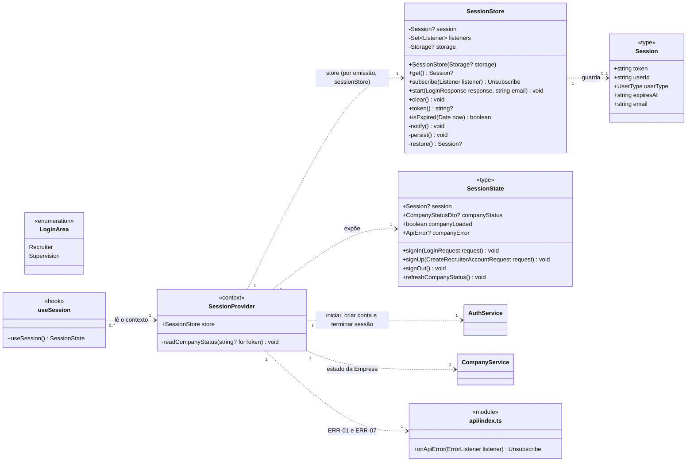

| Elemento | Responsabilidade | Requisitos |
| --- | --- | --- |
| `SessionStore.start` | Guarda a credencial, o identificador, o tipo de conta e a data de expiração devolvidos pelo servidor, e o endereço de correio eletrónico indicado no início de sessão (apresentado no W25 e no menu do utilizador da supervisão); espelha-os no `sessionStorage` e avisa os subscritores. | RF038, RF083 |
| `SessionStore.isExpired` | Compara a data de expiração com o instante atual; a credencial expira ao fim de 8 horas. `token()` devolve `null` com a sessão expirada. | RNF005, P20 |
| `SessionStore` (construção) | Lê a sessão guardada no `sessionStorage` (chave `katch.session`) e descarta-a se tiver formato inválido ou já tiver expirado; sem `sessionStorage` disponível, a sessão fica só em memória. | RNF005 |
| `SessionProvider.signIn`, `signUp` | Iniciam a sessão: `AuthService.login` ou `createRecruiterAccount` e `SessionStore.start`. Não encaminham: a navegação resulta de as rotas lerem a sessão (secção 7.2). Para o Recrutador, o provider lê o estado da Empresa. | RF037, RF038, RF083, RF104 |
| `SessionProvider.signOut` | Pede o fim de sessão ao servidor sem esperar pela resposta e descarta a credencial; a `RecruiterShell` e a `ConversationsPage` são desmontadas e a consulta periódica para (documentação da API v02, 6.1.4). | RF106, RF107 |
| `SessionProvider` (expiração) | Arma um temporizador para o instante de expiração e limpa a sessão se, nessa altura, ainda estiver expirada. | RNF005, P20 |
| `SessionProvider.companyStatus` | Estado da Empresa do Recrutador (`CompanyStatusDto`), `null` quando ainda não há Empresa registada (`getStatus` com `404`; secção 5, regra 7). `companyLoaded` indica se a primeira leitura já terminou; `companyError`, a falha dessa leitura (a `CompanyLoading` mostra-a com «Tentar de novo» e «Terminar sessão»). O estado pertence à credencial que o leu: ao mudar a sessão, o estado de outra sessão não é apresentado. Lido no início de sessão e atualizado depois de cada submissão, quando o Recrutador abre `/empresa/estado` ou escolhe «Atualizar estado» (`refreshCompanyStatus`), e quando um pedido devolve ERR-07 ou ERR-40. Não há notificação da decisão do Administrador: o Recrutador conhece-a pela consulta do estado do pedido (DA v04, F003; RF044). | RF039, RF043, RF044 |
| `SessionProvider` (erros da API) | Regista-se em `onApiError`: com ERR-01 e sessão ativa, termina a sessão; com ERR-07, lê o estado da Empresa de novo. Mais nenhum erro da API é tratado pela sessão. | RNF004, RF039 |

Os dados de registo da Empresa (`CompanyRegistrationDto`) não ficam na sessão: quem precisa deles obtém-nos com o `useCompany` (`CompanyRequestStatusPage`, `useCompanyPage`) ou, para pré-preencher a localidade da vaga, com o `useJobFormData`.

O estado da Empresa guardado no cliente serve apenas para escolher o que mostrar. A restrição é aplicada no servidor em cada operação reservada, pela política `ApprovedCompany` (backend, secção 6; RF039, RNF006): um estado desatualizado no cliente não permite nenhuma operação indevida, porque o pedido é rejeitado e o cliente volta a pedir o estado.

A credencial é guardada em memória no `SessionStore` e espelhada no `sessionStorage` do browser (decisão DF-05).

### 7.2. Rotas protegidas

```mermaid
classDiagram
    direction LR
    class AppRouter {
        <<component>>
    }
    class PublicOnly {
        <<component>>
        +LoginArea area
    }
    class RequireSession {
        <<component>>
    }
    class RequireUserType {
        <<component>>
        +UserType userType
    }
    class RequireCompanyStatus {
        <<component>>
        +CompanyAccess[] allow
    }
    class SessionHome {
        <<component>>
    }
    class CompanyLoading {
        <<component>>
    }
    class CompanyAccess {
        <<type>>
        CompanyStatus ou NONE
    }
    class paths {
        <<module>>
        +loginPathFor(string pathname) string
        +homePath(Session session, CompanyStatusDto? company) string
        +navigationState~T~(Location location) T
    }
    class useSession {
        <<hook>>
    }
    AppRouter "1" *-- "2" PublicOnly
    AppRouter "1" *-- "1" RequireSession
    AppRouter "1" *-- "1" SessionHome
    RequireSession "1" *-- "2" RequireUserType
    RequireUserType "1" *-- "0..*" RequireCompanyStatus
    RequireCompanyStatus "1" ..> "1" CompanyAccess : allow
    RequireCompanyStatus "1" ..> "0..1" CompanyLoading : enquanto lê o estado
    PublicOnly "1" ..> "1" SessionHome : com sessão
    PublicOnly "1" ..> "1" useSession
    RequireSession "1" ..> "1" useSession
    RequireUserType "1" ..> "1" useSession
    RequireCompanyStatus "1" ..> "1" useSession
    SessionHome "1" ..> "1" useSession
    RequireSession "1" ..> "1" paths : loginPathFor
    RequireCompanyStatus "1" ..> "1" paths : homePath
    SessionHome "1" ..> "1" paths : homePath
```

Os `RequireCompanyStatus` aninham-se: o de `NONE` guarda `/empresa/registo`; o de qualquer estado (`ANY_COMPANY_ACCESS`) envolve a `RecruiterShell`; dentro dela, o de `PENDING`, `REJECTED` e `SUSPENDED` guarda `/empresa/estado`, o de `APPROVED` e `SUSPENDED` guarda `/conversas` e o de `APPROVED` guarda as restantes rotas da Empresa aprovada.

| Rota | Proteção | Página | Ecrãs do protótipo |
| --- | --- | --- | --- |
| `/entrar` | Pública | `LoginPage` (área do Recrutador) | W01 |
| `/criar-conta` | Pública | `CreateRecruiterAccountPage` | W02 |
| `/admin/entrar` | Pública | `LoginPage` (área de supervisão) | A01, A01b |
| `/empresa/registo` | Recrutador sem Empresa registada | `CompanyRegistrationPage` | W03, W04 |
| `/empresa/estado` | Recrutador com Empresa pendente, recusada ou suspensa | `CompanyRequestStatusPage` | W05, W06, W26 |
| `/empresa` | Recrutador com Empresa aprovada | `CompanyProfilePage` | W07, W08 |
| `/vagas` | Recrutador com Empresa aprovada | `JobListPage` | W09, W12, W13, W14, W15 |
| `/vagas/nova` | Recrutador com Empresa aprovada | `JobFormPage` | W10 |
| `/vagas/:jobId/editar` | Recrutador com Empresa aprovada | `JobFormPage` | W11 |
| `/candidatos?vaga=:jobId` | Recrutador com Empresa aprovada | `WaitingCandidatesPage` | W16 |
| `/candidatos/:matchId` | Recrutador com Empresa aprovada | `CandidateProfilePage` | W17, W18, W20 |
| `/candidatos/:matchId/match` | Recrutador com Empresa aprovada | `MatchConfirmedPage` | W19 |
| `/matches` | Recrutador com Empresa aprovada | `MatchesPage` | W21 |
| `/conversas?match=:matchId` | Recrutador com Empresa aprovada ou suspensa | `ConversationsPage` | W22, W23 |
| `/conta` | Recrutador, com a Empresa em qualquer estado, mesmo por registar | `AccountPage` | W25 |
| `/admin/indicadores` | Administrador | `IndicatorsPage` | A02, A02c, A02d |
| `/admin/pendentes` | Administrador | `PendingCompaniesPage` | A03, A03b, A03c, A03d |
| `/admin/pendentes/:companyId` | Administrador | `PendingCompanyDetailPage` | A04, A04b, A04c, A04d, A04e |
| `/admin/empresas` | Administrador | `CompaniesPage` | A05, A05b |
| `/admin/vagas` | Administrador | `PublishedJobsPage` | A06 |
| `/admin/contas` | Administrador | `AccountsPage` | A07, A07b, A07c, A07d |
| `/admin/candidatos` | Administrador | `CandidatesPage` | A08, A08b |
| `/admin/listas` | Administrador | `ReferenceListsPage` | A09, A09b |
| `/admin/conta` | Administrador | `ChangePasswordPage` | A10, A10b |
| `/acesso-negado` | Sessão iniciada | `AccessDeniedPage` | A11 |
| `/` | Qualquer | `SessionHome`: encaminha para a página inicial do tipo de conta, ou para `/entrar` sem sessão | — |
| qualquer outra | Qualquer | Encaminha para `/` | — |

O ecrã A02b é o `UserMenu` da barra superior da área de supervisão e está disponível em todas as rotas `/admin/...` com sessão (secção 8.1).

Regras de encaminhamento:

1. `PublicOnly` deixa passar quem não tem sessão; quem já tem sessão vai para a página inicial do seu tipo de conta (`SessionHome`), exceto um Recrutador que abra `/admin/entrar`, que vai para `/acesso-negado`. `RequireSession` encaminha quem não tem sessão, ou tem a credencial expirada, para `/entrar` ou `/admin/entrar`, conforme o caminho pedido (`loginPathFor`; RNF004, RNF005).
2. Depois do início de sessão em `/entrar`: Recrutador → página inicial do Recrutador (regra 4); Administrador → `/admin/indicadores`. Depois do início de sessão em `/admin/entrar`: Administrador → `/admin/indicadores`; Recrutador → `/acesso-negado` (A01, navegação «A11 (conta de Recrutador)»).
3. `RequireUserType`: um Recrutador que abra uma rota `/admin/...` vai para `/acesso-negado` (A11), e não para uma página em branco (RF104); um Administrador que abra uma rota do Recrutador vai para `/admin/indicadores`. O servidor rejeita sempre o pedido não autorizado (RNF006).
4. `RequireCompanyStatus` recebe a lista de estados admitidos, em que `NONE` representa «sem Empresa registada» (rota `/empresa/registo`). Enquanto o estado não foi lido (`companyLoaded` falso), mostra a `CompanyLoading`; com um estado não admitido, encaminha para a página inicial do Recrutador (`homePath`): sem Empresa registada → `/empresa/registo`; Empresa pendente, recusada ou suspensa → `/empresa/estado`; Empresa aprovada → `/vagas` (RF039).
5. Uma conta de Candidato não usa a área de gestão web: o cliente envia `X-Client-App: web` e o servidor rejeita a conta de Candidato com `403` (ERR-05), depois de verificar as credenciais e o estado da conta (documentação da API, secções 3.2 e 6.1.3); a página apresenta o motivo devolvido pelo servidor. O texto «Os Candidatos utilizam a aplicação móvel» é uma nota fixa do ecrã A01, e não a mensagem de rejeição.
6. Nenhuma destas proteções é uma medida de segurança: são uma conveniência de navegação. A autorização é verificada no servidor em cada pedido (RNF006).

---

## 8. Páginas e componentes

### 8.1. Estrutura comum

O protótipo tem duas molduras diferentes: a do Recrutador (barra lateral com contador de mensagens por ler) e a da área de supervisão (barra lateral por secções e menu do utilizador). Cada moldura é um layout (`src/layouts`) que desenha a barra lateral e apresenta, dentro de `<main>`, a página escolhida pela rota. A barra lateral não é um componente separado: é uma função interna da `RecruiterShell` e uma parte da `AdminShell`, ambas compostas por `NavItem`.

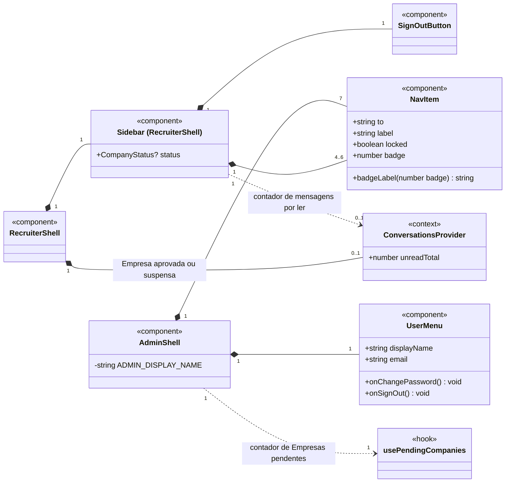

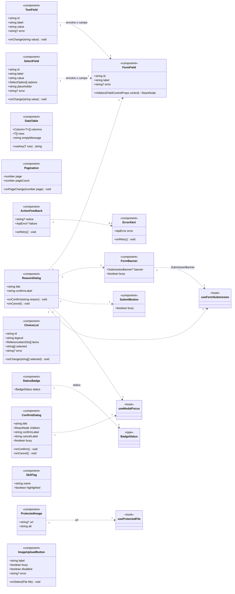

Os componentes genéricos não dependem uns dos outros, exceto os indicados: `TextField` e `SelectField` assentam no `FormField` (rótulo, ligação ao erro e `aria-invalid`), `ActionFeedback` no `ErrorAlert` e o `ReasonDialog` no `FormField`, `FormBanner` e `SubmitButton`. Os hooks de apoio que os componentes usam (`useModalFocus`, `useFormSubmission`, `useFileUpload`, `useProtectedFile`, `useLocations`, `useSession`) estão na secção 9. As páginas que usam cada componente estão na secção 8.4.

Os componentes da Empresa e das listas pré-definidas compõem os genéricos:

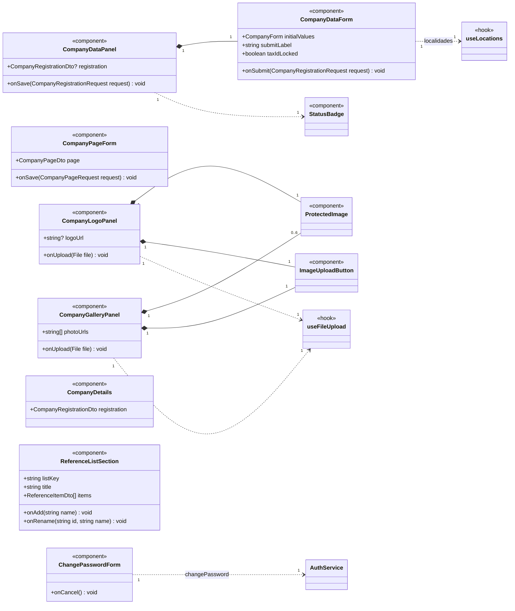

| Componente | Responsabilidade | Ecrãs | Requisitos |
| --- | --- | --- | --- |
| `RecruiterShell` | Moldura do Recrutador. Sem Empresa registada mostra «Registo da Empresa»; com a Empresa pendente, recusada ou suspensa, mostra «Estado do pedido»; com a Empresa aprovada, Vagas, Candidatos e Empresa. Matches tem cadeado sempre que a Empresa não está aprovada (documentação da API v02, 6.7.1); Conversas fica com cadeado sem Empresa e nos estados pendente e recusada; Conta fica sempre acessível, com «Terminar sessão» (divergências P1 e P2 da secção 12). Não tem item nem contador de notificações. Só com a Empresa aprovada ou suspensa envolve o conteúdo no `ConversationsProvider` (secção 6): nos outros estados o servidor recusaria a lista (ERR-07). | W05 a W23, W25, W26 | RF039, RF075, RF106 |
| `AdminShell` | Moldura da área de supervisão: Indicadores; Empresas (Pendentes de aprovação, com o número de pendentes; Todas as Empresas; Vagas publicadas); Utilizadores (Contas de utilizador; Candidatos); Configuração (Listas pré-definidas). Tem o `UserMenu` na barra superior. Não tem conversas nem notificações. | A02 a A10 | RF103, RF104 |
| `NavItem` | Ligação da barra lateral, com o item ativo em destaque e, quando o `badge` é positivo, o contador: conversas (soma das mensagens por ler, `ConversationsProvider.unreadTotal`), no Recrutador; Empresas pendentes, no Administrador (`badgeLabel` dá a legenda acessível). Com `locked`, mostra o item como indisponível, sem ligação. | W05 a W23, W25, W26, A02 a A10 | RF071, RF091 |
| `UserMenu` | Botão com a designação do utilizador que abre um painel com o correio eletrónico, «Alterar palavra-passe» e «Terminar sessão» (`aria-expanded` e `aria-controls`); fecha ao clicar fora e com Escape. Nenhum DTO tem o nome do Administrador: `displayName` é o texto fixo «Administrador Katch» do A02b. | A02 a A10, A02b | RF084, RF107 |
| `SignOutButton` | Botão «Terminar sessão» (`SessionState.signOut`), usado na barra lateral do Recrutador, nas páginas sem moldura e na `CompanyLoading`. | W01 a W26, A11 | RF106, RF107 |
| `CompanyLoading` | «A carregar…» enquanto o estado da Empresa não foi lido; se a leitura falhar, o `ErrorAlert` com «Tentar de novo» e «Terminar sessão». | W03 a W26 | RNF018 |
| `ConfirmDialog` | Diálogo modal de confirmação antes de uma ação, com a lista dos efeitos; também usado para informar uma rejeição com ação alternativa (W15: «Encerrar vaga» ou «Voltar»). Foco inicial no botão de confirmar, Tab preso no diálogo, Escape cancela e o foco volta ao elemento de origem (`useModalFocus`). | W12, W13, W14, W15, W18, W20, W23, A04b, A05b, A07b, A07c, A08b | RF053, RF055, RF056, RF058, RF063, RF064, RF093, RF095, RF086, RF087, RF089, RF117 |
| `ReasonDialog` | Diálogo modal com o pedido do motivo da recusa do registo, com contador de 10 a 500 caracteres e a mensagem de motivo inválido (verificada no cliente e, se o servidor a rejeitar, junto do campo). | A04c, A04d | RF094, P12 |
| `DataTable` | Tabela genérica com cabeçalho, linhas e mensagem de lista vazia; cada coluna tem `key`, `header` e uma função `render`. Os filtros e a pesquisa não pertencem à tabela: são aplicados no cliente pelo hook sobre a lista completa devolvida pela API (filtro por estado em A05; pesquisa e filtros por tipo e estado em A07) e a paginação de 12 linhas pelo `Pagination` (A06 e A07). A lista de Candidatos (A08) não é paginada e indica o total e o número de ativos. A lista de candidatos em espera não tem filtros, classificação nem ações de decisão (W16). | W09, W16, W21, A03, A05 a A08 | RF053, RF060, RF067, RF085, RF088, RF091, RF097, RF098 |
| `Pagination` | «Anterior», «Página n de m» e «Seguinte»; não aparece com uma só página. | A06, A07 | RF085, RF098 |
| `FormField`, `TextField`, `SelectField`, `ChoiceList` | Rótulo, campo e mensagem de erro por campo, ligados por `aria-describedby` e `aria-invalid`; o `FormField` recebe o controlo como função (`children(control)`), o `TextField` e o `SelectField` fixam-no a um `input` ou `select`, e o `ChoiceList` apresenta uma lista de caixas de seleção a partir de uma lista pré-definida. | W02 a W04, W06 a W08, W10, W11, W25, A09, A10 | RF037, RF042, RF046, RF050, RF051, RF084, RF099 a RF102; P01, P03, P08, P13 |
| `SubmitButton`, `FormBanner` | Botão de envio com «A enviar…» e `aria-busy`; faixa de erro do formulário («Corrija os campos indicados» ou a mensagem do servidor) com «Tentar de novo» quando a falha foi de ligação. | Todos os formulários | RF037, RF042, RNF018 |
| `ErrorAlert`, `ActionFeedback` | `ErrorAlert`: mensagem de erro da API com «Tentar de novo» opcional e ações acrescentadas pela página. `ActionFeedback`: aviso de sucesso (`role="status"`) e/ou falha de uma ação sobre uma lista. | Todos | RNF018 |
| `ImageUploadButton` | Escolha de um ficheiro de imagem (JPEG ou PNG), com o estado «A enviar…» e o erro do ficheiro. | W07, W10, W11 | RF047, RF048, RF052 |
| `StatusBadge` | Estado da Empresa, da vaga ou da conta, com a designação do mapa de apresentação (`badgeStatusLabels`). | W05, W06, W08, W09, W21, W26, A04, A05, A07, A08 | RF044, RF053, RF085, RF097 |
| `SkillTag` | Competência em etiqueta, em destaque (✓ e texto para leitores de ecrã) quando coincide com as pretendidas na vaga. | W17 | RF062 |
| `ProtectedImage` | Fotografia ou logótipo protegido (secção 4.3). | W07, W10, W11, W17, W19 | RF047, RF048, RF052, RF061 |
| `CompanyDataForm` | Formulário dos oito dados da Empresa, com as localidades vindas de `useLocations`; usado no registo (W03, W04), na correção do pedido recusado (W06) e na alteração dos dados (W08, com o NIF bloqueado: `taxIdLocked`). | W03, W04, W06, W08 | RF041, RF042, RF043, RF049 |
| `CompanyDetails` | Os oito dados submetidos, só de leitura (W05, W26). | W05, W26 | RF044, RF045 |
| `CompanyPageForm`, `CompanyLogoPanel`, `CompanyGalleryPanel`, `CompanyDataPanel` | Separador «Página da Empresa»: descrição com contador até 1000 e sítio na Internet; logótipo; galeria com contador «n/6». Separador «Dados da Empresa»: estado «Aprovada» e o `CompanyDataForm`. | W07, W08 | RF046 a RF049 |
| `ReferenceListSection` | Lista de competências ou de benefícios com «Alterar designação» em cada linha e o formulário «Acrescentar»; cada formulário valida a designação (obrigatória, até 100 caracteres) antes de enviar. | A09, A09b | RF099 a RF102 |
| `ChangePasswordForm` | Palavra-passe atual, nova e confirmação, com a mensagem de nova palavra-passe inválida e «Palavra-passe alterada.»; «Cancelar» só quando a página o pede. | W25, A10, A10b | RF040, RF084 |

`BadgeStatus` é a união de `CompanyStatus`, `JobStatus` e `AccountStatus`. As páginas apresentam o estado de carregamento («A carregar…»), de erro (`ErrorAlert`) e de lista vazia (`empty-state`) em texto próprio, sem componente separado. Todos os ecrãs são desenhados sem deslocamento horizontal entre 1280 e 1920 píxeis de largura (RNF012, P21).

### 8.2. Páginas do Recrutador

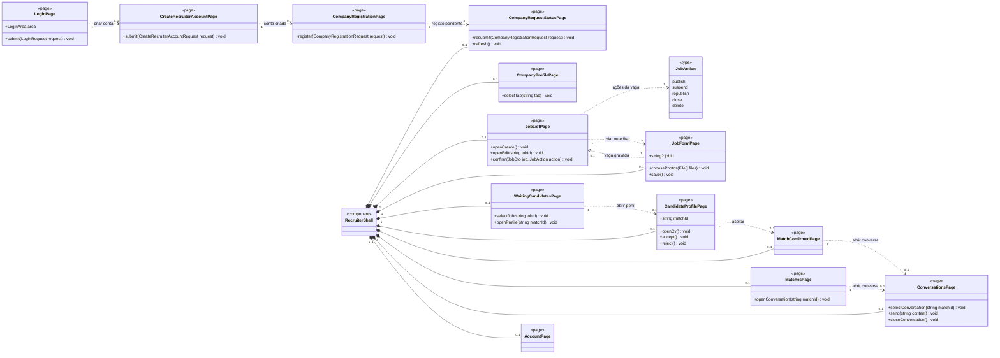

A `LoginPage`, a `CreateRecruiterAccountPage` e a `CompanyRegistrationPage` não têm moldura (W01 a W04). As restantes páginas do Recrutador são apresentadas dentro da `RecruiterShell`, uma de cada vez. As páginas lêem os dados por hooks (secção 9). Os pedidos de escrita que só uma página usa são feitos pela própria página, sobre o serviço: `CompanyRegistrationPage` (`register`), `CompanyRequestStatusPage` (`resubmit`), `JobListPage` (publicar, suspender, voltar a publicar, encerrar e eliminar) e `JobFormPage` (criar, alterar e acrescentar fotografias). Os hooks ficam com as leituras e com as operações que obrigam a ler a lista de novo.

| Página | Responsabilidade | Hook | Serviço (chamado pela página) | Requisitos |
| --- | --- | --- | --- | --- |
| `LoginPage` | Início de sessão na área do Recrutador (W01, com «Criar conta») ou na área de supervisão (A01). A rejeição devolvida pelo servidor aparece na faixa do formulário, com o texto do servidor: credenciais erradas (ERR-02, mensagem única que não distingue endereço inexistente de palavra-passe errada), conta bloqueada ou suspensa (ERR-03, ERR-04) e conta de Candidato (ERR-05; secção 4.2). | `useSession`, `useFormSubmission` | — (`SessionProvider.signIn`) | RF038, RF083, RF086, RNF009 |
| `CreateRecruiterAccountPage` | Criação da conta de Recrutador com correio eletrónico, palavra-passe e aceitação das condições; «Já tenho conta» volta ao W01. | `useSession`, `useFormSubmission` | — (`SessionProvider.signUp`) | RF037 |
| `CompanyRegistrationPage` | Primeiro registo da Empresa com os oito dados e o erro por campo (W04); com «Terminar sessão». ERR-40 (a Empresa já existe) não é tratado como falha: o estado é lido e a página segue para `/empresa/estado`. | `useSession` | `CompanyService.register` | RF041, RF042, RF043 |
| `CompanyRequestStatusPage` | Estado do pedido: pendente, com os dados submetidos só de leitura (W05); recusada, com o motivo e o formulário preenchido para corrigir e «Submeter novamente» (W06); suspensa, com os dados só de leitura (W26). Indica sempre que a Empresa não pode publicar vagas nem aceder a candidatos. É aqui que o Recrutador conhece a decisão do Administrador: ao abrir a página e com «Atualizar estado» (`refresh`), o estado é pedido de novo e, se a Empresa tiver sido aprovada, a proteção da rota encaminha para `/vagas` (secção 7.2, regra 4). ERR-30 em `resubmit` (a Empresa já não está recusada) não é tratado como falha: o estado é lido de novo e a página mostra o ecrã do estado novo. Não há notificação nem consulta periódica do estado (DA v04, F003). | `useSession`, `useCompany` | `CompanyService.resubmit` | RF039, RF043, RF044, RF045 |
| `CompanyProfilePage` | Separador «Página da Empresa»: descrição (contador até 1000), sítio na Internet, logótipo e galeria com contador «n/6» (W07). Separador «Dados da Empresa»: dados de registo com o NIF bloqueado e o estado «Aprovada» (W08). Os dois painéis ficam montados, para não perder o que está por gravar ao mudar de separador; as setas esquerda e direita mudam de separador. | `useCompanyPage` | — | RF046 a RF049 |
| `JobListPage` | Vagas com função, localidade, estado, candidatos em espera (`–` na vaga encerrada), data-limite e as ações de cada estado: Publicada (Editar, Suspender, Encerrar, Eliminar); Não publicada (Editar, Publicar, Eliminar); Suspensa (Editar, Voltar a publicar, Encerrar); Encerrada (sem ações). Cada ação passa por `ConfirmDialog` (W12 a W14); a eliminação rejeitada com ERR-38 abre o W15, com a alternativa «Encerrar vaga». Qualquer outro erro, incluindo ERR-30 (o estado mudou entretanto), mostra a falha e lê a lista de novo. Recebe, por `location.state`, o aviso da criação ou da alteração de uma vaga. | `useJobs` | `JobService` | RF053 a RF059, RF114, RF115 |
| `JobFormPage` | Criação e alteração da vaga: campos obrigatórios e opcionais, localidade proposta com a da Empresa, competências e benefícios das listas, até 5 fotografias; a vaga é gravada como não publicada e as fotografias são enviadas depois de a vaga existir (secção 5, regra 3). Se alguma fotografia for recusada, a vaga fica gravada e a página continua na alteração, com as fotografias recusadas indicadas. Uma vaga encerrada não pode ser alterada: a página indica-o e volta às vagas. | `useJobFormData`, `useFormSubmission` | `JobService` | RF050, RF051, RF052, RF054 |
| `WaitingCandidatesPage` | Vaga escolhida (parâmetro `vaga`, só entre as vagas da Empresa) e candidatos em espera, com função pretendida, localidade e data do interesse (`WaitingCandidateDto.desiredRole`, `locationName` e `interestAt`); a única ação é «Abrir perfil», que leva o identificador da vaga em `location.state` para «Voltar aos candidatos». É aqui que o Recrutador conhece os novos interessados de cada vaga, sem aviso (DA v04, F007); a lista de vagas (W09) indica o número de candidatos em espera de cada vaga (`JobDto.waitingCandidates`). | `useJobs`, `useWaitingCandidates` | — | RF060 |
| `CandidateProfilePage` | Perfil completo, competências coincidentes em destaque, hiperligações (só `http` e `https`), «Abrir CV (PDF)» e a indicação da abertura registada («Abertura do perfil registada hoje às 10:32», a partir de `CandidateFullProfileDto.profileOpenedAt`); «Aceitar» e «Recusar» com confirmação (W18, W20). Uma resposta `4xx` do servidor (403, 404, 409) é definitiva: a página não oferece «Tentar de novo». Depois de uma decisão, «Abrir CV» deixa de estar disponível. | `useCandidateProfile` | — | RF061 a RF064, RF117, RF118, RNF007 |
| `MatchConfirmedPage` | Match confirmado com a fotografia, o nome, a vaga, a localidade e os contactos do Candidato; «Abrir conversa», «Ver matches» e «Voltar aos candidatos». | — | — | RF066, RF067 |
| `MatchesPage` | Matches da Empresa com Candidato, vaga, localidade e estado da vaga (`MatchDto.jobStatus`), contactos e «Abrir conversa», incluindo vagas encerradas. É aqui que o Recrutador consulta os matches confirmados, sem aviso (DA v04, F008). | `useMatches` | — | RF067 |
| `ConversationsPage` | Lista de conversas com as mensagens por ler e a indicação «Encerrada» (por si, pelo Candidato ou automaticamente, a partir de `closeReason` e `closedBy`); conversa aberta (parâmetro `match`) com texto, data e hora e indicação «Lida»; envio com contador até 1000 (Enter envia, Shift+Enter muda de linha); encerramento com confirmação; modo só de consulta (W23). Abrir a conversa marca como lidas as mensagens do Candidato. Enquanto está aberta, a lista e a conversa escolhida são atualizadas por consulta periódica de 3 em 3 segundos (`watchList(true)` ao montar e `watchList(false)` ao desmontar; secção 6). | `useConversations` | — | RF068 a RF075, RF109 |
| `AccountPage` | Correio eletrónico da sessão, alteração da palavra-passe (`ChangePasswordForm`) e «Terminar sessão». Disponível com a Empresa em qualquer estado. | `useSession` | — (`AuthService`, pelo `ChangePasswordForm`) | RF040, RF106 |

A `MatchConfirmedPage` não lê nada da API: recebe o `MatchDto` devolvido por `accept` e a fotografia do Candidato em `location.state`. Como a API não tem leitura de um match isolado, ao recarregar a página (sem `location.state`) o cliente encaminha para `/matches`. A conversa do match já existe quando a página é apresentada (RF068): «Abrir conversa» abre `/conversas?match=:matchId`.

A área de gestão web não tem área de notificações nem ecrã W24 (protótipo v02). A `NotificationsPage`, a rota `/notificacoes`, o `useNotifications` e o `NotificationService` da v01 foram retirados.

### 8.3. Páginas do Administrador

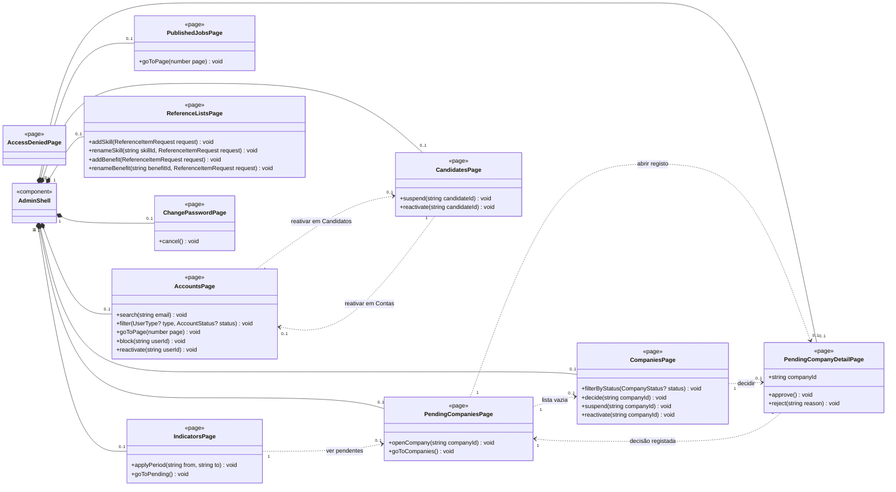

A `AccessDeniedPage` não tem moldura (A11).

| Página | Responsabilidade | Hook | Requisitos |
| --- | --- | --- | --- |
| `IndicatorsPage` | Data inicial e final, «Aplicar período» e número de dias; os três indicadores de estado na data final e os quatro de atividade no período; barras «Do interesse à conversa» calculadas no cliente com os mesmos valores. Faixa «Há n Empresa(s) a aguardar aprovação» com «Ver pendentes» (A03), apresentada quando há Empresas pendentes; o número é o mesmo do contador da barra lateral, obtido pelo `usePendingCompanies`. Rejeita o período com data inicial posterior à final (A02c), no cliente ou com o ERR-10 do servidor; falha de ligação com «Tentar de novo» (A02d). | `useIndicators`, `usePendingCompanies` | RF091, RF096, RF103, RNF018 |
| `PendingCompaniesPage` | Empresas pendentes com designação social, NIF e data de submissão, das mais antigas para as mais recentes; mensagem depois de uma aprovação (A03b) ou de uma recusa (A03c), recebida em `location.state` e sem referência a aviso ao Recrutador (protótipo v02); estado vazio com acesso a todas as Empresas (A03d). | `usePendingCompanies` | RF043, RF091 |
| `PendingCompanyDetailPage` | Os oito dados submetidos, data de submissão e estado; «Aprovar registo» com confirmação (A04b), que não anuncia aviso ao Recrutador (o Recrutador consulta a decisão no estado do pedido); «Recusar registo» com motivo de 10 a 500 caracteres (A04c, A04d; o ERR-10 do servidor fica no campo do diálogo); decisão rejeitada por a Empresa já ter sido decidida (ERR-30), com a mensagem do servidor e «Ver lista atualizada» (A04e). A ligação «Voltar às Empresas pendentes» está sempre no topo da página. Depois de decidir, volta a `/admin/pendentes` com a mensagem. | `usePendingCompanies` | RF092, RF093, RF094, RF112 |
| `CompaniesPage` | Todas as Empresas, com filtro por estado, designação social, estado, vagas publicadas e ações: «Decidir» (pendente; abre o registo), «Suspender» com confirmação (aprovada, A05b) e «Reativar» (suspensa). | `useCompaniesAdmin`, `useActionConfirmation` | RF075, RF095, RF097, RF116 |
| `PublishedJobsPage` | Vagas publicadas com função, Empresa, data de publicação e interesses, só de consulta, paginadas no cliente (12 linhas). | `usePublishedJobs` | RF098 |
| `AccountsPage` | Contas com correio eletrónico, tipo e estado, com pesquisa, filtros e paginação de 12 linhas; «Bloquear» com confirmação (A07b) e «Reativar» uma conta bloqueada (A07c, A07d). As contas de Administrador não têm ações e as contas suspensas reativam-se em Candidatos («Reativar em Candidatos»). | `useAccounts`, `useActionConfirmation` | RF075, RF085, RF086, RF087 |
| `CandidatesPage` | Candidatos com nome, correio eletrónico, localidade, data de registo e estado; o total e o número de ativos; «Suspender» com confirmação (A08b) e «Reativar» uma conta suspensa; numa conta bloqueada, «Reativar em Contas». | `useCandidatesAdmin`, `useActionConfirmation` | RF075, RF088, RF089, RF090 |
| `ReferenceListsPage` | Competências e benefícios com «Alterar designação» na própria lista e «Acrescentar»; rejeição das designações vazias ou repetidas com o motivo (A09b). A lista de localidades não é editável e não aparece. | `useReferenceLists` | RF099 a RF102 |
| `ChangePasswordPage` | Palavra-passe atual e nova, com a mensagem de nova palavra-passe inválida (A10b), pelo `ChangePasswordForm`; «Cancelar» volta aos indicadores (A02). | — | RF084 |
| `AccessDeniedPage` | Apresentada a uma conta que não é de Administrador e tenta abrir a área de supervisão: «Voltar ao início» (a rota `/` leva cada tipo de conta à sua página inicial) e «Terminar sessão». | — | RF104, RNF006 |

A área de supervisão não tem nenhum ecrã de conversas nem acesso ao conteúdo das mensagens (RF103).

### 8.4. Ligações das páginas aos hooks e aos componentes

Os diagramas seguintes representam as colunas «Hook» das tabelas das secções 8.2 e 8.3 e os componentes usados por cada página, com as multiplicidades. Cada página usa uma instância de cada hook; as multiplicidades dos componentes indicam quantas instâncias a página apresenta (`0..1` nos diálogos, que só aparecem quando a ação é pedida). As molduras (`RecruiterShell`, `AdminShell`) estão no primeiro diagrama da secção 8.1. A ligação dos hooks aos serviços está na secção 9. As páginas usam ainda o módulo `paths` (secção 7.2) para navegar e as funções de `utils/date` para formatar datas; não se repetem nos diagramas.

Páginas do Recrutador, hooks e componentes:

```mermaid
classDiagram
    direction LR
    class LoginPage {
        <<page>>
    }
    class CreateRecruiterAccountPage {
        <<page>>
    }
    class CompanyRegistrationPage {
        <<page>>
    }
    class CompanyRequestStatusPage {
        <<page>>
    }
    class CompanyProfilePage {
        <<page>>
    }
    class JobListPage {
        <<page>>
    }
    class JobFormPage {
        <<page>>
    }
    class WaitingCandidatesPage {
        <<page>>
    }
    class CandidateProfilePage {
        <<page>>
    }
    class MatchConfirmedPage {
        <<page>>
    }
    class MatchesPage {
        <<page>>
    }
    class ConversationsPage {
        <<page>>
    }
    class AccountPage {
        <<page>>
    }
    class useSession {
        <<hook>>
    }
    class useFormSubmission {
        <<hook>>
    }
    class useCompany {
        <<hook>>
    }
    class useCompanyPage {
        <<hook>>
    }
    class useJobs {
        <<hook>>
    }
    class useJobFormData {
        <<hook>>
    }
    class useWaitingCandidates {
        <<hook>>
    }
    class useCandidateProfile {
        <<hook>>
    }
    class useMatches {
        <<hook>>
    }
    class useConversations {
        <<hook>>
    }
    class TextField {
        <<component>>
    }
    class FormBanner {
        <<component>>
    }
    class SubmitButton {
        <<component>>
    }
    class FormField {
        <<component>>
    }
    class CompanyDataForm {
        <<component>>
    }
    class SignOutButton {
        <<component>>
    }
    class CompanyDetails {
        <<component>>
    }
    class ErrorAlert {
        <<component>>
    }
    class CompanyPageForm {
        <<component>>
    }
    class CompanyLogoPanel {
        <<component>>
    }
    class CompanyGalleryPanel {
        <<component>>
    }
    class CompanyDataPanel {
        <<component>>
    }
    class DataTable {
        <<component>>
    }
    class StatusBadge {
        <<component>>
    }
    class ConfirmDialog {
        <<component>>
    }
    class ActionFeedback {
        <<component>>
    }
    class SelectField {
        <<component>>
    }
    class ChoiceList {
        <<component>>
    }
    class ProtectedImage {
        <<component>>
    }
    class SkillTag {
        <<component>>
    }
    class ChangePasswordForm {
        <<component>>
    }
    LoginPage "1" ..> "1" useSession
    LoginPage "1" ..> "1" useFormSubmission
    LoginPage "1" ..> "2" TextField
    LoginPage "1" ..> "1" FormBanner
    LoginPage "1" ..> "1" SubmitButton
    CreateRecruiterAccountPage "1" ..> "1" useSession
    CreateRecruiterAccountPage "1" ..> "1" useFormSubmission
    CreateRecruiterAccountPage "1" ..> "2" TextField
    CreateRecruiterAccountPage "1" ..> "1" FormField
    CreateRecruiterAccountPage "1" ..> "1" FormBanner
    CreateRecruiterAccountPage "1" ..> "1" SubmitButton
    CompanyRegistrationPage "1" ..> "1" useSession
    CompanyRegistrationPage "1" ..> "1" CompanyDataForm
    CompanyRegistrationPage "1" ..> "1" SignOutButton
    CompanyRequestStatusPage "1" ..> "1" useSession
    CompanyRequestStatusPage "1" ..> "1" useCompany
    CompanyRequestStatusPage "1" ..> "0..1" CompanyDataForm
    CompanyRequestStatusPage "1" ..> "0..1" CompanyDetails
    CompanyRequestStatusPage "1" ..> "0..1" ErrorAlert
    CompanyProfilePage "1" ..> "1" useCompanyPage
    CompanyProfilePage "1" ..> "1" CompanyPageForm
    CompanyProfilePage "1" ..> "1" CompanyLogoPanel
    CompanyProfilePage "1" ..> "1" CompanyGalleryPanel
    CompanyProfilePage "1" ..> "1" CompanyDataPanel
    CompanyProfilePage "1" ..> "0..1" ErrorAlert
    JobListPage "1" ..> "1" useJobs
    JobListPage "1" ..> "1" DataTable
    JobListPage "1" ..> "0..*" StatusBadge
    JobListPage "1" ..> "0..1" ConfirmDialog
    JobListPage "1" ..> "1" ActionFeedback
    JobListPage "1" ..> "0..1" ErrorAlert
    JobFormPage "1" ..> "1" useJobFormData
    JobFormPage "1" ..> "1" useFormSubmission
    JobFormPage "1" ..> "1..*" TextField
    JobFormPage "1" ..> "1..*" SelectField
    JobFormPage "1" ..> "1..*" FormField
    JobFormPage "1" ..> "2" ChoiceList
    JobFormPage "1" ..> "0..5" ProtectedImage
    JobFormPage "1" ..> "1" FormBanner
    JobFormPage "1" ..> "1" SubmitButton
    JobFormPage "1" ..> "0..1" ErrorAlert
    WaitingCandidatesPage "1" ..> "1" useJobs
    WaitingCandidatesPage "1" ..> "1" useWaitingCandidates
    WaitingCandidatesPage "1" ..> "0..1" DataTable
    WaitingCandidatesPage "1" ..> "0..*" ErrorAlert
    CandidateProfilePage "1" ..> "1" useCandidateProfile
    CandidateProfilePage "1" ..> "0..1" ProtectedImage
    CandidateProfilePage "1" ..> "0..*" SkillTag
    CandidateProfilePage "1" ..> "0..1" ConfirmDialog
    CandidateProfilePage "1" ..> "0..*" ErrorAlert
    MatchConfirmedPage "1" ..> "1" ProtectedImage
    MatchesPage "1" ..> "1" useMatches
    MatchesPage "1" ..> "1" DataTable
    MatchesPage "1" ..> "0..*" StatusBadge
    MatchesPage "1" ..> "0..1" ErrorAlert
    ConversationsPage "1" ..> "1" useConversations
    ConversationsPage "1" ..> "0..1" ConfirmDialog
    ConversationsPage "1" ..> "0..*" ErrorAlert
    AccountPage "1" ..> "1" useSession
    AccountPage "1" ..> "1" ChangePasswordForm
    AccountPage "1" ..> "1" SignOutButton
```

Páginas do Administrador, hooks e componentes:

```mermaid
classDiagram
    direction LR
    class IndicatorsPage {
        <<page>>
    }
    class PendingCompaniesPage {
        <<page>>
    }
    class PendingCompanyDetailPage {
        <<page>>
    }
    class CompaniesPage {
        <<page>>
    }
    class PublishedJobsPage {
        <<page>>
    }
    class AccountsPage {
        <<page>>
    }
    class CandidatesPage {
        <<page>>
    }
    class ReferenceListsPage {
        <<page>>
    }
    class ChangePasswordPage {
        <<page>>
    }
    class AccessDeniedPage {
        <<page>>
    }
    class useIndicators {
        <<hook>>
    }
    class usePendingCompanies {
        <<hook>>
    }
    class useCompaniesAdmin {
        <<hook>>
    }
    class useActionConfirmation {
        <<hook>>
    }
    class usePublishedJobs {
        <<hook>>
    }
    class useAccounts {
        <<hook>>
    }
    class useCandidatesAdmin {
        <<hook>>
    }
    class useReferenceLists {
        <<hook>>
    }
    class ErrorAlert {
        <<component>>
    }
    class DataTable {
        <<component>>
    }
    class ActionFeedback {
        <<component>>
    }
    class StatusBadge {
        <<component>>
    }
    class ConfirmDialog {
        <<component>>
    }
    class ReasonDialog {
        <<component>>
    }
    class SelectField {
        <<component>>
    }
    class Pagination {
        <<component>>
    }
    class ReferenceListSection {
        <<component>>
    }
    class ChangePasswordForm {
        <<component>>
    }
    class SignOutButton {
        <<component>>
    }
    IndicatorsPage "1" ..> "1" useIndicators
    IndicatorsPage "1" ..> "1" usePendingCompanies
    IndicatorsPage "1" ..> "0..1" ErrorAlert
    PendingCompaniesPage "1" ..> "1" usePendingCompanies
    PendingCompaniesPage "1" ..> "1" DataTable
    PendingCompaniesPage "1" ..> "0..1" ActionFeedback
    PendingCompaniesPage "1" ..> "0..1" ErrorAlert
    PendingCompanyDetailPage "1" ..> "1" usePendingCompanies
    PendingCompanyDetailPage "1" ..> "1" StatusBadge
    PendingCompanyDetailPage "1" ..> "0..1" ConfirmDialog
    PendingCompanyDetailPage "1" ..> "0..1" ReasonDialog
    PendingCompanyDetailPage "1" ..> "0..2" ErrorAlert
    CompaniesPage "1" ..> "1" useCompaniesAdmin
    CompaniesPage "1" ..> "1" useActionConfirmation
    CompaniesPage "1" ..> "1" DataTable
    CompaniesPage "1" ..> "0..*" StatusBadge
    CompaniesPage "1" ..> "1" SelectField
    CompaniesPage "1" ..> "0..1" ConfirmDialog
    CompaniesPage "1" ..> "1" ActionFeedback
    CompaniesPage "1" ..> "0..1" ErrorAlert
    PublishedJobsPage "1" ..> "1" usePublishedJobs
    PublishedJobsPage "1" ..> "1" DataTable
    PublishedJobsPage "1" ..> "1" Pagination
    PublishedJobsPage "1" ..> "0..1" ErrorAlert
    AccountsPage "1" ..> "1" useAccounts
    AccountsPage "1" ..> "1" useActionConfirmation
    AccountsPage "1" ..> "1" DataTable
    AccountsPage "1" ..> "0..*" StatusBadge
    AccountsPage "1" ..> "2" SelectField
    AccountsPage "1" ..> "1" Pagination
    AccountsPage "1" ..> "0..1" ConfirmDialog
    AccountsPage "1" ..> "1" ActionFeedback
    AccountsPage "1" ..> "0..1" ErrorAlert
    CandidatesPage "1" ..> "1" useCandidatesAdmin
    CandidatesPage "1" ..> "1" useActionConfirmation
    CandidatesPage "1" ..> "1" DataTable
    CandidatesPage "1" ..> "0..*" StatusBadge
    CandidatesPage "1" ..> "0..1" ConfirmDialog
    CandidatesPage "1" ..> "1" ActionFeedback
    CandidatesPage "1" ..> "0..1" ErrorAlert
    ReferenceListsPage "1" ..> "1" useReferenceLists
    ReferenceListsPage "1" ..> "2" ReferenceListSection
    ReferenceListsPage "1" ..> "1" ActionFeedback
    ReferenceListsPage "1" ..> "0..1" ErrorAlert
    ChangePasswordPage "1" ..> "1" ChangePasswordForm
    AccessDeniedPage "1" ..> "1" SignOutButton
```

O `useSession` não chama serviços: lê o `SessionProvider`, que usa o `AuthService` e o `CompanyService` (secção 7.1). O `useProtectedFile` não é usado pelas páginas, mas pelo componente `ProtectedImage` (secção 8.1). O `ReasonDialog` usa o `useFormSubmission`; os formulários das Empresas e das listas usam-no através dos componentes `CompanyDataForm`, `CompanyPageForm`, `ChangePasswordForm` e `ReferenceListSection`.

---

## 9. Estado dos ecrãs

Os hooks concentram o estado de cada ecrã. Todos os hooks que obtêm dados para um ecrã realizam o contrato `IResourceState<T>`, exceto o `useProtectedFile` (secção 4.3), que serve um componente e devolve apenas o endereço local de um ficheiro, e os hooks de apoio de formulários e de diálogos (`useFormSubmission`, `useFileUpload`, `useActionConfirmation`, `useModalFocus`), que não obtêm dados. Assim, as páginas tratam o carregamento, o erro e a lista vazia da mesma forma: `data` é o recurso principal do hook, com o tipo `T` indicado na tabela desta secção, e os atributos acrescentados por cada hook são estado complementar. Os hooks são funções: compõem-se, não se especializam. O `useResource` é a base comum: recebe a função que lê o recurso e devolve `data`, `loading`, `error` e `reload`; a função `reloadAfter` executa uma ação e lê o recurso de novo, quer a ação tenha êxito, quer falhe.

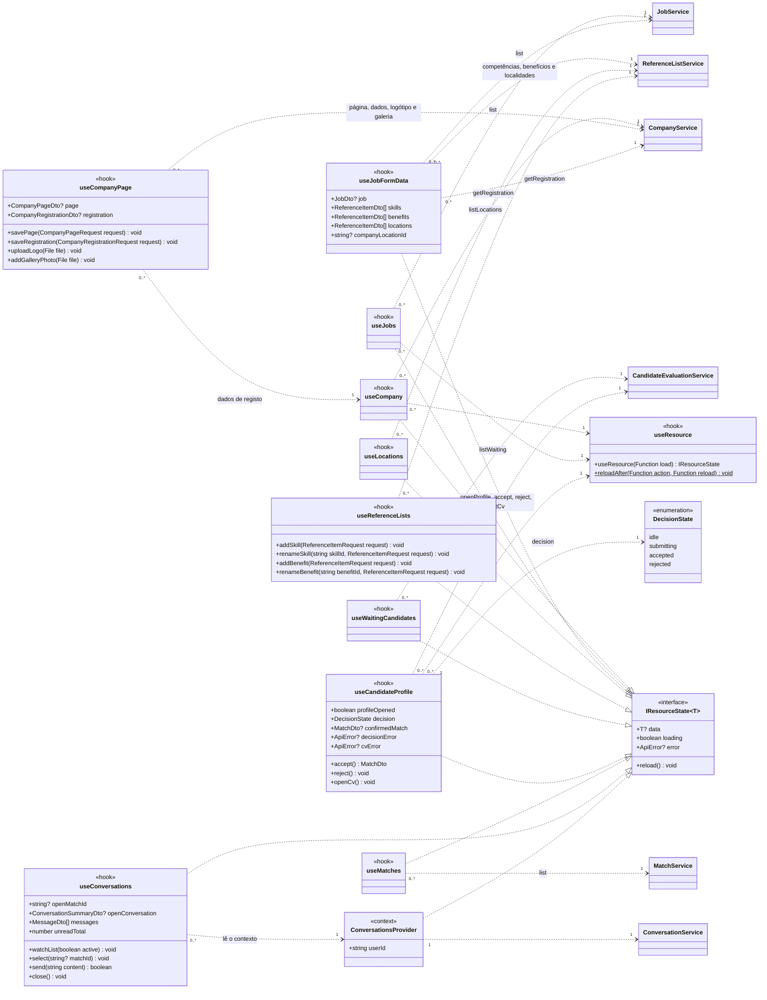

```mermaid
classDiagram
    direction LR
    class IResourceState~T~ {
        <<interface>>
        +T? data
        +boolean loading
        +ApiError? error
        +reload() void
    }
    class Pagination~T~ {
        <<interface>>
        +number page
        +number pageCount
        +T[] visibleRows
        +goToPage(number page) void
    }
    class usePagination {
        <<hook>>
        +usePagination(T[] rows, number pageSize) Pagination
    }
    class useIndicators {
        <<hook>>
        +string from
        +string to
        +number periodDays
        +string? periodError
        +applyPeriod(string from, string to) void
    }
    class usePendingCompanies {
        <<hook>>
        +CompanyRegistrationDto? selected
        +boolean selectedLoading
        +ApiError? selectedError
        +reloadSelected() void
        +approve(string companyId) void
        +reject(string companyId, RejectCompanyRequest request) void
    }
    class useCompaniesAdmin {
        <<hook>>
        +CompanyStatus? statusFilter
        +CompanyAdminDto[] visibleRows
        +filterByStatus(CompanyStatus? status) void
        +suspend(string companyId) void
        +reactivate(string companyId) void
    }
    class usePublishedJobs {
        <<hook>>
    }
    class useAccounts {
        <<hook>>
        +string emailQuery
        +UserType? typeFilter
        +AccountStatus? statusFilter
        +search(string email) void
        +filter(UserType? type, AccountStatus? status) void
        +block(string userId) void
        +reactivate(string userId) void
    }
    class useCandidatesAdmin {
        <<hook>>
        +number activeCount
        +suspend(string candidateId) void
        +reactivate(string candidateId) void
    }
    useIndicators ..|> IResourceState
    usePendingCompanies ..|> IResourceState
    useCompaniesAdmin ..|> IResourceState
    usePublishedJobs ..|> IResourceState
    usePublishedJobs ..|> Pagination
    useAccounts ..|> IResourceState
    useAccounts ..|> Pagination
    useCandidatesAdmin ..|> IResourceState
    usePublishedJobs "0..*" ..> "1" usePagination
    useAccounts "0..*" ..> "1" usePagination
    class IndicatorService
    class AdminCompanyService
    class AdminAccountService
    useIndicators "0..*" ..> "1" IndicatorService : get
    usePendingCompanies "0..*" ..> "1" AdminCompanyService
    useCompaniesAdmin "0..*" ..> "1" AdminCompanyService
    usePublishedJobs "0..*" ..> "1" AdminCompanyService : listPublishedJobs
    useAccounts "0..*" ..> "1" AdminAccountService
    useCandidatesAdmin "0..*" ..> "1" AdminAccountService
```

Hooks de apoio, que não obtêm dados:

```mermaid
classDiagram
    direction LR
    class useFormSubmission {
        <<hook>>
        +boolean busy
        +FieldErrors errors
        +SubmissionBanner? banner
        +submit(FormEvent event, FieldErrors local, Function action) void
    }
    class SubmissionBanner {
        <<type>>
        +string message
        +boolean canRetry
    }
    class useFileUpload {
        <<hook>>
        +boolean busy
        +string? error
        +upload(File file) void
    }
    class useActionConfirmation {
        <<hook>>
        +T? pending
        +boolean busy
        +string? notice
        +ApiError? failure
        +request(T item) void
        +cancel() void
        +confirm(Function action, string done) void
    }
    class useModalFocus {
        <<hook>>
        +useModalFocus(RefObject initialFocus, Function onClose, boolean closable) Function
    }
    class useProtectedFile {
        <<hook>>
        +useProtectedFile(string? url) string?
    }
    class FieldErrors {
        <<type>>
    }
    class ApiError
    class HttpApiClient
    useFormSubmission "1" ..> "1" SubmissionBanner : banner
    useFormSubmission "1" ..> "1" FieldErrors : errors
    useFormSubmission "0..*" ..> "1" ApiError : ApiError.from
    useFileUpload "0..*" ..> "1" ApiError : ApiError.from
    useActionConfirmation "0..*" ..> "1" ApiError : ApiError.from
    useProtectedFile "0..*" ..> "1" HttpApiClient : getFile
```

Cada serviço é uma instância única, partilhada por todos os hooks que o usam (`0..*` → `1`). O `useReferenceLists` do Administrador usa o mesmo `ReferenceListService` do `useJobFormData` e do `useLocations`, com as operações de acrescento e alteração. O `useSession` está na secção 7.1.

| Hook | `data` (T) | Estado complementar | Origem das atualizações |
| --- | --- | --- | --- |
| `useSession` | — (lê o `SessionProvider`, secção 7.1) | Sessão, estado e dados da Empresa | Início e fim de sessão; `refreshCompanyStatus` |
| `useCompany` | `CompanyRegistrationDto` ou `null` (sem Empresa registada) | — | Pedido à API ao abrir o ecrã; `reload` depois de submeter de novo e com «Atualizar estado» (consulta da decisão do Administrador, sem notificação) |
| `useCompanyPage` | — (compõe a leitura da página e a leitura dos dados de registo; `loading` e `error` juntam as duas) | `page` (`CompanyPageDto`) e `registration` | Pedido à API ao abrir; nova leitura da página depois de gravar a página, o logótipo ou uma fotografia (também quando a galeria recusa a fotografia com ERR-39, para mostrar a galeria atual); `saveRegistration` não lê de novo |
| `useJobs` | `JobDto[]` | — | Pedido à API; a página chama `reload` depois de cada ação de estado |
| `useJobFormData` | `JobFormData` | Vaga a alterar (`null` na criação), competências, benefícios, localidades e localidade da Empresa (só na criação) | Pedido à API ao abrir (até cinco leituras em paralelo); a vaga é procurada na lista da Empresa, porque a API não tem leitura de uma vaga isolada (ERR-20 do cliente se não existir); `reload` depois de acrescentar fotografias |
| `useLocations` | `ReferenceItemDto[]` | — | Pedido à API ao abrir o formulário da Empresa |
| `useReferenceLists` | `EditableReferenceLists` (competências e benefícios) | — | Pedido à API; nova leitura depois de cada acrescento ou alteração |
| `useWaitingCandidates` | `WaitingCandidateDto[]` | — (a vaga escolhida e o seu título estão na `WaitingCandidatesPage`, no parâmetro `vaga`) | Pedido à API ao abrir o ecrã e ao escolher outra vaga |
| `useCandidateProfile` | `CandidateFullProfileDto` | `profileOpened`, `decision` (`DecisionState`), match confirmado e erros da decisão e do CV | O pedido do perfil regista a abertura (RF118) e reutiliza o pedido em curso para o mesmo match, para não registar a abertura duas vezes; `accept` e `reject` só ficam disponíveis com `profileOpened` verdadeiro e uma só decisão de cada vez; o CV abre num separador e o endereço local é libertado ao fim de 60 segundos |
| `useMatches` | `MatchDto[]` | — | Pedido à API ao abrir o ecrã |
| `useConversations` | `ConversationSummaryDto[]` | Conversa aberta, histórico, mensagens por ler e erros, lidos do `ConversationsProvider` | Pedido à API ao abrir; consulta periódica de 3 em 3 segundos da lista e da conversa escolhida enquanto a `ConversationsPage` está aberta (secção 6); nova leitura depois de enviar ou encerrar |
| `useProtectedFile` | — (endereço local, secção 4.3) | — | Pedido à API; libertado ao desmontar |
| `useIndicators` | `IndicatorsDto` | Período, número de dias e erro de período (local ou ERR-10 do servidor) | Pedido à API depois de validar o período |
| `usePendingCompanies` | `PendingCompanyDto[]` | Dados submetidos da Empresa aberta (`selected`) com o seu carregamento e erro | Pedido à API; depois de cada decisão, todas as instâncias montadas do hook leem a lista de novo (atualiza também o contador da barra lateral e a faixa do A02) |
| `useCompaniesAdmin` | `CompanyAdminDto[]` | Filtro por estado e linhas visíveis | Pedido à API; nova leitura depois de cada mudança de estado |
| `usePublishedJobs` | `PublishedJobAdminDto[]` | Página atual, número de páginas e linhas visíveis (12 por página) | Pedido à API ao abrir o ecrã |
| `useAccounts` | `AccountDto[]` | Pesquisa, filtros, página atual e linhas visíveis (12 por página) | Pedido à API; nova leitura depois de cada mudança de estado |
| `useCandidatesAdmin` | `CandidateAdminDto[]` | Número de Candidatos ativos («22 Candidatos · 20 ativos») | Pedido à API; nova leitura depois de cada mudança de estado |

O `useConversations` é o único hook de dados que não guarda o estado em si: lê o `ConversationsProvider`, montado na `RecruiterShell`, para que a `ConversationsPage` e o contador da barra lateral partilhem a mesma lista (decisão DF-14). O contador vive por isso na `RecruiterShell`, que se mantém montada enquanto o Recrutador muda de página. Cada ecrã lê o que precisa quando é aberto; só a área de conversas é atualizada periodicamente; o servidor é a única fonte de verdade.

## 10. Exemplo de interação entre camadas

Aceitação de um Candidato pelo Recrutador (UC12), com as multiplicidades de cada ligação. O fluxo mostra a regra do RF118: a decisão só é possível depois de a abertura do perfil ter sido registada.

```mermaid
classDiagram
    direction LR
    class WaitingCandidatesPage {
        <<page>>
        +openProfile(string matchId) void
    }
    class CandidateProfilePage {
        <<page>>
        +accept() void
    }
    class useCandidateProfile {
        <<hook>>
        +boolean profileOpened
        +accept() MatchDto
    }
    class CandidateEvaluationService {
        +openProfile(string matchId) CandidateFullProfileDto
        +accept(string matchId) MatchDto
    }
    class HttpApiClient {
        +get(string path) T
        +post(string path, unknown body) T
    }
    class SessionStore {
        +token() string?
    }
    class MatchConfirmedPage {
        <<page>>
    }
    class ConversationsPage {
        <<page>>
    }
    WaitingCandidatesPage "1" ..> "1" CandidateProfilePage : 1 abrir perfil
    CandidateProfilePage "1" ..> "1" useCandidateProfile : 2 e 4 perfil e accept
    useCandidateProfile "1" ..> "1" CandidateEvaluationService : 2 e 4
    CandidateEvaluationService "1" ..> "1" HttpApiClient : 2 e 4
    HttpApiClient "1" ..> "1" SessionStore : credencial
    CandidateProfilePage "1" ..> "1" MatchConfirmedPage : 6 match confirmado
    MatchConfirmedPage "1" ..> "0..1" ConversationsPage : 7 abrir conversa
```

1. Na `WaitingCandidatesPage` (W16), o Recrutador escolhe «Abrir perfil». A lista não tem ações de decisão (RF060).
2. A `CandidateProfilePage` (W17) usa o `useCandidateProfile`, que ao ser montado pede o perfil completo (`GET /api/recruiter/interests/{matchId}/profile`), uma só vez por match. O servidor regista a abertura para a vaga (RF118) e, com o perfil recebido, o hook passa `profileOpened` a verdadeiro.
3. Só então «Aceitar» e «Recusar» ficam disponíveis. A confirmação (W18) enumera os efeitos e avisa que a decisão não pode ser alterada (RF117).
4. `CandidateEvaluationService.accept` envia `POST /api/recruiter/interests/{matchId}/accept` com a credencial de sessão no cabeçalho; o identificador do Recrutador vem da credencial e não do corpo (RNF006).
5. O servidor executa a operação atómica (backend, secção 8) e devolve `200` com o `MatchDto`.
6. A página abre a `MatchConfirmedPage` (W19), passando-lhe o `MatchDto` e a fotografia do Candidato em `location.state`, com o contacto do Candidato e o acesso à conversa (RF066, RF067).
7. «Abrir conversa» abre a `ConversationsPage` com a conversa do match escolhida; a partir daí, a lista e a conversa são atualizadas por consulta periódica (secção 6). Não há notificação ao Recrutador nem ao Candidato: o match passa a constar da lista de matches de cada parte (`/matches` na área de gestão web e a lista de matches da aplicação móvel), que cada uma consulta (DA v04, F008).

Se o servidor rejeitar a decisão com `409` porque o Candidato já foi avaliado noutro pedido (ERR-35; UC12, E4), o `ApiError` é apresentado na página (`decisionError`, no `ErrorAlert`) e a decisão registada não muda (RF117); ao voltar a «Candidatos em espera», a lista é lida de novo e já não inclui o Candidato.

---

## 11. Dependências do backend

Na v01, a verificação cruzada com o modelo de classes do backend (`I036`) e com os protótipos aceites (`I040`, `I041`) encontrou elementos de que a área de gestão web precisava e que o backend ainda não definia (G1 a G12). A documentação da API v02 (`I101`, `I104`) e o modelo de classes do backend v02 (`I103`) resolveram-nas todas, exceto a G6, que deixou de se aplicar com a retirada da ligação persistente. A tabela conserva a descrição da v01 e acrescenta a resolução; o modelo segue as resoluções nas secções indicadas. Não há dependências por resolver nesta versão. O modelo de classes do backend v03 (`I138` e `I136`) acrescenta os campos da `I104` aos DTOs (secções 7.1 e 7.2 do backend) e mantém o contrato da API v02 para o cliente; as duas alterações do backend que o cliente sente são o fim de sessão no servidor (`POST /api/auth/logout` revoga as credenciais emitidas à conta, DC-17) e a rejeição a cada pedido das contas bloqueadas ou suspensas (ERR-03, ERR-04), tratadas nas secções 4.2, 5 e 6.

| ID | Dependência (v01) | Onde se manifesta | Proposta (v01) | Resolução na documentação da API v02 e neste modelo |
| --- | --- | --- | --- | --- |
| G1 | O `CompanyController` não tem operação para o Recrutador ler os dados de registo da própria Empresa (a tabela 7.2 do backend associa `CompanyRegistrationDto` ao `CompanyController`, mas nenhuma operação o devolve). | W05, W06, W08, W26, barra superior, W25 (nome do responsável); UC07 A3 («o sistema apresenta os dados submetidos e o motivo da recusa»); RF044, RF045, RF049 | `GetRegistration() ActionResult<CompanyRegistrationDto>` no `CompanyController` e `GetRegistrationAsync` no `ICompanyService`, com a política `Recruiter` e não `ApprovedCompany`, porque os ecrãs W05, W06 e W26 são de Empresa pendente, recusada ou suspensa | Resolvida (PA-03): `GET /api/recruiter/company` (6.4.8), política `Recruiter`, `404` sem Empresa. `CompanyService.getRegistration` (secção 5) |
| G2 | O `CompanyController` não tem operação para o Recrutador ler a página de apresentação da própria Empresa (só o `JobExplorationController`, reservado ao Candidato, a devolve). | W07; RF046 a RF048 | `GetPage() ActionResult<CompanyPageDto>` no `CompanyController` | Resolvida (PA-03): `GET /api/recruiter/company/page` (6.4.9), política `ApprovedCompany`. `CompanyService.getPage` (secção 5) |
| G3 | `CompanyRegistrationDto` só tem `LocationName`; o pedido de alteração exige `LocationId`. | W06 e W08 (seleção da localidade preenchida); W10 (localidade proposta com a da Empresa, RF050) | Acrescentar `Guid LocationId` ao `CompanyRegistrationDto` | Resolvida (PA-03): `CompanyRegistrationDto.locationId` (8.3). Tipo da secção 3.2 |
| G4 | `WaitingCandidateDto` não tem a função pretendida nem a localidade. | W16 (colunas «Função pretendida» e «Localidade») | Acrescentar `string? DesiredRole` e `string LocationName` | Resolvida (PA-07): `WaitingCandidateDto.desiredRole` e `locationName` (8.4). Tipo da secção 3.2; `WaitingCandidatesPage` |
| G5 | `MatchDto` não tem o estado da vaga. | W21 (coluna «Estado da vaga») | Acrescentar `JobStatus JobStatus` | Resolvida (PA-08): `MatchDto.jobStatus`, `locationName` e `logoUrl` (8.4). Tipo da secção 3.2; `MatchesPage` |
| G6 | O acontecimento `MessageReceived` envia só o `MessageDto`, que não identifica a conversa. | RF073 (acrescentar a mensagem à conversa certa) | Enviar o identificador do match no acontecimento; até lá aplica-se a regra 2 da secção 6 | Sem aplicação (PA-02): não há ligação persistente nem acontecimentos; as mensagens novas são pedidas por conversa, identificada pelo `matchId` (6.8.2 com `after`; secção 6 deste modelo) |
| G7 | `IAuthService.LoginAsync` recebe `ClientApp`, mas o contrato não define como o cliente o indica. | Rejeição do início de sessão de um Candidato na área de gestão web (A01) | Fixar na documentação da API | Resolvida: cabeçalho `X-Client-App: web` (secção 3.2, DAPI-02); aplicada na secção 4.1 |
| G8 | Não estava definida a resposta de `GetStatus` quando o Recrutador ainda não registou a Empresa. | Encaminhamento para `/empresa/registo` depois do W02 e no início de sessão | Fixar na documentação da API | Resolvida: `404` com ERR-20 (6.4.3); aplicada na secção 5, regra 7 |
| G9 | Não estava definida a serialização das enumerações em JSON. | Todos os tipos da secção 3 | Serialização das enumerações como texto | Resolvida: valores em maiúsculas com `_` (secção 2.4, DAPI-01); aplicada nas secções 2.2 e 3.1 |
| G10 | `CandidateFullProfileDto` não tem a data e hora da abertura do perfil. | W17 («Abertura do perfil registada hoje às 10:32») | Acrescentar `DateTimeOffset ProfileOpenedAt` | Resolvida (PA-09): `CandidateFullProfileDto.profileOpenedAt` (8.4). Tipo da secção 3.2; `CandidateProfilePage` |
| G11 | Não há operação que sirva os ficheiros referidos por `photoUrl`, `logoUrl` e `photoUrls`. | W07, W10, W11, W17, W19 (logótipo, galeria, fotografias da vaga e do Candidato); RF047, RF048, RF052, RF061 | A proposta da API, com autorização pela credencial de sessão no cabeçalho, para manter a secção 4.3 | Resolvida (PA-01): `GET /api/files/{kind}/{fileName}` (6.9.1), com a credencial no cabeçalho. Secção 4.3 |
| G12 | `ApiErrorDto` não tem código de erro. | Distinção dos erros `403` e `409` (secção 4.2) | Acrescentar `string Code` com os identificadores ERR-xx | Resolvida (PA-05): `ApiErrorDto.code` (4.1, 8.5). Secções 4.1 e 4.2: os erros identificam-se por `code` |

A PA-04 da documentação da API (lista de localidades sem sessão) foi resolvida pela `I101` e não afeta a área de gestão web. A PA-06 (SignalR e ratificação da AD-01) deixou de se aplicar à ligação persistente; a AD-01 foi ratificada na deliberação 3 da ata de 2026-10-16.

Os campos acrescentados pela `I104` constam da documentação da API v02, que é o contrato que o cliente segue, e do modelo de classes do backend v03. Se a implementação do backend divergir do contrato, prevalece a documentação da API (DAPI-11) e a divergência é tratada como defeito do backend.

---

## 12. Divergências com os protótipos

O modelo segue o protótipo v02 (`m3-prototipo-baixa-fidelidade-v02.pdf`), exceto onde contraria os requisitos ou o backend. Nesses casos prevalecem os requisitos, e a divergência fica registada para correção do protótipo numa Issue própria. As divergências P1 a P4 da v02 mantêm-se na v03 e o código da `I134` cumpre-as (secção 8.1).

| ID | Divergência | Decisão no modelo | Fundamento |
| --- | --- | --- | --- |
| P1 | Na variante bloqueada da barra lateral (W05, W06, W26) não existe o item Conta. | Conta fica sempre acessível ao Recrutador; o item «Estado do pedido» substitui Vagas e Candidatos enquanto a Empresa não está aprovada. | RF106 (terminar sessão) e RF040 (alterar a palavra-passe) com a Empresa em qualquer estado; RF044 (consulta do estado do pedido, que substitui a notificação da decisão). Na v01, a P1 abrangia também Notificações, retiradas com a F011. |
| P2 | No W26 (Empresa suspensa), Conversas está bloqueado. | Com a Empresa suspensa, Conversas fica acessível em modo só de consulta; nos estados pendente e recusada continua bloqueado, porque não pode haver conversas. Matches fica bloqueado, como no W26, porque a lista de matches exige Empresa aprovada. | RF075 (conversas passam a só de consulta, não a inacessíveis); documentação da API, 6.7.1 (`ApprovedCompany` na lista de matches do Recrutador, RF039) e 6.8 (`CandidateOrRecruiter` nas conversas) |
| P3 | O W01 («Backoffice do Recrutador») e o A01 («Recrutadores e Administrador») são dois ecrãs de início de sessão. | Uma `LoginPage` em duas rotas (`/entrar` e `/admin/entrar`), com o encaminhamento da secção 7.2. | Mantém os dois ecrãs aceites e a navegação do A01 para o A11 com conta de Recrutador |
| P4 | Os botões tracejados «Simular: …» (W01, W03, W05, W22, W26) só servem para navegar no protótipo. | Não são modelados. | Não correspondem a nenhuma funcionalidade |

---

## 13. Decisões de desenho

| ID | Decisão | Fundamentação |
| --- | --- | --- |
| DF-01 | Separação em páginas, componentes, layouts, rotas, hooks, serviços, cliente da API, consulta periódica, sessão, validação, configuração, utilitários e tipos. | As páginas ficam sem conhecimento do protocolo e os serviços sem conhecimento da interface, o que permite testar hooks e serviços com Jest e o cliente da API simulado (RI, secção 11.5). Na v03, algumas páginas e componentes chamam serviços ou hooks por necessidade de um só ecrã (DF-16). |
| DF-02 | Um serviço por controller do backend, com os mesmos nomes de operação em camelCase, sem uma interface por serviço (v03). | Torna imediata a verificação da coerência entre o cliente e a API (backend, secção 6). As interfaces `I*Service` tinham uma só implementação e foram retiradas na `I134` (R-007); a abstração que os testes simulam é o `IApiClient`. |
| DF-03 | Os tipos do cliente espelham os DTOs, sem tipos intermédios. | Uma divergência entre o cliente e a API aparece como erro de compilação do TypeScript. |
| DF-04 | Uma página por ecrã do protótipo, com os estados e diálogos do mesmo ecrã na mesma página. | Mantém a rastreabilidade aos ecrãs aceites nas `I040` e `I041`. |
| DF-05 | A credencial é guardada em memória e espelhada no `sessionStorage`, limpo no fim de sessão e quando a credencial expira. | Recarregar a página não obriga a novo início de sessão; o `sessionStorage` é por separador e desaparece ao fechá-lo, ao contrário do `localStorage`. A credencial expira ao fim de 8 horas no servidor (RNF005, P20). O RI não fixa esta escolha. |
| DF-06 | Os ficheiros protegidos são obtidos com a credencial e apresentados por endereço local. | O browser não envia o cabeçalho `Authorization` em `` e `<a href>`; o acesso aos ficheiros é verificado no servidor (RNF007; backend, secção 7.2). |
| DF-07 | As proteções de rota são de navegação, e não de segurança. | A autorização é sempre verificada no servidor (RNF006); o cliente apenas evita mostrar ecrãs inacessíveis e apresenta o ecrã de acesso negado (RF104). |
| DF-08 | As mensagens novas, o número de mensagens por ler e o estado das conversas chegam por consulta periódica à API, de 3 em 3 segundos, só enquanto a lista de conversas ou uma conversa está aberta (revista na v02; a v01 previa a ligação persistente). Não há notificações. | DA v04 (F010 e limites transversais); arquitetura v02, AD-02 (D-08 retirada); backend v02, secção 6.1 e DC-07; documentação da API v02, secção 7; P17; ata de 2026-10-16, deliberação 1. |
| DF-09 | As ações de decisão sobre um Candidato só existem na página do perfil completo e só ficam disponíveis depois de a abertura ser registada. | UC12, pré-condição 5 e E1; RF063, RF064, RF118. A mesma regra é verificada no servidor. |
| DF-10 | Filtros, pesquisa e paginação das listas da área de supervisão são aplicados no cliente. | O backend devolve as listas completas, sem parâmetros de filtragem nem de paginação (backend, secção 6); os volumes de demonstração são pequenos (P18). |
| DF-11 | As ações irreversíveis e as mudanças de estado passam por `ConfirmDialog` com a lista dos efeitos. | Ecrãs W12 a W15, W18, W20, A04b, A05b, A07b, A07c e A08b, aceites nas `I040` e `I041`; RF117. |
| DF-12 | O cliente identifica os erros pelo código HTTP e pelo campo `code` do `ApiErrorDto` (revista na v02; a v01 comparava as mensagens fixas). | A documentação da API v02 acrescentou `code` ao `ApiErrorDto` (PA-05); o texto das mensagens pode mudar sem afetar o cliente. |
| DF-13 | Retirada na v02 (destino da notificação `COMPANY_APPROVED`). O identificador não é reutilizado. | A funcionalidade F011 saiu do âmbito (DA v04); a decisão da Empresa é consultada em `/empresa/estado` (secção 8.2). |
| DF-14 | O estado da área de conversas fica num contexto (`ConversationsProvider`) montado na `RecruiterShell`, lido pelo `useConversations`. Fora da `ConversationsPage`, o contador da barra lateral é atualizado por uma leitura da lista quando a moldura é montada e quando o Recrutador muda de página, e não por consulta periódica. | A lista e o contador têm de ser os mesmos na página e na barra lateral; a DA v04 (F010) e o P17 só preveem a consulta periódica enquanto a conversa ou a lista de conversas está aberta. Uma leitura por mudança de página mantém o contador útil sem pedidos a cada 3 segundos em todas as páginas. |
| DF-15 | A consulta periódica agenda o pedido seguinte só depois da resposta do anterior (`PollingLoop` com `setTimeout`), e não com um intervalo fixo independente das respostas (`setInterval`). O agendamento fica atrás de `IPollingScheduler`. | Evita pedidos sobrepostos quando o servidor demora, cumprindo o atraso máximo do P17 com o RNF001 (2 segundos por operação); a interface permite testar o intervalo com temporizadores simulados do Jest (RI, secção 11.5). |
| DF-16 | As operações de escrita que só uma página usa são pedidas pela própria página ao serviço (`CompanyRegistrationPage`, `CompanyRequestStatusPage`, `JobListPage`, `JobFormPage`); os hooks ficam com as leituras e com as operações que obrigam a ler uma lista de novo. | Um hook por pedido único não traz benefício (KISS; `I134`, R-033). A regra de camadas da v02 (páginas sem acesso aos serviços) deixou de ser verdadeira nestes quatro casos. |
| DF-17 | Não há monitor de ligação nem faixa global: a falha de ligação (`ApiError.connectionFailure`) é apresentada em cada página ou diálogo pelo `ErrorAlert` ou pelo `FormBanner`, com «Tentar de novo». | O RNF018 continua cumprido sem estado global (`I134`, R-004); o `HttpApiClient` deixa de ter a opção de monitor. |
| DF-18 | Os blocos repetidos das páginas são componentes e hooks de apoio: `ErrorAlert`, `ActionFeedback`, `FormField` e campos, `Pagination`, `ReferenceListSection`, painéis da Empresa; `useFormSubmission`, `useFileUpload`, `useActionConfirmation`, `usePagination`, `useModalFocus` e `reloadAfter`. | Elimina a duplicação medida na `I134` (R-012 a R-018, R-043) sem mudar o comportamento dos ecrãs; as exceções de fluxo (ERR-38 e ERR-30 em diálogos) ficam nas páginas (R-013). |
| DF-19 | Os valores fixos da aplicação (intervalo da consulta periódica, linhas por página, limites das imagens, comprimento das mensagens, período por omissão) ficam em `src/config/app.ts`; o endereço da API e o tempo limite ficam em `config/env.ts`. | Um único sítio por valor, sem constantes exportadas só para os testes (`I134`, R-009, R-046); o `env.ts` fica separado porque é simulado nos testes. |

---

## 14. Limitações

| Limitação | Consequência |
| --- | --- |
| As divergências P1 e P2 (secção 12) ficam por corrigir no protótipo. | O comportamento implementado segue este modelo, os requisitos e a documentação da API, e não os ecrãs W05, W06 e W26 nesses pontos. |
| A mensagem nova pode demorar até 3 segundos mais a duração do pedido a aparecer, e a mudança de estado de uma conversa só chega na consulta seguinte (documentação da API v02, L-04). | Dentro do P17 (5 segundos). Fora da área de conversas, o contador da barra lateral só é atualizado quando o Recrutador muda de página (DF-14). |
| A consulta periódica faz um pedido a cada 3 segundos por pedido repetido (lista e conversa), enquanto a `ConversationsPage` está aberta (documentação da API v02, L-07). | Adequado aos dados de demonstração (P18); a arquitetura (secção 3.6, ponto 1) manda verificar o RNF001 com as consultas periódicas no ambiente de demonstração. |
| Uma falha da consulta da lista com a lista já apresentada não interrompe o ciclo nem é indicada; a mensagem de erro da lista só aparece quando ainda não há lista (secção 6, regra 6). | A lista pode ficar desatualizada durante uma falha prolongada, até a consulta seguinte ter resposta. A falha da consulta da conversa escolhida é indicada acima do histórico. |
| Uma conta bloqueada ou suspensa durante a sessão não termina a sessão no cliente: o servidor responde com ERR-03 ou ERR-04 a cada pedido e cada página mostra a mensagem (secção 4.2). | O Recrutador sai com «Terminar sessão». Só o ERR-01 e o ERR-07 são tratados pela sessão. |
| O ERR-06 e o ERR-41 não têm tratamento próprio (secção 4.2). | O ERR-06 só ocorre se o servidor rejeitar um pedido que a rota já impede; o ERR-41 mostra a mensagem do servidor e o utilizador repete a operação. |
| A `AccountPage` (W25) apresenta o correio eletrónico da sessão; a v02 indicava também o nome do responsável, que a sessão não contém. | O nome do responsável consulta-se nos dados da Empresa (W08). |
| O título do separador do browser não muda por página (`I134`, R-043). | Os leitores de ecrã e o histórico do browser mostram o mesmo título em todas as rotas; seria funcionalidade nova. |
| O RNF012 (1280 a 1920 píxeis) e o RNF018 (mensagens de erro) não foram medidos com a aplicação a correr; as capturas a 1280 píxeis não mostram deslocamento horizontal (`I134`, R-002). | Verificam-se nos testes de sistema (QG-06, `I079`), que ainda não existem. |
| O Regulamento Interno e a stack tecnológica indicam TypeScript 7.0 e o guia Airbnb com `.eslintrc.json`; o código usa `typescript ^6.0.3` e `eslint.config.js` (configuração plana, ESLint 10), sem verificação do guia Airbnb (`I134`, secção 6 do relatório). | Este modelo segue o código. A decisão do grupo sobre a versão do TypeScript e sobre o guia Airbnb fica por registar nesses documentos. |
| Os pedidos da secção 5 seguem a documentação da API v02. | Uma nova versão dessa documentação obriga a rever a tabela da secção 5, a secção 4.2 e a secção 6, e a acrescentar uma linha ao histórico de versões. |
| As assinaturas mostram os tipos de retorno sem `Promise`. | Simplificação de leitura; a convenção da secção 2.2 aplica-se ao código. |
| O separador do browser em segundo plano mantém a consulta periódica enquanto a `ConversationsPage` estiver aberta. | Os browsers podem espaçar os temporizadores de separadores em segundo plano; ao voltar ao separador, a consulta seguinte repõe o estado. Não afeta os requisitos, que se verificam com a página visível. |
| A decisão DF-05 não está fixada no Regulamento Interno. | Se o grupo decidir outra forma de persistência da credencial, muda apenas o `SessionStore`. |
| O modelo segue o protótipo de baixa fidelidade v02. | Um protótipo de alta fidelidade, se existir, pode alterar componentes de apresentação sem alterar páginas, hooks nem serviços. |

---

## 15. Rastreabilidade

| Casos de uso | Páginas | Hooks | Serviços | Ecrãs do protótipo |
| --- | --- | --- | --- | --- |
| UC01 (início e fim de sessão) | `LoginPage`, `AccountPage`, `AccessDeniedPage` | `useSession`, `useFormSubmission` | `AuthService` | W01, W25, A01, A01b, A02b, A11 |
| UC02 (alterar a palavra-passe) | `AccountPage`, `ChangePasswordPage` | `useSession`, `useFormSubmission` | `AuthService` | W25, A02b, A10, A10b |
| UC07 (registo da Empresa) | `CreateRecruiterAccountPage`, `CompanyRegistrationPage`, `CompanyRequestStatusPage` | `useSession`, `useCompany`, `useLocations`, `useFormSubmission` | `AuthService`, `CompanyService`, `ReferenceListService` | W02 a W06, W26 |
| UC08 (página e dados da Empresa) | `CompanyProfilePage` | `useCompanyPage`, `useCompany`, `useFileUpload`, `useProtectedFile` | `CompanyService`, `IApiClient.getFile` | W07, W08 |
| UC09, UC10 (vagas) | `JobListPage`, `JobFormPage` | `useJobs`, `useJobFormData`, `useFormSubmission`, `useProtectedFile` | `JobService`, `ReferenceListService`, `CompanyService` | W09 a W15 |
| UC11 (perfil do Candidato) | `WaitingCandidatesPage`, `CandidateProfilePage` | `useJobs`, `useWaitingCandidates`, `useCandidateProfile`, `useProtectedFile` | `JobService`, `CandidateEvaluationService` | W16, W17 |
| UC12 (aceitar ou recusar) | `CandidateProfilePage`, `MatchConfirmedPage` | `useCandidateProfile` | `CandidateEvaluationService` | W17 a W20 |
| UC13 (matches e contactos) | `MatchConfirmedPage`, `MatchesPage` | `useMatches`, `useProtectedFile` | `MatchService` | W19, W21 |
| UC14 (conversas) | `ConversationsPage` | `useConversations` (`ConversationsProvider`, `PollingLoop`) | `ConversationService` | W22, W23 |
| UC16 (aprovar ou recusar o registo de Empresa) | `PendingCompaniesPage`, `PendingCompanyDetailPage`, `AccessDeniedPage` | `usePendingCompanies` | `AdminCompanyService` | A03 a A04e, A11 |
| UC17 (supervisionar Empresas e vagas) | `CompaniesPage`, `PublishedJobsPage` | `useCompaniesAdmin`, `usePublishedJobs`, `useActionConfirmation`, `usePagination` | `AdminCompanyService` | A05, A05b, A06 |
| UC18 (contas de utilizador) | `AccountsPage`, `CandidatesPage` | `useAccounts`, `useCandidatesAdmin`, `useActionConfirmation`, `usePagination` | `AdminAccountService` | A07 a A08b |
| UC19 (painel de indicadores) | `IndicatorsPage` | `useIndicators`, `usePendingCompanies` | `IndicatorService`, `AdminCompanyService` | A02, A02c, A02d |
| UC20 (listas pré-definidas) | `ReferenceListsPage` | `useReferenceLists` | `ReferenceListService` | A09, A09b |

O UC15 (consultar notificações) foi retirado da especificação de casos de uso v02 e deixa de ter correspondência.

| Verificação | Resultado |
| --- | --- |
| Ecrãs do Recrutador do protótipo v02 com página, estado ou diálogo correspondente | 25 de 25 (W01 a W23, W25 e W26; o W24 foi retirado) |
| Ecrãs e estados do Administrador do protótipo v02 com página, estado, diálogo ou componente correspondente | 29 de 29 (A01 a A11, com os 18 estados) |
| Controllers do backend usados pela área de gestão web | 11 de 13: 10 com serviço correspondente e o `FilesController` através de `IApiClient.getFile`; `CandidateProfileController` e `JobExplorationController` são exclusivos do Candidato |
| Hubs, acontecimentos e notificações | Nenhum (DA v04); consulta periódica com 2 pedidos repetidos: 6.8.1 e 6.8.2 com `after` (secção 6) |
| DTOs usados pela área de gestão web declarados como tipos | 29, com os campos da documentação da API v02 (secção 8) e iguais aos de `src/types/api.ts`; enumerações do contrato: 10 |
| Operações dos serviços com pedido na documentação da API v02 | 53 de 53 |
| Endpoints da documentação da API v02 usados pela área de gestão web | 54 de 72 (as 53 operações dos serviços e `GET /api/files/{kind}/{fileName}`); os restantes 18 são exclusivos do Candidato (`RegisterCandidate` e os controllers `CandidateProfileController` e `JobExplorationController`) |
| Requisitos funcionais com componente «Frontend web» representados | 67 de 67 (RF037 a RF064, RF066 a RF075, RF083 a RF104, RF106, RF107, RF109, RF114 a RF117); RF065, RF112, RF113 e RF118 são só do backend e são respeitados pelas regras das secções 5 e 10 |
| Requisitos descontinuados ainda referidos como em vigor | Nenhum (RF076 a RF082 e RF111 retirados das tabelas) |
| Rotas declaradas | 25: 3 públicas, 12 do Recrutador, 9 do Administrador e 1 que exige apenas sessão |
| Classes dos diagramas confrontadas com o código da `I134` | 23 páginas, 24 hooks, 2 contextos e 37 componentes (28 em `components`, 2 layouts, 6 de rotas e a função interna `Sidebar` da `RecruiterShell`): todos existem em `src/` e todos os ficheiros de `pages`, `components`, `layouts` e `hooks` estão representados |
| Operações dos serviços confrontadas com o código | 53 operações em 10 serviços, com os mesmos nomes do código |
| Fonte textual dos diagramas incluída | Sim, em Mermaid, em todas as secções com diagrama |

---

## 16. Alterações

### 16.1. Alterações da v03 face à v02

| # | Secção | Alteração na v03 | Fundamento |
| --- | --- | --- | --- |
| 1 | 1 | Identificação na v03, Issue `I137`, responsáveis da v03, versões do React (19.3), do TypeScript (6.0) e do Vite (8.3), documentos de origem atualizados (arquitetura v03, backend v03, relatório da `I134`, notas do docente de 2026-11-17). | `I137`; `I134` |
| 2 | 2.1 | Camadas Layouts, Validação, Configuração e Utilitários na tabela e no diagrama; as páginas já não «não chamam a API»: quatro páginas chamam serviços (DF-16); componentes usam hooks. | `I134`, R-033 e secção 6 do relatório |
| 3 | 2.2 | Convenções de código: ESLint 10 em configuração plana e Prettier, guia Airbnb não verificado, cabeçalhos JSDoc e comentário `RFxxx` por rota; estereótipos `<<context>>`, `<<constant>>` e `<<module>>`. | `I134`, R-035, R-036, R-042 |
| 4 | 3.1, 3.2 | Mapas de designações em português (`types/labels.ts`) e `BadgeStatus`; tipos conferidos campo a campo com `src/types/api.ts` (29 tipos, 10 enumerações). | Código; backend v03, 7.1 e 7.2 |
| 5 | 4.1 | `ConnectionMonitor` e `ConnectionBanner` retirados; `HttpApiClient` sem a opção de monitor, com `buildHeaders`, `upload` e `request`; módulo da API (`api/index.ts`) com `onApiError`; `appConfig` em `config/env.ts`; `isConflictWithCode`. | `I134`, R-004, R-008, R-020, R-046 |
| 6 | 4.2 | Tabela de erros revista contra o código: tratamento de ERR-01, ERR-03 e ERR-04 (sem fim de sessão no cliente), ERR-06, ERR-07, ERR-30, ERR-38 a ERR-41 e da falha de ligação em cada página. | Código; backend v03, DC-17 |
| 7 | 4.3 | `ProtectedImage` e `useProtectedFile` com o endereço local libertado; CV aberto pelo `useCandidateProfile.openCv`. | Código |
| 8 | 5 | Interfaces `I*Service` retiradas (R-007); instância única de cada serviço em `services/index.ts`; `AuthService.logout` com `POST /api/auth/logout`; regras 1 a 11 revistas, incluindo a regra do envio das fotografias da vaga pela página e a da abertura do perfil. | `I134`, R-007; backend v03, DC-17 |
| 9 | 6 | Parâmetros da consulta em `src/config/app.ts` (`POLLING_INTERVAL_MS`); `PollingLoop` sem `isRunning`; limitação da indicação «Lida» resolvida: `nextAfter` e `mergeMessages` atualizam-na durante a conversa; geração de respostas fora de tempo; regras 1 a 9 revistas. | `I134`, R-006, R-046; código |
| 10 | 7.1 | Acrescentado o `SessionState` (sessão, estado da Empresa, `companyLoaded`, `companyError`, `signIn`, `signUp`, `signOut` e `refreshCompanyStatus`); `SessionProvider` com temporizador de expiração e registo em `onApiError`; `SessionStore` com restauro do `sessionStorage` (descarta a sessão inválida ou expirada) e `Storage` indicado na construção; fim de sessão sem esperar pela resposta do servidor. | Código; `I134`, R-020 |
| 11 | 7.2 | `PublicOnly`, `RequireSession`, `RequireUserType`, `RequireCompanyStatus` (lista de estados admitidos, com `NONE`), `SessionHome` e módulo `paths`; tabela das 25 rotas com os ecrãs; regras de encaminhamento 1 a 6. | Código; `I134`, R-005, R-022, R-024, R-036 |
| 12 | 8.1 | Retirados `ConnectionBanner`, `EmptyState`, `RecruiterTopBar`, `AdminTopBar` e `FileUpload` (substituído pelo `ImageUploadButton` e pelo `useFileUpload`). Acrescentados: `ErrorAlert`, `ActionFeedback`, `TextField`, `SelectField`, `ChoiceList`, `SubmitButton`, `FormBanner`, `Pagination`, `ReferenceListSection`, `CompanyDataForm`, `CompanyPageForm`, `CompanyLogoPanel`, `CompanyGalleryPanel`, `CompanyDataPanel`, `ChangePasswordForm` e `SignOutButton`; `UserMenu` como botão e painel (deixa de ser um menu ARIA); `ConfirmDialog` e `ReasonDialog` com `useModalFocus`; `<main>` nas molduras. | `I134`, R-004, R-012 a R-018, R-023, R-043 |
| 13 | 8.2, 8.3 | Páginas conferidas com o código: colunas «Hook» e «Serviço (chamado pela página)» na 8.2; parâmetros `vaga` e `match`; `JobAction`; `MatchConfirmedPage` sem hook; `AccessDeniedPage` com «Voltar ao início»; `AccountPage` só com o correio eletrónico; relações de navegação revistas. | Código; `I134`, R-033 |
| 14 | 8.4 | Diagramas página → hook e página → componente regenerados a partir dos `import` de cada página. | Código |
| 15 | 9 | Hooks conferidos com o código: acrescentados `useCompanyPage`, `useJobFormData`, `useLocations`, `useResource` (com `reloadAfter`), `usePagination`, `useFormSubmission`, `useFileUpload`, `useActionConfirmation` e `useModalFocus`; `useCompany` e `useJobs` só de leitura; `useWaitingCandidates` sem vaga escolhida (a vaga está no parâmetro `vaga`); `useCandidateProfile` com `decision`; `ReferenceLists` substituído por `EditableReferenceLists`; tabela da origem das atualizações revista. | `I134`, R-015, R-033 |
| 16 | 10 | Exemplo da aceitação com o perfil pedido ao montar o hook e com o `MatchDto` e a fotografia em `location.state`. | Código |
| 17 | 11, 12 | Introdução da secção 11 com as alterações do backend v03; introdução da secção 12 (P1 a P4 mantidas). | Backend v03 |
| 18 | 13 | DF-01 e DF-02 revistas; acrescentadas DF-16 (escritas pedidas pela página), DF-17 (sem monitor de ligação), DF-18 (componentes e hooks de apoio) e DF-19 (configuração em `config/app.ts`). | `I134` |
| 19 | 14 | Retiradas as limitações dos campos da `I104` no backend (resolvida no backend v03) e da indicação «Lida»; acrescentadas as do ERR-03 e ERR-04 durante a sessão, da falha da consulta da lista, do ERR-06 e ERR-41, da `AccountPage`, do título por página, do RNF012 e RNF018 por medir e do TypeScript 6.0 e do guia Airbnb. | `I134`, secção 6 do relatório |
| 20 | 15, 16 | Rastreabilidade com os hooks e serviços do código; lista de alterações da v03 e da v02. | — |

### 16.2. Alterações da v02 face à v01

| # | Secção | Alteração na v02 | Fundamento |
| --- | --- | --- | --- |
| 1 | 1 | Identificação na v02, Issue `I111`, responsáveis da v02, documentos de origem na PS e na DA v04 e nas v02 da arquitetura, do backend, da especificação de requisitos, dos casos de uso, do protótipo, dos diagramas de comportamento, do modelo de dados e da API; linha `OF-M3-025` da CCA. | Redução de âmbito (`I100`); CCA v04 |
| 2 | 2.1, 13 (DF-01) | Camada Tempo real (`src/realtime`) substituída pela camada Consulta periódica (`src/polling`); a Sessão deixa de depender dela; diagrama das camadas sem os hubs. | DA v04, F010; arquitetura v02, AD-02 |
| 3 | 3.1 | Retirada a enumeração `NotificationType` e o mapa das ações das notificações; atualizada a lista das enumerações internas (`MatchStatus`, `OperationType`, `ClientApp`) e o tratamento de `FileKind`; acrescentada a apresentação de `closedBy`. | DA v04; API v02, 2.4 e 8.4 |
| 4 | 3.2 | Retirados `NotificationDto` e `NotificationListDto` (29 tipos); acrescentados `CompanyRegistrationDto.locationId`, `WaitingCandidateDto.desiredRole` e `locationName`, `CandidateFullProfileDto.profileOpenedAt`, `MatchDto.jobStatus`, `locationName` e `logoUrl`, `ConversationSummaryDto.closedBy`, `ApiErrorDto.code` e `blockedUntil`. | API v02, secção 8 e 11.3 (PA-03, PA-05, PA-07 a PA-09, PC-04) |
| 5 | 4.1, 4.2, 13 (DF-12) | `ApiError.errorId` passa a `code`, copiado do `ApiErrorDto`; os erros deixam de ser identificados pela comparação das mensagens; tratamento dos erros na consulta periódica (ERR-01, ERR-03, ERR-04, falha de ligação). | API v02, 4.1 (PA-05) |
| 6 | 4.3, 5 | Ficheiros obtidos em `GET /api/files/{kind}/{fileName}`, com `404` tratado como marcador vazio; acrescentada a linha de `IApiClient.getFile` à tabela dos pedidos. | API v02, 6.9.1 (PA-01) |
| 7 | 5 | Retirado o `NotificationService`; `CompanyService.getRegistration` e `getPage` com os pedidos 6.4.8 e 6.4.9; `ConversationService.open(matchId, after)`; pedidos referidos à API v02 com o número da secção; regras 10 e 11. | API v02, 6.4, 6.8 e 7 |
| 8 | 6 | Secção «Ligação persistente» substituída por «Consulta periódica das conversas»: retirados `IRealtimeClient`, `SignalRRealtimeClient`, `RealtimeStatus`, `RealtimeProvider` e os hubs; acrescentados `IPollingScheduler`, `TimeoutPollingScheduler`, `PollingLoop`, `pollingConfig` e `ConversationsProvider`, com os pedidos repetidos e as regras 1 a 8. | DA v04, F010 e limites transversais; P17; backend v02, 6.1; API v02, 7 |
| 9 | 7.1 | `SessionProvider` sem dependência do cliente de tempo real; `signIn` e `signOut` sem abertura e fecho da ligação; `companyStatus` atualizado pela consulta do estado do pedido, e não pela notificação da decisão. | DA v04, F003; RF044 |
| 10 | 7.2 | Retirada a rota `/notificacoes` (25 rotas). | Protótipo v02 (sem o W24) |
| 11 | 8.1 | `RecruiterShell` sem item nem contador de notificações e com o `ConversationsProvider`; `Sidebar` só com o contador de conversas; ecrã W24 retirado das listas. | Protótipo v02; DF-14 |
| 12 | 8.2, 8.3 | Retirada a `NotificationsPage`; `CompanyRequestStatusPage` passa a ser o ponto de consulta da decisão do Administrador; `WaitingCandidatesPage`, `CandidateProfilePage`, `MatchesPage` e `ConversationsPage` com os campos da API v02 e a consulta periódica; páginas do Administrador sem referência a aviso ao Recrutador. | DA v04, F003, F007, F008, F010; API v02 |
| 13 | 8.4, 9 | Retirado o `useNotifications`; `useConversations` lê o `ConversationsProvider`, com `watchList`; tabela de origem das atualizações revista. | Secção 6; DF-14 |
| 14 | 10 | Passo 7 do exemplo: sem notificação de novo match; abertura da conversa e consulta periódica. | DA v04, F008 |
| 15 | 11 | Dependências G1 a G12 com a resolução da API v02 (G6 sem aplicação); sem dependências por resolver. | API v02, 11.3 |
| 16 | 12 | Divergência P1 ajustada ao protótipo v02 (sem o item Notificações). | Protótipo v02 |
| 17 | 13 | DF-08 e DF-12 revistas; DF-13 retirada; acrescentadas DF-14 (contexto das conversas e contador da barra lateral) e DF-15 (agendamento sem sobreposição). | Secções 4.2 e 6 |
| 18 | 14 | Retiradas as limitações da consulta periódica pendente, do SignalR e das dependências em aberto; acrescentadas as limitações dos campos da `I104` no backend, do atraso da consulta periódica, da indicação de leitura com `after`, da carga e dos separadores em segundo plano. | API v02, L-04, L-07 e L-08 |
| 19 | 15 | Retirado o UC15; verificação com o protótipo v02 (25 ecrãs do Recrutador), 13 controllers da API v02, 29 tipos, 53 operações, 54 de 72 endpoints, 67 requisitos funcionais e 25 rotas. | Especificação de requisitos v02; API v02 |

As restantes classes, operações, relações, regras e decisões da v02 mantêm-se sem alterações.
