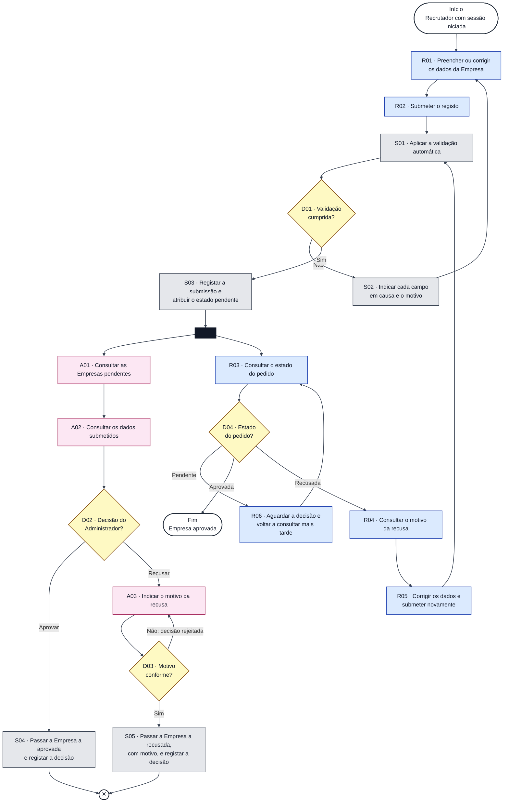

# Diagrama de Atividades — Aprovação de Empresas

**Unidade curricular:** Laboratório de Desenvolvimento de Software — LDS
**Milestone:** `m3`
**Ficheiro:** `m3-diagrama-atividades-aprovacao-empresa-v02.md`
**Pasta de arquivo:** `04-artefactos-tecnicos/04.08-modelos-de-comportamento`
**Compromisso na CCA:** `AD-009` — Diagrama de atividades — aprovação de empresas v2 (versão anterior: `AD-002`)

---

## 1. Identificação do documento

| Campo | Informação |
| --- | --- |
| Grupo | G11 |
| Sistema | Katch |
| Ano letivo | 2026/2027 |
| Curso | LEI — Licenciatura em Engenharia Informática |
| Turma | LEI3T2 |
| Versão do documento | v02 |
| Issue | `I111` — Atualizar à Declaração de Âmbito v04 os modelos de classes dos frontends e os diagramas de comportamento (v02); versão anterior: `I038` |
| Documentos de origem | `m3-proposta-sistema-v04.pdf` (F001, F003, F009) e `m3-declaracao-ambito-v04.pdf` (F003 e limites transversais), homologados em 14-10-2026 (`m3-email-homologacao-ps-da-cca-v02.pdf`); `m3-especificacao-requisitos-v02.md` (RF039, RF041 a RF045, RF091 a RF094, RF112; secção 1.3, requisitos descontinuados); `m3-especificacoes-casos-uso-v02.md` (UC07 — secção 8.2 e UC16 — secção 8.3); `m3-modelo-de-dados-katch-v02.md` (tabela `company`, tipos `company_status` e `operation_type`); `m3-documentacao-api-v02.md` (6.4 e 6.11); `m3-checklist-controlo-artefactos-v04.xlsx` (AD-009); `m2-diagrama-atividades-aprovacao-empresa-v01.md` (versão anterior, conservada) |

### 1.1. Responsáveis

| Issue | Executor | Revisor | Auditor |
| --- | --- | --- | --- |
| `I038` (v01) | Miguel Santos | Roberto Baptista | João Borguem |
| `I111` (v02) | João Borguem | Roberto Baptista | João Coelho |

### 1.2. Histórico de versões

| Versão | Data | Descrição das alterações | Issue |
| --- | --- | --- | --- |
| v01 | 2026-10-02 | Criação do diagrama de atividades do fluxo de aprovação de empresas. | `I038` |
| v01 | 2026-10-06 | Correções da revisão (ciclo 1): nome do ficheiro, responsáveis, funcionalidades e casos de uso na rastreabilidade, e documentos de origem. | `I038` |
| v02 | 2026-10-29 | Atualização à Declaração de Âmbito v04 (redução de âmbito, `I100`): retirada a atividade S06 — «Notificar o Recrutador da decisão» (RF079 descontinuado). O Recrutador passa a conhecer a decisão consultando o estado do pedido: depois da submissão, o fluxo bifurca-se na verificação manual do Administrador e na consulta do estado pelo Recrutador, que pode encontrar o pedido pendente (nova atividade R06, aguardar e voltar a consultar), aprovado ou recusado. Valores de estado e operações registadas do modelo de dados v02, passos do UC07 e do UC16 da especificação de casos de uso v02 e pedidos da documentação da API v02. Lista das alterações na secção 11. | `I111` |

Cada alteração posterior acrescenta uma linha. As versões anteriores são conservadas, nos termos da secção 18.2 do Regulamento de Funcionamento da Unidade Curricular.

---

## 2. Contexto

No Katch, uma Empresa só pode publicar vagas e aceder a candidatos depois de aprovada. A aprovação não é automática: o registo passa por uma validação automática e fica pendente até uma verificação manual obrigatória do Administrador, que aprova ou recusa o pedido (F003). Este documento modela esse fluxo, conforme o compromisso `AD-009` da Checklist de Controlo de Artefactos, para que o comportamento esperado do sistema, as responsabilidades de cada participante e as decisões possíveis fiquem explícitos antes da implementação.

O fluxo começa quando um Recrutador com sessão iniciada na área de gestão web inicia o registo da Empresa. Termina quando a Empresa fica aprovada. Uma recusa não termina o fluxo: o Recrutador pode corrigir os dados e submeter novamente, e o fluxo regressa à validação automática.

**Consulta do estado em vez de notificação.** A Declaração de Âmbito v04 exclui a comunicação da decisão por correio eletrónico ou por aviso na plataforma: a decisão é «consultada pelo Recrutador no estado do pedido» (F003) e não existe mecanismo de notificações (limites transversais). O sistema regista a decisão e não avisa ninguém; o Recrutador sabe se o pedido foi decidido quando consulta o estado do pedido de registo (RF044), o que pode fazer em qualquer momento depois da submissão, mesmo enquanto o pedido está pendente. Por isso, depois da submissão, o fluxo divide-se em dois fluxos paralelos e independentes: a verificação manual do Administrador e a consulta do estado pelo Recrutador.

### 2.1. Âmbito do modelo

| Dentro do modelo | Fora do modelo |
| --- | --- |
| Preenchimento e submissão do registo da Empresa. | Criação da conta do Recrutador (RF037). |
| Validação automática do registo e unicidade do número de identificação fiscal. | Página de apresentação da Empresa, logótipo e galeria (RF046 a RF048), que só existe depois da aprovação. |
| Estado pendente até à decisão. | Alteração dos dados de uma Empresa já aprovada (RF049). |
| Consulta das Empresas pendentes e dos dados submetidos pelo Administrador. | Suspensão e reativação de uma Empresa aprovada (RF095, RF116). |
| Aprovação ou recusa com motivo. | Validação do número de identificação fiscal junto de entidades oficiais, carregamento de documentação comprovativa e comunicação da decisão por correio eletrónico ou por aviso na plataforma (excluídos pela DA v04, F003). |
| Consulta do estado do pedido pelo Recrutador, nos estados pendente, aprovada e recusada, e do motivo da recusa. | Saída do Administrador sem decidir e decisão já tomada noutro pedido (UC16-A2 e UC16-E2): não alteram o estado da Empresa e não mudam o fluxo. |
| Correção dos dados e nova submissão. | |

---

## 3. Participantes e responsabilidades

| Participante | Responsabilidade neste fluxo | Ponto de acesso |
| --- | --- | --- |
| Recrutador | Preenche e submete o registo da Empresa, consulta o estado do pedido (pendente, aprovada ou recusada) e o motivo de uma recusa, corrige os dados e submete novamente. | Área de gestão web |
| Administrador | Realiza a verificação manual obrigatória: consulta as Empresas pendentes e os dados submetidos, e decide aprovar ou recusar, indicando o motivo na recusa. | Área de gestão web (área de supervisão, reservada ao Administrador) |
| Sistema | Valida automaticamente o registo, atribui e altera o estado da Empresa e regista o autor e a data e hora de cada operação. Não comunica a decisão: guarda-a no estado da Empresa, que o Recrutador consulta. | Backend |

---

## 4. Diagrama de atividades

### 4.1. Convenções

| Elemento | Representação |
| --- | --- |
| Início | Retângulo de cantos arredondados, com contorno escuro e fundo branco. |
| Fim da atividade | Retângulo de cantos arredondados, com contorno escuro e fundo branco («Fim — Empresa aprovada»). Termina todos os fluxos. |
| Fim de fluxo | Círculo com ✕. Termina só o fluxo que lá chega. |
| Bifurcação (fork) | Barra preta (`FK1`); os fluxos de saída são executados em paralelo. |
| Atividade do Recrutador | Retângulo azul, código `Rnn`. |
| Atividade do Sistema | Retângulo cinzento, código `Snn`. |
| Atividade do Administrador | Retângulo rosa, código `Ann`. |
| Decisão | Losango amarelo, código `Dnn`, com o resultado de cada ramo na seta. |
| Fluxo | Seta contínua. |

O responsável por cada atividade é identificado pela cor e pela letra inicial do código. Depois da bifurcação `FK1`, o fluxo do Administrador termina num fim de fluxo, quando a decisão fica registada; o fluxo do Recrutador termina no fim da atividade, quando o Recrutador encontra o pedido aprovado, ou regressa à validação automática, depois de uma recusa. Como o fim da atividade só é alcançado com a Empresa aprovada, o fluxo do Administrador já terminou nesse instante. As cores estão fixadas no próprio diagrama, para que se leia da mesma forma em tema claro e em tema escuro.

### 4.2. Diagrama

Os códigos das atividades mantêm os da v01, para facilitar a comparação; o código S06, retirado, não é reutilizado.

---

## 5. Descrição das atividades

| Código | Atividade | Responsável | Descrição | Requisitos |
| --- | --- | --- | --- | --- |
| R01 | Preencher ou corrigir os dados da Empresa | Recrutador | Indica a designação social, o número de identificação fiscal, o setor de atividade, a morada, a localidade da lista pré-definida, o endereço de correio eletrónico, o contacto telefónico e o nome do responsável. Depois de S02, corrige os campos indicados. | RF041 |
| R02 | Submeter o registo | Recrutador | Submete o registo da Empresa na área de gestão web (`POST /api/recruiter/company` no primeiro registo; `POST /api/recruiter/company/resubmission` depois de uma recusa). | RF041, RF045 |
| S01 | Aplicar a validação automática | Sistema | Verifica os campos obrigatórios, o formato do endereço de correio eletrónico (local@domínio), o contacto telefónico e o número de identificação fiscal com 9 algarismos, e se o número de identificação fiscal já está registado por outra Empresa. | RF042 |
| S02 | Indicar cada campo em causa e o motivo | Sistema | Impede que o registo seja concluído e indica ao Recrutador cada campo em causa e o motivo. | RF042 |
| S03 | Registar a submissão e atribuir o estado pendente | Sistema | Atribui à Empresa o estado pendente e mantém-no até à decisão do Administrador. Regista o Recrutador que submeteu e a data e hora. | RF043, RF112 |
| A01 | Consultar as Empresas pendentes | Administrador | Consulta a lista das Empresas no estado pendente, com a designação social, o número de identificação fiscal e a data de submissão do pedido. | RF091 |
| A02 | Consultar os dados submetidos | Administrador | Consulta os oito dados submetidos no registo da Empresa pendente. | RF092 |
| A03 | Indicar o motivo da recusa | Administrador | Ao decidir recusar, indica o motivo, com 10 a 500 caracteres. | RF094 |
| S04 | Passar a Empresa a aprovada e registar a decisão | Sistema | Passa a Empresa de pendente a aprovada. Regista o Administrador que decidiu e a data e hora. Não envia nenhum aviso ao Recrutador: a decisão fica no estado da Empresa. | RF093, RF112 |
| S05 | Passar a Empresa a recusada, com motivo, e registar a decisão | Sistema | Passa a Empresa de pendente a recusada e guarda o motivo. Regista o Administrador que decidiu e a data e hora. Não envia nenhum aviso ao Recrutador: a decisão e o motivo ficam no estado da Empresa. | RF094, RF112 |
| R03 | Consultar o estado do pedido | Recrutador | Consulta, na área de gestão web, o estado do pedido de registo da Empresa (pendente, aprovada ou recusada). É assim que o Recrutador conhece a decisão do Administrador, porque o sistema não a comunica. Pode consultar em qualquer momento depois da submissão; enquanto a Empresa não estiver aprovada, a área de gestão web apresenta o estado e não permite publicar vagas nem aceder a candidatos. | RF039, RF044 |
| R06 | Aguardar a decisão e voltar a consultar mais tarde | Recrutador | Com o pedido pendente, o Recrutador não tem nada a fazer: aguarda a verificação manual e volta a consultar o estado mais tarde (por exemplo, no início de sessão seguinte). | RF039, RF044 |
| R04 | Consultar o motivo da recusa | Recrutador | Consulta o motivo indicado pelo Administrador, apresentado com o estado recusada. | RF044 |
| R05 | Corrigir os dados e submeter novamente | Recrutador | Corrige os dados do registo recusado e submete-o novamente. O fluxo regressa a S01. | RF045 |

---

## 6. Decisões

| Código | Decisão | Decide | Condição | Resultado |
| --- | --- | --- | --- | --- |
| D01 | Validação cumprida? | Sistema | O registo cumpre todas as verificações de S01. | Sim: S03. Não, por campo obrigatório vazio, endereço de correio eletrónico fora do formato, contacto telefónico ou número de identificação fiscal sem 9 algarismos, ou número de identificação fiscal já registado: S02 e regresso a R01. |
| D02 | Decisão do Administrador? | Administrador | Decisão sobre uma Empresa pendente. | Aprovar: S04. Recusar: A03. |
| D03 | Motivo conforme? | Sistema | O motivo da recusa tem entre 10 e 500 caracteres. | Sim: S05. Não: a decisão é rejeitada e o Administrador volta a A03. A Empresa mantém-se pendente. |
| D04 | Estado do pedido? | Recrutador | Estado da Empresa consultado em R03. | Pendente: R06 e nova consulta em R03. Aprovada: fim da atividade. Recusada: R04, R05 e regresso a S01. |

---

## 7. Estados da Empresa neste fluxo

Os estados são os do tipo `company_status` do modelo de dados v02 (tabela `company`, coluna `status`); cada decisão fica também registada no `operation_log`, com o autor e a data e hora (RF112).

| Transição | Atividade | `company_status` | Operação registada | Requisito |
| --- | --- | --- | --- | --- |
| (registo submetido e válido) para pendente | S03 | `PENDING` | `COMPANY_SUBMITTED` | RF043 |
| pendente para aprovada | S04 | `PENDING` → `APPROVED` | `COMPANY_APPROVED` | RF093 |
| pendente para recusada | S05 | `PENDING` → `REJECTED`, com `status_reason` | `COMPANY_REJECTED` | RF094 |
| recusada para pendente | R05 seguido de S01 e S03 | `REJECTED` → `PENDING`, com `status_reason` limpo | `COMPANY_SUBMITTED` | RF045 |

O estado suspensa (`SUSPENDED`, RF095) não faz parte deste fluxo. As consultas R03, R04 e R06 não alteram o estado.

---

## 8. Regras e restrições

1. A verificação manual do Administrador é obrigatória: nenhuma Empresa passa a aprovada sem decisão do Administrador (F003, RF093).
2. Só o Administrador decide sobre o registo de Empresas. A área de supervisão é reservada ao Administrador (RF093, RF094, RF104).
3. A recusa exige um motivo com 10 a 500 caracteres, e uma decisão sem motivo conforme é rejeitada (RF094, parâmetro `P12`).
4. Enquanto a Empresa não estiver aprovada, o Recrutador não pode publicar vagas nem aceder a candidatos, e o sistema indica o estado atual da Empresa (RF039).
5. O número de identificação fiscal é único em todo o sistema e não pode ser alterado depois da aprovação (RF042, RF049).
6. O autor e a data e hora da submissão, da aprovação e da recusa ficam registados (RF112).
7. A decisão não é comunicada ao Recrutador: não há notificação na plataforma, nem envio por correio eletrónico ou por mensagem telefónica. O Recrutador conhece a decisão e o motivo da recusa ao consultar o estado do pedido (DA v04, F003 e limites transversais; RF044).

---

## 9. Rastreabilidade

| Atividade ou decisão | Funcionalidade | Requisitos | Caso de uso | Pedido da API v02 |
| --- | --- | --- | --- | --- |
| R01, R02 | F003 | RF041 | UC07 passo 5 | 6.4.1 `POST /api/recruiter/company` |
| S01, S02, D01 | F003 | RF042 | UC07 passo 6; UC07-E3, E4, E5 | 6.4.1, 6.4.2 (`400`, ERR-10) |
| S03 | F003, F001 | RF043, RF112 | UC07 passo 7 | 6.4.1, 6.4.2 |
| R03, D04, R06 | F003 | RF039, RF044 | UC07 passo 7; UC07-A2; UC07-E6 | 6.4.3 `GET /api/recruiter/company/status` |
| R04 | F003 | RF044 | UC07-A2; UC07-A3 | 6.4.3 (`rejectionReason`); 6.4.8 `GET /api/recruiter/company` |
| R05 | F003 | RF045 | UC07-A3 | 6.4.2 `POST /api/recruiter/company/resubmission` |
| A01 | F003, F009 | RF091 | UC16 passos 1 e 2 | 6.11.1 `GET /api/admin/companies/pending` |
| A02 | F003 | RF092 | UC16 passos 3 e 4 | 6.11.2 `GET /api/admin/companies/{companyId}/registration` |
| D02, S04 | F003, F001 | RF093, RF112 | UC16 passos 5 a 8 | 6.11.3 `POST /api/admin/companies/{companyId}/approve` |
| A03, D03, S05 | F003, F001 | RF094, RF112 | UC16-A1; UC16-E1 | 6.11.4 `POST /api/admin/companies/{companyId}/reject` |

A atividade S06 da v01 (notificação da decisão, F011, RF079) foi retirada: a funcionalidade F011 saiu do âmbito e o RF079 foi descontinuado (especificação de requisitos v02, secção 1.3).

---

## 10. Verificação

| Verificação | Resultado |
| --- | --- |
| Requisitos funcionais do fluxo representados no diagrama | RF041 a RF045, RF091 a RF094 e RF112. O RF039 é uma regra do fluxo (secção 8) e está também nas atividades R03 e R06. |
| Atividades com responsável identificado | 14 de 14 atividades (6 do Recrutador, 5 do Sistema e 3 do Administrador), mais 4 decisões. |
| Fonte textual do diagrama incluída | Sim (secção 4.2, Mermaid). |
| Elementos excluídos pela DA v04 representados | Nenhum: não há notificação, aviso, correio eletrónico nem mensagem telefónica. |
| Requisitos descontinuados referidos como em vigor | Nenhum. |

---

## 11. Alterações face à v01

| # | Elemento da v01 | Alteração na v02 | Fundamento |
| --- | --- | --- | --- |
| 1 | S06 — «Notificar o Recrutador da decisão» | Retirada. S04 e S05 terminam o fluxo do Administrador num fim de fluxo (FA1). | DA v04, F003 («a decisão consultada pelo Recrutador no estado do pedido») e limites transversais; RF079 descontinuado |
| 2 | Fluxo sequencial S03 → A01 … S06 → R03 | S03 liga a uma bifurcação (FK1) com dois fluxos paralelos: a verificação manual do Administrador (A01 a S05) e a consulta do estado pelo Recrutador (R03 a R05). | Sem notificação, a consulta do estado não depende da decisão: o Recrutador pode consultar o pedido ainda pendente |
| 3 | D04 com os ramos «Aprovada» e «Recusada» | Acrescentado o ramo «Pendente», com a nova atividade R06 — «Aguardar a decisão e voltar a consultar mais tarde», que regressa a R03. | RF044 (estado pendente consultável); UC07-A2 |
| 4 | Convenções (secção 4.1) — «O processo não tem atividades paralelas» | Acrescentados a bifurcação, o fim de fluxo e o fim da atividade, com a explicação da terminação dos dois fluxos. | Consequência da alteração 2 |
| 5 | Secção 2.1 — «Notificação da decisão ao Recrutador» dentro do modelo | Substituída pela consulta do estado do pedido nos estados pendente, aprovada e recusada; a comunicação da decisão por aviso na plataforma passa para fora do modelo. | DA v04, F003 |
| 6 | Secção 3 — o Sistema notifica o Recrutador | O Sistema guarda a decisão no estado da Empresa, sem a comunicar. | DA v04, F003 |
| 7 | Secção 7 | Acrescentados os valores de `company_status` e as operações registadas no `operation_log`. | Modelo de dados v02 |
| 8 | Secção 8, regra 7 — decisão comunicada dentro da plataforma | A decisão não é comunicada; é consultada no estado do pedido. | DA v04, F003 e limites transversais |
| 9 | Secção 9 | Retirada a linha de S06 (F011, RF079); acrescentados os passos do UC07 e do UC16 e o pedido da API v02 de cada atividade; nova linha de R06. | Especificação de casos de uso v02; documentação da API v02 |
| 10 | Secção 1 | Documentos de origem atualizados para a PS e a DA v04 e para as v02 da especificação de requisitos, dos casos de uso, do modelo de dados e da API; compromisso AD-009. | CCA v04 |

Não foram alterados as restantes atividades, decisões e regras da v01.
