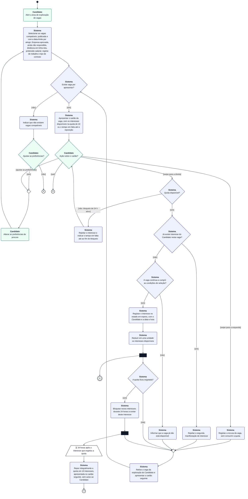
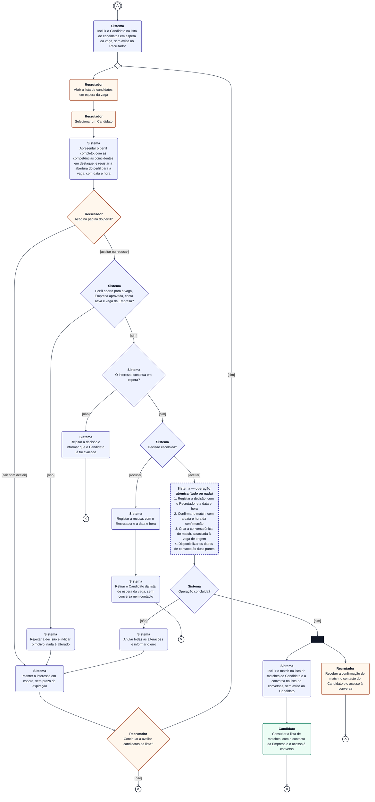

# Modelo de Comportamento — Fluxo de Match (Diagrama de Atividades) — Katch

**Unidade curricular:** Laboratório de Desenvolvimento de Software — LDS
**Milestone:** `m3`
**Ficheiro:** `m3-diagrama-atividades-fluxo-match-v02.md`
**Pasta de arquivo:** `04-artefactos-tecnicos/04.08-modelos-de-comportamento`
**Compromisso na CCA:** `AD-008` — Diagrama de atividades — fluxo de match v2

---

## 1. Identificação do documento

| Campo | Informação |
| --- | --- |
| Grupo | G11 |
| Sistema | Katch |
| Ano letivo | 2026/2027 |
| Curso | LEI — Licenciatura em Engenharia Informática |
| Turma | LEI3T2 |
| Versão do documento | v02 |
| Issue | `I111` — Atualizar à Declaração de Âmbito v04 os modelos de classes dos frontends e os diagramas de comportamento (v02); versão anterior: `I037` |
| Documentos de origem | `m3-proposta-sistema-v04.pdf` e `m3-declaracao-ambito-v04.pdf` (F006, F007, F008 e limites transversais), homologados em 14-10-2026 (`m3-email-homologacao-ps-da-cca-v02.pdf`); `m3-especificacao-requisitos-v02.md` (requisitos funcionais de F006, F007 e F008; secção 1.3, requisitos descontinuados); `m3-especificacoes-casos-uso-v02.md` (UC05 — secção 8.5, UC12 — secção 8.6, UC11 — secção 8.7); `m3-modelo-de-dados-katch-v02.md` (tabela `match`, tipo `match_status`, DM-17 e DM-21); `m3-documentacao-api-v02.md` (6.3, 6.6 e 6.7); `m3-diagrama-estados-interesse-match-v02.md`; `m2-diagrama-atividades-fluxo-match-v01.md` (versão anterior, conservada) |

Os casos de uso UC05 e UC11, que na v01 ainda não estavam especificados, estão aprovados na especificação de casos de uso v02. As atividades e as decisões deste diagrama passam a estar rastreadas aos passos, aos fluxos alternativos e às exceções desses casos de uso (secção 5).

### 1.1. Responsáveis

| Issue | Executor | Revisor | Auditor |
| --- | --- | --- | --- |
| `I037` (v01) | João Borguem | João Coelho | Miguel Santos |
| `I111` (v02) | João Borguem | Roberto Baptista | João Coelho |

### 1.2. Histórico de versões

| Versão | Data | Descrição das alterações | Issue |
| --- | --- | --- | --- |
| v01 | 2026-10-03 | Criação do documento: contexto, convenções, diagrama de atividades do fluxo de match (partes A e B), descrição das decisões e rastreabilidade. | `I037` |
| v01 | 2026-10-07 | Correção dos defeitos D01 a D03 do relatório de revisão `m2-s02-i037-20261006-relatorio-revisao-v01`: origens das decisões da parte A substituídas por requisitos funcionais (D01); saída do ciclo de espera na parte B (D02); ajuste de preferências a partir do cartão e correção da rastreabilidade de F006 (D03). | `I037` |
| v02 | 2026-10-29 | Atualização à Declaração de Âmbito v04 (redução de âmbito, `I100`): retiradas as atividades de notificação — notificação de novo interesse ao Recrutador (S10 da v01), notificação de reposição da quota ao Candidato (S14 e C6 da v01) e notificações de novo match às duas partes (subação 5 da operação atómica e C5 da v01). O Recrutador passa a conhecer os novos interesses pela lista de candidatos em espera e o Candidato o novo match pela lista de matches, que cada um consulta na sua aplicação. Seleção das vagas com a exclusão das vagas com data-limite atingida (modelo de dados v02, DM-17). Rastreabilidade aos passos do UC05, UC11 e UC12 da especificação de casos de uso v02, aos requisitos da especificação de requisitos v02 e aos valores de `match_status` do modelo de dados v02. Lista das alterações na secção 7. | `I111` |

Cada alteração posterior acrescenta uma linha. As versões anteriores são conservadas, nos termos da secção 18.2 do Regulamento de Funcionamento da Unidade Curricular.

---

## 2. Contexto e objetivo

O match é o processo central do Katch: uma ligação entre um Candidato e uma Empresa só existe quando há interesse confirmado pelas duas partes — a manifestação de interesse do Candidato numa vaga e a posterior aceitação desse Candidato pelo Recrutador responsável pela vaga (F008). Nenhuma ação unilateral confirma a ligação.

Este modelo de comportamento descreve, num diagrama de atividades, o percurso completo de um interesse, desde o swipe do Candidato até à confirmação do match ou à recusa, com todas as decisões tomadas pelo Candidato, pelo Recrutador e pelo sistema. Serve para:

- clarificar a ordem das atividades e as condições de cada decisão, antes da implementação das funcionalidades F006 a F008;
- orientar o desenho dos testes (cada ramo de decisão corresponde a, pelo menos, um caso de teste);
- reunir num único modelo os comportamentos especificados nos requisitos funcionais de F006, F007 e F008 e nos casos de uso UC05, UC11 e UC12.

**Sem notificações.** A Declaração de Âmbito v04 retira o mecanismo de notificações (limites transversais): não há área nem contador de notificações, nem avisos dentro ou fora da plataforma. Cada parte consulta a informação que lhe diz respeito na área correspondente da sua aplicação: o Candidato, a quota de interesses na área de exploração (F006) e as ligações confirmadas na lista de matches (F008); o Recrutador, os novos interessados na lista de candidatos em espera (F007) e as ligações confirmadas na lista de matches da Empresa (F008). O diagrama representa essas consultas como ações do ator e não tem nenhuma atividade do sistema que avise uma das partes.

### 2.1. Âmbito do diagrama

| Incluído | Fora do diagrama (modelado noutro artefacto) |
| --- | --- |
| Seleção das vagas compatíveis e apresentação do cartão, com os interesses disponíveis na quota ou o tempo em falta até à reposição (RF013, RF014, RF015, RF022). | Consulta do detalhe da vaga e da página da Empresa (RF016, RF017; UC05-A2 e UC06): não altera o fluxo de match e regressa ao mesmo cartão. |
| Ajuste das preferências de procura a partir da área de exploração (RF023). Recusa da vaga e manifestação de interesse, com as verificações da quota de 10 interesses, do bloqueio de 24 horas, da unicidade do interesse e da disponibilidade da vaga (RF018, RF019, RF020). | Troca de mensagens na conversa do match (RF026 a RF030, RF069 a RF075) e a sua atualização por consulta periódica (RF029, RF073). |
| Reposição da quota no fim do bloqueio (RF021). | Efeito do encerramento da vaga e da suspensão da Empresa sobre um match já confirmado (diagrama de estados do interesse e do match). |
| Interesse em espera (RF113), consulta da lista de candidatos em espera, abertura obrigatória do perfil completo (RF060, RF061, RF118), aceitação ou recusa do Candidato e confirmação do match com criação da conversa (UC11, UC12). Consulta do novo match na lista de matches de cada parte (RF024, RF067). | Fluxo de aprovação de Empresas (`m3-diagrama-atividades-aprovacao-empresa-v02.md`). |

---

## 3. Convenções

O Mermaid não tem um tipo de diagrama UML de atividades. O diagrama usa um `flowchart` com as convenções seguintes:

| Elemento UML | Representação no diagrama |
| --- | --- |
| Nó inicial | Círculo preto preenchido |
| Ação | Retângulo de cantos arredondados, com a responsabilidade a negrito na primeira linha |
| Decisão e junção (merge) | Losango; o losango pequeno sem texto é uma junção de fluxos |
| Guarda | Texto entre parênteses retos na transição (`[sim]`, `[não]`, `[aceitar]`…) |
| Bifurcação (fork) | Barra preta; todos os fluxos de saída são executados em paralelo |
| Evento de tempo | Trapézio com ⌛ |
| Fim de fluxo (flow final) | Círculo com ✕; termina só o fluxo que lá chega, os restantes continuam |
| Conector | Círculo duplo com letra (`A`); liga a parte A à parte B do diagrama |
| Operação atómica | Ação com contorno tracejado, com as subações numeradas; ou são todas aplicadas ou nenhuma é |

**Responsabilidade (partições).** Como o Mermaid não posiciona de forma fiável as partições (swimlanes) quando há muitas transições entre elas, a responsabilidade de cada ação e decisão é indicada de duas formas redundantes: o nome a negrito na primeira linha do nó e a cor do nó. A redundância garante a leitura em impressão a preto e branco.

| Responsabilidade | Cor | Ponto de acesso |
| --- | --- | --- |
| Candidato | Verde | Aplicação móvel |
| Sistema Katch | Azul | Backend (executado sem intervenção direta de um ator) |
| Recrutador | Laranja | Área de gestão web |

As cores estão fixadas no próprio diagrama (fundo branco, linhas escuras), para que se leia da mesma forma em tema claro e em tema escuro.

**Uso do fim de fluxo.** O diagrama não tem nó final de atividade. A exploração de vagas pelo Candidato e a avaliação do interesse pelo Recrutador decorrem em paralelo depois da bifurcação; o Candidato sair da exploração não termina a avaliação do interesse, e vice-versa. Por isso, todos os términos são fins de fluxo e a atividade termina quando nenhum fluxo está ativo. Todos os ciclos do diagrama têm uma saída para um fim de fluxo.

---

## 4. Diagrama de atividades

O diagrama está dividido em duas partes ligadas pelo conector **A**, que corresponde à bifurcação após o registo do interesse.

### 4.1. Parte A — Exploração de vagas e manifestação de interesse

Os identificadores dos nós mantêm os da v01, para facilitar a comparação; os nós retirados (S10, S14 e C6) não são reutilizados.

### 4.2. Parte B — Avaliação do interesse e confirmação do match

A ação «Consultar a lista de matches» (C5) é da iniciativa do Candidato e pode ocorrer em qualquer momento depois da confirmação: o diagrama representa o primeiro momento em que o Candidato vê o novo match, e não um aviso enviado pelo sistema (DA v04, F008: «a nova ligação é apresentada na lista de ligações confirmadas de cada parte»).

---

## 5. Descrição das decisões

### 5.1. Decisões da parte A

| Decisão | Responsável | Guardas e resultado | Origem |
| --- | --- | --- | --- |
| Existe vaga por apresentar? | Sistema | `[sim]` apresenta o cartão; `[não]` indica que não há vagas compatíveis. | UC05 passos 2 e 3; UC05-A6; RF013; RF014 |
| Ajustar as preferências? | Candidato | `[sim]` grava as novas preferências e repete a seleção; `[não]` termina a exploração. | UC05-A6; UC05-A3; RF023 |
| Ação sobre o cartão? | Candidato | `[swipe para a esquerda]` recusa a vaga; `[swipe para a direita]` manifesta interesse; `[ajustar as preferências]` grava as novas preferências e repete a seleção, aplicando-as às vagas apresentadas a seguir; `[sair]` termina a exploração. | UC05 passo 4; UC05-A1; UC05-A3; RF013; RF018; RF019; RF023 |
| Quota disponível? | Sistema | `[sim]` continua; `[não: bloqueio de 24 h ativo]` rejeita o interesse, mostra o tempo em falta e mantém o mesmo cartão (o Candidato ainda pode recusar, ajustar as preferências ou sair). | UC05 passo 5; UC05-A4; UC05-E1; RF020; RF022 |
| Já existe interesse do Candidato nesta vaga? | Sistema | `[sim]` rejeita a segunda manifestação; `[não]` continua. | UC05 passo 5; UC05-E2; RF019 |
| A vaga continua a cumprir as condições de seleção? | Sistema | `[sim]` regista o interesse; `[não]` (vaga suspensa, encerrada ou com a data-limite atingida, Empresa suspensa) informa que a vaga já não está disponível. | UC05 passo 5; UC05-E3; RF014; RF019; modelo de dados v02, DM-17 |
| A quota ficou esgotada? | Sistema | `[sim]` bloqueia novos interesses durante 24 horas a contar do instante deste interesse e agenda a reposição; `[não]` apresenta o cartão seguinte. | UC05 passo 7; RF020; RF021 (P11) |

Nas três rejeições (quota, interesse repetido e vaga indisponível) nada é registado e a quota não é alterada. A recusa da vaga nunca consome a quota e não tem limite (UC05-A1).

**Reposição da quota (UC05-A5).** Decorridas 24 horas sobre o interesse que esgotou a quota, o sistema repõe-na integralmente (RF021). A reposição não gera aviso: o Candidato vê os 10 interesses no cartão seguinte que lhe é apresentado, ou quando volta a abrir a área de exploração, porque o cartão mostra sempre os interesses disponíveis ou o tempo em falta (RF022; DA v04, F006: «o aviso ativo da reposição da quota» está fora do âmbito). A reposição é aplicada pela tarefa periódica do backend ou, se esta ainda não tiver corrido, na própria consulta da quota (documentação da API v02, 6.3.6; modelo de dados v02, secção 7.2).

### 5.2. Decisões da parte B

| Decisão | Responsável | Guardas e resultado | Origem |
| --- | --- | --- | --- |
| Ação na página do perfil? | Recrutador | `[aceitar ou recusar]` pede a decisão; `[sair sem decidir]` mantém o interesse em espera, sem prazo, e o Candidato continua na lista. | UC12 passo 4; UC12-A2; UC11 passo 6; UC11-A4 |
| Continuar a avaliar candidatos da lista? | Recrutador | `[sim]` regressa à lista de candidatos em espera da vaga; `[não]` termina este fluxo de avaliação. Em ambos os casos o interesse continua em espera, sem prazo de expiração, e o Candidato continua na lista. | UC11-A4; UC12-A2; RF113 |
| Perfil aberto para a vaga, Empresa aprovada, conta ativa e vaga da Empresa? | Sistema | `[sim]` continua; `[não]` rejeita a decisão sem alterar nada e o interesse continua em espera. | UC12 passo 5; UC12-E1, E2, E3 |
| O interesse continua em espera? | Sistema | `[sim]` continua; `[não]` (decidido noutro pedido simultâneo) rejeita e mantém a decisão já registada. | UC12-E4; RF117 |
| Decisão escolhida? | Sistema | `[aceitar]` executa a operação atómica; `[recusar]` regista a recusa e retira o Candidato da lista de espera dessa vaga. | UC12 passo 6; UC12-A1 |
| Operação concluída? | Sistema | `[sim]` bifurca: o Recrutador recebe a confirmação, o contacto e o acesso à conversa, e o match fica na lista de matches do Candidato, que o consulta na aplicação móvel; `[não]` anula todas as alterações e o interesse continua em espera. | UC12 passos 6 e 7; UC12-E5; RF024; RF025 |

A abertura obrigatória do perfil é garantida duas vezes: pela ordem das atividades (a ação de decisão só existe na página do perfil, depois de o sistema registar a abertura) e pela verificação no servidor (decisão «Perfil aberto para a vaga…»), que cobre pedidos diretos à API.

O fim de fluxo após «Continuar a avaliar candidatos da lista? `[não]`» termina apenas a avaliação em curso; não altera o estado do interesse, que continua em espera (RF113). Quando o Recrutador volta a abrir a lista de candidatos em espera da vaga, a avaliação do mesmo interesse recomeça na ação «Abrir a lista de candidatos em espera da vaga».

**Novos interessados.** A inclusão do Candidato na lista de candidatos em espera (S15) não gera aviso ao Recrutador: os novos interessados são consultados na lista de candidatos em espera de cada vaga (DA v04, F007: «o aviso ativo ao Recrutador de novos interessados» está fora do âmbito). A lista de vagas indica o número de candidatos em espera de cada vaga (documentação da API v02, 6.5.1, `waitingCandidates`).

### 5.3. Ações correspondentes aos passos dos casos de uso

| Ação do diagrama | Caso de uso |
| --- | --- |
| C1, S1, D1, S3 | UC05 passos 1 a 3 |
| S2, C3, C4 | UC05-A6 e UC05-A3 |
| C2, D2, D3, D4 | UC05 passos 4 e 5; UC05-E1, E2, E3 |
| S4, S12 | UC05-A1; UC05 passo 8 |
| S8, S9 | UC05 passo 6 |
| D5, S11 | UC05 passo 7 |
| T1, S13 | UC05-A5 |
| S15, R1, R2 | UC11 passos 1 a 3; UC12 passos 1 e 2 |
| S16 | UC11 passos 4 e 5; UC12 passo 3 |
| R3, S17, R5 | UC12 passo 4; UC12-A2; UC11-A4 |
| D6, S18, D7, S19 | UC12 passo 5; UC12-E1 a E4 |
| D8, S20, S21 | UC12-A1 |
| A1, D9, S22 | UC12 passo 6; UC12-E5 |
| R4 | UC12 passo 7 |
| S23, C5 | UC12, pós-condição de aceitação; UC13 (consulta dos matches e dos contactos) |

---

## 6. Rastreabilidade

### 6.1. Funcionalidades e requisitos

| Funcionalidade | Atividades do diagrama | Casos de uso | Requisitos |
| --- | --- | --- | --- |
| F006 — Exploração de vagas e manifestação de interesse | Parte A completa | UC05 (secção 5.3) | RF013, RF014, RF018 a RF022; RF023 (ajuste de preferências, sem vagas por apresentar e a partir do cartão); RF015 (distância em linha reta); RF113 (interesse em espera); RF112 (autor e data e hora) |
| F007 — Avaliação de candidatos interessados | Parte B, da lista de espera até à decisão | UC11, UC12 | RF060, RF061, RF062, RF118 (abertura do perfil); RF063, RF064, RF065, RF066, RF117; RF113 (interesse em espera sem decisão); RF039 (Empresa aprovada) |
| F008 — Confirmação de match e disponibilização de contacto | Operação atómica e bifurcação final da parte B | UC12, UC13 | RF066 (confirmação); RF068 (criação da conversa); RF024 e RF025 (lista de matches e contacto da Empresa, Candidato); RF067 (contacto do Candidato, Recrutador) |

Os requisitos RF016 (detalhe da vaga, F006) e RF017 (página de apresentação da Empresa, F003) não estão representados no diagrama, por a consulta do detalhe da vaga e da página da Empresa ficar fora do âmbito definido na secção 2.1.

Os requisitos de notificação que a v01 rastreava (RF031, RF033, RF076 e RF077) foram descontinuados com a funcionalidade F011 (especificação de requisitos v02, secção 1.3) e deixam de ser referidos.

### 6.2. Estados do interesse produzidos pelo fluxo

Os estados correspondem ao diagrama de estados do interesse e do match v02 e ao tipo `match_status` do modelo de dados v02 (tabela `match`, coluna `status`).

| Atividade do diagrama | Estado antes | Estado depois | `match_status` |
| --- | --- | --- | --- |
| Registar a recusa da vaga (S4) | — (não existe) | Recusado pelo Candidato | `DECLINED_BY_CANDIDATE` |
| Registar o interesse no estado em espera (S8) | — (não existe) | Em espera | `WAITING` |
| Apresentar o perfil completo e registar a abertura (S16) | Em espera (perfil por abrir) | Em espera (perfil aberto) | `WAITING`, com `profile_opened_at` preenchido |
| Manter o interesse em espera (sair sem decidir, rejeição por pré-condição, falha da operação atómica) e terminar a avaliação sem decisão | Em espera | Em espera | `WAITING` |
| Registar a recusa do Candidato (S20) | Em espera | Recusado pelo Recrutador | `REJECTED_BY_RECRUITER` |
| Operação atómica concluída (A1) | Em espera | Match confirmado, com a conversa aberta | `MATCHED`, com `conversation_status = OPEN` |
| Rejeitar porque o Candidato já foi avaliado (S19) | Recusado pelo Recrutador ou match confirmado | Inalterado (RF117) | Inalterado |

Nas rejeições da parte A (S5, S6 e S7) não é criado nenhum registo na tabela `match`.

---

## 7. Alterações face à v01

| # | Elemento da v01 | Alteração na v02 | Fundamento |
| --- | --- | --- | --- |
| 1 | S10 — «Gerar a notificação de novo interesse ao Recrutador» | Retirada. S9 liga diretamente à bifurcação FK1. S15 indica que a inclusão na lista de espera é feita sem aviso ao Recrutador. | DA v04, F007 e limites transversais; RF076 descontinuado |
| 2 | S14 — «Gerar a notificação de reposição da quota ao Candidato» e C6 — «Receber a notificação de reposição da quota» | Retiradas. S13 passa a indicar que a quota reposta é apresentada no cartão seguinte, sem aviso; o fluxo termina em FC3. | DA v04, F006 e limites transversais; RF033 descontinuado |
| 3 | A1, subação 5 — «Gerar as notificações de novo match ao Candidato e ao Recrutador» | Retirada. A operação atómica tem quatro subações. | DA v04, F008 e limites transversais; RF031 e RF077 descontinuados |
| 4 | C5 — «Receber a notificação de novo match» | Substituída por S23 (o sistema inclui o match na lista de matches do Candidato e a conversa na lista de conversas, sem aviso) e por C5 — «Consultar a lista de matches» (ação do Candidato). | DA v04, F008 («a nova ligação é apresentada na lista de ligações confirmadas de cada parte»); RF024, RF025 |
| 5 | S21 — «… sem conversa, contacto nem notificação» | Passa a «… sem conversa nem contacto». | Não há notificações a excluir |
| 6 | S1 — condições de seleção | Acrescentada a condição «com a data-limite por atingir»; na decisão D4, a data-limite atingida passa a ser também motivo de vaga indisponível. | Modelo de dados v02, DM-17 (vagas expiradas excluídas sem esperar pela tarefa periódica) |
| 7 | Secção 1 — UC05 e UC11 por especificar | Retirada a ressalva; documentos de origem atualizados para a PS e a DA v04 e para as v02 da especificação de requisitos, dos casos de uso, do modelo de dados e da API. | Especificação de casos de uso v02 (UC05 e UC11 aprovados) |
| 8 | Secção 5 — origens das decisões | Acrescentados os passos, os fluxos alternativos e as exceções do UC05, do UC11 e do UC12; nova secção 5.3 com a correspondência das ações aos passos; parágrafos sobre a reposição da quota e os novos interessados sem aviso. | Especificação de casos de uso v02 |
| 9 | Secção 6.1 | Retiradas as referências a RF031, RF033, RF076 e RF077; acrescentados RF024, RF025, RF066 e RF067 à F008 e o UC13. | Especificação de requisitos v02, secção 1.3 |
| 10 | Secção 6.2 | Acrescentados a recusa da vaga pelo Candidato, a abertura do perfil e a coluna com o valor de `match_status`. | Modelo de dados v02, `match_status` de quatro valores (DM-21) |

Não foram alterados os restantes nós, decisões, guardas e transições da v01.
