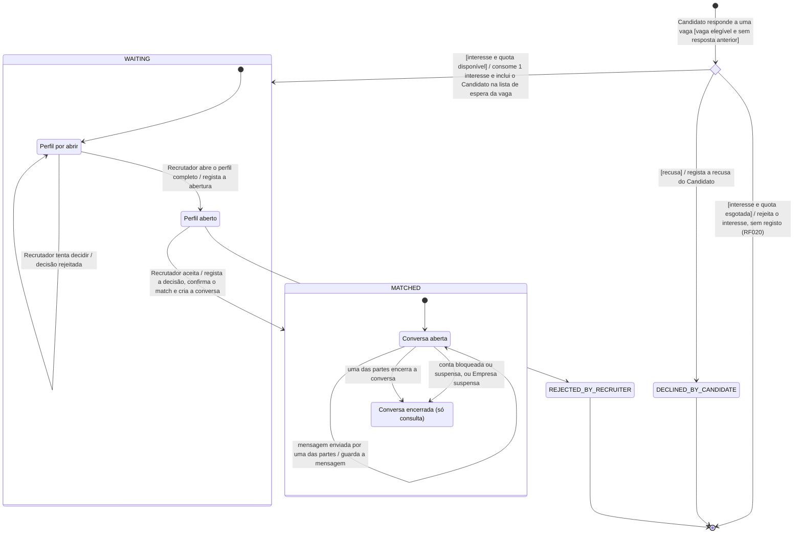

# Diagrama de Estados — Interesse e Match

**Unidade curricular:** Laboratório de Desenvolvimento de Software — LDS
**Milestone:** `m3`
**Ficheiro:** `m3-diagrama-estados-interesse-match-v02.md`
**Pasta de arquivo:** `04-artefactos-tecnicos/04.08-modelos-de-comportamento`
**Compromisso na CCA:** `AD-010` — Diagrama de estados — interesse e match v2

---

## 1. Identificação do documento

| Campo | Informação |
| --- | --- |
| Grupo | G11 |
| Sistema | Katch |
| Ano letivo | 2026/2027 |
| Curso | LEI — Licenciatura em Engenharia Informática |
| Turma | LEI3T2 |
| Versão do documento | v02 |
| Documentos de origem | Ver a secção 1.1 |

### 1.1. Documentos de origem

| Documento | Caminho em `/projeto` | Versão | Estado |
| --- | --- | --- | --- |
| Proposta de Sistema | `04-artefactos-tecnicos/04.01-proposta-de-sistema-e-declaracao-de-ambito/m3-proposta-sistema-v04.pdf` | v04 | Homologada em 14-10-2026 (`m3-email-homologacao-ps-da-cca-v02.pdf`) |
| Declaração de Âmbito | `04-artefactos-tecnicos/04.01-proposta-de-sistema-e-declaracao-de-ambito/m3-declaracao-ambito-v04.pdf` | v04 | Homologada em 14-10-2026 |
| Especificação de Requisitos (103 requisitos funcionais em vigor) | `04-artefactos-tecnicos/04.03-requisitos-e-rtm/m3-especificacao-requisitos-v02.md` | v02 | Aprovada (deliberação 1 da ata `m3-20261016-reuniao-extraordinaria-ata-v01.pdf`) |
| Especificações de Casos de Uso (UC05, UC11, UC12 e UC14) | `04-artefactos-tecnicos/04.04-casos-de-uso/m3-especificacoes-casos-uso-v02.md` | v02 | Aprovada (Issue `I100`) |
| Modelo de dados PostgreSQL | `04-artefactos-tecnicos/04.06-modelos-de-dados/m3-modelo-de-dados-katch-v02.md` | v02 | Aprovado (Issue `I102`) |
| Documentação da API | `04-artefactos-tecnicos/04.11-documentacao-de-api/m3-documentacao-api-v02.md` | v02 | Aprovada (Issues `I101` e `I104`) |
| Diagrama de estados (versão anterior) | `04-artefactos-tecnicos/04.08-modelos-de-comportamento/m2-diagrama-estados-interesse-match-v01.md` | v01 | Conservada |

**Correspondência com o modelo de dados.** Os estados principais deste diagrama coincidem com os quatro valores do tipo `match_status` do modelo de dados v02 (tabela `match`, coluna `status`; DM-21), e as transições T1 a T6 são as que o modelo de dados indica na tabela de valores do estado (secção 6.13). A correspondência deixou de ser provisória: o modelo de dados v02 está aprovado.

### 1.2. Responsáveis

| Issue | Executor | Revisor | Auditor |
| --- | --- | --- | --- |
| `I086` (v01) — Diagrama de estados do interesse e do match | João Coelho | João Borguem | Miguel Santos |
| `I111` (v02) — Atualizar à Declaração de Âmbito v04 os modelos de classes dos frontends e os diagramas de comportamento | João Borguem | Roberto Baptista | João Coelho |

### 1.3. Histórico de versões

| Versão | Data | Descrição das alterações | Issue |
| --- | --- | --- | --- |
| v01 | 2026-10-02 | Criação do documento e do diagrama de estados do interesse e do match. | `I086` |
| v01 | 2026-10-06 | Correções após a revisão: retirada a transição de encerramento sem decisão do Recrutador (D01); pseudoestado de escolha corrigido (D02); documentos de origem identificados (D03); correspondência com os estados do critério de aceitação e transições T5 e T6 a partir de «Perfil aberto» (M01, M02). | `I086` |
| v02 | 2026-10-29 | Atualização à Declaração de Âmbito v04 (redução de âmbito, `I100`): retiradas as notificações das ações das transições T2 (novo interesse ao Recrutador), T5 (novo match às duas partes) e T7 (nova mensagem ao destinatário), com os requisitos descontinuados RF031, RF032, RF076, RF077 e RF078; a mensagem nova chega à outra parte pela consulta periódica da conversa (RF029, RF073; P17). Estados alinhados com o modelo de dados v02: o estado final `REJECTED` divide-se em `DECLINED_BY_CANDIDATE` e `REJECTED_BY_RECRUITER`, os quatro valores de `match_status`, sem `candidate_status`, `recruiter_status`, `matched_at` nem `profile_opened_by`. Documentos de origem na v04 e na v02. Lista das alterações na secção 7. | `I111` |

Cada alteração posterior acrescenta uma linha. As versões anteriores são conservadas, nos termos da secção 18.2 do Regulamento de Funcionamento da Unidade Curricular.

---

## 2. Contexto

O elemento modelado é a **resposta de um Candidato a uma vaga**. Começa com a recusa ou com a manifestação de interesse e pode terminar num match. Existe um único registo por par Candidato–vaga: o Candidato só responde uma vez a cada vaga.

O registo é criado quando o Candidato responde a uma vaga que lhe é apresentada (UC05). Se a quota de interesses estiver esgotada, o interesse é rejeitado e não é criado nenhum registo (RF020). No diagrama, este caso é o ramo `[interesse e quota esgotada]` do pseudoestado `resposta`, que termina sem criar registo e sem consumir interesse. A quota de interesses pertence ao Candidato e não a cada interesse, por isso o seu saldo não é modelado aqui; só a guarda a consulta.

O match não é uma entidade separada: é o estado final positivo do mesmo registo. A conversa entre as partes existe apenas enquanto o registo está em match e é modelada como subestado desse estado.

O registo tem dois estados finais negativos, que correspondem a dois valores distintos de `match_status`: `DECLINED_BY_CANDIDATE` (recusa da vaga pelo Candidato) e `REJECTED_BY_RECRUITER` (recusa do Candidato pelo Recrutador). Em ambos, o registo é encerrado sem match.

O interesse em espera não tem prazo de expiração (RF113): mantém-se em `WAITING` até o Recrutador aceitar ou recusar. O encerramento ou suspensão da vaga, a suspensão da Empresa e o bloqueio ou suspensão da conta do Candidato não alteram o estado do interesse em espera (modelo de dados v02, secção 7.2; documentação da API v02, 6.10.3). Ver a nota da secção 4.1.

**Sem notificações.** A Declaração de Âmbito v04 retira o mecanismo de notificações (limites transversais). Nenhuma transição deste diagrama tem, na ação, o envio de um aviso a uma das partes: cada parte vê a mudança de estado quando consulta a área correspondente da sua aplicação — o Recrutador, a lista de candidatos em espera da vaga (T2) e a lista de matches (T5); o Candidato, a lista de matches (T5); as duas partes, a conversa, atualizada por consulta periódica ao servidor de 3 em 3 segundos enquanto está aberta (T7 a T9; RF029, RF073; P17). A consulta periódica não altera o estado do registo.

**Correspondência com os estados do critério de aceitação.**

| Estado do critério de aceitação | Estado deste diagrama |
| --- | --- |
| Em espera | `WAITING` |
| Aceite | Decisão do Recrutador em T5; o registo passa a `MATCHED` |
| Ligação confirmada | `MATCHED` |
| Recusado | `DECLINED_BY_CANDIDATE` (recusa do Candidato) ou `REJECTED_BY_RECRUITER` (recusa do Recrutador) |

«Aceite» não é um estado estável: a aceitação do Recrutador e a confirmação do match são atómicas (secção 6), por isso o registo nunca fica «aceite» sem estar em `MATCHED`.

---

## 3. Diagrama

**Notação.** As transições seguem a forma UML `evento [guarda] / ação`. O losango `resposta` é um pseudoestado de escolha: a transição que entra tem evento e guarda, e as que saem têm só guarda e ação, e cobrem todos os casos (recusa, interesse com quota disponível e interesse com quota esgotada). O ramo de quota esgotada termina sem registo, por isso não chega a nenhum estado. `WAITING` e `MATCHED` são estados compostos. `DECLINED_BY_CANDIDATE` e `REJECTED_BY_RECRUITER` são estados finais: o registo mantém-se para histórico, mas não volta a mudar. `MATCHED` não tem saída, porque um match confirmado nunca é anulado. `Conversa encerrada` também não tem saída: a conversa não reabre, mesmo que a conta ou a Empresa seja reativada.

---

## 4. Estados

| Estado | Descrição | Correspondência no modelo de dados v02 | Requisitos |
| --- | --- | --- | --- |
| `DECLINED_BY_CANDIDATE` — Recusado pelo Candidato | Estado final. O Candidato recusou a vaga; a vaga não lhe volta a ser apresentada e a quota não foi consumida. | `status = DECLINED_BY_CANDIDATE`, `candidate_action_at`; `profile_opened_at`, `recruiter_action_at` e `decided_by` vazios (`ck_match_declined`) | RF014, RF018 |
| `WAITING` — Em espera | O Candidato manifestou interesse e aguarda a decisão do Recrutador. Aparece na lista de candidatos em espera da vaga, que o Recrutador consulta. | `status = WAITING`, `candidate_action_at` | RF019, RF060, RF113 |
| `WAITING` › Perfil por abrir | O Recrutador ainda não abriu o perfil completo do Candidato para esta vaga. Nenhuma decisão é aceite. | `profile_opened_at IS NULL` | RF063, RF064, RF118 |
| `WAITING` › Perfil aberto | O Recrutador abriu o perfil completo e pode aceitar ou recusar. | `profile_opened_at` preenchido (primeira abertura, DM-14); o Recrutador que abre é o da Empresa da vaga (DM-24) | RF061, RF118 |
| `MATCHED` — Match confirmado | Existe interesse do Candidato e aceitação do Recrutador. Os dados de contacto estão disponíveis às duas partes, na lista de matches de cada uma. | `status = MATCHED`, `recruiter_action_at` (também instante da confirmação, DM-24), `decided_by` (`ck_match_decision`) | RF024, RF025, RF066, RF067 |
| `MATCHED` › Conversa aberta | As duas partes trocam mensagens; cada parte recebe as mensagens da outra por consulta periódica, enquanto a conversa ou a lista de conversas está aberta. | `conversation_status = OPEN` (`ck_match_conversation`) | RF026, RF029, RF068, RF069, RF073 |
| `MATCHED` › Conversa encerrada | A conversa fica só de consulta. O histórico mantém-se e não são aceites novas mensagens. Não reabre. | `conversation_status = CLOSED`, `conversation_closed_at`, `conversation_close_reason`; `conversation_closed_by` só no encerramento por uma das partes (`ck_match_conversation_close`, `ck_match_closed_by`) | RF030, RF074, RF075 |
| `REJECTED_BY_RECRUITER` — Recusado pelo Recrutador | Estado final. O Candidato fica excluído desta vaga, sem conversa nem contacto; os interesses noutras vagas da Empresa não são afetados. | `status = REJECTED_BY_RECRUITER`, `recruiter_action_at`, `decided_by`, `profile_opened_at` (`ck_match_decision`) | RF064, RF065 |

### 4.1. Interesses em espera e encerramento da vaga, da Empresa ou da conta

**Nota — encerramento de interesses em espera (não adotado).** A proposta de `m2-decisao-encerramento-interesses-em-espera-v01.md` (encerrar sem match os interesses em espera quando a vaga é encerrada ou suspensa, a Empresa é suspensa ou a conta do Candidato é bloqueada ou suspensa) não foi ratificada e os requisitos RF119 a RF121 que propunha não constam da especificação de requisitos v02. O modelo de dados v02 não tem valor de `match_status` para esse encerramento e regista que «os interesses em espera mantêm-se (RF113)» no bloqueio e na suspensão (secções 7.2 e 11), tal como a documentação da API v02 (6.10.3). Nesta versão, nesses casos, o interesse mantém-se em `WAITING` (RF113: sem prazo de expiração). Se a decisão vier a ser ratificada, a transição entra numa nova versão deste diagrama, do modelo de dados e da especificação. A transição que a decisão designava por «T7» não corresponde à T7 deste diagrama (envio de mensagem).

---

## 5. Transições

| # | Origem | Evento | Guarda | Ação | Destino | Requisitos |
| --- | --- | --- | --- | --- | --- | --- |
| T0 | Início | Candidato responde a uma vaga apresentada | Vaga elegível e sem resposta anterior do Candidato | — | Pseudoestado `resposta` | RF013, RF014 |
| T1 | `resposta` | — | `[recusa]` | Regista a recusa; a vaga não volta a ser apresentada | `DECLINED_BY_CANDIDATE` | RF014, RF018 |
| T2 | `resposta` | — | `[interesse e quota disponível]` | Consome 1 interesse da quota e inclui o Candidato na lista de candidatos em espera da vaga, que o Recrutador consulta | `WAITING` › Perfil por abrir | RF019, RF060, RF113 |
| T2a | `resposta` | — | `[interesse e quota esgotada]` | Rejeita o interesse; não cria registo nem consome interesse | Fim, sem registo | RF020 |
| T3 | Perfil por abrir | Recrutador abre o perfil completo do Candidato | — | Regista a abertura do perfil para esta vaga | Perfil aberto | RF061, RF118 |
| T4 | Perfil por abrir | Recrutador tenta aceitar ou recusar | — | Rejeita a decisão | Perfil por abrir | RF063, RF064 |
| T5 | `WAITING` › Perfil aberto | Recrutador aceita o Candidato | — | Regista a decisão com autor e data, confirma o match e cria a conversa; o match passa a constar da lista de matches das duas partes | `MATCHED` › Conversa aberta | RF063, RF065, RF066, RF068, RF024, RF067 |
| T6 | `WAITING` › Perfil aberto | Recrutador recusa o Candidato | — | Regista a decisão com autor e data e exclui o Candidato desta vaga | `REJECTED_BY_RECRUITER` | RF064, RF065 |
| T7 | Conversa aberta | Uma das partes envia uma mensagem | Mensagem não vazia e dentro do comprimento máximo | Guarda a mensagem; a outra parte recebe-a na primeira consulta periódica seguinte ao envio, no máximo 5 segundos depois | Conversa aberta | RF026, RF069, RF029, RF073; P03, P17 |
| T8 | Conversa aberta | O Candidato ou o Recrutador encerra a conversa | — | Regista quem encerrou e quando | Conversa encerrada | RF030, RF074 |
| T9 | Conversa aberta | Bloqueio ou suspensão da conta de uma das partes, ou suspensão da Empresa | — | Passa a conversa a só de consulta, com o motivo | Conversa encerrada | RF075, RF086, RF089, RF095 |

Nas transições T7 a T9, a outra parte vê o novo estado da conversa na consulta periódica seguinte da conversa ou da lista de conversas (documentação da API v02, secção 7.2). Com a conversa ou a lista de conversas fechada, vê-o quando as volta a abrir.

---

## 6. Regras e invariantes

| Regra | Requisitos |
| --- | --- |
| Existe no máximo um registo por par Candidato–vaga. O Candidato não volta a responder a uma vaga já respondida. | RF014, RF019 |
| O match só se confirma com interesse do Candidato **e** aceitação do Recrutador. Nenhuma das partes o confirma sozinha. | RF066 |
| O Recrutador só decide depois de abrir o perfil completo do Candidato para essa vaga. | RF063, RF064, RF118 |
| Uma decisão registada não pode ser alterada. Se dois pedidos de decisão sobre o mesmo registo chegarem ao mesmo tempo, só o primeiro é aceite (concorrência otimista, modelo de dados v02, secção 7.3). | RF117 |
| `DECLINED_BY_CANDIDATE` e `REJECTED_BY_RECRUITER` são finais: o registo não volta a `WAITING` nem passa a `MATCHED`. A recusa do Candidato exclui a vaga; a decisão do Recrutador, uma vez registada, não pode ser alterada. | RF018, RF065, RF117 |
| Um interesse em `WAITING` não expira: mantém-se até o Recrutador aceitar ou recusar. | RF113 |
| Um match confirmado nunca é anulado. O encerramento da vaga e a suspensão da Empresa não eliminam o match. | F008; RF024, RF067 |
| A conversa encerrada não reabre, mesmo depois de reativada a conta ou a Empresa. | RF075, RF087, RF090, RF116 |
| Não há comunicação entre as partes fora do estado `MATCHED`. | RF070 |
| O Administrador não acede ao conteúdo das conversas em nenhum estado. | RF103 |
| A confirmação do match (T5) é atómica: a decisão, o match e a conversa são registados em conjunto, ou nada é registado. | RF066, RF068 |
| Nenhuma transição envia avisos às partes; a consulta periódica das conversas não altera o estado do registo. | DA v04, F010 e limites transversais; RF029, RF073 |

---

## 7. Alterações face à v01

| # | Elemento da v01 | Alteração na v02 | Fundamento |
| --- | --- | --- | --- |
| 1 | T2 — ação «consome 1 interesse e notifica o Recrutador» | Passa a «consome 1 interesse e inclui o Candidato na lista de espera da vaga»; RF076 substituído por RF060. | DA v04, F007 e limites transversais; RF076 descontinuado |
| 2 | T5 — ação «confirma o match, cria a conversa e notifica as duas partes» | Passa a «regista a decisão, confirma o match e cria a conversa»; o match passa a constar da lista de matches das duas partes. RF031 e RF077 substituídos por RF024 e RF067. | DA v04, F008 e limites transversais; RF031 e RF077 descontinuados |
| 3 | T7 — ação «guarda a mensagem e notifica o destinatário» | Passa a «guarda a mensagem; a outra parte recebe-a na consulta periódica seguinte». RF032 e RF078 substituídos por RF029, RF073 e P17. | DA v04, F010; especificação de requisitos v02 (RF029, RF073, P17) |
| 4 | Estado final `REJECTED` com duas causas (secção 4.1 da v01) | Dividido em `DECLINED_BY_CANDIDATE` (destino de T1) e `REJECTED_BY_RECRUITER` (destino de T6). | Modelo de dados v02, `match_status` de quatro valores (DM-21) |
| 5 | Correspondência no modelo de dados com `candidate_status`, `recruiter_status`, `matched_at` e `profile_opened_by` | Substituída pelos valores de `status` e pelas colunas e restrições do modelo de dados v02. | Modelo de dados v02, DM-21 e DM-24 |
| 6 | Correspondência provisória com o modelo de dados (secção 1.1 da v01) | Deixa de ser provisória. | Modelo de dados v02 aprovado (`I102`) |
| 7 | Nota sobre o encerramento de interesses em espera «em análise» | Passa a «não adotado», com a remissão para o modelo de dados v02 e a API v02, que mantêm o interesse em espera; esclarecida a diferença entre a «T7» da decisão e a T7 deste diagrama. | Modelo de dados v02, secções 7.2 e 11; especificação de requisitos v02 sem RF119 a RF121 |
| 8 | Secção 2 | Acrescentado o parágrafo «Sem notificações». | DA v04, limites transversais |
| 9 | Regra da atomicidade da confirmação (secção 6) | Sem «as duas notificações»; RF031 e RF077 retirados. Acrescentada a regra de que nenhuma transição envia avisos. | DA v04; especificação de requisitos v02, secção 1.3 |
| 10 | Secção 1.1 | Documentos de origem na PS e na DA v04 e nas v02 da especificação de requisitos, dos casos de uso, do modelo de dados e da API. | Redução de âmbito (`I100`) |

Não foram alterados os subestados, os eventos, as guardas, os pseudoestados nem as restantes regras da v01.
