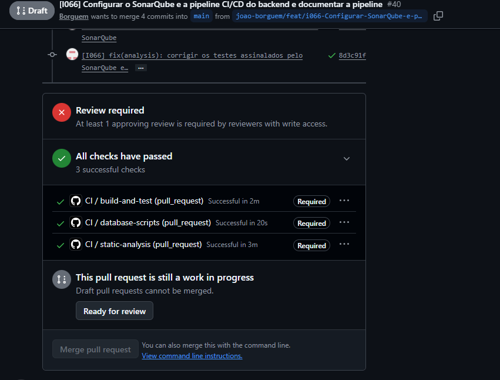
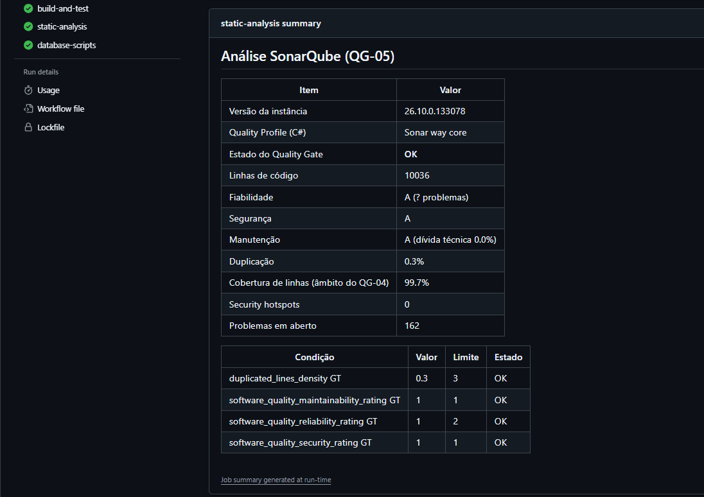
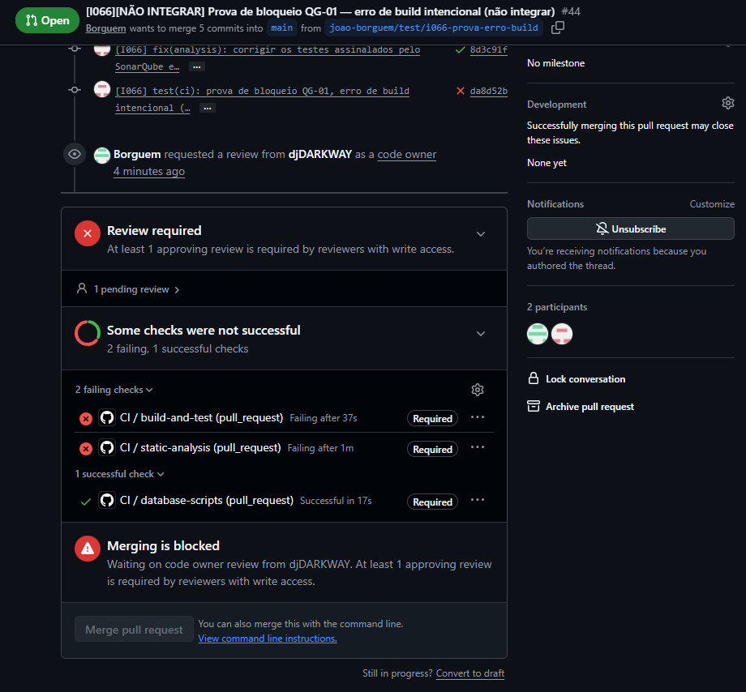
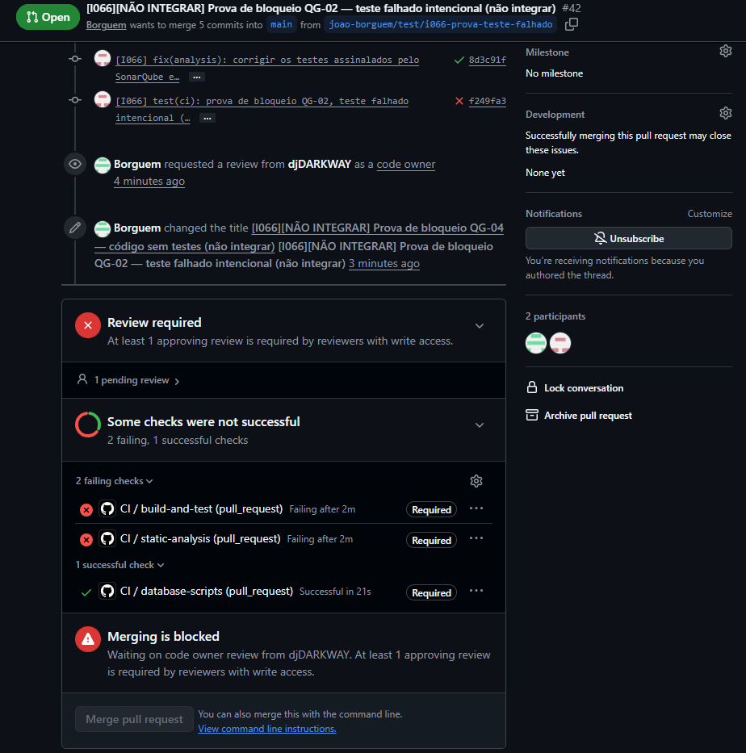
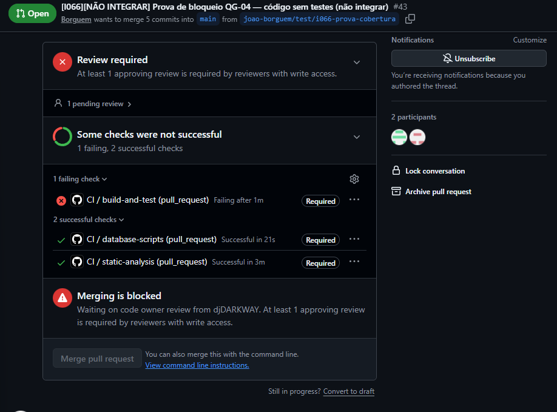
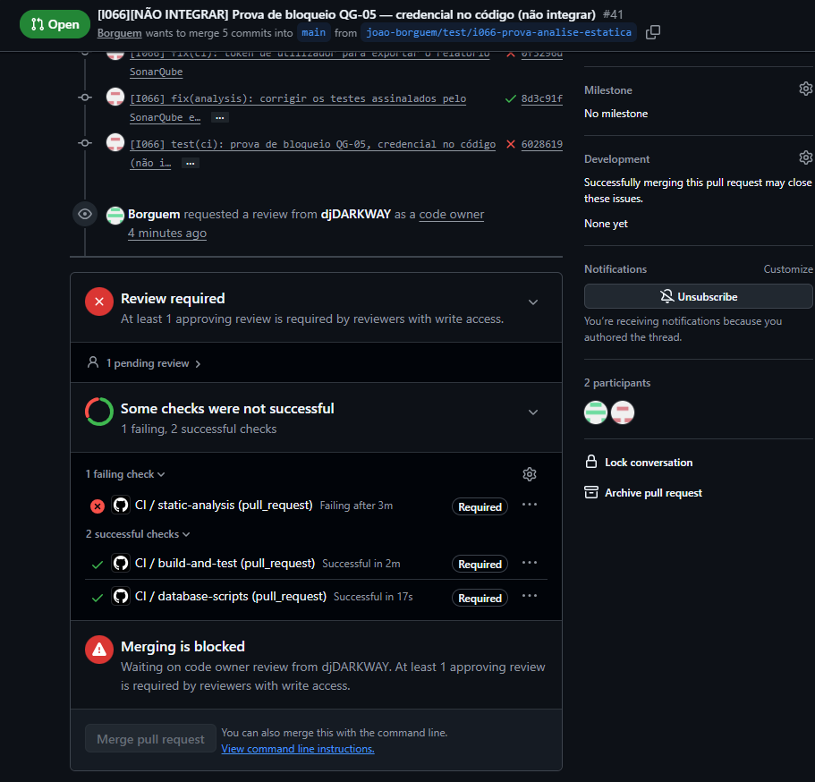
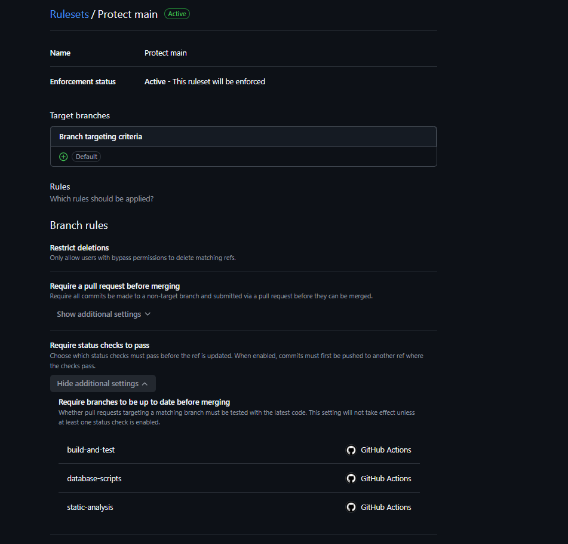

# Relatório de Evidências da Pipeline CI/CD do Backend — Katch

**Unidade curricular:** Laboratório de Desenvolvimento de Software — LDS  
**Milestone:** `m3`  
**Ficheiro:** `m3-relatorio-evidencias-pipeline-ci-cd-v01.md`  
**Pasta de arquivo:** `04-artefactos-tecnicos/04.16-ci-cd`

---

## 1. Identificação do documento

| Campo | Informação |
| --- | --- |
| Grupo | G11 |
| Sistema | Katch |
| Ano letivo | 2026/2027 |
| Curso | LEI — Licenciatura em Engenharia Informática |
| Turma | LEI3T2 |
| Versão do documento | v01 |
| Issue | `I066` — Configurar a análise estática (SonarQube) e a pipeline CI/CD do backend e documentar a pipeline (Sprint 06) |
| Executor / Revisor / Auditor | João Borguem / Miguel Santos / Roberto Baptista |
| Documentos de origem | `m3-descricao-pipeline-ci-cd-v01.md`, `m2-convencoes-codigo-quality-gates-v01.md` (QG-01 a QG-05) |
| Repositório | `katch-lds/katch-backend`, workflow `CI` (`.github/workflows/ci.yml`) |

### 1.1. Histórico de versões

| Versão | Data | Descrição das alterações | Issue |
| --- | --- | --- | --- |
| v01 | 2026-11-04 | Criação do documento: execução de sucesso, quatro execuções bloqueadas (erro de build, teste falhado, cobertura insuficiente e análise estática falhada) e regra de proteção da `main`, com as capturas do Quality Gate e das medidas do SonarQube da execução de sucesso e do ruleset «Protect main». | `I066` |

---

## 2. Objeto

Este relatório demonstra o funcionamento da pipeline descrita em `m3-descricao-pipeline-ci-cd-v01.md`: uma execução em que todos os quality gates passam e quatro execuções em que a integração na `main` é impedida, uma por cada causa exigida (erro de build, teste falhado, cobertura insuficiente e análise estática falhada).

As execuções de bloqueio foram feitas em ramos de teste criados a partir do ramo da `I066` (commit `8d3c91f`), cada um com uma única alteração intencional e com o seu Merge Request para a `main`. Os quatro Merge Requests foram fechados sem merge, depois do registo das evidências. Nenhuma alteração intencional chegou à `main`.

---

## 3. Resumo das execuções

| N.º | Execução | Merge Request | Commit | Alteração | Resultado | Ligação |
| --- | --- | --- | --- | --- | --- | --- |
| E1 | Sucesso | [#40](https://github.com/katch-lds/katch-backend/pull/40) | `8d3c91f33a6c3cf8d43d1bd870b4eca6bf79ad46` | Versão entregue da `I066` | Três jobs com sucesso; merge permitido pelos checks | [41737499711](https://github.com/katch-lds/katch-backend/actions/runs/41737499711) |
| E2 | Bloqueio por erro de build (QG-01) | [#44](https://github.com/katch-lds/katch-backend/pull/44) | `da8d52b145f83e490646cf6ae7865de1d5e08133` | `int erroDeCompilacao = "I066";` em `ReferenceListService` | `build-and-test` falha em «QG-01 Build»; merge bloqueado | [41741409484](https://github.com/katch-lds/katch-backend/actions/runs/41741409484) |
| E3 | Bloqueio por teste falhado (QG-02) | [#42](https://github.com/katch-lds/katch-backend/pull/42) | `f249fa39f84d827d412e3bc12ed5abaa446a6ead` | Teste unitário `ProvaDeBloqueioDaPipelineFalhaDePropósito` com uma asserção errada | `build-and-test` falha em «QG-02 Testes unitários»; merge bloqueado | [41740998425](https://github.com/katch-lds/katch-backend/actions/runs/41740998425) |
| E4 | Bloqueio por cobertura insuficiente (QG-04) | [#43](https://github.com/katch-lds/katch-backend/pull/43) | `d3bb7c50302de0f16dd33575e43ae4413e57d43c` | Classe `ProvaCoberturaSemTestes` (900 métodos sem testes) em `Services` | `build-and-test` falha em «QG-04 Cobertura de linhas ≥ 70%», com os testes a passar; merge bloqueado | [41741319131](https://github.com/katch-lds/katch-backend/actions/runs/41741319131) |
| E5 | Bloqueio por análise estática falhada (QG-05) | [#41](https://github.com/katch-lds/katch-backend/pull/41) | `60286191cac15089fd9059010a840ab50ac0049e` | Classe `ProvaCredencialNoCodigo` com `Password=` numa cadeia de ligação (valor fictício; regra S2068) | `static-analysis` falha em «QG-05 Concluir a análise e verificar o Quality Gate» (segurança pior do que A); merge bloqueado | [41740891672](https://github.com/katch-lds/katch-backend/actions/runs/41740891672) |

Todas as execuções são do evento `pull_request` de 2026-11-03.

---

## 4. Execução de sucesso (E1)

| Campo | Informação |
| --- | --- |
| Execução | <https://github.com/katch-lds/katch-backend/actions/runs/41737499711> |
| Merge Request | <https://github.com/katch-lds/katch-backend/pull/40> |
| Commit | `8d3c91f` — «[I066] fix(analysis): corrigir os testes assinalados pelo SonarQube e registar os falsos positivos» (2026-11-03 23:13) |
| `build-and-test` | Sucesso: build e formatação (QG-01), testes unitários (QG-02) e de integração (QG-03), cobertura de linhas de 99,6% no âmbito do QG-04 (mínimo de 70%) |
| `static-analysis` | Sucesso: Quality Gate «Katch QG-05» aprovado (fiabilidade A, segurança A, manutenção A, duplicação 0,3%), com o Quality Profile «Sonar way core» de C#; 162 problemas em aberto, todos de severidade Info (relatório de análise estática) |
| `database-scripts` | Sucesso |

<!-- CAPTURA E1: Merge Request #40 com os três checks obrigatórios a verde («All checks have passed») -->

O resumo da execução E1 (job `static-analysis`, passo «Exportar o relatório SonarQube») mostra o Quality Gate «Katch QG-05» aprovado e as medidas da análise. A instância SonarQube da pipeline é efémera, por isso este resumo e o artefacto `sonarqube-report` da execução são o registo da análise. A cobertura de 99,7% é a que o SonarQube calcula a partir do relatório importado; o passo «QG-04» do `build-and-test` calcula 99,6% com o ReportGenerator, no mesmo âmbito. Na linha «Fiabilidade», o número de problemas aparece como «?» porque o `export-report.sh` não encontrou essa medida na resposta da API; a classificação A e a condição do Quality Gate não dependem dela.

<!-- CAPTURA E1-QG: resumo da execução 41737499711 com o Quality Gate «Katch QG-05» (Passed) e as medidas -->

---

## 5. Execuções bloqueadas

### 5.1. E2 — erro de build (QG-01)

| Campo | Informação |
| --- | --- |
| Execução | <https://github.com/katch-lds/katch-backend/actions/runs/41741409484> |
| Merge Request | <https://github.com/katch-lds/katch-backend/pull/44> (fechado sem merge) |
| Commit | `da8d52b` — «[I066] test(ci): prova de bloqueio QG-01, erro de build intencional (não integrar)» (2026-11-03 23:28) |
| Alteração | `int erroDeCompilacao = "I066";` em `src/Katch.Backend/Services/ReferenceListService.cs` (não é possível converter `string` em `int`) |
| Causa do bloqueio | `build-and-test` falha no passo «QG-01 Build (analisadores como erro)» com o erro de compilação; os passos seguintes do job não correm. O `static-analysis` falha também no build analisado, pela mesma causa. |

<!-- CAPTURA E2: Merge Request #44 com build-and-test e static-analysis a vermelho e «Merging is blocked» -->

### 5.2. E3 — teste falhado (QG-02)

| Campo | Informação |
| --- | --- |
| Execução | <https://github.com/katch-lds/katch-backend/actions/runs/41740998425> |
| Merge Request | <https://github.com/katch-lds/katch-backend/pull/42> (fechado sem merge) |
| Commit | `f249fa3` — «[I066] test(ci): prova de bloqueio QG-02, teste falhado intencional (não integrar)» (2026-11-03 23:30) |
| Alteração | Teste `LocationTests.ProvaDeBloqueioDaPipelineFalhaDePropósito`, que espera «Porto» numa localidade «Leiria» |
| Causa do bloqueio | `build-and-test` falha no passo «QG-02 Testes unitários» (`Assert.Equal() Failure`); os testes de integração e a cobertura não correm. O `static-analysis` falha também nos testes para a cobertura importada, pela mesma causa. |

<!-- CAPTURA E3: Merge Request #42 com build-and-test e static-analysis a vermelho e «Merging is blocked» -->

### 5.3. E4 — cobertura insuficiente (QG-04)

| Campo | Informação |
| --- | --- |
| Execução | <https://github.com/katch-lds/katch-backend/actions/runs/41741319131> |
| Merge Request | <https://github.com/katch-lds/katch-backend/pull/43> (fechado sem merge) |
| Commit | `d3bb7c5` — «[I066] test(ci): prova de bloqueio QG-04, código sem testes (não integrar)» (2026-11-03 23:32) |
| Alteração | `src/Katch.Backend/Services/ProvaCoberturaSemTestes.cs`: 900 métodos sem testes, com identificadores próprios para não criarem código duplicado |
| Causa do bloqueio | Os testes unitários e de integração passam (QG-02 e QG-03), mas `build-and-test` falha no passo «QG-04 Cobertura de linhas ≥ 70%», com a anotação «QG-04 cobertura insuficiente» e a cobertura abaixo do mínimo. |

<!-- CAPTURA E4: Merge Request #43 com build-and-test a vermelho, static-analysis a verde e «Merging is blocked» -->

### 5.4. E5 — análise estática falhada (QG-05)

| Campo | Informação |
| --- | --- |
| Execução | <https://github.com/katch-lds/katch-backend/actions/runs/41740891672> |
| Merge Request | <https://github.com/katch-lds/katch-backend/pull/41> (fechado sem merge) |
| Commit | `6028619` — «[I066] test(ci): prova de bloqueio QG-05, credencial no código (não integrar)» (2026-11-03 23:36) |
| Alteração | `src/Katch.Backend/Infrastructure/ProvaCredencialNoCodigo.cs`: cadeia de ligação com `Password=` e um valor fictício, assinalada pela regra S2068 do SonarQube como problema de segurança |
| Causa do bloqueio | O build e os testes passam (`build-and-test` com sucesso), mas `static-analysis` falha no passo «QG-05 Concluir a análise e verificar o Quality Gate» com «QUALITY GATE STATUS: FAILED»: a classificação de segurança fica pior do que A. |

<!-- CAPTURA E5: Merge Request #41 com static-analysis a vermelho, build-and-test a verde e «Merging is blocked» -->

---

## 6. Regra de proteção da `main`

A regra de proteção da `main` do `katch-backend` (ruleset «Protect main», captura abaixo) exige os checks `build-and-test`, `static-analysis` e `database-scripts` com sucesso antes do merge, além da aprovação do code owner. Nas capturas E1 a E5, os três checks aparecem com a marca *Required*. Nas execuções E2 a E5, o Merge Request mostra *Some checks were not successful* com o check obrigatório falhado e *Merging is blocked*, com o botão de merge indisponível.

<!-- CAPTURA RULESET: ruleset «Protect main» do katch-backend, com o alvo `main` e os checks obrigatórios -->

A mensagem *Merging is blocked* refere também a revisão do code owner, que é outra condição da mesma regra. Mesmo com a aprovação, o merge continuaria impedido enquanto um check obrigatório falhasse.

O Merge Request #40 (E1) estava em *Draft* durante a execução, por isso o GitHub indica *Draft pull requests cannot be merged*. Os três checks obrigatórios passaram (*All checks have passed*), e o merge fica dependente só da revisão e da aceitação da `I066`.

---

## 7. Credenciais

As execuções usam o secret `SONAR_ADMIN_PASSWORD` do repositório e um token gerado em cada execução, ambos mascarados nos logs. A alteração intencional de E5 tem um valor fictício, criado para a regra S2068, e não é uma credencial de nenhum sistema. Nenhuma captura deste relatório mostra segredos.
