# Relatório de Evidências da Pipeline CI dos Frontends — Katch

**Unidade curricular:** Laboratório de Desenvolvimento de Software — LDS  
**Milestone:** `m4`  
**Ficheiro:** `m4-relatorio-evidencias-pipeline-ci-cd-frontends-v01.md`  
**Pasta de arquivo:** `04-artefactos-tecnicos/04.16-ci-cd`

---

## 1. Identificação do documento

| Campo | Informação |
| --- | --- |
| Grupo | G11 |
| Sistema | Katch |
| Ano letivo | 2026/2027 |
| Curso | LEI — Licenciatura em Engenharia Informática |
| Turma | LEI3T2 |
| Versão do documento | v01 |
| Issue | `I120` — Configurar o projeto e a pipeline CI dos frontends (web e mobile) (Sprint 07) |
| Executor / Revisor / Auditor | João Borguem / João Coelho / Miguel Santos |
| Documentos de origem | `m2-convencoes-codigo-quality-gates-v01.md` (QG-01, QG-05, QG-06, QG-07 e cobertura mínima); `m3-descricao-pipeline-ci-cd-v01.md` e `m3-relatorio-evidencias-pipeline-ci-cd-v01.md` (pipeline do backend, I066, usada como modelo) |
| Repositórios | `katch-lds/katch-frontend-web` e `katch-lds/katch-frontend-mobile`, workflow `CI` (`.github/workflows/ci.yml`) |
| Configuração arquivada | `04-artefactos-tecnicos/04.16-ci-cd/m4-v02` |

### 1.1. Histórico de versões

| Versão | Data | Descrição das alterações | Issue |
| --- | --- | --- | --- |
| v01 | 2026-11-05 | Criação do documento: pipelines dos dois frontends, uma execução de sucesso e três execuções bloqueadas em cada repositório (erro de build, cobertura inferior a 40% e análise estática falhada) e regras de proteção da `main`. | `I120` |

---

## 2. Objeto

Este relatório descreve as pipelines CI dos dois frontends e demonstra o seu funcionamento: em cada repositório, uma execução em que todos os quality gates passam e três execuções em que a integração na `main` é impedida, uma por cada causa exigida pela I120 (build falhado, cobertura inferior a 40% e análise estática falhada).

As execuções de bloqueio foram feitas em ramos de teste criados a partir do ramo da `I120` de cada repositório, cada um com uma única alteração intencional e com o seu Merge Request para a `main`. Os Merge Requests de prova são fechados sem merge depois do registo das evidências; nenhuma alteração intencional chega à `main`.

---

## 3. Pipelines

Os dois repositórios seguem o modelo da pipeline do backend (I066): workflow `CI`, executado em cada Merge Request para a `main`, em cada push na `main` e manualmente, com dois jobs obrigatórios na regra de proteção da `main`.

### 3.1. Frontend web (`katch-frontend-web`)

| Job | Passo | Quality gate | Critério de bloqueio |
| --- | --- | --- | --- |
| `build-and-test` | `npm run build` (`tsc -b` e `vite build`) | QG-01 | Erro de tipos ou de build |
| `build-and-test` | `npm run lint` (ESLint 10: `recommended`, `typescript-eslint/recommended`, `react-hooks/recommended`) | QG-05 | Qualquer erro ou aviso (`--max-warnings 0`) |
| `build-and-test` | `npm run format:check` (Prettier 3.9) | QG-05 | Ficheiro não formatado |
| `build-and-test` | `npm run test:coverage` (Jest 30) | Cobertura | Teste falhado ou cobertura de linhas inferior a 40% (`coverageThreshold`) |
| `build-and-test` | Playwright, quando existir `playwright.config.ts` | QG-06 (preparado) | Teste de sistema falhado |
| `static-analysis` | SonarQube Community Build 26.10 criado em cada execução e configurado por `configure.sh`; análise com a cobertura do Jest | QG-05 | Quality Gate «Katch QG-05» falhado: fiabilidade pior do que B, segurança ou manutenção pior do que A, ou duplicação acima de 3% |

O `static-analysis` usa o secret `SONAR_ADMIN_PASSWORD` do repositório e um token gerado em cada execução, ambos mascarados nos logs. O resumo da análise (`export-report.sh`) fica no resumo do job e no artefacto `sonarqube-report`.

### 3.2. Frontend mobile (`katch-frontend-mobile`)

| Job | Passo | Quality gate | Critério de bloqueio |
| --- | --- | --- | --- |
| `build-and-test` | `flutter test --coverage` | Cobertura | Teste falhado |
| `build-and-test` | Cálculo da cobertura de linhas a partir de `coverage/lcov.info` | Cobertura | Cobertura de linhas inferior a 40% |
| `build-and-test` | `flutter build apk --debug` | QG-01 | Erro de compilação ou de build |
| `build-and-test` | `flutter test integration_test`, quando existir um teste em `integration_test/` | QG-07 (preparado) | Teste de sistema falhado |
| `static-analysis` | `dart format --output=none --set-exit-if-changed lib test` | QG-05 | Ficheiro não formatado |
| `static-analysis` | `flutter analyze --fatal-infos --fatal-warnings` (`flutter_lints`, `strict-casts`, `strict-raw-types`) | QG-05 | Qualquer erro, aviso ou info |

O SonarQube Community Build não analisa Dart. Por decisão do grupo de 2026-11-05, o QG-05 do mobile é o Dart analyzer com `flutter_lints` e o `dart format`, sem SonarQube. O desvio ao Regulamento Interno (secções 11.4 e 11.6) está registado como NC-033 (`m4-registo-nao-conformidades-v02.xlsx`), com a nova versão do RI e das convenções como ação corretiva.

### 3.3. Configuração arquivada (`m4-v02`)

| Ficheiro arquivado | Origem |
| --- | --- |
| `web-ci.yml` | `katch-frontend-web/.github/workflows/ci.yml` |
| `configure.sh`, `export-report.sh` | `katch-frontend-web/scripts/sonarqube/` |
| `web-sonar-project.properties` | `katch-frontend-web/sonar-project.properties` |
| `web-eslint.config.js`, `web-prettierrc.json`, `web-prettierignore`, `web-editorconfig` | Configuração do ESLint, do Prettier e do editor do web |
| `web-jest.config.cjs`, `web-babel.config.cjs` | Configuração do Jest (cobertura mínima de 40%) |
| `web-package.json`, `web-env.example` | Dependências, scripts e configuração por ambiente do web |
| `mobile-ci.yml` | `katch-frontend-mobile/.github/workflows/ci.yml` |
| `mobile-analysis_options.yaml`, `mobile-pubspec.yaml`, `mobile-editorconfig` | Configuração do Dart analyzer, dependências e editor do mobile |

Os ficheiros são cópias exatas dos ramos da I120 nas versões indicadas na secção 4.

---

## 4. Resumo das execuções

| N.º | Repositório | Execução | Merge Request | Commit | Alteração | Resultado | Ligação |
| --- | --- | --- | --- | --- | --- | --- | --- |
| W1 | web | Sucesso | [#2](https://github.com/katch-lds/katch-frontend-web/pull/2) | `3b9c1ae38f1a0130d22f23bf0a021003a78fcd72` | Versão entregue da `I120` | Dois jobs com sucesso; Quality Gate OK | [42114963370](https://github.com/katch-lds/katch-frontend-web/actions/runs/42114963370) |
| W2 | web | Bloqueio por build falhado (QG-01) | [#3](https://github.com/katch-lds/katch-frontend-web/pull/3) | `c487c25ea5c4508f00db4a5e3b4f4687963cb718` | `const erroDeCompilacao: number = 'I120';` em `App.tsx` | `build-and-test` falha no QG-01; merge bloqueado | [42116725708](https://github.com/katch-lds/katch-frontend-web/actions/runs/42116725708) |
| W3 | web | Bloqueio por cobertura inferior a 40% | [#4](https://github.com/katch-lds/katch-frontend-web/pull/4) | `d13c1eb9818092d2f9c780c2a3095852555cb52b` | Retirados 5 dos 6 ficheiros de testes | `build-and-test` e `static-analysis` falham nos testes com cobertura; merge bloqueado | [42116777547](https://github.com/katch-lds/katch-frontend-web/actions/runs/42116777547) |
| W4 | web | Bloqueio por análise estática falhada (QG-05) | [#5](https://github.com/katch-lds/katch-frontend-web/pull/5) | `9516a4f93cdcd0809fdd1025bc8336b1bc17085a` | `HttpApiClientCopia.ts`, cópia integral do cliente da API | `static-analysis` falha no Quality Gate (duplicação acima de 3%); merge bloqueado | [42123724658](https://github.com/katch-lds/katch-frontend-web/actions/runs/42123724658) |
| M1 | mobile | Sucesso | [#2](https://github.com/katch-lds/katch-frontend-mobile/pull/2) | `f6595791d64702b377bce1a82eb770f8c06bb815` | Versão entregue da `I120` | Dois jobs com sucesso | [42078961190](https://github.com/katch-lds/katch-frontend-mobile/actions/runs/42078961190) |
| M2 | mobile | Bloqueio por build falhado (QG-01) | [#3](https://github.com/katch-lds/katch-frontend-mobile/pull/3) | `7afc7edec242caf2e7955bd23e21dfe2864c82ac` | `final int erroDeCompilacao = 'I120';` em `main.dart` | `build-and-test` falha no QG-01; `static-analysis` também, pela mesma causa; merge bloqueado | [42116440559](https://github.com/katch-lds/katch-frontend-mobile/actions/runs/42116440559) |
| M3 | mobile | Bloqueio por cobertura inferior a 40% | [#5](https://github.com/katch-lds/katch-frontend-mobile/pull/5) | `090ec6434fb5efd50b4c832f84fc792d5b908252` | Retirados os testes do cliente da API, dos modelos, do monitor, da consulta periódica e da configuração | `build-and-test` falha no passo da cobertura; merge bloqueado | [42116557654](https://github.com/katch-lds/katch-frontend-mobile/actions/runs/42116557654) |
| M4 | mobile | Bloqueio por análise estática falhada (QG-05) | [#4](https://github.com/katch-lds/katch-frontend-mobile/pull/4) | `8d6d313428aca59b3229b964689f274eea8d0858` | `print('Prova de bloqueio da I120');` em `main.dart` | `static-analysis` falha no `flutter analyze` (`avoid_print`); merge bloqueado | [42116616608](https://github.com/katch-lds/katch-frontend-mobile/actions/runs/42116616608) |

Todas as execuções são do evento `pull_request` de 2026-11-05.

---

## 5. Frontend web

### 5.1. W1 — execução de sucesso

| Campo | Informação |
| --- | --- |
| Merge Request | <https://github.com/katch-lds/katch-frontend-web/pull/2> |
| Execução | <https://github.com/katch-lds/katch-frontend-web/actions/runs/42114963370> |
| Commit | `3b9c1ae` — «[I120] fix(web): retirar as barras finais do endereço sem expressão regular» (2026-11-05 21:41), sobre `2b6bb46` (estrutura inicial, 15:49) |
| `build-and-test` | Sucesso: build, ESLint, Prettier e 7 suites de testes Jest; cobertura de linhas de cerca de 97% |
| `static-analysis` | Sucesso: Quality Gate «Katch QG-05» OK, com 309 linhas de código, fiabilidade A, segurança A, manutenção A (dívida técnica 0,0%), duplicação 0,0%, cobertura importada de 97,2%, 0 security hotspots e 0 problemas em aberto; Quality Profile «Sonar way core» de TypeScript e JavaScript |

A primeira execução sobre `2b6bb46` falhou no Quality Gate com fiabilidade C: dois problemas da regra S8786 (expressão regular `/\/+$/` com retrocesso super-linear) em `HttpApiClient.ts` e `config/env.ts`. O commit `3b9c1ae` substituiu a expressão por uma função sem expressão regular (`src/utils/url.ts`, com testes), e a execução W1 passou.

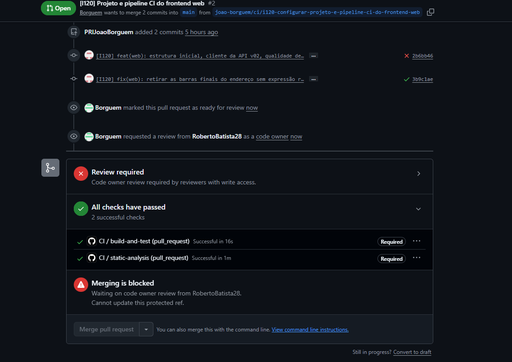

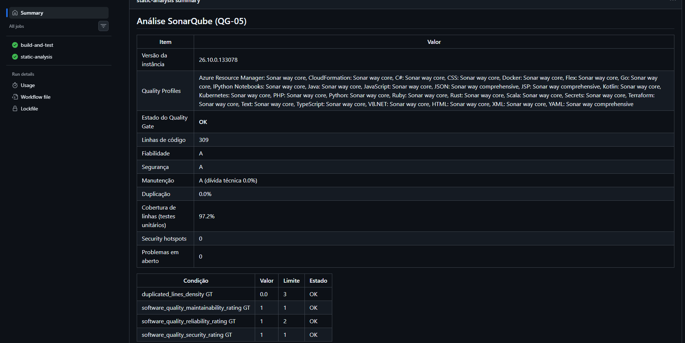

### 5.2. W2 — build falhado (QG-01)

| Campo | Informação |
| --- | --- |
| Merge Request | <https://github.com/katch-lds/katch-frontend-web/pull/3> (fechado sem merge) |
| Execução | <https://github.com/katch-lds/katch-frontend-web/actions/runs/42116725708> |
| Commit | `c487c25` — «[I120] test(ci): prova de bloqueio QG-01, erro de build intencional no frontend web (não integrar)» (2026-11-05 21:46) |
| Alteração | `const erroDeCompilacao: number = 'I120';` em `src/App.tsx` (não é possível atribuir `string` a `number`) |
| Causa do bloqueio | `build-and-test` falha no passo «QG-01 Build (tsc e Vite)» e os passos seguintes não correm. O `static-analysis` passa: os testes usam o Babel, que não verifica os tipos, e o SonarQube não trata o erro de tipos como problema. |

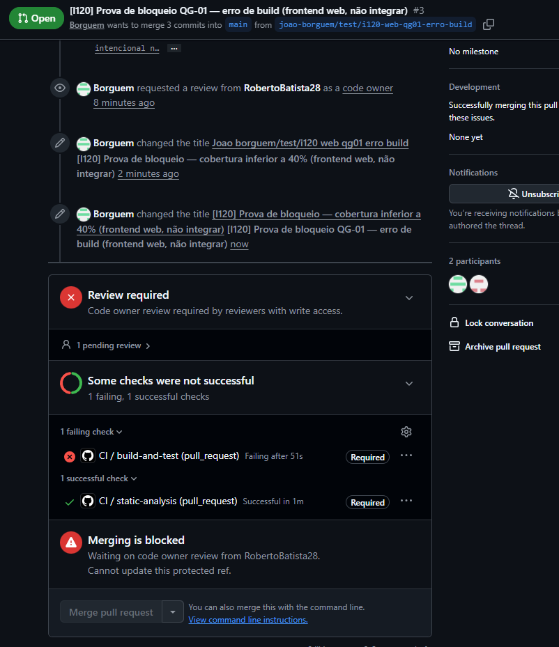

### 5.3. W3 — cobertura inferior a 40%

| Campo | Informação |
| --- | --- |
| Merge Request | <https://github.com/katch-lds/katch-frontend-web/pull/4> (fechado sem merge) |
| Execução | <https://github.com/katch-lds/katch-frontend-web/actions/runs/42116777547> |
| Commit | `d13c1eb` — «[I120] test(ci): prova de bloqueio da cobertura, testes retirados no frontend web (não integrar)» (2026-11-05 21:47) |
| Alteração | Retirados `ApiError.test.ts`, `ConnectionMonitor.test.ts`, `HttpApiClient.test.ts`, `PollingLoop.test.ts` e `SessionStore.test.ts`; fica só o teste da `App` |
| Causa do bloqueio | Os testes que restam passam, mas o Jest termina sem sucesso porque a cobertura de linhas fica abaixo do limiar de 40% (`coverageThreshold`): `build-and-test` falha no passo dos testes com cobertura. O `static-analysis` falha também, no passo que corre os mesmos testes para a cobertura importada, pela mesma causa (como na execução E3 do backend). |

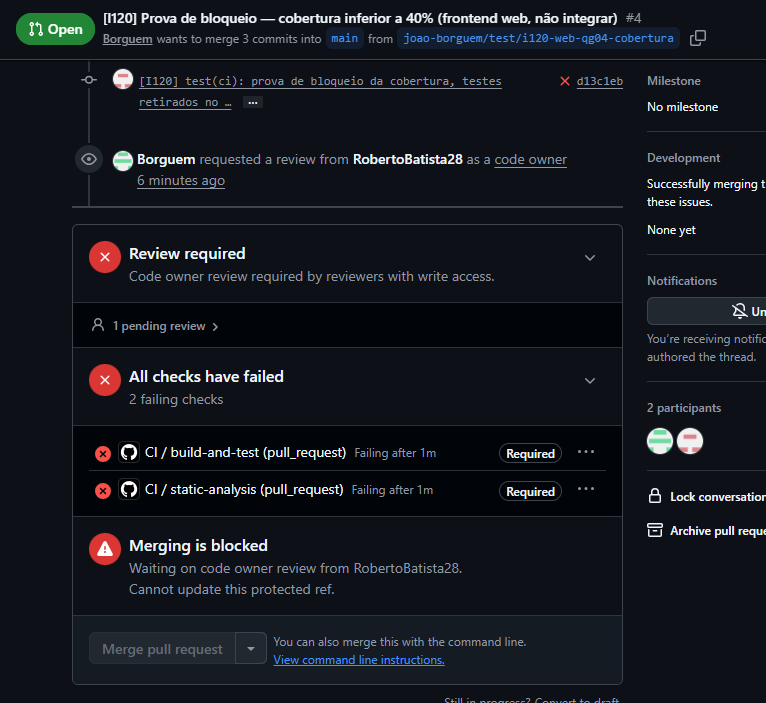

### 5.4. W4 — análise estática falhada (QG-05)

| Campo | Informação |
| --- | --- |
| Merge Request | <https://github.com/katch-lds/katch-frontend-web/pull/5> (fechado sem merge) |
| Execução | <https://github.com/katch-lds/katch-frontend-web/actions/runs/42123724658> |
| Commit | `9516a4f` — «[I120] test(ci): prova de bloqueio QG-05, cópia atualizada para a versão entregue (não integrar)» (2026-11-05 22:42), sobre `14aa07b` (21:48) |
| Alteração | `src/api/HttpApiClientCopia.ts`: cópia integral do `HttpApiClient.ts` da versão entregue, com outro nome de classe |
| Causa do bloqueio | O build, o ESLint, o Prettier e os testes passam (`build-and-test` com sucesso; a cobertura desce, mas fica acima de 40%). O `static-analysis` falha no passo «QG-05 Análise SonarQube e Quality Gate» porque a densidade de linhas duplicadas ultrapassa os 3% da condição do Quality Gate. |

A primeira versão desta prova (`14aa07b`) copiou o cliente da API anterior à correção da S8786, e o Quality Gate falhou também pela fiabilidade. O commit `9516a4f` atualizou a cópia para a versão entregue, para que a única causa do bloqueio seja a duplicação.

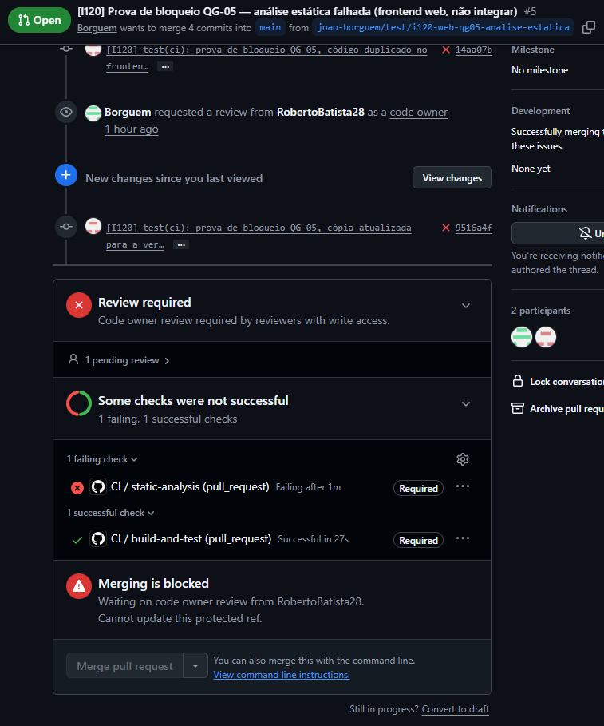

---

## 6. Frontend mobile

### 6.1. M1 — execução de sucesso

| Campo | Informação |
| --- | --- |
| Merge Request | <https://github.com/katch-lds/katch-frontend-mobile/pull/2> |
| Execução | <https://github.com/katch-lds/katch-frontend-mobile/actions/runs/42078961190> |
| Commit | `f659579` — «[I120] style(mobile): formatar o teste do ApiErrorDto com o dart format» (2026-11-05 17:53), sobre `a57f0ae` (estrutura inicial, 17:31) |
| `build-and-test` | Sucesso: testes unitários e de widget, cobertura de linhas acima de 40% e APK de depuração |
| `static-analysis` | Sucesso: `dart format` sem alterações e `flutter analyze` sem ocorrências |

A primeira execução sobre `a57f0ae` falhou no `dart format` (um ficheiro de teste por formatar); o commit `f659579` corrigiu-o.

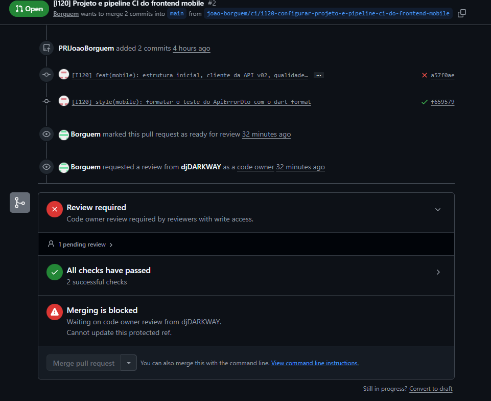

### 6.2. M2 — build falhado (QG-01)

| Campo | Informação |
| --- | --- |
| Merge Request | <https://github.com/katch-lds/katch-frontend-mobile/pull/3> (fechado sem merge) |
| Execução | <https://github.com/katch-lds/katch-frontend-mobile/actions/runs/42116440559> |
| Commit | `7afc7ed` — «[I120] test(ci): prova de bloqueio QG-01, erro de build intencional no frontend mobile (não integrar)» (2026-11-05 21:48) |
| Alteração | `final int erroDeCompilacao = 'I120';` em `lib/main.dart` |
| Causa do bloqueio | Os testes passam (não carregam o `main.dart`), mas `build-and-test` falha no passo «QG-01 Build (APK de depuração)» com o erro de compilação. O `static-analysis` falha também no `flutter analyze`, que assinala o mesmo erro de tipos (como na execução E2 do backend). |

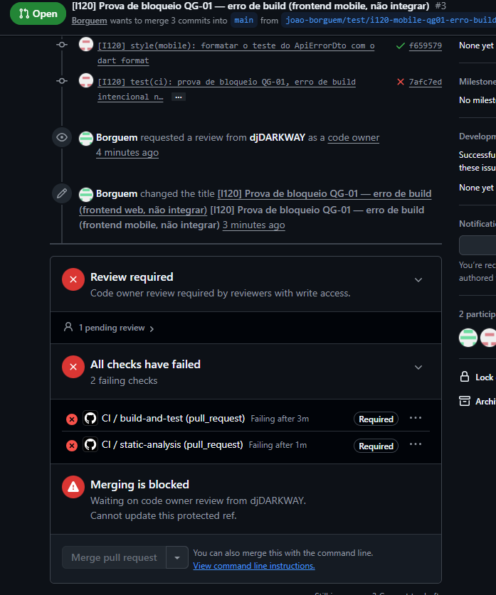

### 6.3. M3 — cobertura inferior a 40%

| Campo | Informação |
| --- | --- |
| Merge Request | <https://github.com/katch-lds/katch-frontend-mobile/pull/5> (fechado sem merge) |
| Execução | <https://github.com/katch-lds/katch-frontend-mobile/actions/runs/42116557654> |
| Commit | `090ec64` — «[I120] test(ci): prova de bloqueio da cobertura, testes retirados no frontend mobile (não integrar)» (2026-11-05 21:49) |
| Alteração | Retirados os testes do `ApiErrorDto`, do `ConnectionMonitor`, do `PollingLoop` e do `AppConfig`; o teste do cliente da API fica reduzido à criação do cliente |
| Causa do bloqueio | Os testes que restam passam, mas `build-and-test` falha no passo «Cobertura de linhas ≥ 40%», com a anotação «Cobertura insuficiente». O `static-analysis` passa. |

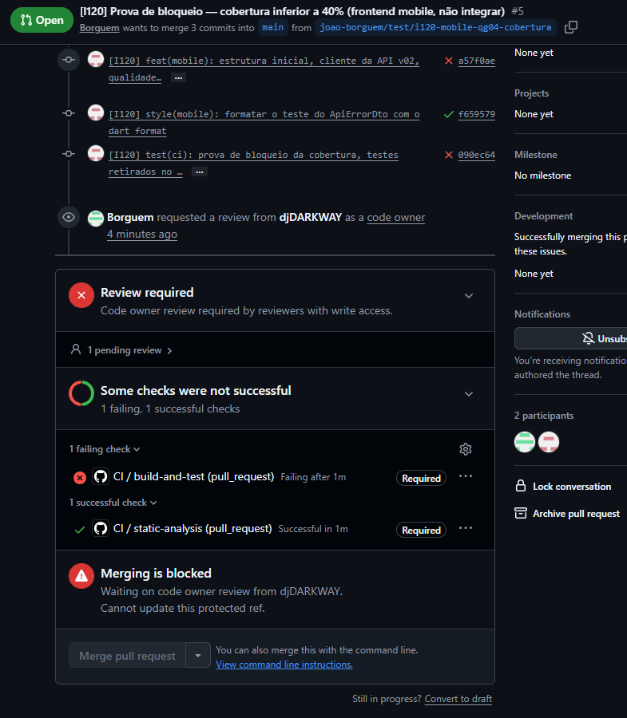

### 6.4. M4 — análise estática falhada (QG-05)

| Campo | Informação |
| --- | --- |
| Merge Request | <https://github.com/katch-lds/katch-frontend-mobile/pull/4> (fechado sem merge) |
| Execução | <https://github.com/katch-lds/katch-frontend-mobile/actions/runs/42116616608> |
| Commit | `8d6d313` — «[I120] test(ci): prova de bloqueio QG-05, print no código do frontend mobile (não integrar)» (2026-11-05 21:50) |
| Alteração | `print('Prova de bloqueio da I120');` em `lib/main.dart` |
| Causa do bloqueio | O build e os testes passam (`build-and-test` com sucesso), mas o `static-analysis` falha no passo «QG-05 Análise estática (Dart analyzer com flutter_lints)»: a regra `avoid_print` gera uma ocorrência de nível info, tratada como erro por `--fatal-infos`. |

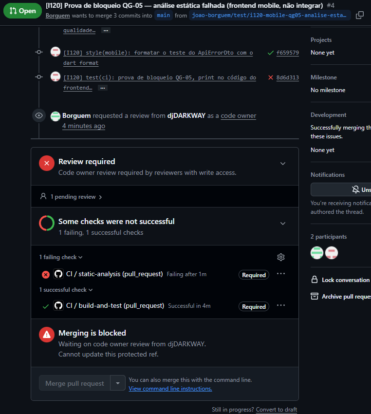

---

## 7. Regras de proteção da `main`

Cada repositório tem o ruleset «Protect main», aplicado ao ramo predefinido (`main`): «Restrict updates» e «Restrict deletions», Pull Request obrigatório com 1 aprovação e revisão do code owner, os checks `build-and-test` e `static-analysis` obrigatórios, com o ramo atualizado antes do merge, e «Block force pushes». Nas capturas W1 a W4 e M1 a M4, os dois checks aparecem com a marca *Required*; nas execuções de bloqueio, o Merge Request mostra o check obrigatório falhado e *Merging is blocked*, com o botão de merge indisponível.

A mensagem *Merging is blocked* refere também a revisão do code owner, que é outra condição da mesma regra. Mesmo com a aprovação, o merge continuaria impedido enquanto um check obrigatório falhasse. Nos Merge Requests W1 e M1, os dois checks passaram e o merge fica dependente só da revisão e da aceitação da `I120`.

Os dois rulesets incluem a regra «Restrict updates», que só deixa atualizar a `main` a quem tem permissão de bypass. Foi esta regra que, no backend, impediu o merge pelo Revisor e levou à NC-014, depois da qual foi retirada do ruleset do `katch-backend`. Se se mantiver nos frontends, o Revisor da `I120` (e das Issues seguintes) não consegue fazer o merge sem bypass; a regra deve ser revista pelo administrador antes da aceitação.

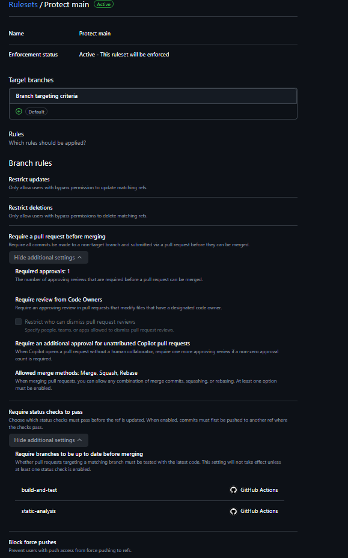

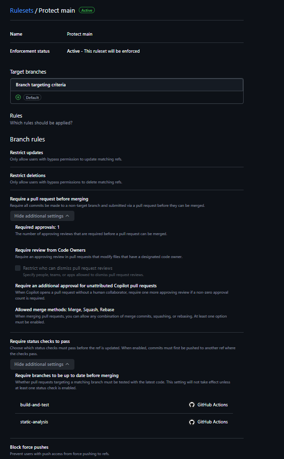

---

## 8. Credenciais e limitações

- **Credenciais:** o único secret é o `SONAR_ADMIN_PASSWORD` do `katch-frontend-web`; o token da análise é gerado em cada execução. Ambos ficam mascarados nos logs, e nenhuma captura mostra segredos. O mobile não usa secrets. A configuração por ambiente (`.env.development` e `.env.example` no web; `--dart-define=API_BASE_URL` no mobile) não contém segredos.
- **SonarQube no mobile:** ver a secção 3.2 e a NC-033.
- **QG-06 e QG-07:** os passos estão preparados e correm logo que existam os testes de sistema (`playwright.config.ts` no web; `integration_test/*_test.dart` no mobile). Não foram exercitados nesta Issue.
- **Versões:** TypeScript 6.0 em vez da 7.0.x das convenções (o `typescript-eslint` 8 não suporta a 7) e ESLint 10 com `eslint.config.js` em vez de `.eslintrc.json`. Ficam abrangidos pela ação corretiva da NC-033.
